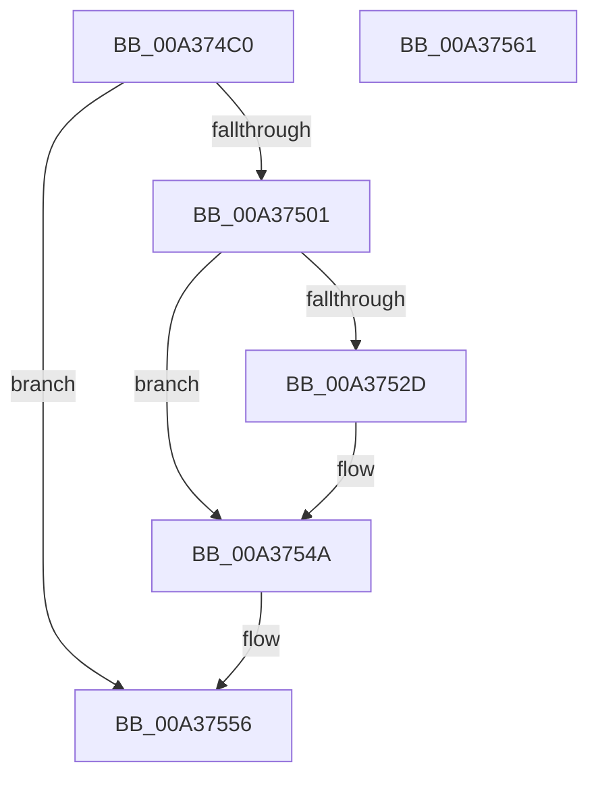

# NtCompareObjects

- RVA: `0x00A374C0`–`0x00A37562` (길이 `162` bytes)
- VA: `0x0000000140A374C0`
- 실행 섹션: `PAGE`
- PDB 이름 있음: `예`; PDB Function 태그: `아니요`
- unwind 정보 RVA: `0x00084AC0`
- 디코드: `44`개 명령, `162/162` bytes 표시
- 미해석 바이트: `0` (있으면 어셈블리에 `.byte`로 보존)

> 이 문서는 커널 이미지의 기계어와 PDB 기호를 분석해 생성했습니다. 4번과 5번은 함수 원형과 자료형을 바이너리 사용 방식에서 추정한 C 해석이며 원본 소스 복구 결과는 아닙니다.

## 1. Dependencies

- 직접 호출 지점: **4**; 고유 호출 대상: **2**
- 직접 호출자로 확인된 함수: **0**
- RIP 상대 이미지 참조: **0**

### Outgoing calls
- `0x00A374F8` → [ObReferenceObjectByHandle](../86/ObReferenceObjectByHandle_function_00868DB0.md) (function, `0x00868DB0`)
- `0x00A37522` → [ObReferenceObjectByHandle](../86/ObReferenceObjectByHandle_function_00868DB0.md) (function, `0x00868DB0`)
- `0x00A37545` → [ObfDereferenceObject](../../text/2F/ObfDereferenceObject_function_002F9350.md) (function, `0x002F9350`)
- `0x00A3754F` → [ObfDereferenceObject](../../text/2F/ObfDereferenceObject_function_002F9350.md) (function, `0x002F9350`)

### Direct callers
- 이 함수 시작 RVA로 연결되는 직접 call은 확인되지 않았습니다. 간접 호출은 완전히 역산할 수 없습니다.

### Static image references
- 디코드된 RIP-relative 메모리 참조가 없습니다.

## 2. Other-region calls and transfers

- 다른 실행 섹션으로 향하는 call: **2**
  - `0x00A37545` → [ObfDereferenceObject](../../text/2F/ObfDereferenceObject_function_002F9350.md) (`PAGE` → `.text`)
  - `0x00A3754F` → [ObfDereferenceObject](../../text/2F/ObfDereferenceObject_function_002F9350.md) (`PAGE` → `.text`)
- 별도 외부 분기/꼬리 이동을 확인하지 못했습니다.

## 3. Assembly (complete function range)

```asm
00A374C0  4C 8B DC                        mov r11, rsp
00A374C3  49 89 5B 08                     mov qword ptr [r11 + 8], rbx
00A374C7  57                              push rdi
00A374C8  48 83 EC 30                     sub rsp, 0x30
00A374CC  65 48 8B 04 25 88 01 00 00      mov rax, qword ptr gs:[0x188]
00A374D5  48 8B FA                        mov rdi, rdx
00A374D8  49 83 63 F0 00                  and qword ptr [r11 - 0x10], 0
00A374DD  45 33 C0                        xor r8d, r8d
00A374E0  49 83 63 18 00                  and qword ptr [r11 + 0x18], 0
00A374E5  33 D2                           xor edx, edx
00A374E7  8A 98 32 02 00 00               mov bl, byte ptr [rax + 0x232]
00A374ED  49 8D 43 18                     lea rax, [r11 + 0x18]
00A374F1  44 8A CB                        mov r9b, bl
00A374F4  49 89 43 E8                     mov qword ptr [r11 - 0x18], rax
00A374F8  E8 B3 18 E3 FF                  call 0x140868db0
00A374FD  85 C0                           test eax, eax
00A374FF  78 55                           js 0x140a37556
00A37501  48 83 64 24 28 00               and qword ptr [rsp + 0x28], 0
00A37507  48 8D 44 24 58                  lea rax, [rsp + 0x58]
00A3750C  48 83 64 24 58 00               and qword ptr [rsp + 0x58], 0
00A37512  44 8A CB                        mov r9b, bl
00A37515  45 33 C0                        xor r8d, r8d
00A37518  48 89 44 24 20                  mov qword ptr [rsp + 0x20], rax
00A3751D  33 D2                           xor edx, edx
00A3751F  48 8B CF                        mov rcx, rdi
00A37522  E8 89 18 E3 FF                  call 0x140868db0
00A37527  8B D8                           mov ebx, eax
00A37529  85 C0                           test eax, eax
00A3752B  78 1D                           js 0x140a3754a
00A3752D  48 8B 4C 24 58                  mov rcx, qword ptr [rsp + 0x58]
00A37532  48 8B 44 24 50                  mov rax, qword ptr [rsp + 0x50]
00A37537  48 2B C1                        sub rax, rcx
00A3753A  48 F7 D8                        neg rax
00A3753D  1B DB                           sbb ebx, ebx
00A3753F  81 E3 AC 01 00 C0               and ebx, 0xc00001ac
00A37545  E8 06 1E 8C FF                  call 0x1402f9350
00A3754A  48 8B 4C 24 50                  mov rcx, qword ptr [rsp + 0x50]
00A3754F  E8 FC 1D 8C FF                  call 0x1402f9350
00A37554  8B C3                           mov eax, ebx
00A37556  48 8B 5C 24 40                  mov rbx, qword ptr [rsp + 0x40]
00A3755B  48 83 C4 30                     add rsp, 0x30
00A3755F  5F                              pop rdi
00A37560  C3                              ret
00A37561  CC                              int3
```

## 4. C-style interpretation (structured pseudocode)

```c
__int64 __fastcall NtCompareObjects(__int64 a1, __int64 a2, int a3)
{
    __int64 result;
    __int64 v_rbx;
    __int64 v_rsp;
    unsigned __int64 v_stack_m10;
    unsigned __int64 v_stack_m18;
    unsigned __int64 v_stack_p18;
    unsigned __int64 v_stack_p20;
    unsigned __int64 v_stack_p8;

    *(unsigned __int64 *)(v_rsp + 8) = v_rbx;
    v_rsp = (v_rsp) - (48);
    a3 = 0;
    a2 = 0;
    *(unsigned __int64 *)(v_rsp - 24) = v_rsp + 24;
    result = ObReferenceObjectByHandle(a1, a2, a3, (unsigned __int8)(*(unsigned __int8 *)(*(unsigned __int64 *)(gs_base + (0 + 392)) + 562)));
    if (sign_flag) goto loc_00A37556;
    a3 = 0;
    v_stack_m18 = v_stack_p20;
    a2 = 0;
    result = ObReferenceObjectByHandle(0, a2, a3, (unsigned __int8)(*(unsigned __int8 *)(*(unsigned __int64 *)(gs_base + (0 + 392)) + 562)));
    v_rbx = (unsigned int)((unsigned int)(result));
    if (!(sign_flag)) {
        a1 = v_stack_p20;
        result = v_stack_p18;
        result = (result) - (a1);
        result = -(result);
        v_rbx = (unsigned int)(((unsigned int)((unsigned int)(result))) & (0xC00001ACULL));
        result = ObfDereferenceObject(a1, a2, a3, (unsigned __int8)(*(unsigned __int8 *)(*(unsigned __int64 *)(gs_base + (0 + 392)) + 562)));
    }
    result = ObfDereferenceObject(v_stack_p18, a2, a3, (unsigned __int8)(*(unsigned __int8 *)(*(unsigned __int64 *)(gs_base + (0 + 392)) + 562)));
loc_00A37556:
    v_rsp = (v_rsp) + (48);
    return (unsigned int)((unsigned int)(v_rbx));
}
```

## 5. (Beta) C Style

```c
int64_t NtCompareObjects(int64_t Arg1, int64_t Arg2, int32_t Arg3)
{
    int64_t result;
    int64_t local_rbx;
    int64_t local_rsp;
    uint64_t v_stack_m10;
    uint64_t v_stack_m18;
    uint64_t v_stack_p18;
    uint64_t v_stack_p20;
    uint64_t v_stack_p8;

    *(uint64_t *)(local_rsp + 0x8) = local_rbx;
    local_rsp = (local_rsp) - (48);
    Arg3 = 0;
    Arg2 = 0;
    *(uint64_t *)(local_rsp - 0x18) = local_rsp + 24;
    result = ObReferenceObjectByHandle(Arg1, Arg2, Arg3, (uint8_t)(*(uint8_t *)(*(uint64_t *)(gs_base + (0 + 0x188)) + 0x232)));
    if (sign_flag) goto loc_00A37556;
    Arg3 = 0;
    v_stack_m18 = v_stack_p20;
    Arg2 = 0;
    result = ObReferenceObjectByHandle(0, Arg2, Arg3, (uint8_t)(*(uint8_t *)(*(uint64_t *)(gs_base + (0 + 0x188)) + 0x232)));
    local_rbx = (uint32_t)((uint32_t)(result));
    if (!(sign_flag)) {
        Arg1 = v_stack_p20;
        result = v_stack_p18;
        result = (result) - (Arg1);
        result = -(result);
        local_rbx = (uint32_t)(((uint32_t)((uint32_t)(result))) & (0xC00001ACULL));
        result = ObfDereferenceObject(Arg1, Arg2, Arg3, (uint8_t)(*(uint8_t *)(*(uint64_t *)(gs_base + (0 + 0x188)) + 0x232)));
    }
    result = ObfDereferenceObject(v_stack_p18, Arg2, Arg3, (uint8_t)(*(uint8_t *)(*(uint64_t *)(gs_base + (0 + 0x188)) + 0x232)));
loc_00A37556:
    local_rsp = (local_rsp) + (48);
    return (uint32_t)((uint32_t)(local_rbx));
}
```

## 6. Execution-region graph

[열기: 2D/3D 그래프와 함수 탐색 컨트롤 패널](../../../control-panel.html?section=page&rva=0x00A374C0&view=graph)

- 2D 그래프는 위에서 아래로 흐르고, 3D 그래프는 빈 공간을 드래그해 회전합니다. Shift+드래그는 이동, 휠은 확대·축소, 함수 노드 선택은 대상 보고서 이동입니다.

### Static fallback


