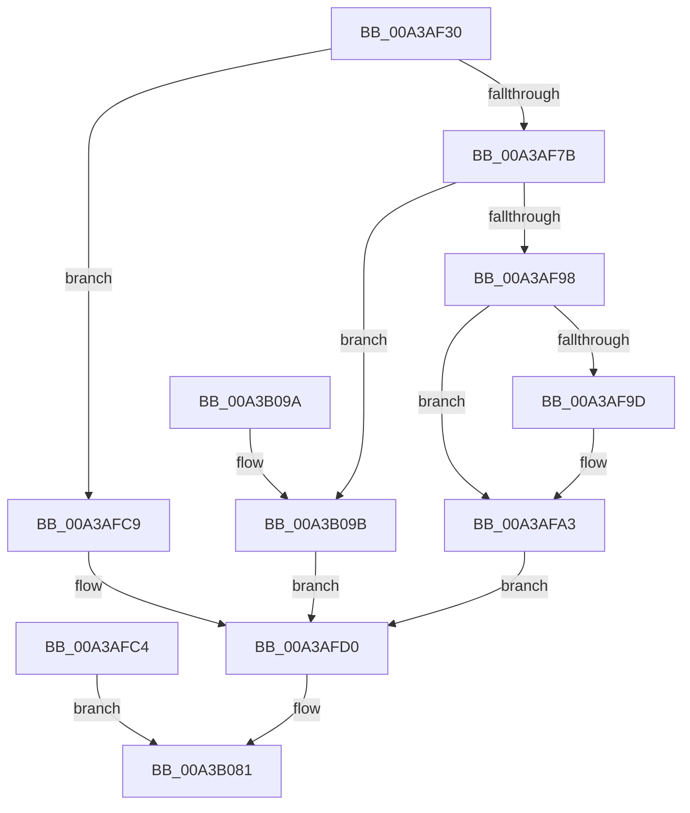

# NtCreateNamedPipeFile

- RVA: `0x00A3AF30`–`0x00A3B0AB` (길이 `379` bytes)
- VA: `0x0000000140A3AF30`
- 실행 섹션: `PAGE`
- PDB 이름 있음: `예`; PDB Function 태그: `아니요`
- unwind 정보 RVA: `0x000AE220`
- 디코드: `72`개 명령, `379/379` bytes 표시
- 미해석 바이트: `0` (있으면 어셈블리에 `.byte`로 보존)

> 이 문서는 커널 이미지의 기계어와 PDB 기호를 분석해 생성했습니다. 4번과 5번은 함수 원형과 자료형을 바이너리 사용 방식에서 추정한 C 해석이며 원본 소스 복구 결과는 아닙니다.

## 1. Dependencies

- 직접 호출 지점: **3**; 고유 호출 대상: **3**
- 직접 호출자로 확인된 함수: **0**
- RIP 상대 이미지 참조: **1**

### Outgoing calls
- `0x00A3AF9D` → [ExRaiseDatatypeMisalignment](../89/ExRaiseDatatypeMisalignment_function_00899FD0.md) (function, `0x00899FD0`)
- `0x00A3B07C` → [IopCreateFile](../8A/IopCreateFile_function_008AB298.md) (function, `0x008AB298`)
- `0x00A3B08C` → [_security_check_cookie](../../text/6A/_security_check_cookie_function_006AC640.md) (function, `0x006AC640`)

### Direct callers
- 이 함수 시작 RVA로 연결되는 직접 call은 확인되지 않았습니다. 간접 호출은 완전히 역산할 수 없습니다.

### Static image references
- `0x00A3AF39` → RVA `0x00E0A740` (`.data`; read)

## 2. Other-region calls and transfers

- 다른 실행 섹션으로 향하는 call: **1**
  - `0x00A3B08C` → [_security_check_cookie](../../text/6A/_security_check_cookie_function_006AC640.md) (`PAGE` → `.text`)
- 별도 외부 분기/꼬리 이동을 확인하지 못했습니다.

## 3. Assembly (complete function range)

```asm
00A3AF30  40 53                           push rbx
00A3AF32  48 81 EC B0 00 00 00            sub rsp, 0xb0
00A3AF39  48 8B 05 00 F8 3C 00            mov rax, qword ptr [rip + 0x3cf800]
00A3AF40  48 33 C4                        xor rax, rsp
00A3AF43  48 89 84 24 A8 00 00 00         mov qword ptr [rsp + 0xa8], rax
00A3AF4B  44 8B DA                        mov r11d, edx
00A3AF4E  48 8B 94 24 28 01 00 00         mov rdx, qword ptr [rsp + 0x128]
00A3AF56  33 DB                           xor ebx, ebx
00A3AF58  48 89 9C 24 98 00 00 00         mov qword ptr [rsp + 0x98], rbx
00A3AF60  89 9C 24 A1 00 00 00            mov dword ptr [rsp + 0xa1], ebx
00A3AF67  66 89 9C 24 A5 00 00 00         mov word ptr [rsp + 0xa5], bx
00A3AF6F  88 9C 24 A7 00 00 00            mov byte ptr [rsp + 0xa7], bl
00A3AF76  48 85 D2                        test rdx, rdx
00A3AF79  74 4E                           je 0x140a3afc9
00A3AF7B  C6 84 24 A0 00 00 00 01         mov byte ptr [rsp + 0xa0], 1
00A3AF83  65 48 8B 04 25 88 01 00 00      mov rax, qword ptr gs:[0x188]
00A3AF8C  38 98 32 02 00 00               cmp byte ptr [rax + 0x232], bl
00A3AF92  0F 84 03 01 00 00               je 0x140a3b09b
00A3AF98  F6 C2 03                        test dl, 3
00A3AF9B  74 06                           je 0x140a3afa3
00A3AF9D  E8 2E F0 E5 FF                  call 0x140899fd0
00A3AFA2  CC                              int3
00A3AFA3  48 B8 00 00 FF FF FF 7F 00 00   movabs rax, 0x7fffffff0000
00A3AFAD  48 3B D0                        cmp rdx, rax
00A3AFB0  48 0F 42 C2                     cmovb rax, rdx
00A3AFB4  90                              nop
00A3AFB5  8A 00                           mov al, byte ptr [rax]
00A3AFB7  48 8B 02                        mov rax, qword ptr [rdx]
00A3AFBA  48 89 84 24 98 00 00 00         mov qword ptr [rsp + 0x98], rax
00A3AFC2  EB 0C                           jmp 0x140a3afd0
00A3AFC4  E9 B8 00 00 00                  jmp 0x140a3b081
00A3AFC9  88 9C 24 A0 00 00 00            mov byte ptr [rsp + 0xa0], bl
00A3AFD0  8B 84 24 F8 00 00 00            mov eax, dword ptr [rsp + 0xf8]
00A3AFD7  89 84 24 80 00 00 00            mov dword ptr [rsp + 0x80], eax
00A3AFDE  8B 84 24 00 01 00 00            mov eax, dword ptr [rsp + 0x100]
00A3AFE5  89 84 24 84 00 00 00            mov dword ptr [rsp + 0x84], eax
00A3AFEC  8B 84 24 08 01 00 00            mov eax, dword ptr [rsp + 0x108]
00A3AFF3  89 84 24 88 00 00 00            mov dword ptr [rsp + 0x88], eax
00A3AFFA  8B 84 24 10 01 00 00            mov eax, dword ptr [rsp + 0x110]
00A3B001  89 84 24 8C 00 00 00            mov dword ptr [rsp + 0x8c], eax
00A3B008  8B 84 24 18 01 00 00            mov eax, dword ptr [rsp + 0x118]
00A3B00F  89 84 24 90 00 00 00            mov dword ptr [rsp + 0x90], eax
00A3B016  8B 84 24 20 01 00 00            mov eax, dword ptr [rsp + 0x120]
00A3B01D  89 84 24 94 00 00 00            mov dword ptr [rsp + 0x94], eax
00A3B024  48 89 5C 24 78                  mov qword ptr [rsp + 0x78], rbx
00A3B029  89 5C 24 70                     mov dword ptr [rsp + 0x70], ebx
00A3B02D  89 5C 24 68                     mov dword ptr [rsp + 0x68], ebx
00A3B031  48 8D 84 24 80 00 00 00         lea rax, [rsp + 0x80]
00A3B039  48 89 44 24 60                  mov qword ptr [rsp + 0x60], rax
00A3B03E  C7 44 24 58 01 00 00 00         mov dword ptr [rsp + 0x58], 1
00A3B046  89 5C 24 50                     mov dword ptr [rsp + 0x50], ebx
00A3B04A  48 89 5C 24 48                  mov qword ptr [rsp + 0x48], rbx
00A3B04F  8B 84 24 F0 00 00 00            mov eax, dword ptr [rsp + 0xf0]
00A3B056  89 44 24 40                     mov dword ptr [rsp + 0x40], eax
00A3B05A  8B 84 24 E8 00 00 00            mov eax, dword ptr [rsp + 0xe8]
00A3B061  89 44 24 38                     mov dword ptr [rsp + 0x38], eax
00A3B065  8B 84 24 E0 00 00 00            mov eax, dword ptr [rsp + 0xe0]
00A3B06C  89 44 24 30                     mov dword ptr [rsp + 0x30], eax
00A3B070  89 5C 24 28                     mov dword ptr [rsp + 0x28], ebx
00A3B074  48 89 5C 24 20                  mov qword ptr [rsp + 0x20], rbx
00A3B079  41 8B D3                        mov edx, r11d
00A3B07C  E8 17 02 E7 FF                  call 0x1408ab298
00A3B081  48 8B 8C 24 A8 00 00 00         mov rcx, qword ptr [rsp + 0xa8]
00A3B089  48 33 CC                        xor rcx, rsp
00A3B08C  E8 AF 15 C7 FF                  call 0x1406ac640
00A3B091  48 81 C4 B0 00 00 00            add rsp, 0xb0
00A3B098  5B                              pop rbx
00A3B099  C3                              ret
00A3B09A  CC                              int3
00A3B09B  48 8B 02                        mov rax, qword ptr [rdx]
00A3B09E  48 89 84 24 98 00 00 00         mov qword ptr [rsp + 0x98], rax
00A3B0A6  E9 25 FF FF FF                  jmp 0x140a3afd0
```

## 4. C-style interpretation (structured pseudocode)

```c
__int64 __fastcall NtCreateNamedPipeFile(__int64 a1, int a2, __int64 a3, __int64 a4, unsigned int a5, unsigned int a6, unsigned int a7, unsigned int a8, unsigned int a9, unsigned int a10, unsigned int a11, unsigned int a12, unsigned int a13, __int64 a14)
{
    __int64 result;
    __int64 v_rbx;
    __int64 v_rsp;
    unsigned __int64 v_stack_m10;
    unsigned __int8 v_stack_m11;
    unsigned __int16 v_stack_m13;
    unsigned int v_stack_m17;
    unsigned __int8 v_stack_m18;
    unsigned __int64 v_stack_m20;
    unsigned int v_stack_m24;
    unsigned int v_stack_m28;
    unsigned int v_stack_m2C;
    unsigned int v_stack_m30;
    unsigned int v_stack_m34;
    unsigned int v_stack_m38;
    unsigned __int64 v_stack_m40;
    unsigned int v_stack_m48;
    unsigned int v_stack_m50;
    unsigned __int64 v_stack_m58;
    unsigned int v_stack_m60;
    unsigned int v_stack_m68;
    unsigned __int64 v_stack_m70;
    unsigned int v_stack_m78;
    unsigned int v_stack_m80;
    unsigned int v_stack_m88;
    unsigned int v_stack_m90;
    unsigned __int64 v_stack_m98;
    unsigned __int64 v_stack_p98;

    v_rsp = (v_rsp) - (176);
    result = (*(unsigned __int64 *)(v_rip + 3995648)) ^ (v_rsp);
    v_stack_m10 = result;
    v_rbx = 0;
    v_stack_m20 = 0;
    v_stack_m17 = 0;
    v_stack_m13 = 0;
    v_stack_m11 = 0;
    if (a14 == 0) goto loc_00A3AFC9;
    v_stack_m18 = 1;
    if ((*(unsigned __int8 *)(*(unsigned __int64 *)(gs_base + (0 + 392)) + 562)) == 0) goto loc_00A3B09B;
    result = *(unsigned __int64 *)(gs_base + (0 + 392));
    if ((((unsigned __int8)(a14)) & (3)) != 0) {
        result = ExRaiseDatatypeMisalignment(a1, a14, a3, a4);
    }
    if (a14 < result) { result = a14; }
    v_stack_m20 = *(unsigned __int64 *)(a14);
    goto loc_00A3AFD0;
loc_00A3AFC9:
    v_stack_m18 = 0;
loc_00A3AFD0:
    v_stack_m38 = (unsigned int)((unsigned int)(a8));
    v_stack_m34 = (unsigned int)((unsigned int)(a9));
    v_stack_m30 = (unsigned int)((unsigned int)(a10));
    v_stack_m2C = (unsigned int)((unsigned int)(a11));
    v_stack_m28 = (unsigned int)((unsigned int)(a12));
    v_stack_m24 = (unsigned int)((unsigned int)(a13));
    v_stack_m40 = 0;
    v_stack_m48 = 0;
    v_stack_m50 = 0;
    v_stack_m58 = v_stack_m38;
    v_stack_m60 = 1;
    v_stack_m68 = 0;
    v_stack_m70 = 0;
    v_stack_m78 = (unsigned int)((unsigned int)(a7));
    v_stack_m80 = (unsigned int)((unsigned int)(a6));
    v_stack_m88 = (unsigned int)((unsigned int)(a5));
    v_stack_m90 = 0;
    v_stack_m98 = 0;
    result = IopCreateFile(a1, (unsigned int)((unsigned int)((unsigned int)(a2))), a3, a4);
loc_00A3B081:
    a1 = (v_stack_m10) ^ (v_rsp);
    result = _security_check_cookie(a1, (unsigned int)((unsigned int)((unsigned int)(a2))), a3, a4);
    v_rsp = (v_rsp) + (176);
    return result;
loc_00A3B09B:
    v_stack_p98 = *(unsigned __int64 *)((unsigned int)((unsigned int)((unsigned int)(a2))));
    goto loc_00A3AFD0;
}
```

## 5. (Beta) C Style

```c
int64_t NtCreateNamedPipeFile(int64_t Arg1, int32_t Arg2, int64_t Arg3, int64_t Arg4, uint32_t Arg5, uint32_t Arg6, uint32_t Arg7, uint32_t Arg8, uint32_t Arg9, uint32_t Arg10, uint32_t Arg11, uint32_t Arg12, uint32_t Arg13, int64_t Arg14)
{
    int64_t result;
    int64_t local_rbx;
    int64_t local_rsp;
    uint64_t v_stack_m10;
    uint8_t v_stack_m11;
    uint16_t v_stack_m13;
    uint32_t v_stack_m17;
    uint8_t v_stack_m18;
    uint64_t v_stack_m20;
    uint32_t v_stack_m24;
    uint32_t v_stack_m28;
    uint32_t v_stack_m2C;
    uint32_t v_stack_m30;
    uint32_t v_stack_m34;
    uint32_t v_stack_m38;
    uint64_t v_stack_m40;
    uint32_t v_stack_m48;
    uint32_t v_stack_m50;
    uint64_t v_stack_m58;
    uint32_t v_stack_m60;
    uint32_t v_stack_m68;
    uint64_t v_stack_m70;
    uint32_t v_stack_m78;
    uint32_t v_stack_m80;
    uint32_t v_stack_m88;
    uint32_t v_stack_m90;
    uint64_t v_stack_m98;
    uint64_t v_stack_p98;

    local_rsp = (local_rsp) - (176);
    result = (*(uint64_t *)(v_rip + 0x3CF800)) ^ (local_rsp);
    v_stack_m10 = result;
    local_rbx = 0;
    v_stack_m20 = 0;
    v_stack_m17 = 0;
    v_stack_m13 = 0;
    v_stack_m11 = 0;
    if (Arg14 == 0) goto loc_00A3AFC9;
    v_stack_m18 = 1;
    if ((*(uint8_t *)(*(uint64_t *)(gs_base + (0 + 0x188)) + 0x232)) == 0) goto loc_00A3B09B;
    result = *(uint64_t *)(gs_base + (0 + 0x188));
    if ((((uint8_t)(Arg14)) & (3)) != 0) {
        result = ExRaiseDatatypeMisalignment(Arg1, Arg14, Arg3, Arg4);
    }
    if (Arg14 < result) { result = Arg14; }
    v_stack_m20 = *(uint64_t *)(Arg14);
    goto loc_00A3AFD0;
loc_00A3AFC9:
    v_stack_m18 = 0;
loc_00A3AFD0:
    v_stack_m38 = (uint32_t)((uint32_t)(Arg8));
    v_stack_m34 = (uint32_t)((uint32_t)(Arg9));
    v_stack_m30 = (uint32_t)((uint32_t)(Arg10));
    v_stack_m2C = (uint32_t)((uint32_t)(Arg11));
    v_stack_m28 = (uint32_t)((uint32_t)(Arg12));
    v_stack_m24 = (uint32_t)((uint32_t)(Arg13));
    v_stack_m40 = 0;
    v_stack_m48 = 0;
    v_stack_m50 = 0;
    v_stack_m58 = v_stack_m38;
    v_stack_m60 = 1;
    v_stack_m68 = 0;
    v_stack_m70 = 0;
    v_stack_m78 = (uint32_t)((uint32_t)(Arg7));
    v_stack_m80 = (uint32_t)((uint32_t)(Arg6));
    v_stack_m88 = (uint32_t)((uint32_t)(Arg5));
    v_stack_m90 = 0;
    v_stack_m98 = 0;
    result = IopCreateFile(Arg1, (uint32_t)((uint32_t)((uint32_t)(Arg2))), Arg3, Arg4);
loc_00A3B081:
    Arg1 = (v_stack_m10) ^ (local_rsp);
    result = _security_check_cookie(Arg1, (uint32_t)((uint32_t)((uint32_t)(Arg2))), Arg3, Arg4);
    local_rsp = (local_rsp) + (176);
    return result;
loc_00A3B09B:
    v_stack_p98 = *(uint64_t *)((uint32_t)((uint32_t)((uint32_t)(Arg2))));
    goto loc_00A3AFD0;
}
```

## 6. Execution-region graph

[열기: 2D/3D 그래프와 함수 탐색 컨트롤 패널](../../../control-panel.html?section=page&rva=0x00A3AF30&view=graph)

- 2D 그래프는 위에서 아래로 흐르고, 3D 그래프는 빈 공간을 드래그해 회전합니다. Shift+드래그는 이동, 휠은 확대·축소, 함수 노드 선택은 대상 보고서 이동입니다.

### Static fallback


