# NtCreateSymbolicLinkObject

- RVA: `0x00A33870`–`0x00A33B92` (길이 `802` bytes)
- VA: `0x0000000140A33870`
- 실행 섹션: `PAGE`
- PDB 이름 있음: `예`; PDB Function 태그: `아니요`
- unwind 정보 RVA: `0x000AD51C`
- 디코드: `193`개 명령, `802/802` bytes 표시
- 미해석 바이트: `0` (있으면 어셈블리에 `.byte`로 보존)

> 이 문서는 커널 이미지의 기계어와 PDB 기호를 분석해 생성했습니다. 4번과 5번은 함수 원형과 자료형을 바이너리 사용 방식에서 추정한 C 해석이며 원본 소스 복구 결과는 아닙니다.

## 1. Dependencies

- 직접 호출 지점: **6**; 고유 호출 대상: **5**
- 직접 호출자로 확인된 함수: **2**
- RIP 상대 이미지 참조: **3**

### Outgoing calls
- `0x00A338BC` → [RtlInitUnicodeString](../../text/42/RtlInitUnicodeString_function_0042A780.md) (function, `0x0042A780`)
- `0x00A338C8` → [RtlInitUnicodeString](../../text/42/RtlInitUnicodeString_function_0042A780.md) (function, `0x0042A780`)
- `0x00A33989` → [ExRaiseDatatypeMisalignment](../89/ExRaiseDatatypeMisalignment_function_00899FD0.md) (function, `0x00899FD0`)
- `0x00A33A06` → [ObCreateSymbolicLink](ObCreateSymbolicLink_function_00A33B98.md) (function, `0x00A33B98`)
- `0x00A33B2A` → [EtwWrite](../../text/41/EtwWrite_function_0041C720.md) (function, `0x0041C720`)
- `0x00A33B3C` → [_security_check_cookie](../../text/6A/_security_check_cookie_function_006AC640.md) (function, `0x006AC640`)

### Direct callers
- [CreateSystemRootLink](../../init/C1/CreateSystemRootLink_function_00C1AA18.md) at `0x00C1ABF9`
- [CreateSystemRootLink](../../init/C1/CreateSystemRootLink_function_00C1AA18.md) at `0x00C1ACCC`
- [CreateSystemRootLink](../../init/C1/CreateSystemRootLink_function_00C1AA18.md) at `0x00C1AD95`
- [CreateSystemRootLink](../../init/C1/CreateSystemRootLink_function_00C1AA18.md) at `0x00C1AE1E`
- [IopReassignSystemRoot](../../init/C2/IopReassignSystemRoot_function_00C2D1D0.md) at `0x00C2D3A6`

### Static image references
- `0x00A3387F` → RVA `0x00E0A740` (`.data`; read)
- `0x00A33A16` → RVA `0x00EFFA38` (`.data`; read)
- `0x00A33B20` → RVA `0x0001A310` (`.rdata`; read)

## 2. Other-region calls and transfers

- 다른 실행 섹션으로 향하는 call: **4**
  - `0x00A338BC` → [RtlInitUnicodeString](../../text/42/RtlInitUnicodeString_function_0042A780.md) (`PAGE` → `.text`)
  - `0x00A338C8` → [RtlInitUnicodeString](../../text/42/RtlInitUnicodeString_function_0042A780.md) (`PAGE` → `.text`)
  - `0x00A33B2A` → [EtwWrite](../../text/41/EtwWrite_function_0041C720.md) (`PAGE` → `.text`)
  - `0x00A33B3C` → [_security_check_cookie](../../text/6A/_security_check_cookie_function_006AC640.md) (`PAGE` → `.text`)
- 별도 외부 분기/꼬리 이동을 확인하지 못했습니다.

## 3. Assembly (complete function range)

```asm
00A33870  40 53                           push rbx
00A33872  56                              push rsi
00A33873  57                              push rdi
00A33874  41 56                           push r14
00A33876  41 57                           push r15
00A33878  48 81 EC 00 01 00 00            sub rsp, 0x100
00A3387F  48 8B 05 BA 6E 3D 00            mov rax, qword ptr [rip + 0x3d6eba]
00A33886  48 33 C4                        xor rax, rsp
00A33889  48 89 84 24 F0 00 00 00         mov qword ptr [rsp + 0xf0], rax
00A33891  49 8B F9                        mov rdi, r9
00A33894  49 8B D8                        mov rbx, r8
00A33897  44 8B F2                        mov r14d, edx
00A3389A  48 8B F1                        mov rsi, rcx
00A3389D  0F 57 C0                        xorps xmm0, xmm0
00A338A0  0F 11 44 24 38                  movups xmmword ptr [rsp + 0x38], xmm0
00A338A5  0F 57 C9                        xorps xmm1, xmm1
00A338A8  0F 11 4C 24 58                  movups xmmword ptr [rsp + 0x58], xmm1
00A338AD  45 33 FF                        xor r15d, r15d
00A338B0  44 89 7C 24 74                  mov dword ptr [rsp + 0x74], r15d
00A338B5  33 D2                           xor edx, edx
00A338B7  48 8D 4C 24 58                  lea rcx, [rsp + 0x58]
00A338BC  E8 BF 6E 9F FF                  call 0x14042a780
00A338C1  33 D2                           xor edx, edx
00A338C3  48 8D 4C 24 38                  lea rcx, [rsp + 0x38]
00A338C8  E8 B3 6E 9F FF                  call 0x14042a780
00A338CD  65 48 8B 04 25 88 01 00 00      mov rax, qword ptr gs:[0x188]
00A338D6  44 8A 88 32 02 00 00            mov r9b, byte ptr [rax + 0x232]
00A338DD  45 84 C9                        test r9b, r9b
00A338E0  0F 84 6B 02 00 00               je 0x140a33b51
00A338E6  F6 C3 03                        test bl, 3
00A338E9  0F 85 9A 00 00 00               jne 0x140a33989
00A338EF  48 B9 00 00 FF FF FF 7F 00 00   movabs rcx, 0x7fffffff0000
00A338F9  48 8B C1                        mov rax, rcx
00A338FC  48 3B D9                        cmp rbx, rcx
00A338FF  48 0F 42 C3                     cmovb rax, rbx
00A33903  90                              nop
00A33904  8A 00                           mov al, byte ptr [rax]
00A33906  48 8B 43 10                     mov rax, qword ptr [rbx + 0x10]
00A3390A  48 89 44 24 68                  mov qword ptr [rsp + 0x68], rax
00A3390F  48 85 C0                        test rax, rax
00A33912  74 36                           je 0x140a3394a
00A33914  48 3B C1                        cmp rax, rcx
00A33917  48 0F 43 C1                     cmovae rax, rcx
00A3391B  90                              nop
00A3391C  8A 00                           mov al, byte ptr [rax]
00A3391E  48 8B 44 24 68                  mov rax, qword ptr [rsp + 0x68]
00A33923  0F 10 00                        movups xmm0, xmmword ptr [rax]
00A33926  0F 11 44 24 58                  movups xmmword ptr [rsp + 0x58], xmm0
00A3392B  66 0F 7E C0                     movd eax, xmm0
00A3392F  66 85 C0                        test ax, ax
00A33932  74 16                           je 0x140a3394a
00A33934  44 0F B7 C0                     movzx r8d, ax
00A33938  48 8B 54 24 60                  mov rdx, qword ptr [rsp + 0x60]
00A3393D  4C 03 C2                        add r8, rdx
00A33940  4C 3B C1                        cmp r8, rcx
00A33943  77 4A                           ja 0x140a3398f
00A33945  4C 3B C2                        cmp r8, rdx
00A33948  72 45                           jb 0x140a3398f
00A3394A  48 8B C1                        mov rax, rcx
00A3394D  48 3B F9                        cmp rdi, rcx
00A33950  48 0F 42 C7                     cmovb rax, rdi
00A33954  90                              nop
00A33955  8A 00                           mov al, byte ptr [rax]
00A33957  0F 10 07                        movups xmm0, xmmword ptr [rdi]
00A3395A  0F 11 44 24 38                  movups xmmword ptr [rsp + 0x38], xmm0
00A3395F  66 48 0F 7E C0                  movq rax, xmm0
00A33964  48 C1 E8 10                     shr rax, 0x10
00A33968  66 85 C0                        test ax, ax
00A3396B  74 26                           je 0x140a33993
00A3396D  44 0F B7 44 24 3A               movzx r8d, word ptr [rsp + 0x3a]
00A33973  48 8B 54 24 40                  mov rdx, qword ptr [rsp + 0x40]
00A33978  4C 03 C2                        add r8, rdx
00A3397B  4C 3B C1                        cmp r8, rcx
00A3397E  77 05                           ja 0x140a33985
00A33980  4C 3B C2                        cmp r8, rdx
00A33983  73 0E                           jae 0x140a33993
00A33985  8A 01                           mov al, byte ptr [rcx]
00A33987  EB 0A                           jmp 0x140a33993
00A33989  E8 42 66 E6 FF                  call 0x140899fd0
00A3398E  CC                              int3
00A3398F  8A 01                           mov al, byte ptr [rcx]
00A33991  EB B7                           jmp 0x140a3394a
00A33993  48 3B F1                        cmp rsi, rcx
00A33996  48 0F 42 CE                     cmovb rcx, rsi
00A3399A  48 8B 01                        mov rax, qword ptr [rcx]
00A3399D  48 89 01                        mov qword ptr [rcx], rax
00A339A0  0F 10 4C 24 38                  movups xmm1, xmmword ptr [rsp + 0x38]
00A339A5  EB 05                           jmp 0x140a339ac
00A339A7  E9 85 01 00 00                  jmp 0x140a33b31
00A339AC  66 48 0F 7E C8                  movq rax, xmm1
00A339B1  48 C1 E8 10                     shr rax, 0x10
00A339B5  A8 01                           test al, 1
00A339B7  0F 85 BE 01 00 00               jne 0x140a33b7b
00A339BD  66 0F C5 C1 01                  pextrw eax, xmm1, 1
00A339C2  66 85 C0                        test ax, ax
00A339C5  0F 84 A9 01 00 00               je 0x140a33b74
00A339CB  66 0F 7E CF                     movd edi, xmm1
00A339CF  66 3B F8                        cmp di, ax
00A339D2  0F 87 9C 01 00 00               ja 0x140a33b74
00A339D8  66 0F 7E C8                     movd eax, xmm1
00A339DC  A8 01                           test al, 1
00A339DE  0F 85 90 01 00 00               jne 0x140a33b74
00A339E4  48 C7 44 24 70 04 00 00 00      mov qword ptr [rsp + 0x70], 4
00A339ED  F3 0F 7F 4C 24 78               movdqu xmmword ptr [rsp + 0x78], xmm1
00A339F3  44 88 4C 24 20                  mov byte ptr [rsp + 0x20], r9b
00A339F8  4C 8D 4C 24 70                  lea r9, [rsp + 0x70]
00A339FD  4C 8B C3                        mov r8, rbx
00A33A00  41 8B D6                        mov edx, r14d
00A33A03  48 8B CE                        mov rcx, rsi
00A33A06  E8 8D 01 00 00                  call 0x140a33b98
00A33A0B  8B D8                           mov ebx, eax
00A33A0D  89 44 24 50                     mov dword ptr [rsp + 0x50], eax
00A33A11  44 89 74 24 48                  mov dword ptr [rsp + 0x48], r14d
00A33A16  4C 8B 15 1B C0 4C 00            mov r10, qword ptr [rip + 0x4cc01b]
00A33A1D  4D 85 D2                        test r10, r10
00A33A20  0F 84 09 01 00 00               je 0x140a33b2f
00A33A26  66 44 89 7C 24 30               mov word ptr [rsp + 0x30], r15w
00A33A2C  45 8B CF                        mov r9d, r15d
00A33A2F  48 8B 4C 24 60                  mov rcx, qword ptr [rsp + 0x60]
00A33A34  48 85 C9                        test rcx, rcx
00A33A37  74 22                           je 0x140a33a5b
00A33A39  48 89 8C 24 90 00 00 00         mov qword ptr [rsp + 0x90], rcx
00A33A41  0F B7 44 24 58                  movzx eax, word ptr [rsp + 0x58]
00A33A46  89 84 24 98 00 00 00            mov dword ptr [rsp + 0x98], eax
00A33A4D  44 89 BC 24 9C 00 00 00         mov dword ptr [rsp + 0x9c], r15d
00A33A55  41 B9 01 00 00 00               mov r9d, 1
00A33A5B  41 8B C1                        mov eax, r9d
00A33A5E  48 03 C0                        add rax, rax
00A33A61  48 8D 4C 24 30                  lea rcx, [rsp + 0x30]
00A33A66  48 89 8C C4 90 00 00 00         mov qword ptr [rsp + rax*8 + 0x90], rcx
00A33A6E  48 C7 84 C4 98 00 00 00 02 00 00 00  mov qword ptr [rsp + rax*8 + 0x98], 2
00A33A7A  41 FF C1                        inc r9d
00A33A7D  48 8B 44 24 40                  mov rax, qword ptr [rsp + 0x40]
00A33A82  48 85 C0                        test rax, rax
00A33A85  74 23                           je 0x140a33aaa
00A33A87  41 8B C9                        mov ecx, r9d
00A33A8A  48 03 C9                        add rcx, rcx
00A33A8D  48 89 84 CC 90 00 00 00         mov qword ptr [rsp + rcx*8 + 0x90], rax
00A33A95  0F B7 C7                        movzx eax, di
00A33A98  89 84 CC 98 00 00 00            mov dword ptr [rsp + rcx*8 + 0x98], eax
00A33A9F  44 89 BC CC 9C 00 00 00         mov dword ptr [rsp + rcx*8 + 0x9c], r15d
00A33AA7  41 FF C1                        inc r9d
00A33AAA  41 8B C1                        mov eax, r9d
00A33AAD  48 03 C0                        add rax, rax
00A33AB0  48 8D 4C 24 30                  lea rcx, [rsp + 0x30]
00A33AB5  48 89 8C C4 90 00 00 00         mov qword ptr [rsp + rax*8 + 0x90], rcx
00A33ABD  48 C7 84 C4 98 00 00 00 02 00 00 00  mov qword ptr [rsp + rax*8 + 0x98], 2
00A33AC9  41 FF C1                        inc r9d
00A33ACC  41 8B C1                        mov eax, r9d
00A33ACF  48 03 C0                        add rax, rax
00A33AD2  48 8D 4C 24 48                  lea rcx, [rsp + 0x48]
00A33AD7  48 89 8C C4 90 00 00 00         mov qword ptr [rsp + rax*8 + 0x90], rcx
00A33ADF  48 C7 84 C4 98 00 00 00 04 00 00 00  mov qword ptr [rsp + rax*8 + 0x98], 4
00A33AEB  41 FF C1                        inc r9d
00A33AEE  41 8B C1                        mov eax, r9d
00A33AF1  48 03 C0                        add rax, rax
00A33AF4  48 8D 4C 24 50                  lea rcx, [rsp + 0x50]
00A33AF9  48 89 8C C4 90 00 00 00         mov qword ptr [rsp + rax*8 + 0x90], rcx
00A33B01  48 C7 84 C4 98 00 00 00 04 00 00 00  mov qword ptr [rsp + rax*8 + 0x98], 4
00A33B0D  41 FF C1                        inc r9d
00A33B10  48 8D 84 24 90 00 00 00         lea rax, [rsp + 0x90]
00A33B18  48 89 44 24 20                  mov qword ptr [rsp + 0x20], rax
00A33B1D  45 33 C0                        xor r8d, r8d
00A33B20  48 8D 15 E9 67 5E FF            lea rdx, [rip - 0xa19817]
00A33B27  49 8B CA                        mov rcx, r10
00A33B2A  E8 F1 8B 9E FF                  call 0x14041c720
00A33B2F  8B C3                           mov eax, ebx
00A33B31  48 8B 8C 24 F0 00 00 00         mov rcx, qword ptr [rsp + 0xf0]
00A33B39  48 33 CC                        xor rcx, rsp
00A33B3C  E8 FF 8A C7 FF                  call 0x1406ac640
00A33B41  48 81 C4 00 01 00 00            add rsp, 0x100
00A33B48  41 5F                           pop r15
00A33B4A  41 5E                           pop r14
00A33B4C  5F                              pop rdi
00A33B4D  5E                              pop rsi
00A33B4E  5B                              pop rbx
00A33B4F  C3                              ret
00A33B50  CC                              int3
00A33B51  0F 10 0F                        movups xmm1, xmmword ptr [rdi]
00A33B54  0F 11 4C 24 38                  movups xmmword ptr [rsp + 0x38], xmm1
00A33B59  48 8B 43 10                     mov rax, qword ptr [rbx + 0x10]
00A33B5D  48 85 C0                        test rax, rax
00A33B60  0F 84 46 FE FF FF               je 0x140a339ac
00A33B66  0F 10 00                        movups xmm0, xmmword ptr [rax]
00A33B69  F3 0F 7F 44 24 58               movdqu xmmword ptr [rsp + 0x58], xmm0
00A33B6F  E9 38 FE FF FF                  jmp 0x140a339ac
00A33B74  B8 0D 00 00 C0                  mov eax, 0xc000000d
00A33B79  EB B6                           jmp 0x140a33b31
00A33B7B  B9 FE FF 00 00                  mov ecx, 0xfffe
00A33B80  66 23 C1                        and ax, cx
00A33B83  66 89 44 24 3A                  mov word ptr [rsp + 0x3a], ax
00A33B88  0F 10 4C 24 38                  movups xmm1, xmmword ptr [rsp + 0x38]
00A33B8D  E9 30 FE FF FF                  jmp 0x140a339c2
```

## 4. C-style interpretation (structured pseudocode)

```c
__int64 __fastcall NtCreateSymbolicLinkObject(__int64 a1, int a2, __int64 a3, __int64 a4)
{
    __int64 result;
    __int64 v_r15;
    __int64 v_rsp;
    unsigned __int8 v_stack_m108;
    unsigned __int64 v_stack_m38;
    unsigned int v_stack_m8C;
    unsigned int v_stack_m90;
    unsigned __int64 v_stack_m98;
    unsigned __int64 v_stack_mB0;
    unsigned int v_stack_mB4;
    unsigned __int64 v_stack_mB8;
    unsigned __int64 v_stack_mC0;
    unsigned __int64 v_stack_mC8;
    unsigned __int64 v_stack_mD0;
    unsigned int v_stack_mD8;
    unsigned int v_stack_mE0;
    unsigned __int64 v_stack_mE8;
    unsigned __int16 v_stack_mEE;
    unsigned __int64 v_stack_mF0;
    unsigned __int16 v_stack_mF8;
    unsigned __int64 v_stack_p38;
    unsigned __int16 v_stack_p3A;
    unsigned __int64 v_stack_p58;

    v_rsp = (v_rsp) - (256);
    result = (*(unsigned __int64 *)(v_rip + 4026042)) ^ (v_rsp);
    v_stack_m38 = result;
    v_stack_mF0 = v_xmm0;
    v_stack_mD0 = v_xmm1;
    v_r15 = 0;
    v_stack_mB4 = 0;
    a2 = 0;
    result = RtlInitUnicodeString(v_stack_mD0, a2, a3, a4);
    a2 = 0;
    result = RtlInitUnicodeString(v_stack_mF0, a2, a3, a4);
    if ((unsigned __int8)(*(unsigned __int8 *)(*(unsigned __int64 *)(gs_base + (0 + 392)) + 562)) == 0) goto loc_00A33B51;
    if ((((unsigned __int8)(a3)) & (3)) != 0) goto loc_00A33989;
    result = v_stack_mF0;
    if (a3 < v_stack_mF0) { result = a3; }
    v_stack_mC0 = *(unsigned __int64 *)(a3 + 16);
    if (*(unsigned __int64 *)(a3 + 16) == 0) goto loc_00A3394A;
    result = *(unsigned __int64 *)(a3 + 16);
    if ((*(unsigned __int64 *)(a3 + 16)) >= v_stack_mF0) { result = v_stack_mF0; }
    v_stack_mD0 = v_xmm0;
    if ((unsigned __int16)(v_stack_mC0) == 0) goto loc_00A3394A;
    a3 = ((unsigned __int16)(v_stack_mC0)) + (v_stack_mC8);
    if (a3 > v_stack_mF0) goto loc_00A3398F;
    if (a3 < v_stack_mC8) goto loc_00A3398F;
loc_00A3394A:
    result = v_stack_mF0;
    if (a4 < v_stack_mF0) { result = a4; }
    v_stack_mF0 = v_xmm0;
    result = (*(unsigned __int8 *)(result)) >> (16);
    if ((unsigned __int16)(result) == 0) goto loc_00A33993;
    a3 = (v_stack_mEE) + (v_stack_mE8);
    if (a3 > v_stack_mF0) goto loc_00A33985;
    if (a3 >= v_stack_mE8) goto loc_00A33993;
loc_00A33985:
    goto loc_00A33993;
loc_00A33989:
    result = ExRaiseDatatypeMisalignment(v_stack_mF0, v_stack_mE8, a3, *(unsigned __int8 *)(*(unsigned __int64 *)(gs_base + (0 + 392)) + 562));
loc_00A3398F:
    goto loc_00A3394A;
loc_00A33993:
    a1 = v_stack_mF0;
    if (a1 < v_stack_mF0) { a1 = a1; }
    *(unsigned __int64 *)(a1) = *(unsigned __int64 *)(a1);
    goto loc_00A339AC;
loc_00A339AC:
    result = (*(unsigned __int64 *)(a1)) >> (16);
    if ((((unsigned __int8)(result)) & (1)) != 0) goto loc_00A33B7B;
loc_00A339C2:
    if ((unsigned __int16)(result) == 0) goto loc_00A33B74;
    if (((unsigned __int16)(a4)) > ((unsigned __int16)(result))) goto loc_00A33B74;
    if ((((unsigned __int8)(result)) & (1)) != 0) goto loc_00A33B74;
    v_stack_mB8 = 4;
    v_stack_mB0 = v_xmm1;
    v_stack_m108 = (unsigned __int8)(*(unsigned __int8 *)(*(unsigned __int64 *)(gs_base + (0 + 392)) + 562));
    result = ObCreateSymbolicLink(a1, (unsigned int)((unsigned int)((unsigned int)(a2))), a3, v_stack_mB8);
    v_stack_mD8 = (unsigned int)(result);
    v_stack_mE0 = (unsigned int)((unsigned int)(a2));
    if (*(unsigned __int64 *)(v_rip + 5029915) == 0) goto loc_00A33B2F;
    v_stack_mF8 = 0;
    if (v_stack_mC8 != 0) {
        v_stack_m98 = v_stack_mC8;
        result = v_stack_mD0;
        v_stack_m90 = (unsigned int)(result);
        v_stack_m8C = 0;
        a4 = 1;
    }
    result = ((unsigned int)((unsigned int)(a4))) + ((unsigned int)((unsigned int)(a4)));
    *(unsigned __int64 *)(v_rsp + result * 8 + 144) = v_stack_mF8;
    *(unsigned __int64 *)(v_rsp + result * 8 + 152) = 2;
    a4 = (unsigned int)((a4) + 1);
    result = v_stack_mE8;
    if (v_stack_mE8 != 0) {
        a1 = (unsigned int)(a4);
        a1 = (a1) + (a1);
        *(unsigned __int64 *)(v_rsp + a1 * 8 + 144) = v_stack_mE8;
        result = (unsigned __int16)(a4);
        *(unsigned int *)(v_rsp + a1 * 8 + 152) = (unsigned int)(result);
        *(unsigned int *)(v_rsp + a1 * 8 + 156) = 0;
        a4 = (unsigned int)((a4) + 1);
    }
    result = ((unsigned int)((unsigned int)(a4))) + ((unsigned int)((unsigned int)(a4)));
    *(unsigned __int64 *)(v_rsp + result * 8 + 144) = v_stack_mF8;
    *(unsigned __int64 *)(v_rsp + result * 8 + 152) = 2;
    a4 = (unsigned int)((a4) + 1);
    result = ((unsigned int)((unsigned int)(a4))) + ((unsigned int)((unsigned int)(a4)));
    *(unsigned __int64 *)(v_rsp + result * 8 + 144) = v_stack_mE0;
    *(unsigned __int64 *)(v_rsp + result * 8 + 152) = 4;
    a4 = (unsigned int)((a4) + 1);
    result = ((unsigned int)((unsigned int)(a4))) + ((unsigned int)((unsigned int)(a4)));
    *(unsigned __int64 *)(v_rsp + result * 8 + 144) = v_stack_mD8;
    *(unsigned __int64 *)(v_rsp + result * 8 + 152) = 4;
    a4 = (unsigned int)((a4) + 1);
    v_stack_m108 = v_stack_m98;
    a3 = 0;
    result = EtwWrite(*(unsigned __int64 *)(v_rip + 5029915), v_rip - 10590231, a3, a4);
loc_00A33B2F:
loc_00A33B31:
    a1 = (v_stack_m38) ^ (v_rsp);
    result = _security_check_cookie(a1, v_rip - 10590231, a3, a4);
    v_rsp = (v_rsp) + (256);
    return result;
loc_00A33B51:
    v_stack_p38 = v_xmm1;
    if (*(unsigned __int64 *)((unsigned int)((unsigned int)(result)) + 16) == 0) goto loc_00A339AC;
    v_stack_p58 = v_xmm0;
    goto loc_00A339AC;
loc_00A33B74:
    goto loc_00A33B31;
loc_00A33B7B:
    result = (unsigned __int16)(((unsigned int)(0xC000000DULL)) & ((unsigned __int16)((unsigned int)(0xFFFEULL))));
    v_stack_p3A = (unsigned __int16)(result);
    goto loc_00A339C2;
}
```

## 5. (Beta) C Style

```c
int64_t NtCreateSymbolicLinkObject(int64_t Arg1, int32_t Arg2, void *Arg3, void *Arg4)
{
    uint8_t *arg3 = (uint8_t *)Arg3;
    uint8_t *arg4 = (uint8_t *)Arg4;

    int64_t result;
    int64_t local_r15;
    int64_t local_rsp;
    uint8_t v_stack_m108;
    uint64_t v_stack_m38;
    uint32_t v_stack_m8C;
    uint32_t v_stack_m90;
    uint64_t v_stack_m98;
    uint64_t v_stack_mB0;
    uint32_t v_stack_mB4;
    uint64_t v_stack_mB8;
    uint64_t v_stack_mC0;
    uint64_t v_stack_mC8;
    uint64_t v_stack_mD0;
    uint32_t v_stack_mD8;
    uint32_t v_stack_mE0;
    uint64_t v_stack_mE8;
    uint16_t v_stack_mEE;
    uint64_t v_stack_mF0;
    uint16_t v_stack_mF8;
    uint64_t v_stack_p38;
    uint16_t v_stack_p3A;
    uint64_t v_stack_p58;

    local_rsp = (local_rsp) - (256);
    result = (*(uint64_t *)(v_rip + 0x3D6EBA)) ^ (local_rsp);
    v_stack_m38 = result;
    v_stack_mF0 = v_xmm0;
    v_stack_mD0 = v_xmm1;
    local_r15 = 0;
    v_stack_mB4 = 0;
    Arg2 = 0;
    result = RtlInitUnicodeString(v_stack_mD0, Arg2, Arg3, Arg4);
    Arg2 = 0;
    result = RtlInitUnicodeString(v_stack_mF0, Arg2, Arg3, Arg4);
    if ((uint8_t)(*(uint8_t *)(*(uint64_t *)(gs_base + (0 + 0x188)) + 0x232)) == 0) goto loc_00A33B51;
    if ((((uint8_t)(Arg3)) & (3)) != 0) goto loc_00A33989;
    result = v_stack_mF0;
    if (Arg3 < v_stack_mF0) { result = Arg3; }
    v_stack_mC0 = *(uint64_t *)(arg3 + 0x10);
    if (*(uint64_t *)(arg3 + 0x10) == 0) goto loc_00A3394A;
    result = *(uint64_t *)(arg3 + 0x10);
    if ((*(uint64_t *)(arg3 + 0x10)) >= v_stack_mF0) { result = v_stack_mF0; }
    v_stack_mD0 = v_xmm0;
    if ((uint16_t)(v_stack_mC0) == 0) goto loc_00A3394A;
    Arg3 = ((uint16_t)(v_stack_mC0)) + (v_stack_mC8);
    if (Arg3 > v_stack_mF0) goto loc_00A3398F;
    if (Arg3 < v_stack_mC8) goto loc_00A3398F;
loc_00A3394A:
    result = v_stack_mF0;
    if (Arg4 < v_stack_mF0) { result = Arg4; }
    v_stack_mF0 = v_xmm0;
    result = (*(uint8_t *)(result)) >> (16);
    if ((uint16_t)(result) == 0) goto loc_00A33993;
    Arg3 = (v_stack_mEE) + (v_stack_mE8);
    if (Arg3 > v_stack_mF0) goto loc_00A33985;
    if (Arg3 >= v_stack_mE8) goto loc_00A33993;
loc_00A33985:
    goto loc_00A33993;
loc_00A33989:
    result = ExRaiseDatatypeMisalignment(v_stack_mF0, v_stack_mE8, Arg3, *(uint8_t *)(*(uint64_t *)(gs_base + (0 + 0x188)) + 0x232));
loc_00A3398F:
    goto loc_00A3394A;
loc_00A33993:
    Arg1 = v_stack_mF0;
    if (Arg1 < v_stack_mF0) { Arg1 = Arg1; }
    *(uint64_t *)(Arg1) = *(uint64_t *)(Arg1);
    goto loc_00A339AC;
loc_00A339AC:
    result = (*(uint64_t *)(Arg1)) >> (16);
    if ((((uint8_t)(result)) & (1)) != 0) goto loc_00A33B7B;
loc_00A339C2:
    if ((uint16_t)(result) == 0) goto loc_00A33B74;
    if (((uint16_t)(Arg4)) > ((uint16_t)(result))) goto loc_00A33B74;
    if ((((uint8_t)(result)) & (1)) != 0) goto loc_00A33B74;
    v_stack_mB8 = 4;
    v_stack_mB0 = v_xmm1;
    v_stack_m108 = (uint8_t)(*(uint8_t *)(*(uint64_t *)(gs_base + (0 + 0x188)) + 0x232));
    result = ObCreateSymbolicLink(Arg1, (uint32_t)((uint32_t)((uint32_t)(Arg2))), Arg3, v_stack_mB8);
    v_stack_mD8 = (uint32_t)(result);
    v_stack_mE0 = (uint32_t)((uint32_t)(Arg2));
    if (*(uint64_t *)(v_rip + 0x4CC01B) == 0) goto loc_00A33B2F;
    v_stack_mF8 = 0;
    if (v_stack_mC8 != 0) {
        v_stack_m98 = v_stack_mC8;
        result = v_stack_mD0;
        v_stack_m90 = (uint32_t)(result);
        v_stack_m8C = 0;
        Arg4 = 1;
    }
    result = ((uint32_t)((uint32_t)(Arg4))) + ((uint32_t)((uint32_t)(Arg4)));
    *(uint64_t *)(local_rsp + result * 8 + 0x90) = v_stack_mF8;
    *(uint64_t *)(local_rsp + result * 8 + 0x98) = 2;
    Arg4 = (uint32_t)((Arg4) + 1);
    result = v_stack_mE8;
    if (v_stack_mE8 != 0) {
        Arg1 = (uint32_t)(Arg4);
        Arg1 = (Arg1) + (Arg1);
        *(uint64_t *)(local_rsp + Arg1 * 8 + 0x90) = v_stack_mE8;
        result = (uint16_t)(Arg4);
        *(uint32_t *)(local_rsp + Arg1 * 8 + 0x98) = (uint32_t)(result);
        *(uint32_t *)(local_rsp + Arg1 * 8 + 0x9C) = 0;
        Arg4 = (uint32_t)((Arg4) + 1);
    }
    result = ((uint32_t)((uint32_t)(Arg4))) + ((uint32_t)((uint32_t)(Arg4)));
    *(uint64_t *)(local_rsp + result * 8 + 0x90) = v_stack_mF8;
    *(uint64_t *)(local_rsp + result * 8 + 0x98) = 2;
    Arg4 = (uint32_t)((Arg4) + 1);
    result = ((uint32_t)((uint32_t)(Arg4))) + ((uint32_t)((uint32_t)(Arg4)));
    *(uint64_t *)(local_rsp + result * 8 + 0x90) = v_stack_mE0;
    *(uint64_t *)(local_rsp + result * 8 + 0x98) = 4;
    Arg4 = (uint32_t)((Arg4) + 1);
    result = ((uint32_t)((uint32_t)(Arg4))) + ((uint32_t)((uint32_t)(Arg4)));
    *(uint64_t *)(local_rsp + result * 8 + 0x90) = v_stack_mD8;
    *(uint64_t *)(local_rsp + result * 8 + 0x98) = 4;
    Arg4 = (uint32_t)((Arg4) + 1);
    v_stack_m108 = v_stack_m98;
    Arg3 = 0;
    result = EtwWrite(*(uint64_t *)(v_rip + 0x4CC01B), v_rip - 10590231, Arg3, Arg4);
loc_00A33B2F:
loc_00A33B31:
    Arg1 = (v_stack_m38) ^ (local_rsp);
    result = _security_check_cookie(Arg1, v_rip - 10590231, Arg3, Arg4);
    local_rsp = (local_rsp) + (256);
    return result;
loc_00A33B51:
    v_stack_p38 = v_xmm1;
    if (*(uint64_t *)((uint32_t)((uint32_t)(result)) + 0x10) == 0) goto loc_00A339AC;
    v_stack_p58 = v_xmm0;
    goto loc_00A339AC;
loc_00A33B74:
    goto loc_00A33B31;
loc_00A33B7B:
    result = (uint16_t)(((uint32_t)(0xC000000DULL)) & ((uint16_t)((uint32_t)(0xFFFEULL))));
    v_stack_p3A = (uint16_t)(result);
    goto loc_00A339C2;
}
```

### 관측된 메모리 오프셋

구조체 형식이 확인되지 않은 접근은 인자 기준의 오프셋으로만 기록했습니다.

| 기준 인자 | 오프셋 표현 | 폭 (bit) | 접근 |
|---|---:|---:|---|
| `Arg3` | `+ 0x10` | `64` | `R` |
| `Arg4` | `+ 0x0` | `128` | `R` |

## 6. Execution-region graph

[열기: 2D/3D 그래프와 함수 탐색 컨트롤 패널](../../../control-panel.html?section=page&rva=0x00A33870&view=graph)

- 2D 그래프는 위에서 아래로 흐르고, 3D 그래프는 빈 공간을 드래그해 회전합니다. Shift+드래그는 이동, 휠은 확대·축소, 함수 노드 선택은 대상 보고서 이동입니다.

### Static fallback

```mermaid
flowchart TD
  bb_00A33870[BB_00A33870]
  bb_00A338E6[BB_00A338E6]
  bb_00A338EF[BB_00A338EF]
  bb_00A33914[BB_00A33914]
  bb_00A33934[BB_00A33934]
  bb_00A33945[BB_00A33945]
  bb_00A3394A[BB_00A3394A]
  bb_00A3396D[BB_00A3396D]
  bb_00A33980[BB_00A33980]
  bb_00A33985[BB_00A33985]
  bb_00A33989[BB_00A33989]
  bb_00A3398F[BB_00A3398F]
  bb_00A33993[BB_00A33993]
  bb_00A339A7[BB_00A339A7]
  bb_00A339AC[BB_00A339AC]
  bb_00A339BD[BB_00A339BD]
  bb_00A339C2[BB_00A339C2]
  bb_00A339CB[BB_00A339CB]
  bb_00A339D8[BB_00A339D8]
  bb_00A339E4[BB_00A339E4]
  bb_00A33A26[BB_00A33A26]
  bb_00A33A39[BB_00A33A39]
  bb_00A33A5B[BB_00A33A5B]
  bb_00A33A87[BB_00A33A87]
  bb_00A33AAA[BB_00A33AAA]
  bb_00A33B2F[BB_00A33B2F]
  bb_00A33B31[BB_00A33B31]
  bb_00A33B50[BB_00A33B50]
  bb_00A33B51[BB_00A33B51]
  bb_00A33B66[BB_00A33B66]
  bb_00A33B74[BB_00A33B74]
  bb_00A33B7B[BB_00A33B7B]
  bb_00A33870 -->|branch| bb_00A33B51
  bb_00A33870 -->|fallthrough| bb_00A338E6
  bb_00A338E6 -->|branch| bb_00A33989
  bb_00A338E6 -->|fallthrough| bb_00A338EF
  bb_00A338EF -->|branch| bb_00A3394A
  bb_00A338EF -->|fallthrough| bb_00A33914
  bb_00A33914 -->|branch| bb_00A3394A
  bb_00A33914 -->|fallthrough| bb_00A33934
  bb_00A33934 -->|branch| bb_00A3398F
  bb_00A33934 -->|fallthrough| bb_00A33945
  bb_00A33945 -->|branch| bb_00A3398F
  bb_00A33945 -->|fallthrough| bb_00A3394A
  bb_00A3394A -->|branch| bb_00A33993
  bb_00A3394A -->|fallthrough| bb_00A3396D
  bb_00A3396D -->|branch| bb_00A33985
  bb_00A3396D -->|fallthrough| bb_00A33980
  bb_00A33980 -->|branch| bb_00A33993
  bb_00A33980 -->|fallthrough| bb_00A33985
  bb_00A33985 -->|branch| bb_00A33993
  bb_00A33989 -->|flow| bb_00A3398F
  bb_00A3398F -->|branch| bb_00A3394A
  bb_00A33993 -->|branch| bb_00A339AC
  bb_00A339A7 -->|branch| bb_00A33B31
  bb_00A339AC -->|branch| bb_00A33B7B
  bb_00A339AC -->|fallthrough| bb_00A339BD
  bb_00A339BD -->|flow| bb_00A339C2
  bb_00A339C2 -->|branch| bb_00A33B74
  bb_00A339C2 -->|fallthrough| bb_00A339CB
  bb_00A339CB -->|branch| bb_00A33B74
  bb_00A339CB -->|fallthrough| bb_00A339D8
  bb_00A339D8 -->|branch| bb_00A33B74
  bb_00A339D8 -->|fallthrough| bb_00A339E4
  bb_00A339E4 -->|branch| bb_00A33B2F
  bb_00A339E4 -->|fallthrough| bb_00A33A26
  bb_00A33A26 -->|branch| bb_00A33A5B
  bb_00A33A26 -->|fallthrough| bb_00A33A39
  bb_00A33A39 -->|flow| bb_00A33A5B
  bb_00A33A5B -->|branch| bb_00A33AAA
  bb_00A33A5B -->|fallthrough| bb_00A33A87
  bb_00A33A87 -->|flow| bb_00A33AAA
  bb_00A33AAA -->|flow| bb_00A33B2F
  bb_00A33B2F -->|flow| bb_00A33B31
  bb_00A33B50 -->|flow| bb_00A33B51
  bb_00A33B51 -->|branch| bb_00A339AC
  bb_00A33B51 -->|fallthrough| bb_00A33B66
  bb_00A33B66 -->|branch| bb_00A339AC
  bb_00A33B74 -->|branch| bb_00A33B31
  bb_00A33B7B -->|branch| bb_00A339C2
```


