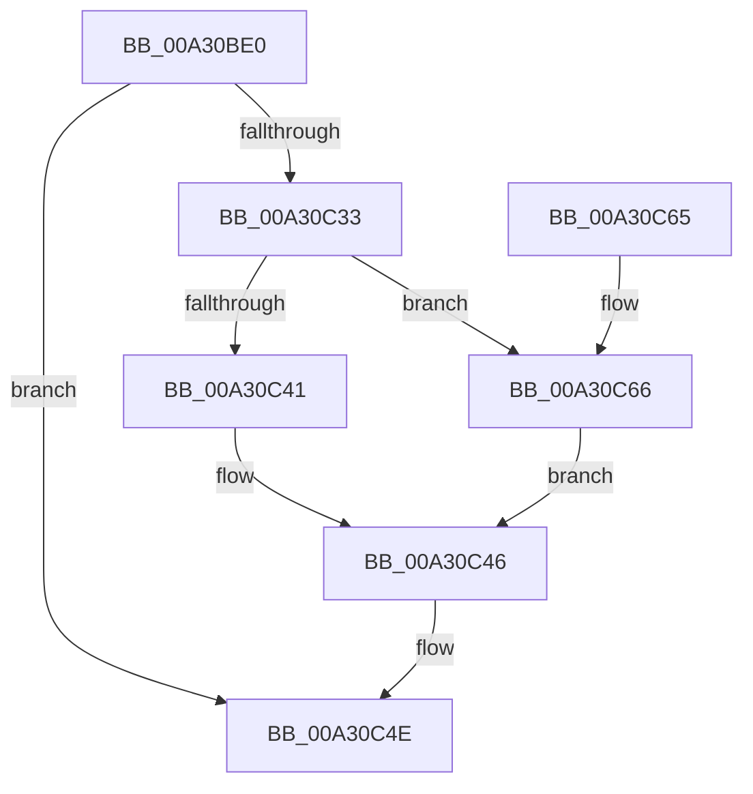

# NtGetContextThread

- RVA: `0x00A30BE0`–`0x00A30C83` (길이 `163` bytes)
- VA: `0x0000000140A30BE0`
- 실행 섹션: `PAGE`
- PDB 이름 있음: `예`; PDB Function 태그: `아니요`
- unwind 정보 RVA: `0x000AD0B4`
- 디코드: `42`개 명령, `163/163` bytes 표시
- 미해석 바이트: `0` (있으면 어셈블리에 `.byte`로 보존)

> 이 문서는 커널 이미지의 기계어와 PDB 기호를 분석해 생성했습니다. 4번과 5번은 함수 원형과 자료형을 바이너리 사용 방식에서 추정한 C 해석이며 원본 소스 복구 결과는 아닙니다.

## 1. Dependencies

- 직접 호출 지점: **3**; 고유 호출 대상: **3**
- 직접 호출자로 확인된 함수: **0**
- RIP 상대 이미지 참조: **1**

### Outgoing calls
- `0x00A30C28` → [ObReferenceObjectByHandle](../86/ObReferenceObjectByHandle_function_00868DB0.md) (function, `0x00868DB0`)
- `0x00A30C49` → [ObfDereferenceObject](../../text/2F/ObfDereferenceObject_function_002F9350.md) (function, `0x002F9350`)
- `0x00A30C7A` → [PspGetContextThreadInternal](../8D/PspGetContextThreadInternal_function_008D4770.md) (function, `0x008D4770`)

### Direct callers
- 이 함수 시작 RVA로 연결되는 직접 call은 확인되지 않았습니다. 간접 호출은 완전히 역산할 수 없습니다.

### Static image references
- `0x00A30C0A` → RVA `0x00FC6AC8` (`ALMOSTRO`; read)

## 2. Other-region calls and transfers

- 다른 실행 섹션으로 향하는 call: **1**
  - `0x00A30C49` → [ObfDereferenceObject](../../text/2F/ObfDereferenceObject_function_002F9350.md) (`PAGE` → `.text`)
- 별도 외부 분기/꼬리 이동을 확인하지 못했습니다.

## 3. Assembly (complete function range)

```asm
00A30BE0  4C 8B DC                        mov r11, rsp
00A30BE3  49 89 5B 08                     mov qword ptr [r11 + 8], rbx
00A30BE7  49 89 6B 10                     mov qword ptr [r11 + 0x10], rbp
00A30BEB  49 89 73 20                     mov qword ptr [r11 + 0x20], rsi
00A30BEF  57                              push rdi
00A30BF0  48 83 EC 30                     sub rsp, 0x30
00A30BF4  65 48 8B 04 25 88 01 00 00      mov rax, qword ptr gs:[0x188]
00A30BFD  48 8B EA                        mov rbp, rdx
00A30C00  49 83 63 F0 00                  and qword ptr [r11 - 0x10], 0
00A30C05  BA 08 00 00 00                  mov edx, 8
00A30C0A  4C 8B 05 B7 5E 59 00            mov r8, qword ptr [rip + 0x595eb7]
00A30C11  49 83 63 18 00                  and qword ptr [r11 + 0x18], 0
00A30C16  40 8A B0 32 02 00 00            mov sil, byte ptr [rax + 0x232]
00A30C1D  49 8D 43 18                     lea rax, [r11 + 0x18]
00A30C21  44 8A CE                        mov r9b, sil
00A30C24  49 89 43 E8                     mov qword ptr [r11 - 0x18], rax
00A30C28  E8 83 81 E3 FF                  call 0x140868db0
00A30C2D  8B F8                           mov edi, eax
00A30C2F  85 C0                           test eax, eax
00A30C31  78 1B                           js 0x140a30c4e
00A30C33  48 8B 5C 24 50                  mov rbx, qword ptr [rsp + 0x50]
00A30C38  F7 43 74 00 04 00 00            test dword ptr [rbx + 0x74], 0x400
00A30C3F  74 25                           je 0x140a30c66
00A30C41  BF 08 00 00 C0                  mov edi, 0xc0000008
00A30C46  48 8B CB                        mov rcx, rbx
00A30C49  E8 02 87 8C FF                  call 0x1402f9350
00A30C4E  48 8B 5C 24 40                  mov rbx, qword ptr [rsp + 0x40]
00A30C53  8B C7                           mov eax, edi
00A30C55  48 8B 6C 24 48                  mov rbp, qword ptr [rsp + 0x48]
00A30C5A  48 8B 74 24 58                  mov rsi, qword ptr [rsp + 0x58]
00A30C5F  48 83 C4 30                     add rsp, 0x30
00A30C63  5F                              pop rdi
00A30C64  C3                              ret
00A30C65  CC                              int3
00A30C66  44 8A CE                        mov r9b, sil
00A30C69  C7 44 24 20 01 00 00 00         mov dword ptr [rsp + 0x20], 1
00A30C71  44 8A C6                        mov r8b, sil
00A30C74  48 8B D5                        mov rdx, rbp
00A30C77  48 8B CB                        mov rcx, rbx
00A30C7A  E8 F1 3A EA FF                  call 0x1408d4770
00A30C7F  8B F8                           mov edi, eax
00A30C81  EB C3                           jmp 0x140a30c46
```

## 4. C-style interpretation (structured pseudocode)

```c
__int64 __fastcall NtGetContextThread(__int64 a1, __int64 a2)
{
    __int64 result;
    __int64 v_rsp;
    unsigned __int64 v_stack_p10;
    unsigned __int64 v_stack_p18;
    unsigned __int64 v_stack_p20;
    unsigned __int64 v_stack_p8;

    *(unsigned __int64 *)(v_rsp + 8) = v_rbx;
    *(unsigned __int64 *)(v_rsp + 16) = v_rbp;
    *(unsigned __int64 *)(v_rsp + 32) = v_rsi;
    v_rsp = (v_rsp) - (48);
    *(unsigned __int64 *)(v_rsp - 24) = v_rsp + 24;
    result = ObReferenceObjectByHandle(a1, 8, *(unsigned __int64 *)(v_rip + 5856951), (unsigned __int8)(*(unsigned __int8 *)(*(unsigned __int64 *)(gs_base + (0 + 392)) + 562)));
    if (sign_flag) goto loc_00A30C4E;
    if (((*(unsigned int *)(v_stack_p18 + 116)) & (0x400ULL)) == 0) goto loc_00A30C66;
loc_00A30C46:
    result = ObfDereferenceObject(v_stack_p18, 8, *(unsigned __int64 *)(v_rip + 5856951), (unsigned __int8)(*(unsigned __int8 *)(*(unsigned __int64 *)(gs_base + (0 + 392)) + 562)));
loc_00A30C4E:
    v_rsp = (v_rsp) + (48);
    return (unsigned int)((unsigned int)((unsigned int)(0xC0000008ULL)));
loc_00A30C66:
    v_stack_p20 = 1;
    result = PspGetContextThreadInternal(v_stack_p8, v_stack_p10, (unsigned __int8)(v_stack_p20), (unsigned __int8)(v_stack_p20));
    goto loc_00A30C46;
}
```

## 5. (Beta) C Style

```c
int64_t NtGetContextThread(int64_t Arg1, int64_t Arg2)
{
    int64_t result;
    int64_t local_rsp;
    uint64_t v_stack_p10;
    uint64_t v_stack_p18;
    uint64_t v_stack_p20;
    uint64_t v_stack_p8;

    *(uint64_t *)(local_rsp + 0x8) = local_rbx;
    *(uint64_t *)(local_rsp + 0x10) = local_rbp;
    *(uint64_t *)(local_rsp + 0x20) = local_rsi;
    local_rsp = (local_rsp) - (48);
    *(uint64_t *)(local_rsp - 0x18) = local_rsp + 24;
    result = ObReferenceObjectByHandle(Arg1, 8, *(uint64_t *)(v_rip + 0x595EB7), (uint8_t)(*(uint8_t *)(*(uint64_t *)(gs_base + (0 + 0x188)) + 0x232)));
    if (sign_flag) goto loc_00A30C4E;
    if (((*(uint32_t *)(v_stack_p18 + 0x74)) & (0x400ULL)) == 0) goto loc_00A30C66;
loc_00A30C46:
    result = ObfDereferenceObject(v_stack_p18, 8, *(uint64_t *)(v_rip + 0x595EB7), (uint8_t)(*(uint8_t *)(*(uint64_t *)(gs_base + (0 + 0x188)) + 0x232)));
loc_00A30C4E:
    local_rsp = (local_rsp) + (48);
    return (uint32_t)((uint32_t)((uint32_t)(0xC0000008ULL)));
loc_00A30C66:
    v_stack_p20 = 1;
    result = PspGetContextThreadInternal(v_stack_p8, v_stack_p10, (uint8_t)(v_stack_p20), (uint8_t)(v_stack_p20));
    goto loc_00A30C46;
}
```

## 6. Execution-region graph

[열기: 2D/3D 그래프와 함수 탐색 컨트롤 패널](../../../control-panel.html?section=page&rva=0x00A30BE0&view=graph)

- 2D 그래프는 위에서 아래로 흐르고, 3D 그래프는 빈 공간을 드래그해 회전합니다. Shift+드래그는 이동, 휠은 확대·축소, 함수 노드 선택은 대상 보고서 이동입니다.

### Static fallback


