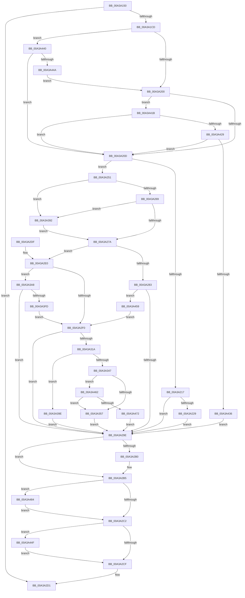

# NtImpersonateAnonymousToken

- RVA: `0x00A3A150`–`0x00A3A48E` (길이 `830` bytes)
- VA: `0x0000000140A3A150`
- 실행 섹션: `PAGE`
- PDB 이름 있음: `예`; PDB Function 태그: `아니요`
- unwind 정보 RVA: `0x000AE0E4`
- 디코드: `192`개 명령, `830/830` bytes 표시
- 미해석 바이트: `0` (있으면 어셈블리에 `.byte`로 보존)

> 이 문서는 커널 이미지의 기계어와 PDB 기호를 분석해 생성했습니다. 4번과 5번은 함수 원형과 자료형을 바이너리 사용 방식에서 추정한 C 해석이며 원본 소스 복구 결과는 아닙니다.

## 1. Dependencies

- 직접 호출 지점: **23**; 고유 호출 대상: **16**
- 직접 호출자로 확인된 함수: **0**
- RIP 상대 이미지 참조: **6**

### Outgoing calls
- `0x00A3A1C0` → [ObReferenceObjectByHandle](../86/ObReferenceObjectByHandle_function_00868DB0.md) (function, `0x00868DB0`)
- `0x00A3A1D1` → [SeCaptureSubjectContext](../86/SeCaptureSubjectContext_function_0086B820.md) (function, `0x0086B820`)
- `0x00A3A1F3` → [SepRegQueryDwordValue](SepRegQueryDwordValue_function_00A3A494.md) (function, `0x00A3A494`)
- `0x00A3A21E` → [SepGetAnonymousToken](../../text/30/SepGetAnonymousToken_function_00301830.md) (function, `0x00301830`)
- `0x00A3A23F` → [PsImpersonateClient](../8C/PsImpersonateClient_function_008CBE10.md) (function, `0x008CBE10`)
- `0x00A3A24A` → [ObfDereferenceObject](../../text/2F/ObfDereferenceObject_function_002F9350.md) (function, `0x002F9350`)
- `0x00A3A25C` → [SepRegQueryDwordValue](SepRegQueryDwordValue_function_00A3A494.md) (function, `0x00A3A494`)
- `0x00A3A27A` → [PsIsCurrentThreadInServerSilo](../../text/43/PsIsCurrentThreadInServerSilo_function_004362E0.md) (function, `0x004362E0`)
- `0x00A3A283` → [PsGetCurrentServerSilo](../../text/22/PsGetCurrentServerSilo_function_00225710.md) (function, `0x00225710`)
- `0x00A3A28F` → [SepCopyAnonymousTokenAndSetSilo](SepCopyAnonymousTokenAndSetSilo_function_00A3A510.md) (function, `0x00A3A510`)
- `0x00A3A2A2` → [SeReleaseSubjectContext](../86/SeReleaseSubjectContext_function_0086B710.md) (function, `0x0086B710`)
- `0x00A3A2B0` → [ObfDereferenceObject](../../text/2F/ObfDereferenceObject_function_002F9350.md) (function, `0x002F9350`)
- `0x00A3A30F` → [ObReferenceObjectByPointer](../../text/43/ObReferenceObjectByPointer_function_00438D00.md) (function, `0x00438D00`)
- `0x00A3A31D` → [ObfDereferenceObject](../../text/2F/ObfDereferenceObject_function_002F9350.md) (function, `0x002F9350`)
- `0x00A3A33A` → [PsReferencePrimaryTokenWithTag](../../text/20/PsReferencePrimaryTokenWithTag_function_0020FF80.md) (function, `0x0020FF80`)
- `0x00A3A34A` → [SeTokenIsRestricted](../../text/43/SeTokenIsRestricted_function_00438CE0.md) (function, `0x00438CE0`)
- `0x00A3A367` → [ObFastDereferenceObject](../../text/3E/ObFastDereferenceObject_function_003ED5F0.md) (function, `0x003ED5F0`)
- `0x00A3A386` → [PsImpersonateClient](../8C/PsImpersonateClient_function_008CBE10.md) (function, `0x008CBE10`)
- `0x00A3A3EE` → [SepDuplicateToken](../8B/SepDuplicateToken_function_008B87EC.md) (function, `0x008B87EC`)
- `0x00A3A44F` → [ObfDereferenceObject](../../text/2F/ObfDereferenceObject_function_002F9350.md) (function, `0x002F9350`)
- `0x00A3A465` → [SeTokenIsWriteRestricted](../../text/46/SeTokenIsWriteRestricted_function_00463380.md) (function, `0x00463380`)
- `0x00A3A475` → [ObfDereferenceObject](../../text/2F/ObfDereferenceObject_function_002F9350.md) (function, `0x002F9350`)
- `0x00A3A484` → [ObfDereferenceObject](../../text/2F/ObfDereferenceObject_function_002F9350.md) (function, `0x002F9350`)

### Direct callers
- 이 함수 시작 RVA로 연결되는 직접 call은 확인되지 않았습니다. 간접 호출은 완전히 역산할 수 없습니다.

### Static image references
- `0x00A3A18C` → RVA `0x00FC6AC8` (`ALMOSTRO`; read)
- `0x00A3A1E2` → RVA `0x00B05FC0` (` ?? ::NNGAKEGL::`string'`; read)
- `0x00A3A255` → RVA `0x00B05F80` (` ?? ::NNGAKEGL::`string'`; read)
- `0x00A3A26D` → RVA `0x00FDA010` (`PAGEDATA`; read)
- `0x00A3A2FE` → RVA `0x00FD8020` (`PAGEDATA`; read)
- `0x00A3A392` → RVA `0x00FD9D80` (`PAGEDATA`; read)

## 2. Other-region calls and transfers

- 다른 실행 섹션으로 향하는 call: **14**
  - `0x00A3A21E` → [SepGetAnonymousToken](../../text/30/SepGetAnonymousToken_function_00301830.md) (`PAGE` → `.text`)
  - `0x00A3A24A` → [ObfDereferenceObject](../../text/2F/ObfDereferenceObject_function_002F9350.md) (`PAGE` → `.text`)
  - `0x00A3A27A` → [PsIsCurrentThreadInServerSilo](../../text/43/PsIsCurrentThreadInServerSilo_function_004362E0.md) (`PAGE` → `.text`)
  - `0x00A3A283` → [PsGetCurrentServerSilo](../../text/22/PsGetCurrentServerSilo_function_00225710.md) (`PAGE` → `.text`)
  - `0x00A3A2B0` → [ObfDereferenceObject](../../text/2F/ObfDereferenceObject_function_002F9350.md) (`PAGE` → `.text`)
  - `0x00A3A30F` → [ObReferenceObjectByPointer](../../text/43/ObReferenceObjectByPointer_function_00438D00.md) (`PAGE` → `.text`)
  - `0x00A3A31D` → [ObfDereferenceObject](../../text/2F/ObfDereferenceObject_function_002F9350.md) (`PAGE` → `.text`)
  - `0x00A3A33A` → [PsReferencePrimaryTokenWithTag](../../text/20/PsReferencePrimaryTokenWithTag_function_0020FF80.md) (`PAGE` → `.text`)
  - `0x00A3A34A` → [SeTokenIsRestricted](../../text/43/SeTokenIsRestricted_function_00438CE0.md) (`PAGE` → `.text`)
  - `0x00A3A367` → [ObFastDereferenceObject](../../text/3E/ObFastDereferenceObject_function_003ED5F0.md) (`PAGE` → `.text`)
  - `0x00A3A44F` → [ObfDereferenceObject](../../text/2F/ObfDereferenceObject_function_002F9350.md) (`PAGE` → `.text`)
  - `0x00A3A465` → [SeTokenIsWriteRestricted](../../text/46/SeTokenIsWriteRestricted_function_00463380.md) (`PAGE` → `.text`)
  - `0x00A3A475` → [ObfDereferenceObject](../../text/2F/ObfDereferenceObject_function_002F9350.md) (`PAGE` → `.text`)
  - `0x00A3A484` → [ObfDereferenceObject](../../text/2F/ObfDereferenceObject_function_002F9350.md) (`PAGE` → `.text`)
- 별도 외부 분기/꼬리 이동을 확인하지 못했습니다.

## 3. Assembly (complete function range)

```asm
00A3A150  40 55                           push rbp
00A3A152  53                              push rbx
00A3A153  56                              push rsi
00A3A154  57                              push rdi
00A3A155  41 56                           push r14
00A3A157  48 8D 6C 24 C9                  lea rbp, [rsp - 0x37]
00A3A15C  48 81 EC A0 00 00 00            sub rsp, 0xa0
00A3A163  45 33 F6                        xor r14d, r14d
00A3A166  33 C0                           xor eax, eax
00A3A168  0F 57 C0                        xorps xmm0, xmm0
00A3A16B  48 89 45 27                     mov qword ptr [rbp + 0x27], rax
00A3A16F  89 45 2F                        mov dword ptr [rbp + 0x2f], eax
00A3A172  BA 00 01 00 00                  mov edx, 0x100
00A3A177  0F 11 45 07                     movups xmmword ptr [rbp + 7], xmm0
00A3A17B  4C 89 75 D7                     mov qword ptr [rbp - 0x29], r14
00A3A17F  0F 11 45 17                     movups xmmword ptr [rbp + 0x17], xmm0
00A3A183  65 48 8B 04 25 88 01 00 00      mov rax, qword ptr gs:[0x188]
00A3A18C  4C 8B 05 35 C9 58 00            mov r8, qword ptr [rip + 0x58c935]
00A3A193  4C 89 74 24 28                  mov qword ptr [rsp + 0x28], r14
00A3A198  4C 89 75 7F                     mov qword ptr [rbp + 0x7f], r14
00A3A19C  44 8A 88 32 02 00 00            mov r9b, byte ptr [rax + 0x232]
00A3A1A3  48 8D 45 77                     lea rax, [rbp + 0x77]
00A3A1A7  48 89 44 24 20                  mov qword ptr [rsp + 0x20], rax
00A3A1AC  44 89 75 6F                     mov dword ptr [rbp + 0x6f], r14d
00A3A1B0  0F 11 45 E7                     movups xmmword ptr [rbp - 0x19], xmm0
00A3A1B4  4C 89 75 DF                     mov qword ptr [rbp - 0x21], r14
00A3A1B8  0F 11 45 F7                     movups xmmword ptr [rbp - 9], xmm0
00A3A1BC  4C 89 75 77                     mov qword ptr [rbp + 0x77], r14
00A3A1C0  E8 EB EB E2 FF                  call 0x140868db0
00A3A1C5  85 C0                           test eax, eax
00A3A1C7  0F 88 04 01 00 00               js 0x140a3a2d1
00A3A1CD  48 8D 4D E7                     lea rcx, [rbp - 0x19]
00A3A1D1  E8 4A 16 E3 FF                  call 0x14086b820
00A3A1D6  48 8B 45 E7                     mov rax, qword ptr [rbp - 0x19]
00A3A1DA  4C 8D 45 6F                     lea r8, [rbp + 0x6f]
00A3A1DE  48 8B 5D F7                     mov rbx, qword ptr [rbp - 9]
00A3A1E2  48 8D 15 D7 BD 0C 00            lea rdx, [rip + 0xcbdd7]
00A3A1E9  48 85 C0                        test rax, rax
00A3A1EC  48 8B FB                        mov rdi, rbx
00A3A1EF  48 0F 45 F8                     cmovne rdi, rax
00A3A1F3  E8 9C 02 00 00                  call 0x140a3a494
00A3A1F8  85 C0                           test eax, eax
00A3A1FA  0F 89 40 02 00 00               jns 0x140a3a440
00A3A200  83 BF C0 00 00 00 01            cmp dword ptr [rdi + 0xc0], 1
00A3A207  0F 85 0E 02 00 00               jne 0x140a3a41b
00A3A20D  0F BA A7 C8 00 00 00 0E         bt dword ptr [rdi + 0xc8], 0xe
00A3A215  73 3A                           jae 0x140a3a251
00A3A217  48 8D 55 DF                     lea rdx, [rbp - 0x21]
00A3A21B  48 8B CF                        mov rcx, rdi
00A3A21E  E8 0D 76 8C FF                  call 0x140301830
00A3A223  8B D8                           mov ebx, eax
00A3A225  85 C0                           test eax, eax
00A3A227  78 75                           js 0x140a3a29e
00A3A229  48 8B 55 DF                     mov rdx, qword ptr [rbp - 0x21]
00A3A22D  45 33 C9                        xor r9d, r9d
00A3A230  48 8B 4D 77                     mov rcx, qword ptr [rbp + 0x77]
00A3A234  41 B0 01                        mov r8b, 1
00A3A237  C7 44 24 20 02 00 00 00         mov dword ptr [rsp + 0x20], 2
00A3A23F  E8 CC 1B E9 FF                  call 0x1408cbe10
00A3A244  48 8B 4D DF                     mov rcx, qword ptr [rbp - 0x21]
00A3A248  8B D8                           mov ebx, eax
00A3A24A  E8 01 F1 8B FF                  call 0x1402f9350
00A3A24F  EB 4D                           jmp 0x140a3a29e
00A3A251  4C 8D 45 6F                     lea r8, [rbp + 0x6f]
00A3A255  48 8D 15 24 BD 0C 00            lea rdx, [rip + 0xcbd24]
00A3A25C  E8 33 02 00 00                  call 0x140a3a494
00A3A261  85 C0                           test eax, eax
00A3A263  0F 88 29 01 00 00               js 0x140a3a392
00A3A269  83 7D 6F 01                     cmp dword ptr [rbp + 0x6f], 1
00A3A26D  48 8B 35 9C FD 59 00            mov rsi, qword ptr [rip + 0x59fd9c]
00A3A274  0F 85 18 01 00 00               jne 0x140a3a392
00A3A27A  E8 61 C0 9F FF                  call 0x1404362e0
00A3A27F  84 C0                           test al, al
00A3A281  74 5D                           je 0x140a3a2e0
00A3A283  E8 88 B4 7E FF                  call 0x140225710
00A3A288  48 8B C8                        mov rcx, rax
00A3A28B  48 8D 55 7F                     lea rdx, [rbp + 0x7f]
00A3A28F  E8 7C 02 00 00                  call 0x140a3a510
00A3A294  8B D8                           mov ebx, eax
00A3A296  85 C0                           test eax, eax
00A3A298  0F 89 BB 01 00 00               jns 0x140a3a459
00A3A29E  48 8D 4D E7                     lea rcx, [rbp - 0x19]
00A3A2A2  E8 69 14 E3 FF                  call 0x14086b710
00A3A2A7  48 8B 4D 77                     mov rcx, qword ptr [rbp + 0x77]
00A3A2AB  48 85 C9                        test rcx, rcx
00A3A2AE  74 05                           je 0x140a3a2b5
00A3A2B0  E8 9B F0 8B FF                  call 0x1402f9350
00A3A2B5  48 8B 4D 7F                     mov rcx, qword ptr [rbp + 0x7f]
00A3A2B9  48 85 C9                        test rcx, rcx
00A3A2BC  0F 85 C2 01 00 00               jne 0x140a3a484
00A3A2C2  48 8B 4D D7                     mov rcx, qword ptr [rbp - 0x29]
00A3A2C6  48 85 C9                        test rcx, rcx
00A3A2C9  0F 85 80 01 00 00               jne 0x140a3a44f
00A3A2CF  8B C3                           mov eax, ebx
00A3A2D1  48 81 C4 A0 00 00 00            add rsp, 0xa0
00A3A2D8  41 5E                           pop r14
00A3A2DA  5F                              pop rdi
00A3A2DB  5E                              pop rsi
00A3A2DC  5B                              pop rbx
00A3A2DD  5D                              pop rbp
00A3A2DE  C3                              ret
00A3A2DF  CC                              int3
00A3A2E0  F7 87 C8 00 00 00 00 00 38 00   test dword ptr [rdi + 0xc8], 0x380000
00A3A2EA  0F 85 B8 00 00 00               jne 0x140a3a3a8
00A3A2F0  65 48 8B 04 25 88 01 00 00      mov rax, qword ptr gs:[0x188]
00A3A2F9  BA 04 00 00 00                  mov edx, 4
00A3A2FE  4C 8B 05 1B DD 59 00            mov r8, qword ptr [rip + 0x59dd1b]
00A3A305  48 8B CE                        mov rcx, rsi
00A3A308  44 8A 88 32 02 00 00            mov r9b, byte ptr [rax + 0x232]
00A3A30F  E8 EC E9 9F FF                  call 0x140438d00
00A3A314  8B D8                           mov ebx, eax
00A3A316  85 C0                           test eax, eax
00A3A318  78 84                           js 0x140a3a29e
00A3A31A  48 8B CE                        mov rcx, rsi
00A3A31D  E8 2E F0 8B FF                  call 0x1402f9350
00A3A322  65 48 8B 04 25 88 01 00 00      mov rax, qword ptr gs:[0x188]
00A3A32B  BA 44 66 6C 74                  mov edx, 0x746c6644
00A3A330  48 8B B8 B8 00 00 00            mov rdi, qword ptr [rax + 0xb8]
00A3A337  48 8B CF                        mov rcx, rdi
00A3A33A  E8 41 5C 7D FF                  call 0x14020ff80
00A3A33F  48 8B D8                        mov rbx, rax
00A3A342  48 85 C0                        test rax, rax
00A3A345  74 57                           je 0x140a3a39e
00A3A347  48 8B C8                        mov rcx, rax
00A3A34A  E8 91 E9 9F FF                  call 0x140438ce0
00A3A34F  84 C0                           test al, al
00A3A351  0F 85 0B 01 00 00               jne 0x140a3a462
00A3A357  48 8D 8F 48 02 00 00            lea rcx, [rdi + 0x248]
00A3A35E  41 B8 44 66 6C 74               mov r8d, 0x746c6644
00A3A364  48 8B D3                        mov rdx, rbx
00A3A367  E8 84 32 9B FF                  call 0x1403ed5f0
00A3A36C  4C 39 75 7F                     cmp qword ptr [rbp + 0x7f], r14
00A3A370  48 8B D6                        mov rdx, rsi
00A3A373  48 8B 4D 77                     mov rcx, qword ptr [rbp + 0x77]
00A3A377  41 0F 94 C0                     sete r8b
00A3A37B  C7 44 24 20 02 00 00 00         mov dword ptr [rsp + 0x20], 2
00A3A383  45 33 C9                        xor r9d, r9d
00A3A386  E8 85 1A E9 FF                  call 0x1408cbe10
00A3A38B  8B D8                           mov ebx, eax
00A3A38D  E9 0C FF FF FF                  jmp 0x140a3a29e
00A3A392  48 8B 35 E7 F9 59 00            mov rsi, qword ptr [rip + 0x59f9e7]
00A3A399  E9 DC FE FF FF                  jmp 0x140a3a27a
00A3A39E  BB 01 00 00 C0                  mov ebx, 0xc0000001
00A3A3A3  E9 F6 FE FF FF                  jmp 0x140a3a29e
00A3A3A8  48 8D 45 D7                     lea rax, [rbp - 0x29]
00A3A3AC  C7 45 07 30 00 00 00            mov dword ptr [rbp + 7], 0x30
00A3A3B3  48 89 44 24 38                  mov qword ptr [rsp + 0x38], rax
00A3A3B8  48 8D 55 07                     lea rdx, [rbp + 7]
00A3A3BC  C6 44 24 30 01                  mov byte ptr [rsp + 0x30], 1
00A3A3C1  0F 57 C0                        xorps xmm0, xmm0
00A3A3C4  44 88 74 24 28                  mov byte ptr [rsp + 0x28], r14b
00A3A3C9  41 B9 02 00 00 00               mov r9d, 2
00A3A3CF  41 B0 01                        mov r8b, 1
00A3A3D2  C7 44 24 20 02 00 00 00         mov dword ptr [rsp + 0x20], 2
00A3A3DA  48 8B CE                        mov rcx, rsi
00A3A3DD  4C 89 75 0F                     mov qword ptr [rbp + 0xf], r14
00A3A3E1  44 89 75 1F                     mov dword ptr [rbp + 0x1f], r14d
00A3A3E5  4C 89 75 17                     mov qword ptr [rbp + 0x17], r14
00A3A3E9  F3 0F 7F 45 27                  movdqu xmmword ptr [rbp + 0x27], xmm0
00A3A3EE  E8 F9 E3 E7 FF                  call 0x1408b87ec
00A3A3F3  8B D8                           mov ebx, eax
00A3A3F5  85 C0                           test eax, eax
00A3A3F7  0F 88 A1 FE FF FF               js 0x140a3a29e
00A3A3FD  8B 87 C8 00 00 00               mov eax, dword ptr [rdi + 0xc8]
00A3A403  48 8B 4D D7                     mov rcx, qword ptr [rbp - 0x29]
00A3A407  25 00 00 38 00                  and eax, 0x380000
00A3A40C  09 81 C8 00 00 00               or dword ptr [rcx + 0xc8], eax
00A3A412  48 8B 75 D7                     mov rsi, qword ptr [rbp - 0x29]
00A3A416  E9 D5 FE FF FF                  jmp 0x140a3a2f0
00A3A41B  0F BA A3 C8 00 00 00 0E         bt dword ptr [rbx + 0xc8], 0xe
00A3A423  0F 83 E4 FD FF FF               jae 0x140a3a20d
00A3A429  83 BF C4 00 00 00 02            cmp dword ptr [rdi + 0xc4], 2
00A3A430  0F 8D D7 FD FF FF               jge 0x140a3a20d
00A3A436  BB A5 00 00 C0                  mov ebx, 0xc00000a5
00A3A43B  E9 5E FE FF FF                  jmp 0x140a3a29e
00A3A440  44 39 75 6F                     cmp dword ptr [rbp + 0x6f], r14d
00A3A444  0F 85 C3 FD FF FF               jne 0x140a3a20d
00A3A44A  E9 B1 FD FF FF                  jmp 0x140a3a200
00A3A44F  E8 FC EE 8B FF                  call 0x1402f9350
00A3A454  E9 76 FE FF FF                  jmp 0x140a3a2cf
00A3A459  48 8B 75 7F                     mov rsi, qword ptr [rbp + 0x7f]
00A3A45D  E9 8E FE FF FF                  jmp 0x140a3a2f0
00A3A462  48 8B CB                        mov rcx, rbx
00A3A465  E8 16 8F A2 FF                  call 0x140463380
00A3A46A  84 C0                           test al, al
00A3A46C  0F 85 E5 FE FF FF               jne 0x140a3a357
00A3A472  48 8B CB                        mov rcx, rbx
00A3A475  E8 D6 EE 8B FF                  call 0x1402f9350
00A3A47A  BB 22 00 00 C0                  mov ebx, 0xc0000022
00A3A47F  E9 1A FE FF FF                  jmp 0x140a3a29e
00A3A484  E8 C7 EE 8B FF                  call 0x1402f9350
00A3A489  E9 34 FE FF FF                  jmp 0x140a3a2c2
```

## 4. C-style interpretation (structured pseudocode)

```c
__int64 __fastcall NtImpersonateAnonymousToken(void)
{
    __int64 result;
    __int64 v_r14;
    __int64 v_rdi;
    __int64 v_rsp;
    unsigned int v_stack_m30;
    unsigned __int64 v_stack_m38;
    unsigned int v_stack_m40;
    unsigned __int64 v_stack_m48;
    unsigned __int64 v_stack_m50;
    unsigned __int64 v_stack_m58;
    unsigned __int64 v_stack_m5F;
    unsigned __int64 v_stack_m68;
    unsigned __int64 v_stack_m78;
    unsigned __int64 v_stack_m80;
    unsigned __int64 v_stack_m88;
    unsigned __int64 v_stack_mA0;
    unsigned __int64 v_stack_mA8;
    unsigned int v_stack_p10;
    unsigned __int64 v_stack_p18;
    unsigned __int64 v_stack_p20;
    unsigned __int8 v_stack_p28;
    unsigned __int8 v_stack_p30;
    unsigned __int64 v_stack_p38;

    v_rsp = (v_rsp) - (160);
    v_r14 = 0;
    result = 0;
    v_stack_m38 = 0;
    v_stack_m30 = 0;
    v_stack_m58 = v_xmm0;
    v_stack_m88 = 0;
    v_stack_m48 = v_xmm0;
    v_stack_mA0 = 0;
    v_stack_p20 = 0;
    v_stack_mA8 = v_stack_p18;
    v_stack_p10 = 0;
    v_stack_m78 = v_xmm0;
    v_stack_m80 = 0;
    v_stack_m68 = v_xmm0;
    v_stack_p18 = 0;
    result = ObReferenceObjectByHandle(a1, 256, *(unsigned __int64 *)(v_rip + 5818677), *(unsigned __int8 *)(*(unsigned __int64 *)(gs_base + (0 + 392)) + 562));
    if (sign_flag) goto loc_00A3A2D1;
    result = SeCaptureSubjectContext(v_stack_m78, 256, *(unsigned __int64 *)(v_rip + 5818677), *(unsigned __int8 *)(*(unsigned __int64 *)(gs_base + (0 + 392)) + 562));
    v_rdi = v_stack_m68;
    if (v_stack_m78 != 0) { v_rdi = v_stack_m78; }
    result = SepRegQueryDwordValue(v_stack_m78, v_rip + 835031, v_stack_p10, *(unsigned __int8 *)(*(unsigned __int64 *)(gs_base + (0 + 392)) + 562));
    if (!sign_flag) goto loc_00A3A440;
loc_00A3A200:
    if ((*(unsigned int *)(v_rdi + 192)) != 1) goto loc_00A3A41B;
loc_00A3A20D:
    if ((*(unsigned int *)(v_rdi + 192)) >= 1) goto loc_00A3A251;
    result = SepGetAnonymousToken(v_rdi, v_stack_m80, v_stack_p10, *(unsigned __int8 *)(*(unsigned __int64 *)(gs_base + (0 + 392)) + 562));
    if (sign_flag) goto loc_00A3A29E;
    a4 = 0;
    v_stack_mA8 = 2;
    result = PsImpersonateClient(v_stack_p18, v_stack_m80, 1, a4);
    result = ObfDereferenceObject(v_stack_m80, v_stack_m80, 1, a4);
    goto loc_00A3A29E;
loc_00A3A251:
    result = SepRegQueryDwordValue(v_stack_m80, v_rip + 834852, v_stack_p10, a4);
    if (sign_flag) goto loc_00A3A392;
    if (v_stack_p10 != 1) goto loc_00A3A392;
loc_00A3A27A:
    result = PsIsCurrentThreadInServerSilo(v_stack_m80, v_rip + 834852, v_stack_p10, a4);
    if ((unsigned __int8)(result) == 0) goto loc_00A3A2E0;
    result = PsGetCurrentServerSilo(v_stack_m80, v_rip + 834852, v_stack_p10, a4);
    result = SepCopyAnonymousTokenAndSetSilo(result, v_stack_p20, v_stack_p10, a4);
    if (!sign_flag) goto loc_00A3A459;
loc_00A3A29E:
    result = SeReleaseSubjectContext(v_stack_m78, v_stack_p20, v_stack_p10, a4);
    if (v_stack_p18 != 0) {
        result = ObfDereferenceObject(v_stack_p18, v_stack_p20, v_stack_p10, a4);
    }
    if (v_stack_p20 != 0) goto loc_00A3A484;
loc_00A3A2C2:
    if (v_stack_m88 != 0) goto loc_00A3A44F;
loc_00A3A2CF:
loc_00A3A2D1:
    v_rsp = (v_rsp) + (160);
    return (unsigned int)((unsigned int)((unsigned int)((unsigned int)(result))));
loc_00A3A2E0:
    if (((*(unsigned int *)(v_rdi + 200)) & (0x380000ULL)) != 0) goto loc_00A3A3A8;
loc_00A3A2F0:
    result = ObReferenceObjectByPointer(*(unsigned __int64 *)(v_rip + 5897628), 4, *(unsigned __int64 *)(v_rip + 5889307), *(unsigned __int8 *)(*(unsigned __int64 *)(gs_base + (0 + 392)) + 562));
    if (sign_flag) goto loc_00A3A29E;
    result = ObfDereferenceObject(*(unsigned __int64 *)(v_rip + 5897628), 4, *(unsigned __int64 *)(v_rip + 5889307), *(unsigned __int8 *)(*(unsigned __int64 *)(gs_base + (0 + 392)) + 562));
    result = PsReferencePrimaryTokenWithTag(*(unsigned __int64 *)(*(unsigned __int64 *)(gs_base + (0 + 392)) + 184), (unsigned int)(0x746C6644ULL), *(unsigned __int64 *)(v_rip + 5889307), *(unsigned __int8 *)(*(unsigned __int64 *)(gs_base + (0 + 392)) + 562));
    if (result == 0) goto loc_00A3A39E;
    result = SeTokenIsRestricted(result, (unsigned int)(0x746C6644ULL), *(unsigned __int64 *)(v_rip + 5889307), *(unsigned __int8 *)(*(unsigned __int64 *)(gs_base + (0 + 392)) + 562));
    if ((unsigned __int8)(result) != 0) goto loc_00A3A462;
loc_00A3A357:
    result = ObFastDereferenceObject(*(unsigned __int64 *)(*(unsigned __int64 *)(gs_base + (0 + 392)) + 184) + 584, result, (unsigned int)(0x746C6644ULL), *(unsigned __int8 *)(*(unsigned __int64 *)(gs_base + (0 + 392)) + 562));
    a3 = (v_stack_p20 == 0) ? 1 : 0;
    v_stack_p20 = 2;
    a4 = 0;
    result = PsImpersonateClient(v_stack_p18, *(unsigned __int64 *)(v_rip + 5897628), a3, a4);
    goto loc_00A3A29E;
loc_00A3A392:
    goto loc_00A3A27A;
loc_00A3A39E:
    goto loc_00A3A29E;
loc_00A3A3A8:
    v_stack_m58 = 48;
    v_stack_p38 = v_stack_m88;
    v_stack_p30 = 1;
    v_stack_p28 = 0;
    v_stack_p20 = 2;
    v_stack_m50 = 0;
    v_stack_m40 = 0;
    v_stack_m48 = 0;
    v_stack_m38 = v_xmm0;
    result = SepDuplicateToken(*(unsigned __int64 *)(v_rip + 5896679), v_stack_m58, 1, 2);
    if (sign_flag) goto loc_00A3A29E;
    result = (unsigned int)(((unsigned int)(*(unsigned int *)(*(unsigned __int64 *)(*(unsigned __int64 *)(gs_base + (0 + 392)) + 184) + 200))) & (0x380000ULL));
    goto loc_00A3A2F0;
loc_00A3A41B:
    if (condition_is_above_or_equal) goto loc_00A3A20D;
    if ((*(unsigned int *)(*(unsigned __int64 *)(*(unsigned __int64 *)(gs_base + (0 + 392)) + 184) + 196)) >= 2) goto loc_00A3A20D;
    goto loc_00A3A29E;
loc_00A3A440:
    if (v_stack_p10 != 0) goto loc_00A3A20D;
    goto loc_00A3A200;
loc_00A3A44F:
    result = ObfDereferenceObject(v_stack_m88, v_stack_m58, 1, 2);
    goto loc_00A3A2CF;
loc_00A3A459:
    goto loc_00A3A2F0;
loc_00A3A462:
    result = SeTokenIsWriteRestricted((unsigned int)(0xC00000A5ULL), v_stack_m58, 1, 2);
    if ((unsigned __int8)(result) != 0) goto loc_00A3A357;
    result = ObfDereferenceObject((unsigned int)(0xC00000A5ULL), v_stack_m58, 1, 2);
    goto loc_00A3A29E;
loc_00A3A484:
    result = ObfDereferenceObject((unsigned int)(0xC00000A5ULL), v_stack_m58, 1, 2);
    goto loc_00A3A2C2;
}
```

## 5. (Beta) C Style

```c
void NtImpersonateAnonymousToken(void)
{
    int64_t result;
    int64_t local_r14;
    int64_t local_rdi;
    int64_t local_rsp;
    uint32_t v_stack_m30;
    uint64_t v_stack_m38;
    uint32_t v_stack_m40;
    uint64_t v_stack_m48;
    uint64_t v_stack_m50;
    uint64_t v_stack_m58;
    uint64_t v_stack_m5F;
    uint64_t v_stack_m68;
    uint64_t v_stack_m78;
    uint64_t v_stack_m80;
    uint64_t v_stack_m88;
    uint64_t v_stack_mA0;
    uint64_t v_stack_mA8;
    uint32_t v_stack_p10;
    uint64_t v_stack_p18;
    uint64_t v_stack_p20;
    uint8_t v_stack_p28;
    uint8_t v_stack_p30;
    uint64_t v_stack_p38;

    local_rsp = (local_rsp) - (160);
    local_r14 = 0;
    result = 0;
    v_stack_m38 = 0;
    v_stack_m30 = 0;
    v_stack_m58 = v_xmm0;
    v_stack_m88 = 0;
    v_stack_m48 = v_xmm0;
    v_stack_mA0 = 0;
    v_stack_p20 = 0;
    v_stack_mA8 = v_stack_p18;
    v_stack_p10 = 0;
    v_stack_m78 = v_xmm0;
    v_stack_m80 = 0;
    v_stack_m68 = v_xmm0;
    v_stack_p18 = 0;
    result = ObReferenceObjectByHandle(a1, 256, *(uint64_t *)(v_rip + 0x58C935), *(uint8_t *)(*(uint64_t *)(gs_base + (0 + 0x188)) + 0x232));
    if (sign_flag) goto loc_00A3A2D1;
    result = SeCaptureSubjectContext(v_stack_m78, 256, *(uint64_t *)(v_rip + 0x58C935), *(uint8_t *)(*(uint64_t *)(gs_base + (0 + 0x188)) + 0x232));
    local_rdi = v_stack_m68;
    if (v_stack_m78 != 0) { local_rdi = v_stack_m78; }
    result = SepRegQueryDwordValue(v_stack_m78, v_rip + 835031, v_stack_p10, *(uint8_t *)(*(uint64_t *)(gs_base + (0 + 0x188)) + 0x232));
    if (!sign_flag) goto loc_00A3A440;
loc_00A3A200:
    if ((*(uint32_t *)(local_rdi + 0xC0)) != 1) goto loc_00A3A41B;
loc_00A3A20D:
    if ((*(uint32_t *)(local_rdi + 0xC0)) >= 1) goto loc_00A3A251;
    result = SepGetAnonymousToken(local_rdi, v_stack_m80, v_stack_p10, *(uint8_t *)(*(uint64_t *)(gs_base + (0 + 0x188)) + 0x232));
    if (sign_flag) goto loc_00A3A29E;
    a4 = 0;
    v_stack_mA8 = 2;
    result = PsImpersonateClient(v_stack_p18, v_stack_m80, 1, a4);
    result = ObfDereferenceObject(v_stack_m80, v_stack_m80, 1, a4);
    goto loc_00A3A29E;
loc_00A3A251:
    result = SepRegQueryDwordValue(v_stack_m80, v_rip + 834852, v_stack_p10, a4);
    if (sign_flag) goto loc_00A3A392;
    if (v_stack_p10 != 1) goto loc_00A3A392;
loc_00A3A27A:
    result = PsIsCurrentThreadInServerSilo(v_stack_m80, v_rip + 834852, v_stack_p10, a4);
    if ((uint8_t)(result) == 0) goto loc_00A3A2E0;
    result = PsGetCurrentServerSilo(v_stack_m80, v_rip + 834852, v_stack_p10, a4);
    result = SepCopyAnonymousTokenAndSetSilo(result, v_stack_p20, v_stack_p10, a4);
    if (!sign_flag) goto loc_00A3A459;
loc_00A3A29E:
    result = SeReleaseSubjectContext(v_stack_m78, v_stack_p20, v_stack_p10, a4);
    if (v_stack_p18 != 0) {
        result = ObfDereferenceObject(v_stack_p18, v_stack_p20, v_stack_p10, a4);
    }
    if (v_stack_p20 != 0) goto loc_00A3A484;
loc_00A3A2C2:
    if (v_stack_m88 != 0) goto loc_00A3A44F;
loc_00A3A2CF:
loc_00A3A2D1:
    local_rsp = (local_rsp) + (160);
    return (uint32_t)((uint32_t)((uint32_t)((uint32_t)(result))));
loc_00A3A2E0:
    if (((*(uint32_t *)(local_rdi + 0xC8)) & (0x380000ULL)) != 0) goto loc_00A3A3A8;
loc_00A3A2F0:
    result = ObReferenceObjectByPointer(*(uint64_t *)(v_rip + 0x59FD9C), 4, *(uint64_t *)(v_rip + 0x59DD1B), *(uint8_t *)(*(uint64_t *)(gs_base + (0 + 0x188)) + 0x232));
    if (sign_flag) goto loc_00A3A29E;
    result = ObfDereferenceObject(*(uint64_t *)(v_rip + 0x59FD9C), 4, *(uint64_t *)(v_rip + 0x59DD1B), *(uint8_t *)(*(uint64_t *)(gs_base + (0 + 0x188)) + 0x232));
    result = PsReferencePrimaryTokenWithTag(*(uint64_t *)(*(uint64_t *)(gs_base + (0 + 0x188)) + 0xB8), (uint32_t)(0x746C6644ULL), *(uint64_t *)(v_rip + 0x59DD1B), *(uint8_t *)(*(uint64_t *)(gs_base + (0 + 0x188)) + 0x232));
    if (result == 0) goto loc_00A3A39E;
    result = SeTokenIsRestricted(result, (uint32_t)(0x746C6644ULL), *(uint64_t *)(v_rip + 0x59DD1B), *(uint8_t *)(*(uint64_t *)(gs_base + (0 + 0x188)) + 0x232));
    if ((uint8_t)(result) != 0) goto loc_00A3A462;
loc_00A3A357:
    result = ObFastDereferenceObject(*(uint64_t *)(*(uint64_t *)(gs_base + (0 + 0x188)) + 0xB8) + 584, result, (uint32_t)(0x746C6644ULL), *(uint8_t *)(*(uint64_t *)(gs_base + (0 + 0x188)) + 0x232));
    a3 = (v_stack_p20 == 0) ? 1 : 0;
    v_stack_p20 = 2;
    a4 = 0;
    result = PsImpersonateClient(v_stack_p18, *(uint64_t *)(v_rip + 0x59FD9C), a3, a4);
    goto loc_00A3A29E;
loc_00A3A392:
    goto loc_00A3A27A;
loc_00A3A39E:
    goto loc_00A3A29E;
loc_00A3A3A8:
    v_stack_m58 = 48;
    v_stack_p38 = v_stack_m88;
    v_stack_p30 = 1;
    v_stack_p28 = 0;
    v_stack_p20 = 2;
    v_stack_m50 = 0;
    v_stack_m40 = 0;
    v_stack_m48 = 0;
    v_stack_m38 = v_xmm0;
    result = SepDuplicateToken(*(uint64_t *)(v_rip + 0x59F9E7), v_stack_m58, 1, 2);
    if (sign_flag) goto loc_00A3A29E;
    result = (uint32_t)(((uint32_t)(*(uint32_t *)(*(uint64_t *)(*(uint64_t *)(gs_base + (0 + 0x188)) + 0xB8) + 0xC8))) & (0x380000ULL));
    goto loc_00A3A2F0;
loc_00A3A41B:
    if (condition_is_above_or_equal) goto loc_00A3A20D;
    if ((*(uint32_t *)(*(uint64_t *)(*(uint64_t *)(gs_base + (0 + 0x188)) + 0xB8) + 0xC4)) >= 2) goto loc_00A3A20D;
    goto loc_00A3A29E;
loc_00A3A440:
    if (v_stack_p10 != 0) goto loc_00A3A20D;
    goto loc_00A3A200;
loc_00A3A44F:
    result = ObfDereferenceObject(v_stack_m88, v_stack_m58, 1, 2);
    goto loc_00A3A2CF;
loc_00A3A459:
    goto loc_00A3A2F0;
loc_00A3A462:
    result = SeTokenIsWriteRestricted((uint32_t)(0xC00000A5ULL), v_stack_m58, 1, 2);
    if ((uint8_t)(result) != 0) goto loc_00A3A357;
    result = ObfDereferenceObject((uint32_t)(0xC00000A5ULL), v_stack_m58, 1, 2);
    goto loc_00A3A29E;
loc_00A3A484:
    result = ObfDereferenceObject((uint32_t)(0xC00000A5ULL), v_stack_m58, 1, 2);
    goto loc_00A3A2C2;
}
```

## 6. Execution-region graph

[열기: 2D/3D 그래프와 함수 탐색 컨트롤 패널](../../../control-panel.html?section=page&rva=0x00A3A150&view=graph)

- 2D 그래프는 위에서 아래로 흐르고, 3D 그래프는 빈 공간을 드래그해 회전합니다. Shift+드래그는 이동, 휠은 확대·축소, 함수 노드 선택은 대상 보고서 이동입니다.

### Static fallback


