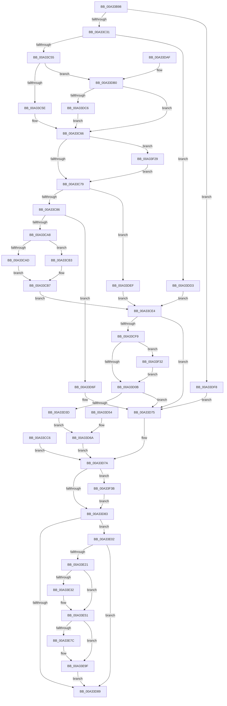

# ObCreateSymbolicLink

- RVA: `0x00A33B98`–`0x00A33F48` (길이 `944` bytes)
- VA: `0x0000000140A33B98`
- 실행 섹션: `PAGE`
- PDB 이름 있음: `예`; PDB Function 태그: `아니요`
- unwind 정보 RVA: `0x000AD550`
- 디코드: `221`개 명령, `944/944` bytes 표시
- 미해석 바이트: `0` (있으면 어셈블리에 `.byte`로 보존)

> 이 문서는 커널 이미지의 기계어와 PDB 기호를 분석해 생성했습니다. 4번과 5번은 함수 원형과 자료형을 바이너리 사용 방식에서 추정한 C 해석이며 원본 소스 복구 결과는 아닙니다.

## 1. Dependencies

- 직접 호출 지점: **9**; 고유 호출 대상: **9**
- 직접 호출자로 확인된 함수: **3**
- RIP 상대 이미지 참조: **4**

### Outgoing calls
- `0x00A33C21` → [ObCreateObjectEx](../89/ObCreateObjectEx_function_0089B1E0.md) (function, `0x0089B1E0`)
- `0x00A33C93` → [ExAllocatePool2](../../poolcode/B8/ExAllocatePool2_function_00B820F0.md) (function, `0x00B820F0`)
- `0x00A33CBF` → [memcpy](../../text/6C/memcpy_function_006C6840.md) (function, `0x006C6840`)
- `0x00A33CED` → [ObpGetIntegrityLevel](ObpGetIntegrityLevel_function_00A33F50.md) (function, `0x00A33F50`)
- `0x00A33CFE` → [RtlIsSandboxedToken](../8B/RtlIsSandboxedToken_function_008B3AB0.md) (function, `0x008B3AB0`)
- `0x00A33D29` → [ObInsertObjectEx](../8B/ObInsertObjectEx_function_008B97A0.md) (function, `0x008B97A0`)
- `0x00A33D97` → [_security_check_cookie](../../text/6A/_security_check_cookie_function_006AC640.md) (function, `0x006AC640`)
- `0x00A33F1F` → [EtwWrite](../../text/41/EtwWrite_function_0041C720.md) (function, `0x0041C720`)
- `0x00A33F3E` → [ObfDereferenceObject](../../text/2F/ObfDereferenceObject_function_002F9350.md) (function, `0x002F9350`)

### Direct callers
- [MiCreateMemoryEvent](../81/MiCreateMemoryEvent_function_00810D98.md) at `0x00810EC4`
- [IoCreateSymbolicLink2](IoCreateSymbolicLink2_function_00A337A0.md) at `0x00A3382A`
- [NtCreateSymbolicLinkObject](NtCreateSymbolicLinkObject_function_00A33870.md) at `0x00A33A06`

### Static image references
- `0x00A33BAB` → RVA `0x00E0A740` (`.data`; read)
- `0x00A33BED` → RVA `0x00F0F658` (`.data`; read)
- `0x00A33E11` → RVA `0x00EFFA38` (`.data`; read)
- `0x00A33F15` → RVA `0x0001A310` (`.rdata`; read)

## 2. Other-region calls and transfers

- 다른 실행 섹션으로 향하는 call: **5**
  - `0x00A33C93` → [ExAllocatePool2](../../poolcode/B8/ExAllocatePool2_function_00B820F0.md) (`PAGE` → `POOLCODE`)
  - `0x00A33CBF` → [memcpy](../../text/6C/memcpy_function_006C6840.md) (`PAGE` → `.text`)
  - `0x00A33D97` → [_security_check_cookie](../../text/6A/_security_check_cookie_function_006AC640.md) (`PAGE` → `.text`)
  - `0x00A33F1F` → [EtwWrite](../../text/41/EtwWrite_function_0041C720.md) (`PAGE` → `.text`)
  - `0x00A33F3E` → [ObfDereferenceObject](../../text/2F/ObfDereferenceObject_function_002F9350.md) (`PAGE` → `.text`)
- 별도 외부 분기/꼬리 이동을 확인하지 못했습니다.

## 3. Assembly (complete function range)

```asm
00A33B98  40 53                           push rbx
00A33B9A  56                              push rsi
00A33B9B  57                              push rdi
00A33B9C  41 54                           push r12
00A33B9E  41 55                           push r13
00A33BA0  41 56                           push r14
00A33BA2  41 57                           push r15
00A33BA4  48 81 EC 00 01 00 00            sub rsp, 0x100
00A33BAB  48 8B 05 8E 6B 3D 00            mov rax, qword ptr [rip + 0x3d6b8e]
00A33BB2  48 33 C4                        xor rax, rsp
00A33BB5  48 89 84 24 F0 00 00 00         mov qword ptr [rsp + 0xf0], rax
00A33BBD  49 8B F1                        mov rsi, r9
00A33BC0  49 8B C0                        mov rax, r8
00A33BC3  48 89 44 24 60                  mov qword ptr [rsp + 0x60], rax
00A33BC8  44 8B EA                        mov r13d, edx
00A33BCB  48 89 8C 24 80 00 00 00         mov qword ptr [rsp + 0x80], rcx
00A33BD3  89 54 24 50                     mov dword ptr [rsp + 0x50], edx
00A33BD7  48 89 44 24 70                  mov qword ptr [rsp + 0x70], rax
00A33BDC  4C 89 4C 24 78                  mov qword ptr [rsp + 0x78], r9
00A33BE1  33 FF                           xor edi, edi
00A33BE3  48 89 7C 24 68                  mov qword ptr [rsp + 0x68], rdi
00A33BE8  48 89 7C 24 58                  mov qword ptr [rsp + 0x58], rdi
00A33BED  48 8B 15 64 BA 4D 00            mov rdx, qword ptr [rip + 0x4dba64]
00A33BF4  48 89 7C 24 48                  mov qword ptr [rsp + 0x48], rdi
00A33BF9  48 8D 4C 24 58                  lea rcx, [rsp + 0x58]
00A33BFE  48 89 4C 24 40                  mov qword ptr [rsp + 0x40], rcx
00A33C03  89 7C 24 38                     mov dword ptr [rsp + 0x38], edi
00A33C07  89 7C 24 30                     mov dword ptr [rsp + 0x30], edi
00A33C0B  C7 44 24 28 28 00 00 00         mov dword ptr [rsp + 0x28], 0x28
00A33C13  44 8A A4 24 60 01 00 00         mov r12b, byte ptr [rsp + 0x160]
00A33C1B  45 8A CC                        mov r9b, r12b
00A33C1E  41 8A CC                        mov cl, r12b
00A33C21  E8 BA 75 E6 FF                  call 0x14089b1e0
00A33C26  44 8B F0                        mov r14d, eax
00A33C29  85 C0                           test eax, eax
00A33C2B  0F 88 C7 01 00 00               js 0x140a33df8
00A33C31  48 A1 14 00 00 00 80 F7 FF FF   movabs rax, qword ptr [0xfffff78000000014]
00A33C3B  48 8B 5C 24 58                  mov rbx, qword ptr [rsp + 0x58]
00A33C40  48 89 03                        mov qword ptr [rbx], rax
00A33C43  48 89 7B 18                     mov qword ptr [rbx + 0x18], rdi
00A33C47  8B 06                           mov eax, dword ptr [rsi]
00A33C49  44 8D 7F 02                     lea r15d, [rdi + 2]
00A33C4D  A8 01                           test al, 1
00A33C4F  0F 85 7E 01 00 00               jne 0x140a33dd3
00A33C55  45 84 E4                        test r12b, r12b
00A33C58  0F 84 52 01 00 00               je 0x140a33db0
00A33C5E  0F B7 46 0A                     movzx eax, word ptr [rsi + 0xa]
00A33C62  66 89 43 0A                     mov word ptr [rbx + 0xa], ax
00A33C66  0F B7 46 08                     movzx eax, word ptr [rsi + 8]
00A33C6A  66 89 43 08                     mov word ptr [rbx + 8], ax
00A33C6E  8B 06                           mov eax, dword ptr [rsi]
00A33C70  41 84 C7                        test r15b, al
00A33C73  0F 85 B0 02 00 00               jne 0x140a33f29
00A33C79  0F B7 43 0A                     movzx eax, word ptr [rbx + 0xa]
00A33C7D  66 85 C0                        test ax, ax
00A33C80  0F 84 69 01 00 00               je 0x140a33def
00A33C86  8B D0                           mov edx, eax
00A33C88  B9 00 01 00 00                  mov ecx, 0x100
00A33C8D  41 B8 53 79 6D 74               mov r8d, 0x746d7953
00A33C93  E8 58 E4 14 00                  call 0x140b820f0
00A33C98  48 8B C8                        mov rcx, rax
00A33C9B  48 89 43 10                     mov qword ptr [rbx + 0x10], rax
00A33C9F  48 85 C0                        test rax, rax
00A33CA2  0F 84 C7 00 00 00               je 0x140a33d6f
00A33CA8  45 84 E4                        test r12b, r12b
00A33CAB  74 06                           je 0x140a33cb3
00A33CAD  0F B7 43 0A                     movzx eax, word ptr [rbx + 0xa]
00A33CB1  EB 04                           jmp 0x140a33cb7
00A33CB3  0F B7 43 08                     movzx eax, word ptr [rbx + 8]
00A33CB7  44 0F B7 C0                     movzx r8d, ax
00A33CBB  48 8B 56 10                     mov rdx, qword ptr [rsi + 0x10]
00A33CBF  E8 7C 2B C9 FF                  call 0x1406c6840
00A33CC4  EB 1E                           jmp 0x140a33ce4
00A33CC6  44 8B F0                        mov r14d, eax
00A33CC9  33 FF                           xor edi, edi
00A33CCB  48 8B 5C 24 58                  mov rbx, qword ptr [rsp + 0x58]
00A33CD0  44 8B 6C 24 50                  mov r13d, dword ptr [rsp + 0x50]
00A33CD5  4C 8B 64 24 70                  mov r12, qword ptr [rsp + 0x70]
00A33CDA  48 8B 74 24 78                  mov rsi, qword ptr [rsp + 0x78]
00A33CDF  E9 96 00 00 00                  jmp 0x140a33d7a
00A33CE4  4C 8D 43 24                     lea r8, [rbx + 0x24]
00A33CE8  41 8A D4                        mov dl, r12b
00A33CEB  33 C9                           xor ecx, ecx
00A33CED  E8 5E 02 00 00                  call 0x140a33f50
00A33CF2  44 8B F0                        mov r14d, eax
00A33CF5  85 C0                           test eax, eax
00A33CF7  78 7C                           js 0x140a33d75
00A33CF9  41 8A D4                        mov dl, r12b
00A33CFC  33 C9                           xor ecx, ecx
00A33CFE  E8 AD FD E7 FF                  call 0x1408b3ab0
00A33D03  84 C0                           test al, al
00A33D05  0F 85 27 02 00 00               jne 0x140a33f32
00A33D0B  48 8D 44 24 68                  lea rax, [rsp + 0x68]
00A33D10  48 89 44 24 30                  mov qword ptr [rsp + 0x30], rax
00A33D15  48 89 7C 24 28                  mov qword ptr [rsp + 0x28], rdi
00A33D1A  89 7C 24 20                     mov dword ptr [rsp + 0x20], edi
00A33D1E  45 33 C9                        xor r9d, r9d
00A33D21  45 8B C5                        mov r8d, r13d
00A33D24  33 D2                           xor edx, edx
00A33D26  48 8B CB                        mov rcx, rbx
00A33D29  E8 72 5A E8 FF                  call 0x1408b97a0
00A33D2E  44 8B F0                        mov r14d, eax
00A33D31  48 8B DF                        mov rbx, rdi
00A33D34  48 89 5C 24 58                  mov qword ptr [rsp + 0x58], rbx
00A33D39  85 C0                           test eax, eax
00A33D3B  78 38                           js 0x140a33d75
00A33D3D  48 8B 44 24 68                  mov rax, qword ptr [rsp + 0x68]
00A33D42  48 8B 8C 24 80 00 00 00         mov rcx, qword ptr [rsp + 0x80]
00A33D4A  48 89 01                        mov qword ptr [rcx], rax
00A33D4D  4C 8B 64 24 60                  mov r12, qword ptr [rsp + 0x60]
00A33D52  EB 16                           jmp 0x140a33d6a
00A33D54  33 FF                           xor edi, edi
00A33D56  48 8B 5C 24 58                  mov rbx, qword ptr [rsp + 0x58]
00A33D5B  44 8B 6C 24 50                  mov r13d, dword ptr [rsp + 0x50]
00A33D60  4C 8B 64 24 70                  mov r12, qword ptr [rsp + 0x70]
00A33D65  48 8B 74 24 78                  mov rsi, qword ptr [rsp + 0x78]
00A33D6A  44 8B F7                        mov r14d, edi
00A33D6D  EB 0B                           jmp 0x140a33d7a
00A33D6F  41 BE 17 00 00 C0               mov r14d, 0xc0000017
00A33D75  4C 8B 64 24 60                  mov r12, qword ptr [rsp + 0x60]
00A33D7A  48 85 DB                        test rbx, rbx
00A33D7D  0F 85 B8 01 00 00               jne 0x140a33f3b
00A33D83  8B 06                           mov eax, dword ptr [rsi]
00A33D85  A8 05                           test al, 5
00A33D87  74 79                           je 0x140a33e02
00A33D89  41 8B C6                        mov eax, r14d
00A33D8C  48 8B 8C 24 F0 00 00 00         mov rcx, qword ptr [rsp + 0xf0]
00A33D94  48 33 CC                        xor rcx, rsp
00A33D97  E8 A4 88 C7 FF                  call 0x1406ac640
00A33D9C  48 81 C4 00 01 00 00            add rsp, 0x100
00A33DA3  41 5F                           pop r15
00A33DA5  41 5E                           pop r14
00A33DA7  41 5D                           pop r13
00A33DA9  41 5C                           pop r12
00A33DAB  5F                              pop rdi
00A33DAC  5E                              pop rsi
00A33DAD  5B                              pop rbx
00A33DAE  C3                              ret
00A33DAF  CC                              int3
00A33DB0  0F B7 4E 08                     movzx ecx, word ptr [rsi + 8]
00A33DB4  66 89 4B 0A                     mov word ptr [rbx + 0xa], cx
00A33DB8  0F B7 46 08                     movzx eax, word ptr [rsi + 8]
00A33DBC  66 39 46 0A                     cmp word ptr [rsi + 0xa], ax
00A33DC0  0F 86 A0 FE FF FF               jbe 0x140a33c66
00A33DC6  66 41 03 CF                     add cx, r15w
00A33DCA  66 89 4B 0A                     mov word ptr [rbx + 0xa], cx
00A33DCE  E9 93 FE FF FF                  jmp 0x140a33c66
00A33DD3  C7 43 1C 10 00 00 00            mov dword ptr [rbx + 0x1c], 0x10
00A33DDA  48 8B 46 08                     mov rax, qword ptr [rsi + 8]
00A33DDE  48 89 43 08                     mov qword ptr [rbx + 8], rax
00A33DE2  48 8B 46 10                     mov rax, qword ptr [rsi + 0x10]
00A33DE6  48 89 43 10                     mov qword ptr [rbx + 0x10], rax
00A33DEA  E9 F5 FE FF FF                  jmp 0x140a33ce4
00A33DEF  48 89 7B 10                     mov qword ptr [rbx + 0x10], rdi
00A33DF3  E9 EC FE FF FF                  jmp 0x140a33ce4
00A33DF8  48 8B 5C 24 58                  mov rbx, qword ptr [rsp + 0x58]
00A33DFD  E9 73 FF FF FF                  jmp 0x140a33d75
00A33E02  44 89 74 24 58                  mov dword ptr [rsp + 0x58], r14d
00A33E07  49 8B 44 24 10                  mov rax, qword ptr [r12 + 0x10]
00A33E0C  44 89 6C 24 60                  mov dword ptr [rsp + 0x60], r13d
00A33E11  4C 8B 15 20 BC 4C 00            mov r10, qword ptr [rip + 0x4cbc20]
00A33E18  4D 85 D2                        test r10, r10
00A33E1B  0F 84 68 FF FF FF               je 0x140a33d89
00A33E21  66 89 7C 24 50                  mov word ptr [rsp + 0x50], di
00A33E26  44 8B CF                        mov r9d, edi
00A33E29  48 8B 48 08                     mov rcx, qword ptr [rax + 8]
00A33E2D  48 85 C9                        test rcx, rcx
00A33E30  74 1F                           je 0x140a33e51
00A33E32  48 89 8C 24 90 00 00 00         mov qword ptr [rsp + 0x90], rcx
00A33E3A  0F B7 00                        movzx eax, word ptr [rax]
00A33E3D  89 84 24 98 00 00 00            mov dword ptr [rsp + 0x98], eax
00A33E44  89 BC 24 9C 00 00 00            mov dword ptr [rsp + 0x9c], edi
00A33E4B  41 B9 01 00 00 00               mov r9d, 1
00A33E51  41 8B C1                        mov eax, r9d
00A33E54  48 03 C0                        add rax, rax
00A33E57  48 8D 4C 24 50                  lea rcx, [rsp + 0x50]
00A33E5C  48 89 8C C4 90 00 00 00         mov qword ptr [rsp + rax*8 + 0x90], rcx
00A33E64  48 C7 84 C4 98 00 00 00 02 00 00 00  mov qword ptr [rsp + rax*8 + 0x98], 2
00A33E70  41 FF C1                        inc r9d
00A33E73  48 8B 46 10                     mov rax, qword ptr [rsi + 0x10]
00A33E77  48 85 C0                        test rax, rax
00A33E7A  74 23                           je 0x140a33e9f
00A33E7C  41 8B C9                        mov ecx, r9d
00A33E7F  48 03 C9                        add rcx, rcx
00A33E82  48 89 84 CC 90 00 00 00         mov qword ptr [rsp + rcx*8 + 0x90], rax
00A33E8A  0F B7 46 08                     movzx eax, word ptr [rsi + 8]
00A33E8E  89 84 CC 98 00 00 00            mov dword ptr [rsp + rcx*8 + 0x98], eax
00A33E95  89 BC CC 9C 00 00 00            mov dword ptr [rsp + rcx*8 + 0x9c], edi
00A33E9C  41 FF C1                        inc r9d
00A33E9F  41 8B C1                        mov eax, r9d
00A33EA2  48 03 C0                        add rax, rax
00A33EA5  48 8D 4C 24 50                  lea rcx, [rsp + 0x50]
00A33EAA  48 89 8C C4 90 00 00 00         mov qword ptr [rsp + rax*8 + 0x90], rcx
00A33EB2  48 C7 84 C4 98 00 00 00 02 00 00 00  mov qword ptr [rsp + rax*8 + 0x98], 2
00A33EBE  41 FF C1                        inc r9d
00A33EC1  41 8B C1                        mov eax, r9d
00A33EC4  48 03 C0                        add rax, rax
00A33EC7  48 8D 4C 24 60                  lea rcx, [rsp + 0x60]
00A33ECC  48 89 8C C4 90 00 00 00         mov qword ptr [rsp + rax*8 + 0x90], rcx
00A33ED4  48 C7 84 C4 98 00 00 00 04 00 00 00  mov qword ptr [rsp + rax*8 + 0x98], 4
00A33EE0  41 FF C1                        inc r9d
00A33EE3  41 8B C1                        mov eax, r9d
00A33EE6  48 03 C0                        add rax, rax
00A33EE9  48 8D 4C 24 58                  lea rcx, [rsp + 0x58]
00A33EEE  48 89 8C C4 90 00 00 00         mov qword ptr [rsp + rax*8 + 0x90], rcx
00A33EF6  48 C7 84 C4 98 00 00 00 04 00 00 00  mov qword ptr [rsp + rax*8 + 0x98], 4
00A33F02  41 FF C1                        inc r9d
00A33F05  48 8D 84 24 90 00 00 00         lea rax, [rsp + 0x90]
00A33F0D  48 89 44 24 20                  mov qword ptr [rsp + 0x20], rax
00A33F12  45 33 C0                        xor r8d, r8d
00A33F15  48 8D 15 F4 63 5E FF            lea rdx, [rip - 0xa19c0c]
00A33F1C  49 8B CA                        mov rcx, r10
00A33F1F  E8 FC 87 9E FF                  call 0x14041c720
00A33F24  E9 60 FE FF FF                  jmp 0x140a33d89
00A33F29  83 4B 1C 20                     or dword ptr [rbx + 0x1c], 0x20
00A33F2D  E9 47 FD FF FF                  jmp 0x140a33c79
00A33F32  44 09 7B 1C                     or dword ptr [rbx + 0x1c], r15d
00A33F36  E9 D0 FD FF FF                  jmp 0x140a33d0b
00A33F3B  48 8B CB                        mov rcx, rbx
00A33F3E  E8 0D 54 8C FF                  call 0x1402f9350
00A33F43  E9 3B FE FF FF                  jmp 0x140a33d83
```

## 4. C-style interpretation (structured pseudocode)

```c
__int64 __fastcall ObCreateSymbolicLink(__int64 a1, int a2, __int64 a3, __int64 a4, unsigned __int8 a5)
{
    __int64 result;
    __int64 v_rdi;
    __int64 v_rsp;
    unsigned int v_stack_m100;
    unsigned int v_stack_m108;
    unsigned int v_stack_m110;
    unsigned int v_stack_m118;
    unsigned __int64 v_stack_m48;
    unsigned __int64 v_stack_mB8;
    unsigned __int64 v_stack_mC0;
    unsigned __int64 v_stack_mC8;
    unsigned __int64 v_stack_mD0;
    unsigned __int64 v_stack_mD8;
    unsigned __int64 v_stack_mE0;
    unsigned int v_stack_mE8;
    unsigned __int64 v_stack_mF0;
    unsigned __int64 v_stack_mF8;
    unsigned __int64 v_stack_p20;
    unsigned __int16 v_stack_p50;
    unsigned __int64 v_stack_p58;
    unsigned int v_stack_p60;
    unsigned __int64 v_stack_p90;
    unsigned int v_stack_p98;
    unsigned int v_stack_p9C;

    v_rsp = (v_rsp) - (256);
    result = (*(unsigned __int64 *)(v_rip + 4025230)) ^ (v_rsp);
    v_stack_m48 = result;
    v_stack_mD8 = a3;
    v_stack_mB8 = a1;
    v_stack_mE8 = a2;
    v_stack_mC8 = a3;
    v_stack_mC0 = a4;
    v_rdi = 0;
    v_stack_mD0 = 0;
    v_stack_mE0 = 0;
    v_stack_mF0 = 0;
    v_stack_mF8 = v_stack_mE0;
    v_stack_m100 = 0;
    v_stack_m108 = 0;
    v_stack_m110 = 40;
    result = ObCreateObjectEx(a5, *(unsigned __int64 *)(v_rip + 5093988), a3, a5);
    if (sign_flag) goto loc_00A33DF8;
    *(unsigned __int64 *)(v_stack_mE0) = result;
    *(unsigned __int64 *)(v_stack_mE0 + 24) = 0;
    if ((((unsigned __int8)((unsigned int)(*(unsigned int *)(a4)))) & (1)) != 0) goto loc_00A33DD3;
    if (a5 == 0) goto loc_00A33DB0;
    *(unsigned __int16 *)(v_stack_mE0 + 10) = (unsigned __int16)(*(unsigned __int16 *)(a4 + 10));
loc_00A33C66:
    *(unsigned __int16 *)(v_stack_mE0 + 8) = (unsigned __int16)(*(unsigned __int16 *)(a4 + 8));
    if ((((unsigned __int8)(v_rdi + 2)) & ((unsigned __int8)((unsigned int)(*(unsigned int *)(a4))))) != 0) goto loc_00A33F29;
loc_00A33C79:
    if ((unsigned __int16)(*(unsigned __int16 *)(v_stack_mE0 + 10)) == 0) goto loc_00A33DEF;
    result = ExAllocatePool2(256, (unsigned int)((unsigned int)(*(unsigned __int16 *)(v_stack_mE0 + 10))), (unsigned int)(0x746D7953ULL), a5);
    *(unsigned __int64 *)(v_stack_mE0 + 16) = result;
    if (result == 0) goto loc_00A33D6F;
    if (a5 == 0) goto loc_00A33CB3;
    goto loc_00A33CB7;
loc_00A33CB3:
loc_00A33CB7:
    result = memcpy(result, *(unsigned __int64 *)(a4 + 16), (unsigned __int16)(*(unsigned __int16 *)(v_stack_mE0 + 8)), a5);
    goto loc_00A33CE4;
loc_00A33CE4:
    a1 = 0;
    result = ObpGetIntegrityLevel(a1, a5, v_stack_mE0 + 36, a5);
    if (sign_flag) goto loc_00A33D75;
    a1 = 0;
    result = RtlIsSandboxedToken(a1, a5, v_stack_mE0 + 36, a5);
    if ((unsigned __int8)(result) != 0) goto loc_00A33F32;
loc_00A33D0B:
    v_stack_m108 = v_stack_mD0;
    v_stack_m110 = 0;
    v_stack_m118 = 0;
    a4 = 0;
    a2 = 0;
    result = ObInsertObjectEx(v_stack_mE0, a2, (unsigned int)((unsigned int)((unsigned int)(a2))), a4);
    v_stack_mE0 = 0;
    if (sign_flag) goto loc_00A33D75;
    *(unsigned __int64 *)(v_stack_mB8) = v_stack_mD0;
    goto loc_00A33D6A;
loc_00A33D6A:
    goto loc_00A33D7A;
loc_00A33D6F:
loc_00A33D75:
loc_00A33D7A:
    if (0 != 0) goto loc_00A33F3B;
loc_00A33D83:
    if ((((unsigned __int8)((unsigned int)(*(unsigned int *)(a4)))) & (5)) == 0) goto loc_00A33E02;
loc_00A33D89:
    a1 = (v_stack_m48) ^ (v_rsp);
    result = _security_check_cookie(a1, a2, (unsigned int)((unsigned int)((unsigned int)(a2))), a4);
    v_rsp = (v_rsp) + (256);
    return result;
loc_00A33DB0:
    *(unsigned __int16 *)(0 + 10) = (unsigned __int16)(*(unsigned __int16 *)(a4 + 8));
    if ((*(unsigned __int16 *)(a4 + 10)) <= ((unsigned __int16)(*(unsigned __int16 *)(a4 + 8)))) goto loc_00A33C66;
    a1 = (unsigned __int16)((*(unsigned __int16 *)(a4 + 8)) + ((unsigned __int16)(v_rdi + 2)));
    *(unsigned __int16 *)(0 + 10) = (unsigned __int16)(a1);
    goto loc_00A33C66;
loc_00A33DD3:
    *(unsigned int *)(0 + 28) = 16;
    *(unsigned __int64 *)(0 + 8) = *(unsigned __int64 *)(a4 + 8);
    *(unsigned __int64 *)(0 + 16) = *(unsigned __int64 *)(a4 + 16);
    goto loc_00A33CE4;
loc_00A33DEF:
    *(unsigned __int64 *)(0 + 16) = 0;
    goto loc_00A33CE4;
loc_00A33DF8:
    goto loc_00A33D75;
loc_00A33E02:
    v_stack_p58 = (unsigned int)((unsigned int)(0xC0000017ULL));
    v_stack_p60 = (unsigned int)((unsigned int)(a2));
    if (*(unsigned __int64 *)(v_rip + 5028896) == 0) goto loc_00A33D89;
    v_stack_p50 = 0;
    result = *(unsigned __int64 *)(v_stack_mD8 + 16);
    if (*(unsigned __int64 *)(*(unsigned __int64 *)(v_stack_mD8 + 16) + 8) != 0) {
        v_stack_p90 = *(unsigned __int64 *)(*(unsigned __int64 *)(v_stack_mD8 + 16) + 8);
        result = *(unsigned __int16 *)(*(unsigned __int64 *)(v_stack_mD8 + 16));
        v_stack_p98 = (unsigned int)(result);
        v_stack_p9C = 0;
        a4 = 1;
    }
    result = ((unsigned int)((unsigned int)(a4))) + ((unsigned int)((unsigned int)(a4)));
    *(unsigned __int64 *)(v_rsp + result * 8 + 144) = v_stack_p50;
    *(unsigned __int64 *)(v_rsp + result * 8 + 152) = 2;
    a4 = (unsigned int)((a4) + 1);
    result = *(unsigned __int64 *)(a4 + 16);
    if (*(unsigned __int64 *)(a4 + 16) != 0) {
        a1 = (unsigned int)(a4);
        a1 = (a1) + (a1);
        *(unsigned __int64 *)(v_rsp + a1 * 8 + 144) = *(unsigned __int64 *)(a4 + 16);
        result = *(unsigned __int16 *)(a4 + 8);
        *(unsigned int *)(v_rsp + a1 * 8 + 152) = (unsigned int)(result);
        *(unsigned int *)(v_rsp + a1 * 8 + 156) = 0;
        a4 = (unsigned int)((a4) + 1);
    }
    result = ((unsigned int)((unsigned int)(a4))) + ((unsigned int)((unsigned int)(a4)));
    *(unsigned __int64 *)(v_rsp + result * 8 + 144) = v_stack_p50;
    *(unsigned __int64 *)(v_rsp + result * 8 + 152) = 2;
    a4 = (unsigned int)((a4) + 1);
    result = ((unsigned int)((unsigned int)(a4))) + ((unsigned int)((unsigned int)(a4)));
    *(unsigned __int64 *)(v_rsp + result * 8 + 144) = v_stack_p60;
    *(unsigned __int64 *)(v_rsp + result * 8 + 152) = 4;
    a4 = (unsigned int)((a4) + 1);
    result = ((unsigned int)((unsigned int)(a4))) + ((unsigned int)((unsigned int)(a4)));
    *(unsigned __int64 *)(v_rsp + result * 8 + 144) = v_stack_p58;
    *(unsigned __int64 *)(v_rsp + result * 8 + 152) = 4;
    a4 = (unsigned int)((a4) + 1);
    v_stack_p20 = v_stack_p90;
    a3 = 0;
    result = EtwWrite(*(unsigned __int64 *)(v_rip + 5028896), v_rip - 10591244, a3, a4);
    goto loc_00A33D89;
loc_00A33F29:
    goto loc_00A33C79;
loc_00A33F32:
    goto loc_00A33D0B;
loc_00A33F3B:
    result = ObfDereferenceObject(v_stack_p58, v_rip - 10591244, a3, a4);
    goto loc_00A33D83;
}
```

## 5. (Beta) C Style

```c
int64_t ObCreateSymbolicLink(int64_t Arg1, int32_t Arg2, int64_t Arg3, void *Arg4, uint8_t Arg5)
{
    uint8_t *arg4 = (uint8_t *)Arg4;

    int64_t result;
    int64_t local_rdi;
    int64_t local_rsp;
    uint32_t v_stack_m100;
    uint32_t v_stack_m108;
    uint32_t v_stack_m110;
    uint32_t v_stack_m118;
    uint64_t v_stack_m48;
    uint64_t v_stack_mB8;
    uint64_t v_stack_mC0;
    uint64_t v_stack_mC8;
    uint64_t v_stack_mD0;
    uint64_t v_stack_mD8;
    uint64_t v_stack_mE0;
    uint32_t v_stack_mE8;
    uint64_t v_stack_mF0;
    uint64_t v_stack_mF8;
    uint64_t v_stack_p20;
    uint16_t v_stack_p50;
    uint64_t v_stack_p58;
    uint32_t v_stack_p60;
    uint64_t v_stack_p90;
    uint32_t v_stack_p98;
    uint32_t v_stack_p9C;

    local_rsp = (local_rsp) - (256);
    result = (*(uint64_t *)(v_rip + 0x3D6B8E)) ^ (local_rsp);
    v_stack_m48 = result;
    v_stack_mD8 = Arg3;
    v_stack_mB8 = Arg1;
    v_stack_mE8 = Arg2;
    v_stack_mC8 = Arg3;
    v_stack_mC0 = Arg4;
    local_rdi = 0;
    v_stack_mD0 = 0;
    v_stack_mE0 = 0;
    v_stack_mF0 = 0;
    v_stack_mF8 = v_stack_mE0;
    v_stack_m100 = 0;
    v_stack_m108 = 0;
    v_stack_m110 = 40;
    result = ObCreateObjectEx(Arg5, *(uint64_t *)(v_rip + 0x4DBA64), Arg3, Arg5);
    if (sign_flag) goto loc_00A33DF8;
    *(uint64_t *)(v_stack_mE0) = result;
    *(uint64_t *)(v_stack_mE0 + 0x18) = 0;
    if ((((uint8_t)((uint32_t)(*(uint32_t *)(arg4)))) & (1)) != 0) goto loc_00A33DD3;
    if (Arg5 == 0) goto loc_00A33DB0;
    *(uint16_t *)(v_stack_mE0 + 0xA) = (uint16_t)(*(uint16_t *)(arg4 + 0xA));
loc_00A33C66:
    *(uint16_t *)(v_stack_mE0 + 0x8) = (uint16_t)(*(uint16_t *)(arg4 + 0x8));
    if ((((uint8_t)(local_rdi + 2)) & ((uint8_t)((uint32_t)(*(uint32_t *)(arg4))))) != 0) goto loc_00A33F29;
loc_00A33C79:
    if ((uint16_t)(*(uint16_t *)(v_stack_mE0 + 0xA)) == 0) goto loc_00A33DEF;
    result = ExAllocatePool2(256, (uint32_t)((uint32_t)(*(uint16_t *)(v_stack_mE0 + 0xA))), (uint32_t)(0x746D7953ULL), Arg5);
    *(uint64_t *)(v_stack_mE0 + 0x10) = result;
    if (result == 0) goto loc_00A33D6F;
    if (Arg5 == 0) goto loc_00A33CB3;
    goto loc_00A33CB7;
loc_00A33CB3:
loc_00A33CB7:
    result = memcpy(result, *(uint64_t *)(arg4 + 0x10), (uint16_t)(*(uint16_t *)(v_stack_mE0 + 0x8)), Arg5);
    goto loc_00A33CE4;
loc_00A33CE4:
    Arg1 = 0;
    result = ObpGetIntegrityLevel(Arg1, Arg5, v_stack_mE0 + 36, Arg5);
    if (sign_flag) goto loc_00A33D75;
    Arg1 = 0;
    result = RtlIsSandboxedToken(Arg1, Arg5, v_stack_mE0 + 36, Arg5);
    if ((uint8_t)(result) != 0) goto loc_00A33F32;
loc_00A33D0B:
    v_stack_m108 = v_stack_mD0;
    v_stack_m110 = 0;
    v_stack_m118 = 0;
    Arg4 = 0;
    Arg2 = 0;
    result = ObInsertObjectEx(v_stack_mE0, Arg2, (uint32_t)((uint32_t)((uint32_t)(Arg2))), Arg4);
    v_stack_mE0 = 0;
    if (sign_flag) goto loc_00A33D75;
    *(uint64_t *)(v_stack_mB8) = v_stack_mD0;
    goto loc_00A33D6A;
loc_00A33D6A:
    goto loc_00A33D7A;
loc_00A33D6F:
loc_00A33D75:
loc_00A33D7A:
    if (0 != 0) goto loc_00A33F3B;
loc_00A33D83:
    if ((((uint8_t)((uint32_t)(*(uint32_t *)(arg4)))) & (5)) == 0) goto loc_00A33E02;
loc_00A33D89:
    Arg1 = (v_stack_m48) ^ (local_rsp);
    result = _security_check_cookie(Arg1, Arg2, (uint32_t)((uint32_t)((uint32_t)(Arg2))), Arg4);
    local_rsp = (local_rsp) + (256);
    return result;
loc_00A33DB0:
    *(uint16_t *)(0 + 0xA) = (uint16_t)(*(uint16_t *)(arg4 + 0x8));
    if ((*(uint16_t *)(arg4 + 0xA)) <= ((uint16_t)(*(uint16_t *)(arg4 + 0x8)))) goto loc_00A33C66;
    Arg1 = (uint16_t)((*(uint16_t *)(arg4 + 0x8)) + ((uint16_t)(local_rdi + 2)));
    *(uint16_t *)(0 + 0xA) = (uint16_t)(Arg1);
    goto loc_00A33C66;
loc_00A33DD3:
    *(uint32_t *)(0 + 0x1C) = 16;
    *(uint64_t *)(0 + 0x8) = *(uint64_t *)(arg4 + 0x8);
    *(uint64_t *)(0 + 0x10) = *(uint64_t *)(arg4 + 0x10);
    goto loc_00A33CE4;
loc_00A33DEF:
    *(uint64_t *)(0 + 0x10) = 0;
    goto loc_00A33CE4;
loc_00A33DF8:
    goto loc_00A33D75;
loc_00A33E02:
    v_stack_p58 = (uint32_t)((uint32_t)(0xC0000017ULL));
    v_stack_p60 = (uint32_t)((uint32_t)(Arg2));
    if (*(uint64_t *)(v_rip + 0x4CBC20) == 0) goto loc_00A33D89;
    v_stack_p50 = 0;
    result = *(uint64_t *)(v_stack_mD8 + 0x10);
    if (*(uint64_t *)(*(uint64_t *)(v_stack_mD8 + 0x10) + 0x8) != 0) {
        v_stack_p90 = *(uint64_t *)(*(uint64_t *)(v_stack_mD8 + 0x10) + 0x8);
        result = *(uint16_t *)(*(uint64_t *)(v_stack_mD8 + 0x10));
        v_stack_p98 = (uint32_t)(result);
        v_stack_p9C = 0;
        Arg4 = 1;
    }
    result = ((uint32_t)((uint32_t)(Arg4))) + ((uint32_t)((uint32_t)(Arg4)));
    *(uint64_t *)(local_rsp + result * 8 + 0x90) = v_stack_p50;
    *(uint64_t *)(local_rsp + result * 8 + 0x98) = 2;
    Arg4 = (uint32_t)((Arg4) + 1);
    result = *(uint64_t *)(arg4 + 0x10);
    if (*(uint64_t *)(arg4 + 0x10) != 0) {
        Arg1 = (uint32_t)(Arg4);
        Arg1 = (Arg1) + (Arg1);
        *(uint64_t *)(local_rsp + Arg1 * 8 + 0x90) = *(uint64_t *)(arg4 + 0x10);
        result = *(uint16_t *)(arg4 + 0x8);
        *(uint32_t *)(local_rsp + Arg1 * 8 + 0x98) = (uint32_t)(result);
        *(uint32_t *)(local_rsp + Arg1 * 8 + 0x9C) = 0;
        Arg4 = (uint32_t)((Arg4) + 1);
    }
    result = ((uint32_t)((uint32_t)(Arg4))) + ((uint32_t)((uint32_t)(Arg4)));
    *(uint64_t *)(local_rsp + result * 8 + 0x90) = v_stack_p50;
    *(uint64_t *)(local_rsp + result * 8 + 0x98) = 2;
    Arg4 = (uint32_t)((Arg4) + 1);
    result = ((uint32_t)((uint32_t)(Arg4))) + ((uint32_t)((uint32_t)(Arg4)));
    *(uint64_t *)(local_rsp + result * 8 + 0x90) = v_stack_p60;
    *(uint64_t *)(local_rsp + result * 8 + 0x98) = 4;
    Arg4 = (uint32_t)((Arg4) + 1);
    result = ((uint32_t)((uint32_t)(Arg4))) + ((uint32_t)((uint32_t)(Arg4)));
    *(uint64_t *)(local_rsp + result * 8 + 0x90) = v_stack_p58;
    *(uint64_t *)(local_rsp + result * 8 + 0x98) = 4;
    Arg4 = (uint32_t)((Arg4) + 1);
    v_stack_p20 = v_stack_p90;
    Arg3 = 0;
    result = EtwWrite(*(uint64_t *)(v_rip + 0x4CBC20), v_rip - 10591244, Arg3, Arg4);
    goto loc_00A33D89;
loc_00A33F29:
    goto loc_00A33C79;
loc_00A33F32:
    goto loc_00A33D0B;
loc_00A33F3B:
    result = ObfDereferenceObject(v_stack_p58, v_rip - 10591244, Arg3, Arg4);
    goto loc_00A33D83;
}
```

### 관측된 메모리 오프셋

구조체 형식이 확인되지 않은 접근은 인자 기준의 오프셋으로만 기록했습니다.

| 기준 인자 | 오프셋 표현 | 폭 (bit) | 접근 |
|---|---:|---:|---|
| `Arg4` | `+ 0x0` | `32` | `R` |
| `Arg4` | `+ 0x8` | `16` | `R` |
| `Arg4` | `+ 0x8` | `64` | `R` |
| `Arg4` | `+ 0xA` | `16` | `R` |
| `Arg4` | `+ 0x10` | `64` | `R` |

## 6. Execution-region graph

[열기: 2D/3D 그래프와 함수 탐색 컨트롤 패널](../../../control-panel.html?section=page&rva=0x00A33B98&view=graph)

- 2D 그래프는 위에서 아래로 흐르고, 3D 그래프는 빈 공간을 드래그해 회전합니다. Shift+드래그는 이동, 휠은 확대·축소, 함수 노드 선택은 대상 보고서 이동입니다.

### Static fallback


