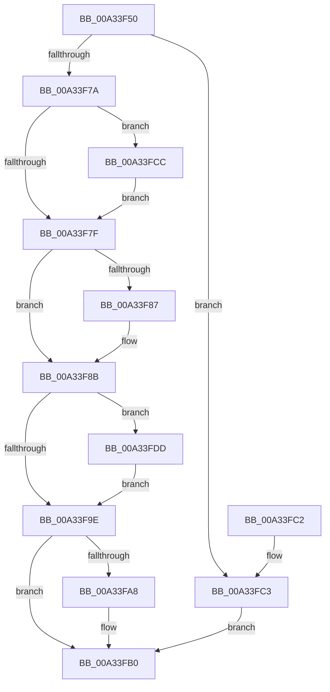

# ObpGetIntegrityLevel

- RVA: `0x00A33F50`–`0x00A33FE2` (길이 `146` bytes)
- VA: `0x0000000140A33F50`
- 실행 섹션: `PAGE`
- PDB 이름 있음: `예`; PDB Function 태그: `아니요`
- unwind 정보 RVA: `0x000AD598`
- 디코드: `46`개 명령, `146/146` bytes 표시
- 미해석 바이트: `0` (있으면 어셈블리에 `.byte`로 보존)

> 이 문서는 커널 이미지의 기계어와 PDB 기호를 분석해 생성했습니다. 4번과 5번은 함수 원형과 자료형을 바이너리 사용 방식에서 추정한 C 해석이며 원본 소스 복구 결과는 아닙니다.

## 1. Dependencies

- 직접 호출 지점: **3**; 고유 호출 대상: **3**
- 직접 호출자로 확인된 함수: **1**
- RIP 상대 이미지 참조: **0**

### Outgoing calls
- `0x00A33F93` → [SeQueryInformationToken](../8B/SeQueryInformationToken_function_008B5090.md) (function, `0x008B5090`)
- `0x00A33FAB` → [SeReleaseSubjectContext](../86/SeReleaseSubjectContext_function_0086B710.md) (function, `0x0086B710`)
- `0x00A33FD6` → [SeCaptureSubjectContext](../86/SeCaptureSubjectContext_function_0086B820.md) (function, `0x0086B820`)

### Direct callers
- [ObCreateSymbolicLink](ObCreateSymbolicLink_function_00A33B98.md) at `0x00A33CED`

### Static image references
- 디코드된 RIP-relative 메모리 참조가 없습니다.

## 2. Other-region calls and transfers

- 다른 실행 섹션으로 향하는 call: **0**
- 별도 외부 분기/꼬리 이동을 확인하지 못했습니다.

## 3. Assembly (complete function range)

```asm
00A33F50  48 8B C4                        mov rax, rsp
00A33F53  48 89 58 08                     mov qword ptr [rax + 8], rbx
00A33F57  48 89 70 10                     mov qword ptr [rax + 0x10], rsi
00A33F5B  57                              push rdi
00A33F5C  48 83 EC 40                     sub rsp, 0x40
00A33F60  33 F6                           xor esi, esi
00A33F62  0F 57 C0                        xorps xmm0, xmm0
00A33F65  41 21 30                        and dword ptr [r8], esi
00A33F68  49 8B F8                        mov rdi, r8
00A33F6B  48 8B D9                        mov rbx, rcx
00A33F6E  0F 11 40 D8                     movups xmmword ptr [rax - 0x28], xmm0
00A33F72  0F 11 40 E8                     movups xmmword ptr [rax - 0x18], xmm0
00A33F76  84 D2                           test dl, dl
00A33F78  74 49                           je 0x140a33fc3
00A33F7A  48 85 C9                        test rcx, rcx
00A33F7D  74 4D                           je 0x140a33fcc
00A33F7F  48 8B 0B                        mov rcx, qword ptr [rbx]
00A33F82  48 85 C9                        test rcx, rcx
00A33F85  75 04                           jne 0x140a33f8b
00A33F87  48 8B 4B 10                     mov rcx, qword ptr [rbx + 0x10]
00A33F8B  4C 8B C7                        mov r8, rdi
00A33F8E  BA 19 00 00 00                  mov edx, 0x19
00A33F93  E8 F8 10 E8 FF                  call 0x1408b5090
00A33F98  8B F0                           mov esi, eax
00A33F9A  85 C0                           test eax, eax
00A33F9C  78 3F                           js 0x140a33fdd
00A33F9E  48 8D 44 24 20                  lea rax, [rsp + 0x20]
00A33FA3  48 3B D8                        cmp rbx, rax
00A33FA6  75 08                           jne 0x140a33fb0
00A33FA8  48 8B CB                        mov rcx, rbx
00A33FAB  E8 60 77 E3 FF                  call 0x14086b710
00A33FB0  48 8B 5C 24 50                  mov rbx, qword ptr [rsp + 0x50]
00A33FB5  8B C6                           mov eax, esi
00A33FB7  48 8B 74 24 58                  mov rsi, qword ptr [rsp + 0x58]
00A33FBC  48 83 C4 40                     add rsp, 0x40
00A33FC0  5F                              pop rdi
00A33FC1  C3                              ret
00A33FC2  CC                              int3
00A33FC3  41 C7 00 00 50 00 00            mov dword ptr [r8], 0x5000
00A33FCA  EB E4                           jmp 0x140a33fb0
00A33FCC  48 8D 4C 24 20                  lea rcx, [rsp + 0x20]
00A33FD1  48 8D 5C 24 20                  lea rbx, [rsp + 0x20]
00A33FD6  E8 45 78 E3 FF                  call 0x14086b820
00A33FDB  EB A2                           jmp 0x140a33f7f
00A33FDD  83 27 00                        and dword ptr [rdi], 0
00A33FE0  EB BC                           jmp 0x140a33f9e
```

## 4. C-style interpretation (structured pseudocode)

```c
__int64 __fastcall ObpGetIntegrityLevel(__int64 a1, unsigned __int8 a2, __int64 a3)
{
    __int64 result;
    __int64 v_rsi;
    __int64 v_rsp;
    unsigned __int64 v_stack_m28;
    unsigned __int64 v_stack_p10;
    unsigned __int64 v_stack_p20;
    unsigned __int64 v_stack_p8;

    *(unsigned __int64 *)(v_rsp + 8) = v_rbx;
    *(unsigned __int64 *)(v_rsp + 16) = v_rsi;
    v_rsp = (v_rsp) - (64);
    v_rsi = 0;
    *(unsigned __int64 *)(v_rsp - 40) = v_xmm0;
    *(unsigned __int64 *)(v_rsp - 24) = v_xmm0;
    if (a2 == 0) goto loc_00A33FC3;
    if (a1 == 0) goto loc_00A33FCC;
loc_00A33F7F:
    if (*(unsigned __int64 *)(a1) == 0) {
        a1 = *(unsigned __int64 *)(a1 + 16);
    }
    result = SeQueryInformationToken(a1, 25, a3, a4);
    if (sign_flag) goto loc_00A33FDD;
loc_00A33F9E:
    result = v_stack_m28;
    if (a1 == v_stack_m28) {
        a1 = a1;
        result = SeReleaseSubjectContext(a1, 25, a3, a4);
    }
    v_rsp = (v_rsp) + (64);
    return (unsigned int)((unsigned int)((unsigned int)((unsigned int)(result))));
loc_00A33FC3:
    *(unsigned int *)(a3) = 0x5000ULL;
    goto loc_00A33FB0;
loc_00A33FCC:
    result = SeCaptureSubjectContext(v_stack_p20, 25, a3, a4);
    goto loc_00A33F7F;
loc_00A33FDD:
    goto loc_00A33F9E;
}
```

## 5. (Beta) C Style

```c
int64_t ObpGetIntegrityLevel(int64_t Arg1, uint8_t Arg2, void *Arg3)
{
    uint8_t *arg3 = (uint8_t *)Arg3;

    int64_t result;
    int64_t local_rsi;
    int64_t local_rsp;
    uint64_t v_stack_m28;
    uint64_t v_stack_p10;
    uint64_t v_stack_p20;
    uint64_t v_stack_p8;

    *(uint64_t *)(local_rsp + 0x8) = local_rbx;
    *(uint64_t *)(local_rsp + 0x10) = local_rsi;
    local_rsp = (local_rsp) - (64);
    local_rsi = 0;
    *(uint64_t *)(local_rsp - 0x28) = v_xmm0;
    *(uint64_t *)(local_rsp - 0x18) = v_xmm0;
    if (Arg2 == 0) goto loc_00A33FC3;
    if (Arg1 == 0) goto loc_00A33FCC;
loc_00A33F7F:
    if (*(uint64_t *)(Arg1) == 0) {
        Arg1 = *(uint64_t *)(Arg1 + 0x10);
    }
    result = SeQueryInformationToken(Arg1, 25, Arg3, a4);
    if (sign_flag) goto loc_00A33FDD;
loc_00A33F9E:
    result = v_stack_m28;
    if (Arg1 == v_stack_m28) {
        Arg1 = Arg1;
        result = SeReleaseSubjectContext(Arg1, 25, Arg3, a4);
    }
    local_rsp = (local_rsp) + (64);
    return (uint32_t)((uint32_t)((uint32_t)((uint32_t)(result))));
loc_00A33FC3:
    *(uint32_t *)(arg3) = 0x5000ULL;
    goto loc_00A33FB0;
loc_00A33FCC:
    result = SeCaptureSubjectContext(v_stack_p20, 25, Arg3, a4);
    goto loc_00A33F7F;
loc_00A33FDD:
    goto loc_00A33F9E;
}
```

### 관측된 메모리 오프셋

구조체 형식이 확인되지 않은 접근은 인자 기준의 오프셋으로만 기록했습니다.

| 기준 인자 | 오프셋 표현 | 폭 (bit) | 접근 |
|---|---:|---:|---|
| `Arg3` | `+ 0x0` | `32` | `R/W` |
| `Arg3` | `+ 0x0` | `32` | `W` |

## 6. Execution-region graph

[열기: 2D/3D 그래프와 함수 탐색 컨트롤 패널](../../../control-panel.html?section=page&rva=0x00A33F50&view=graph)

- 2D 그래프는 위에서 아래로 흐르고, 3D 그래프는 빈 공간을 드래그해 회전합니다. Shift+드래그는 이동, 휠은 확대·축소, 함수 노드 선택은 대상 보고서 이동입니다.

### Static fallback


