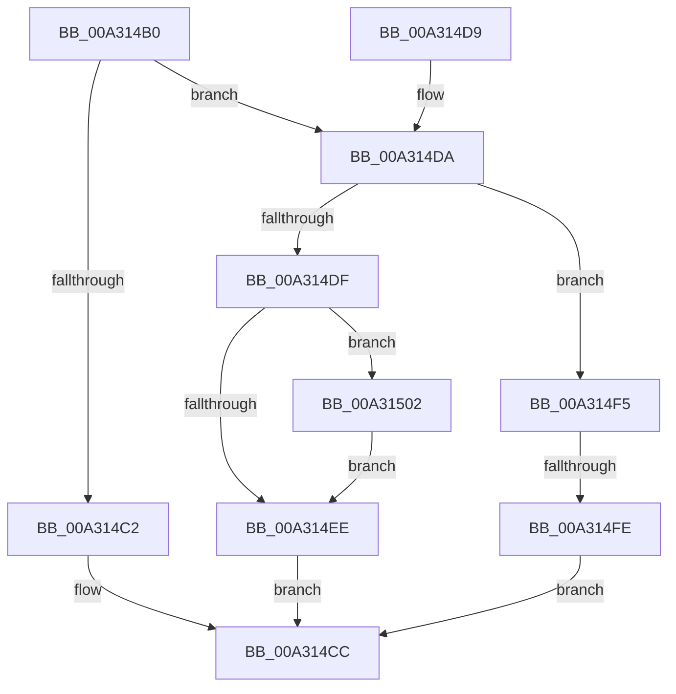

# PdcPoResiliencyClient

- RVA: `0x00A314B0`–`0x00A31510` (길이 `96` bytes)
- VA: `0x0000000140A314B0`
- 실행 섹션: `PAGE`
- PDB 이름 있음: `예`; PDB Function 태그: `예`
- unwind 정보 RVA: `0x00076828`
- 디코드: `30`개 명령, `96/96` bytes 표시
- 미해석 바이트: `0` (있으면 어셈블리에 `.byte`로 보존)

> 이 문서는 커널 이미지의 기계어와 PDB 기호를 분석해 생성했습니다. 4번과 5번은 함수 원형과 자료형을 바이너리 사용 방식에서 추정한 C 해석이며 원본 소스 복구 결과는 아닙니다.

## 1. Dependencies

- 직접 호출 지점: **4**; 고유 호출 대상: **4**
- 직접 호출자로 확인된 함수: **0**
- RIP 상대 이미지 참조: **2**

### Outgoing calls
- `0x00A314C5` → [PopPdcIdleResiliencyCallback](PopPdcIdleResiliencyCallback_function_00A31518.md) (function, `0x00A31518`)
- `0x00A314DF` → [PopAcquirePolicyLock](../../pagelk/B7/PopAcquirePolicyLock_function_00B783C0.md) (function, `0x00B783C0`)
- `0x00A314EE` → [PopReleasePolicyLock](../../pagelk/B7/PopReleasePolicyLock_function_00B78410.md) (function, `0x00B78410`)
- `0x00A31509` → [PopCheckResiliencyScenarios](PopCheckResiliencyScenarios_function_00A31718.md) (function, `0x00A31718`)

### Direct callers
- 이 함수 시작 RVA로 연결되는 직접 call은 확인되지 않았습니다. 간접 호출은 완전히 역산할 수 없습니다.

### Static image references
- `0x00A314E6` → RVA `0x00FC5284` (`ALMOSTRO`; read)
- `0x00A31502` → RVA `0x00F0C8D8` (`.data`; write)

## 2. Other-region calls and transfers

- 다른 실행 섹션으로 향하는 call: **2**
  - `0x00A314DF` → [PopAcquirePolicyLock](../../pagelk/B7/PopAcquirePolicyLock_function_00B783C0.md) (`PAGE` → `PAGELK`)
  - `0x00A314EE` → [PopReleasePolicyLock](../../pagelk/B7/PopReleasePolicyLock_function_00B78410.md) (`PAGE` → `PAGELK`)
- call이 아닌 외부 분기/꼬리 이동: **1**
  - `0x00A314F8` → [sub_00B39B66](../B3/Unknown_function_00B39B66.md) (`tail-transfer`)

## 3. Assembly (complete function range)

```asm
00A314B0  48 89 5C 24 08                  mov qword ptr [rsp + 8], rbx
00A314B5  57                              push rdi
00A314B6  48 83 EC 20                     sub rsp, 0x20
00A314BA  40 8A FA                        mov dil, dl
00A314BD  83 E9 01                        sub ecx, 1
00A314C0  75 18                           jne 0x140a314da
00A314C2  41 8B C8                        mov ecx, r8d
00A314C5  E8 4E 00 00 00                  call 0x140a31518
00A314CA  8B D8                           mov ebx, eax
00A314CC  8B C3                           mov eax, ebx
00A314CE  48 8B 5C 24 30                  mov rbx, qword ptr [rsp + 0x30]
00A314D3  48 83 C4 20                     add rsp, 0x20
00A314D7  5F                              pop rdi
00A314D8  C3                              ret
00A314D9  CC                              int3
00A314DA  83 E9 01                        sub ecx, 1
00A314DD  75 16                           jne 0x140a314f5
00A314DF  E8 DC 6E 14 00                  call 0x140b783c0
00A314E4  33 DB                           xor ebx, ebx
00A314E6  39 1D 98 3D 59 00               cmp dword ptr [rip + 0x593d98], ebx
00A314EC  74 14                           je 0x140a31502
00A314EE  E8 1D 6F 14 00                  call 0x140b78410
00A314F3  EB D7                           jmp 0x140a314cc
00A314F5  83 F9 01                        cmp ecx, 1
00A314F8  0F 84 68 86 10 00               je 0x140b39b66
00A314FE  33 DB                           xor ebx, ebx
00A31500  EB CA                           jmp 0x140a314cc
00A31502  40 88 3D CF B3 4D 00            mov byte ptr [rip + 0x4db3cf], dil
00A31509  E8 0A 02 00 00                  call 0x140a31718
00A3150E  EB DE                           jmp 0x140a314ee
```

## 4. C-style interpretation (structured pseudocode)

```c
__int64 __fastcall PdcPoResiliencyClient(int a1, unsigned __int8 a2, int a3)
{
    __int64 result;
    __int64 v_rbx;
    __int64 v_rsp;
    unsigned __int64 v_stack_p8;

    v_stack_p8 = v_rbx;
    v_rsp = (v_rsp) - (32);
    a1 = (unsigned int)((a1) - (1));
    if (condition_is_not_equal) goto loc_00A314DA;
    result = PopPdcIdleResiliencyCallback((unsigned int)(a3), a2, a3, a4);
loc_00A314CC:
    v_rsp = (v_rsp) + (32);
    return (unsigned int)((unsigned int)((unsigned int)((unsigned int)(result))));
loc_00A314DA:
    a1 = (unsigned int)(((unsigned int)(a3)) - (1));
    if (condition_is_not_equal) goto loc_00A314F5;
    result = PopAcquirePolicyLock(a1, a2, a3, a4);
    v_rbx = 0;
    if ((*(unsigned int *)(v_rip + 5848472)) == 0) goto loc_00A31502;
loc_00A314EE:
    result = PopReleasePolicyLock(a1, a2, a3, a4);
    goto loc_00A314CC;
loc_00A314F5:
    v_rbx = 0;
    goto loc_00A314CC;
loc_00A31502:
    *(unsigned __int8 *)(v_rip + 5092303) = a2;
    result = PopCheckResiliencyScenarios(a1, a2, a3, a4);
    goto loc_00A314EE;
}
```

## 5. (Beta) C Style

```c
int64_t PdcPoResiliencyClient(int32_t Arg1, uint8_t Arg2, int32_t Arg3)
{
    int64_t result;
    int64_t local_rbx;
    int64_t local_rsp;
    uint64_t v_stack_p8;

    v_stack_p8 = local_rbx;
    local_rsp = (local_rsp) - (32);
    Arg1 = (uint32_t)((Arg1) - (1));
    if (condition_is_not_equal) goto loc_00A314DA;
    result = PopPdcIdleResiliencyCallback((uint32_t)(Arg3), Arg2, Arg3, a4);
loc_00A314CC:
    local_rsp = (local_rsp) + (32);
    return (uint32_t)((uint32_t)((uint32_t)((uint32_t)(result))));
loc_00A314DA:
    Arg1 = (uint32_t)(((uint32_t)(Arg3)) - (1));
    if (condition_is_not_equal) goto loc_00A314F5;
    result = PopAcquirePolicyLock(Arg1, Arg2, Arg3, a4);
    local_rbx = 0;
    if ((*(uint32_t *)(v_rip + 0x593D98)) == 0) goto loc_00A31502;
loc_00A314EE:
    result = PopReleasePolicyLock(Arg1, Arg2, Arg3, a4);
    goto loc_00A314CC;
loc_00A314F5:
    local_rbx = 0;
    goto loc_00A314CC;
loc_00A31502:
    *(uint8_t *)(v_rip + 0x4DB3CF) = Arg2;
    result = PopCheckResiliencyScenarios(Arg1, Arg2, Arg3, a4);
    goto loc_00A314EE;
}
```

## 6. Execution-region graph

[열기: 2D/3D 그래프와 함수 탐색 컨트롤 패널](../../../control-panel.html?section=page&rva=0x00A314B0&view=graph)

- 2D 그래프는 위에서 아래로 흐르고, 3D 그래프는 빈 공간을 드래그해 회전합니다. Shift+드래그는 이동, 휠은 확대·축소, 함수 노드 선택은 대상 보고서 이동입니다.

### Static fallback


