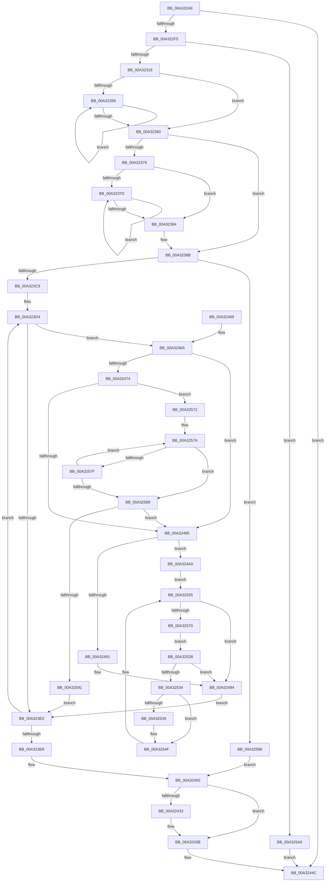

# PfpRpCHashDeleteEntries

- RVA: `0x00A322A8`–`0x00A325AA` (길이 `770` bytes)
- VA: `0x0000000140A322A8`
- 실행 섹션: `PAGE`
- PDB 이름 있음: `예`; PDB Function 태그: `아니요`
- unwind 정보 RVA: `0x000AD320`
- 디코드: `208`개 명령, `770/770` bytes 표시
- 미해석 바이트: `0` (있으면 어셈블리에 `.byte`로 보존)

> 이 문서는 커널 이미지의 기계어와 PDB 기호를 분석해 생성했습니다. 4번과 5번은 함수 원형과 자료형을 바이너리 사용 방식에서 추정한 C 해석이며 원본 소스 복구 결과는 아닙니다.

## 1. Dependencies

- 직접 호출 지점: **10**; 고유 호출 대상: **10**
- 직접 호출자로 확인된 함수: **1**
- RIP 상대 이미지 참조: **0**

### Outgoing calls
- `0x00A322DC` → [FsRtlAcquirePushLockExclusive](../../text/4A/FsRtlAcquirePushLockExclusive_function_004A05F4.md) (function, `0x004A05F4`)
- `0x00A32302` → [ExAllocatePool2](../../poolcode/B8/ExAllocatePool2_function_00B820F0.md) (function, `0x00B820F0`)
- `0x00A3231B` → [FsRtlAcquirePushLockShared](../../text/48/FsRtlAcquirePushLockShared_function_0048B034.md) (function, `0x0048B034`)
- `0x00A323A0` → [memset](../../text/6C/memset_function_006C6C40.md) (function, `0x006C6C40`)
- `0x00A32411` → [PfLockSharedRelease](../../text/48/PfLockSharedRelease_function_0048DF24.md) (function, `0x0048DF24`)
- `0x00A32436` → [ExfAcquireReleasePushLockExclusive](../../text/41/ExfAcquireReleasePushLockExclusive_function_00419C2C.md) (function, `0x00419C2C`)
- `0x00A3243B` → [KeLeaveCriticalRegion](../../text/25/KeLeaveCriticalRegion_function_0025D8B0.md) (function, `0x0025D8B0`)
- `0x00A32447` → [ExFreePoolWithTag](../../poolcode/B8/ExFreePoolWithTag_function_00B82870.md) (function, `0x00B82870`)
- `0x00A32451` → [PfLockExclusiveRelease](../../text/49/PfLockExclusiveRelease_function_00491D88.md) (function, `0x00491D88`)
- `0x00A3249D` → [memcpy](../../text/6C/memcpy_function_006C6840.md) (function, `0x006C6840`)

### Direct callers
- [PfpRpControlRequestUpdate](../A7/PfpRpControlRequestUpdate_function_00A7D2A8.md) at `0x00A7D400`
- [PfpRpControlRequestUpdate](../A7/PfpRpControlRequestUpdate_function_00A7D2A8.md) at `0x00A7D424`

### Static image references
- 디코드된 RIP-relative 메모리 참조가 없습니다.

## 2. Other-region calls and transfers

- 다른 실행 섹션으로 향하는 call: **10**
  - `0x00A322DC` → [FsRtlAcquirePushLockExclusive](../../text/4A/FsRtlAcquirePushLockExclusive_function_004A05F4.md) (`PAGE` → `.text`)
  - `0x00A32302` → [ExAllocatePool2](../../poolcode/B8/ExAllocatePool2_function_00B820F0.md) (`PAGE` → `POOLCODE`)
  - `0x00A3231B` → [FsRtlAcquirePushLockShared](../../text/48/FsRtlAcquirePushLockShared_function_0048B034.md) (`PAGE` → `.text`)
  - `0x00A323A0` → [memset](../../text/6C/memset_function_006C6C40.md) (`PAGE` → `.text`)
  - `0x00A32411` → [PfLockSharedRelease](../../text/48/PfLockSharedRelease_function_0048DF24.md) (`PAGE` → `.text`)
  - `0x00A32436` → [ExfAcquireReleasePushLockExclusive](../../text/41/ExfAcquireReleasePushLockExclusive_function_00419C2C.md) (`PAGE` → `.text`)
  - `0x00A3243B` → [KeLeaveCriticalRegion](../../text/25/KeLeaveCriticalRegion_function_0025D8B0.md) (`PAGE` → `.text`)
  - `0x00A32447` → [ExFreePoolWithTag](../../poolcode/B8/ExFreePoolWithTag_function_00B82870.md) (`PAGE` → `POOLCODE`)
  - `0x00A32451` → [PfLockExclusiveRelease](../../text/49/PfLockExclusiveRelease_function_00491D88.md) (`PAGE` → `.text`)
  - `0x00A3249D` → [memcpy](../../text/6C/memcpy_function_006C6840.md) (`PAGE` → `.text`)
- 별도 외부 분기/꼬리 이동을 확인하지 못했습니다.

## 3. Assembly (complete function range)

```asm
00A322A8  44 89 4C 24 20                  mov dword ptr [rsp + 0x20], r9d
00A322AD  4C 89 44 24 18                  mov qword ptr [rsp + 0x18], r8
00A322B2  48 89 54 24 10                  mov qword ptr [rsp + 0x10], rdx
00A322B7  53                              push rbx
00A322B8  55                              push rbp
00A322B9  56                              push rsi
00A322BA  57                              push rdi
00A322BB  41 54                           push r12
00A322BD  41 55                           push r13
00A322BF  41 56                           push r14
00A322C1  41 57                           push r15
00A322C3  48 83 EC 68                     sub rsp, 0x68
00A322C7  48 8D 81 80 00 00 00            lea rax, [rcx + 0x80]
00A322CE  4D 8B E8                        mov r13, r8
00A322D1  48 8B C8                        mov rcx, rax
00A322D4  48 89 44 24 38                  mov qword ptr [rsp + 0x38], rax
00A322D9  4C 8B FA                        mov r15, rdx
00A322DC  E8 13 E3 A6 FF                  call 0x1404a05f4
00A322E1  41 8B 7F 0C                     mov edi, dword ptr [r15 + 0xc]
00A322E5  33 DB                           xor ebx, ebx
00A322E7  41 8B 4F 08                     mov ecx, dword ptr [r15 + 8]
00A322EB  D3 E7                           shl edi, cl
00A322ED  85 FF                           test edi, edi
00A322EF  0F 84 57 01 00 00               je 0x140a3244c
00A322F5  8B D7                           mov edx, edi
00A322F7  B9 00 01 00 00                  mov ecx, 0x100
00A322FC  41 B8 50 66 43 48               mov r8d, 0x48436650
00A32302  E8 E9 FD 14 00                  call 0x140b820f0
00A32307  48 89 44 24 28                  mov qword ptr [rsp + 0x28], rax
00A3230C  48 8B E8                        mov rbp, rax
00A3230F  48 85 C0                        test rax, rax
00A32312  0F 84 88 02 00 00               je 0x140a325a0
00A32318  49 8B CD                        mov rcx, r13
00A3231B  E8 14 8D A5 FF                  call 0x14048b034
00A32320  41 0F 10 0F                     movups xmm1, xmmword ptr [r15]
00A32324  44 8D 43 01                     lea r8d, [rbx + 1]
00A32328  83 CA FF                        or edx, 0xffffffff
00A3232B  F2 41 0F 10 47 10               movsd xmm0, qword ptr [r15 + 0x10]
00A32331  41 8B F0                        mov esi, r8d
00A32334  0F 11 4C 24 40                  movups xmmword ptr [rsp + 0x40], xmm1
00A32339  F3 41 0F 7E 4F 08               movq xmm1, qword ptr [r15 + 8]
00A3233F  66 0F 7E C9                     movd ecx, xmm1
00A32343  F2 0F 11 44 24 50               movsd qword ptr [rsp + 0x50], xmm0
00A32349  66 0F 7E 4C 24 20               movd dword ptr [rsp + 0x20], xmm1
00A3234F  D3 E6                           shl esi, cl
00A32351  8B CA                           mov ecx, edx
00A32353  8B C6                           mov eax, esi
00A32355  85 F6                           test esi, esi
00A32357  74 07                           je 0x140a32360
00A32359  41 03 C8                        add ecx, r8d
00A3235C  D1 E8                           shr eax, 1
00A3235E  75 F9                           jne 0x140a32359
00A32360  8D 46 FF                        lea eax, [rsi - 1]
00A32363  85 C6                           test esi, eax
00A32365  44 8D 61 01                     lea r12d, [rcx + 1]
00A32369  44 0F 44 E1                     cmove r12d, ecx
00A3236D  41 8B CC                        mov ecx, r12d
00A32370  D3 EF                           shr edi, cl
00A32372  8D 47 FF                        lea eax, [rdi - 1]
00A32375  85 C7                           test edi, eax
00A32377  74 12                           je 0x140a3238b
00A32379  85 FF                           test edi, edi
00A3237B  74 07                           je 0x140a32384
00A3237D  41 03 D0                        add edx, r8d
00A32380  D1 EF                           shr edi, 1
00A32382  75 F9                           jne 0x140a3237d
00A32384  8B CA                           mov ecx, edx
00A32386  41 8B F8                        mov edi, r8d
00A32389  D3 E7                           shl edi, cl
00A3238B  41 8B CC                        mov ecx, r12d
00A3238E  44 8B C7                        mov r8d, edi
00A32391  49 D3 E0                        shl r8, cl
00A32394  33 D2                           xor edx, edx
00A32396  48 8B CD                        mov rcx, rbp
00A32399  89 9C 24 B0 00 00 00            mov dword ptr [rsp + 0xb0], ebx
00A323A0  E8 9B 48 C9 FF                  call 0x1406c6c40
00A323A5  48 8B 44 24 40                  mov rax, qword ptr [rsp + 0x40]
00A323AA  8B 6C 24 4C                     mov ebp, dword ptr [rsp + 0x4c]
00A323AE  4C 8B F0                        mov r14, rax
00A323B1  8B 4C 24 20                     mov ecx, dword ptr [rsp + 0x20]
00A323B5  48 D3 E5                        shl rbp, cl
00A323B8  48 03 E8                        add rbp, rax
00A323BB  48 89 44 24 30                  mov qword ptr [rsp + 0x30], rax
00A323C0  48 3B C5                        cmp rax, rbp
00A323C3  0F 83 CD 01 00 00               jae 0x140a32596
00A323C9  44 8B FE                        mov r15d, esi
00A323CC  44 8B EB                        mov r13d, ebx
00A323CF  48 8B 74 24 28                  mov rsi, qword ptr [rsp + 0x28]
00A323D4  4D 8B 06                        mov r8, qword ptr [r14]
00A323D7  4D 85 C0                        test r8, r8
00A323DA  0F 85 8A 00 00 00               jne 0x140a3246a
00A323E0  4D 03 F7                        add r14, r15
00A323E3  4C 3B F5                        cmp r14, rbp
00A323E6  72 EC                           jb 0x140a323d4
00A323E8  4C 8B BC 24 B8 00 00 00         mov r15, qword ptr [rsp + 0xb8]
00A323F0  44 89 AC 24 B0 00 00 00         mov dword ptr [rsp + 0xb0], r13d
00A323F8  4C 8B AC 24 C0 00 00 00         mov r13, qword ptr [rsp + 0xc0]
00A32400  8B 84 24 B0 00 00 00            mov eax, dword ptr [rsp + 0xb0]
00A32407  49 8B CD                        mov rcx, r13
00A3240A  41 89 47 10                     mov dword ptr [r15 + 0x10], eax
00A3240E  49 89 37                        mov qword ptr [r15], rsi
00A32411  E8 0E BB A5 FF                  call 0x14048df24
00A32416  65 48 8B 04 25 88 01 00 00      mov rax, qword ptr gs:[0x188]
00A3241F  66 FF 88 E4 01 00 00            dec word ptr [rax + 0x1e4]
00A32426  90                              nop
00A32427  F0 09 1C 24                     lock or dword ptr [rsp], ebx
00A3242B  49 8B 45 00                     mov rax, qword ptr [r13]
00A3242F  A8 01                           test al, 1
00A32431  74 08                           je 0x140a3243b
00A32433  49 8B CD                        mov rcx, r13
00A32436  E8 F1 77 9E FF                  call 0x140419c2c
00A3243B  E8 70 B4 82 FF                  call 0x14025d8b0
00A32440  48 8B 4C 24 30                  mov rcx, qword ptr [rsp + 0x30]
00A32445  33 D2                           xor edx, edx
00A32447  E8 24 04 15 00                  call 0x140b82870
00A3244C  48 8B 4C 24 38                  mov rcx, qword ptr [rsp + 0x38]
00A32451  E8 32 F9 A5 FF                  call 0x140491d88
00A32456  8B C3                           mov eax, ebx
00A32458  48 83 C4 68                     add rsp, 0x68
00A3245C  41 5F                           pop r15
00A3245E  41 5E                           pop r14
00A32460  41 5D                           pop r13
00A32462  41 5C                           pop r12
00A32464  5F                              pop rdi
00A32465  5E                              pop rsi
00A32466  5D                              pop rbp
00A32467  5B                              pop rbx
00A32468  C3                              ret
00A32469  CC                              int3
00A3246A  48 39 9C 24 D0 00 00 00         cmp qword ptr [rsp + 0xd0], rbx
00A32472  74 11                           je 0x140a32485
00A32474  8B 94 24 C8 00 00 00            mov edx, dword ptr [rsp + 0xc8]
00A3247B  8B C3                           mov eax, ebx
00A3247D  85 D2                           test edx, edx
00A3247F  0F 85 ED 00 00 00               jne 0x140a32572
00A32485  4C 89 84 24 B0 00 00 00         mov qword ptr [rsp + 0xb0], r8
00A3248D  85 FF                           test edi, edi
00A3248F  75 19                           jne 0x140a324aa
00A32491  48 8B C3                        mov rax, rbx
00A32494  4D 8B C7                        mov r8, r15
00A32497  49 8B D6                        mov rdx, r14
00A3249A  48 8B C8                        mov rcx, rax
00A3249D  E8 9E 43 C9 FF                  call 0x1406c6840
00A324A2  41 FF C5                        inc r13d
00A324A5  E9 36 FF FF FF                  jmp 0x140a323e0
00A324AA  41 0F B6 C0                     movzx eax, r8b
00A324AE  44 8D 57 FF                     lea r10d, [rdi - 1]
00A324B2  48 05 CB 5D B1 00               add rax, 0xb15dcb
00A324B8  45 8B CA                        mov r9d, r10d
00A324BB  48 6B C8 25                     imul rcx, rax, 0x25
00A324BF  0F B6 84 24 B1 00 00 00         movzx eax, byte ptr [rsp + 0xb1]
00A324C7  48 03 C8                        add rcx, rax
00A324CA  0F B6 84 24 B2 00 00 00         movzx eax, byte ptr [rsp + 0xb2]
00A324D2  48 6B D1 25                     imul rdx, rcx, 0x25
00A324D6  48 03 D0                        add rdx, rax
00A324D9  0F B6 84 24 B3 00 00 00         movzx eax, byte ptr [rsp + 0xb3]
00A324E1  48 6B CA 25                     imul rcx, rdx, 0x25
00A324E5  48 03 C8                        add rcx, rax
00A324E8  0F B6 84 24 B4 00 00 00         movzx eax, byte ptr [rsp + 0xb4]
00A324F0  48 6B D1 25                     imul rdx, rcx, 0x25
00A324F4  48 03 D0                        add rdx, rax
00A324F7  0F B6 84 24 B5 00 00 00         movzx eax, byte ptr [rsp + 0xb5]
00A324FF  48 6B CA 25                     imul rcx, rdx, 0x25
00A32503  48 03 C8                        add rcx, rax
00A32506  0F B6 84 24 B6 00 00 00         movzx eax, byte ptr [rsp + 0xb6]
00A3250E  48 6B D1 25                     imul rdx, rcx, 0x25
00A32512  48 03 D0                        add rdx, rax
00A32515  0F B6 84 24 B7 00 00 00         movzx eax, byte ptr [rsp + 0xb7]
00A3251D  48 6B CA 25                     imul rcx, rdx, 0x25
00A32521  48 8B D3                        mov rdx, rbx
00A32524  48 03 C1                        add rax, rcx
00A32527  8B C0                           mov eax, eax
00A32529  EB 2A                           jmp 0x140a32555
00A3252B  49 3B C8                        cmp rcx, r8
00A3252E  0F 84 60 FF FF FF               je 0x140a32494
00A32534  48 85 D2                        test rdx, rdx
00A32537  75 16                           jne 0x140a3254f
00A32539  B9 B1 79 37 9E                  mov ecx, 0x9e3779b1
00A3253E  49 8B C0                        mov rax, r8
00A32541  48 0F AF C1                     imul rax, rcx
00A32545  A8 01                           test al, 1
00A32547  48 8D 50 01                     lea rdx, [rax + 1]
00A3254B  48 0F 45 D0                     cmovne rdx, rax
00A3254F  4C 03 CA                        add r9, rdx
00A32552  41 8B C2                        mov eax, r10d
00A32555  4C 23 C8                        and r9, rax
00A32558  41 8B CC                        mov ecx, r12d
00A3255B  49 8B C1                        mov rax, r9
00A3255E  48 D3 E0                        shl rax, cl
00A32561  48 03 C6                        add rax, rsi
00A32564  48 8B 08                        mov rcx, qword ptr [rax]
00A32567  48 85 C9                        test rcx, rcx
00A3256A  0F 84 24 FF FF FF               je 0x140a32494
00A32570  EB B9                           jmp 0x140a3252b
00A32572  48 8B 8C 24 D0 00 00 00         mov rcx, qword ptr [rsp + 0xd0]
00A3257A  4C 39 01                        cmp qword ptr [rcx], r8
00A3257D  74 0A                           je 0x140a32589
00A3257F  FF C0                           inc eax
00A32581  48 83 C1 08                     add rcx, 8
00A32585  3B C2                           cmp eax, edx
00A32587  72 F1                           jb 0x140a3257a
00A32589  3B C2                           cmp eax, edx
00A3258B  0F 83 F4 FE FF FF               jae 0x140a32485
00A32591  E9 4A FE FF FF                  jmp 0x140a323e0
00A32596  48 8B 74 24 28                  mov rsi, qword ptr [rsp + 0x28]
00A3259B  E9 60 FE FF FF                  jmp 0x140a32400
00A325A0  BB 9A 00 00 C0                  mov ebx, 0xc000009a
00A325A5  E9 A2 FE FF FF                  jmp 0x140a3244c
```

## 4. C-style interpretation (structured pseudocode)

```c
__int64 __fastcall PfpRpCHashDeleteEntries(__int64 a1, __int64 a2, __int64 a3, int a4, __int64 a5)
{
    __int64 result;
    __int64 v_r12;
    __int64 v_r13;
    __int64 v_r14;
    __int64 v_rbp;
    __int64 v_rbx;
    __int64 v_rdi;
    __int64 v_rsi;
    __int64 v_rsp;
    unsigned __int64 v_stack_m58;
    unsigned int v_stack_m5C;
    unsigned __int64 v_stack_m68;
    unsigned __int64 v_stack_m70;
    unsigned __int64 v_stack_m78;
    unsigned __int64 v_stack_m80;
    unsigned int v_stack_m88;
    unsigned int v_stack_mA8;
    unsigned __int64 v_stack_p10;
    unsigned __int64 v_stack_p18;
    unsigned int v_stack_p20;
    unsigned __int64 v_stack_p28;
    unsigned int v_stack_p8;
    unsigned __int64 v_stack_pB0;
    unsigned __int8 v_stack_pB1;
    unsigned __int8 v_stack_pB2;
    unsigned __int8 v_stack_pB3;
    unsigned __int8 v_stack_pB4;
    unsigned __int8 v_stack_pB5;
    unsigned __int8 v_stack_pB6;
    unsigned __int8 v_stack_pB7;
    unsigned int v_stack_pC8;

    v_stack_p20 = a4;
    v_stack_p18 = a3;
    v_stack_p10 = a2;
    v_rsp = (v_rsp) - (104);
    v_stack_m70 = a1 + 128;
    result = FsRtlAcquirePushLockExclusive(a1 + 128, a2, a3, a4);
    v_rbx = 0;
    v_rdi = (unsigned int)(((unsigned int)(*(unsigned int *)(a2 + 12))) << ((unsigned __int8)((unsigned int)(*(unsigned int *)(a2 + 8)))));
    if ((unsigned int)(v_rdi) == 0) goto loc_00A3244C;
    result = ExAllocatePool2(256, (unsigned int)((unsigned int)(v_rdi)), (unsigned int)(0x48436650ULL), a4);
    v_stack_m80 = result;
    if (result == 0) goto loc_00A325A0;
    result = FsRtlAcquirePushLockShared(a3, (unsigned int)((unsigned int)(v_rdi)), (unsigned int)(0x48436650ULL), a4);
    a2 = (unsigned int)(((unsigned int)((unsigned int)(v_rdi))) | (0xFFFFFFFFULL));
    v_stack_m68 = v_xmm1;
    v_stack_m58 = v_xmm0;
    v_stack_m88 = v_xmm1;
    v_rsi = (unsigned int)(((unsigned int)((unsigned int)(v_rbx + 1))) << ((unsigned __int8)(a3)));
    if ((unsigned int)(v_rsi) == 0) goto loc_00A32360;
loc_00A32359:
    a1 = (unsigned int)(((unsigned int)((unsigned int)(a2))) + ((unsigned int)(v_rbx + 1)));
    result = (unsigned int)(((unsigned int)((unsigned int)(v_rsi))) >> (1));
    if (condition_is_not_equal) goto loc_00A32359;
loc_00A32360:
    v_r12 = a1 + 1;
    if ((((unsigned int)(v_rsi)) & ((unsigned int)(v_rsi - 1))) == 0) { v_r12 = (unsigned int)(a1); }
    v_rdi = (unsigned int)((v_rdi) >> ((unsigned __int8)((unsigned int)((unsigned int)(v_r12)))));
    if ((((unsigned int)(v_rdi)) & ((unsigned int)(v_rdi - 1))) == 0) goto loc_00A3238B;
    if ((unsigned int)(v_rdi) == 0) goto loc_00A32384;
loc_00A3237D:
    a2 = (unsigned int)((a2) + ((unsigned int)(v_rbx + 1)));
    v_rdi = (unsigned int)((v_rdi) >> (1));
    if (condition_is_not_equal) goto loc_00A3237D;
loc_00A32384:
    v_rdi = (unsigned int)(((unsigned int)((unsigned int)(v_rbx + 1))) << ((unsigned __int8)((unsigned int)((unsigned int)(a2)))));
loc_00A3238B:
    a3 = ((unsigned int)((unsigned int)(v_rdi))) << ((unsigned __int8)((unsigned int)((unsigned int)(v_r12))));
    a2 = 0;
    v_stack_p8 = 0;
    result = memset(result, a2, a3, a4);
    v_rbp = ((unsigned int)(v_stack_m5C)) << ((unsigned __int8)((unsigned int)(v_stack_m88)));
    v_rbp = (v_rbp) + (v_stack_m68);
    v_stack_m78 = v_stack_m68;
    if (v_stack_m68 >= v_rbp) goto loc_00A32596;
loc_00A323D4:
    if (*(unsigned __int64 *)(v_stack_m68) != 0) goto loc_00A3246A;
loc_00A323E0:
    v_r14 = (v_stack_m68) + ((unsigned int)((unsigned int)(v_rsi)));
    if (v_r14 < v_rbp) goto loc_00A323D4;
    v_stack_p8 = 0;
loc_00A32400:
    *(unsigned int *)(v_stack_p10 + 16) = (unsigned int)((unsigned int)(v_stack_p8));
    *(unsigned __int64 *)(v_stack_p10) = v_stack_m80;
    result = PfLockSharedRelease(v_stack_p18, a2, *(unsigned __int64 *)(v_stack_m68), a4);
    result = *(unsigned __int64 *)(v_stack_p18);
    if ((((unsigned __int8)(*(unsigned __int64 *)(v_stack_p18))) & (1)) != 0) {
        a1 = v_stack_p18;
        result = ExfAcquireReleasePushLockExclusive(a1, a2, *(unsigned __int64 *)(v_stack_m68), a4);
    }
    result = KeLeaveCriticalRegion(a1, a2, *(unsigned __int64 *)(v_stack_m68), a4);
    a2 = 0;
    result = ExFreePoolWithTag(v_stack_m78, a2, *(unsigned __int64 *)(v_stack_m68), a4);
loc_00A3244C:
    result = PfLockExclusiveRelease(v_stack_m70, a2, *(unsigned __int64 *)(v_stack_m68), a4);
    v_rsp = (v_rsp) + (104);
    return 0;
loc_00A3246A:
    if (a5 == 0) goto loc_00A32485;
    if ((unsigned int)((unsigned int)(v_stack_pC8)) != 0) goto loc_00A32572;
loc_00A32485:
    v_stack_pB0 = *(unsigned __int64 *)(v_stack_m68);
    if ((unsigned int)(v_rdi) != 0) goto loc_00A324AA;
loc_00A32494:
    result = memcpy(0, v_r14, v_stack_p10, a4);
    v_r13 = (unsigned int)((v_stack_p18) + 1);
    goto loc_00A323E0;
loc_00A324AA:
    result = ((unsigned __int8)(v_stack_p10)) + (0xB15DCBULL);
    a1 = (0) * (result);
    a1 = (a1) + (v_stack_pB1);
    a2 = (v_r14) * (a1);
    a2 = (a2) + (v_stack_pB2);
    a1 = (a1) * (a2);
    a1 = (a1) + (v_stack_pB3);
    a2 = (a2) * (a1);
    a2 = (a2) + (v_stack_pB4);
    a1 = (a1) * (a2);
    a1 = (a1) + (v_stack_pB5);
    a2 = (a2) * (a1);
    a2 = (a2) + (v_stack_pB6);
    a1 = (a1) * (a2);
    result = (v_stack_pB7) + (a1);
    goto loc_00A32555;
loc_00A3252B:
    if (a1 == v_stack_p10) goto loc_00A32494;
    result = (unsigned int)((unsigned int)(result));
    if (0 == 0) {
        a1 = 0x9E3779B1ULL;
        result = v_stack_p10;
        result = (result) * (a1);
        a2 = result + 1;
        if ((((unsigned __int8)(result)) & (1)) != 0) { a2 = result; }
    }
    a4 = ((unsigned int)((unsigned int)(v_rdi - 1))) + (a2);
loc_00A32555:
    a4 = (a4) & ((unsigned int)((unsigned int)(v_rdi - 1)));
    result = (a4) << ((unsigned __int8)((unsigned int)((unsigned int)(v_r12))));
    result = (result) + (v_stack_m80);
    if (*(unsigned __int64 *)(result) == 0) goto loc_00A32494;
    goto loc_00A3252B;
loc_00A32572:
loc_00A3257A:
    if ((*(unsigned __int64 *)(a5)) == v_stack_p10) goto loc_00A32589;
    result = (unsigned int)((result) + 1);
    a1 = (a5) + (8);
    if (((unsigned int)(result)) < ((unsigned int)(a2))) goto loc_00A3257A;
loc_00A32589:
    if (((unsigned int)(result)) >= ((unsigned int)(a2))) goto loc_00A32485;
    goto loc_00A323E0;
loc_00A32596:
    goto loc_00A32400;
loc_00A325A0:
    goto loc_00A3244C;
}
```

## 5. (Beta) C Style

```c
int64_t PfpRpCHashDeleteEntries(void *Arg1, void *Arg2, int64_t Arg3, int32_t Arg4, void *Arg5)
{
    uint8_t *arg1 = (uint8_t *)Arg1;
    uint8_t *arg2 = (uint8_t *)Arg2;
    uint8_t *arg5 = (uint8_t *)Arg5;

    int64_t result;
    int64_t local_r12;
    int64_t local_r13;
    int64_t local_r14;
    int64_t local_rbp;
    int64_t local_rbx;
    int64_t local_rdi;
    int64_t local_rsi;
    int64_t local_rsp;
    uint64_t v_stack_m58;
    uint32_t v_stack_m5C;
    uint64_t v_stack_m68;
    uint64_t v_stack_m70;
    uint64_t v_stack_m78;
    uint64_t v_stack_m80;
    uint32_t v_stack_m88;
    uint32_t v_stack_mA8;
    uint64_t v_stack_p10;
    uint64_t v_stack_p18;
    uint32_t v_stack_p20;
    uint64_t v_stack_p28;
    uint32_t v_stack_p8;
    uint64_t v_stack_pB0;
    uint8_t v_stack_pB1;
    uint8_t v_stack_pB2;
    uint8_t v_stack_pB3;
    uint8_t v_stack_pB4;
    uint8_t v_stack_pB5;
    uint8_t v_stack_pB6;
    uint8_t v_stack_pB7;
    uint32_t v_stack_pC8;

    v_stack_p20 = Arg4;
    v_stack_p18 = Arg3;
    v_stack_p10 = Arg2;
    local_rsp = (local_rsp) - (104);
    v_stack_m70 = Arg1 + 128;
    result = FsRtlAcquirePushLockExclusive(Arg1 + 128, Arg2, Arg3, Arg4);
    local_rbx = 0;
    local_rdi = (uint32_t)(((uint32_t)(*(uint32_t *)(arg2 + 0xC))) << ((uint8_t)((uint32_t)(*(uint32_t *)(arg2 + 0x8)))));
    if ((uint32_t)(local_rdi) == 0) goto loc_00A3244C;
    result = ExAllocatePool2(256, (uint32_t)((uint32_t)(local_rdi)), (uint32_t)(0x48436650ULL), Arg4);
    v_stack_m80 = result;
    if (result == 0) goto loc_00A325A0;
    result = FsRtlAcquirePushLockShared(Arg3, (uint32_t)((uint32_t)(local_rdi)), (uint32_t)(0x48436650ULL), Arg4);
    Arg2 = (uint32_t)(((uint32_t)((uint32_t)(local_rdi))) | (0xFFFFFFFFULL));
    v_stack_m68 = v_xmm1;
    v_stack_m58 = v_xmm0;
    v_stack_m88 = v_xmm1;
    local_rsi = (uint32_t)(((uint32_t)((uint32_t)(local_rbx + 1))) << ((uint8_t)(Arg3)));
    if ((uint32_t)(local_rsi) == 0) goto loc_00A32360;
loc_00A32359:
    Arg1 = (uint32_t)(((uint32_t)((uint32_t)(Arg2))) + ((uint32_t)(local_rbx + 1)));
    result = (uint32_t)(((uint32_t)((uint32_t)(local_rsi))) >> (1));
    if (condition_is_not_equal) goto loc_00A32359;
loc_00A32360:
    local_r12 = Arg1 + 1;
    if ((((uint32_t)(local_rsi)) & ((uint32_t)(local_rsi - 1))) == 0) { local_r12 = (uint32_t)(Arg1); }
    local_rdi = (uint32_t)((local_rdi) >> ((uint8_t)((uint32_t)((uint32_t)(local_r12)))));
    if ((((uint32_t)(local_rdi)) & ((uint32_t)(local_rdi - 1))) == 0) goto loc_00A3238B;
    if ((uint32_t)(local_rdi) == 0) goto loc_00A32384;
loc_00A3237D:
    Arg2 = (uint32_t)((Arg2) + ((uint32_t)(local_rbx + 1)));
    local_rdi = (uint32_t)((local_rdi) >> (1));
    if (condition_is_not_equal) goto loc_00A3237D;
loc_00A32384:
    local_rdi = (uint32_t)(((uint32_t)((uint32_t)(local_rbx + 1))) << ((uint8_t)((uint32_t)((uint32_t)(Arg2)))));
loc_00A3238B:
    Arg3 = ((uint32_t)((uint32_t)(local_rdi))) << ((uint8_t)((uint32_t)((uint32_t)(local_r12))));
    Arg2 = 0;
    v_stack_p8 = 0;
    result = memset(result, Arg2, Arg3, Arg4);
    local_rbp = ((uint32_t)(v_stack_m5C)) << ((uint8_t)((uint32_t)(v_stack_m88)));
    local_rbp = (local_rbp) + (v_stack_m68);
    v_stack_m78 = v_stack_m68;
    if (v_stack_m68 >= local_rbp) goto loc_00A32596;
loc_00A323D4:
    if (*(uint64_t *)(v_stack_m68) != 0) goto loc_00A3246A;
loc_00A323E0:
    local_r14 = (v_stack_m68) + ((uint32_t)((uint32_t)(local_rsi)));
    if (local_r14 < local_rbp) goto loc_00A323D4;
    v_stack_p8 = 0;
loc_00A32400:
    *(uint32_t *)(v_stack_p10 + 0x10) = (uint32_t)((uint32_t)(v_stack_p8));
    *(uint64_t *)(v_stack_p10) = v_stack_m80;
    result = PfLockSharedRelease(v_stack_p18, Arg2, *(uint64_t *)(v_stack_m68), Arg4);
    result = *(uint64_t *)(v_stack_p18);
    if ((((uint8_t)(*(uint64_t *)(v_stack_p18))) & (1)) != 0) {
        Arg1 = v_stack_p18;
        result = ExfAcquireReleasePushLockExclusive(Arg1, Arg2, *(uint64_t *)(v_stack_m68), Arg4);
    }
    result = KeLeaveCriticalRegion(Arg1, Arg2, *(uint64_t *)(v_stack_m68), Arg4);
    Arg2 = 0;
    result = ExFreePoolWithTag(v_stack_m78, Arg2, *(uint64_t *)(v_stack_m68), Arg4);
loc_00A3244C:
    result = PfLockExclusiveRelease(v_stack_m70, Arg2, *(uint64_t *)(v_stack_m68), Arg4);
    local_rsp = (local_rsp) + (104);
    return 0;
loc_00A3246A:
    if (Arg5 == NULL) goto loc_00A32485;
    if ((uint32_t)((uint32_t)(v_stack_pC8)) != 0) goto loc_00A32572;
loc_00A32485:
    v_stack_pB0 = *(uint64_t *)(v_stack_m68);
    if ((uint32_t)(local_rdi) != 0) goto loc_00A324AA;
loc_00A32494:
    result = memcpy(0, local_r14, v_stack_p10, Arg4);
    local_r13 = (uint32_t)((v_stack_p18) + 1);
    goto loc_00A323E0;
loc_00A324AA:
    result = ((uint8_t)(v_stack_p10)) + (0xB15DCBULL);
    Arg1 = (0) * (result);
    Arg1 = (Arg1) + (v_stack_pB1);
    Arg2 = (local_r14) * (Arg1);
    Arg2 = (Arg2) + (v_stack_pB2);
    Arg1 = (Arg1) * (Arg2);
    Arg1 = (Arg1) + (v_stack_pB3);
    Arg2 = (Arg2) * (Arg1);
    Arg2 = (Arg2) + (v_stack_pB4);
    Arg1 = (Arg1) * (Arg2);
    Arg1 = (Arg1) + (v_stack_pB5);
    Arg2 = (Arg2) * (Arg1);
    Arg2 = (Arg2) + (v_stack_pB6);
    Arg1 = (Arg1) * (Arg2);
    result = (v_stack_pB7) + (Arg1);
    goto loc_00A32555;
loc_00A3252B:
    if (Arg1 == v_stack_p10) goto loc_00A32494;
    result = (uint32_t)((uint32_t)(result));
    if (0 == 0) {
        Arg1 = 0x9E3779B1ULL;
        result = v_stack_p10;
        result = (result) * (Arg1);
        Arg2 = result + 1;
        if ((((uint8_t)(result)) & (1)) != 0) { Arg2 = result; }
    }
    Arg4 = ((uint32_t)((uint32_t)(local_rdi - 1))) + (Arg2);
loc_00A32555:
    Arg4 = (Arg4) & ((uint32_t)((uint32_t)(local_rdi - 1)));
    result = (Arg4) << ((uint8_t)((uint32_t)((uint32_t)(local_r12))));
    result = (result) + (v_stack_m80);
    if (*(uint64_t *)(result) == 0) goto loc_00A32494;
    goto loc_00A3252B;
loc_00A32572:
loc_00A3257A:
    if ((*(uint64_t *)(arg5)) == v_stack_p10) goto loc_00A32589;
    result = (uint32_t)((result) + 1);
    Arg1 = (Arg5) + (8);
    if (((uint32_t)(result)) < ((uint32_t)(Arg2))) goto loc_00A3257A;
loc_00A32589:
    if (((uint32_t)(result)) >= ((uint32_t)(Arg2))) goto loc_00A32485;
    goto loc_00A323E0;
loc_00A32596:
    goto loc_00A32400;
loc_00A325A0:
    goto loc_00A3244C;
}
```

### 관측된 메모리 오프셋

구조체 형식이 확인되지 않은 접근은 인자 기준의 오프셋으로만 기록했습니다.

| 기준 인자 | 오프셋 표현 | 폭 (bit) | 접근 |
|---|---:|---:|---|
| `Arg1` | `+ 0x80` | `64` | `R` |
| `Arg2` | `+ 0x0` | `128` | `R` |
| `Arg2` | `+ 0x8` | `32` | `R` |
| `Arg2` | `+ 0x8` | `64` | `R` |
| `Arg2` | `+ 0xC` | `32` | `R` |
| `Arg2` | `+ 0x10` | `64` | `R` |
| `Arg5` | `+ 0x0` | `64` | `R` |

## 6. Execution-region graph

[열기: 2D/3D 그래프와 함수 탐색 컨트롤 패널](../../../control-panel.html?section=page&rva=0x00A322A8&view=graph)

- 2D 그래프는 위에서 아래로 흐르고, 3D 그래프는 빈 공간을 드래그해 회전합니다. Shift+드래그는 이동, 휠은 확대·축소, 함수 노드 선택은 대상 보고서 이동입니다.

### Static fallback


