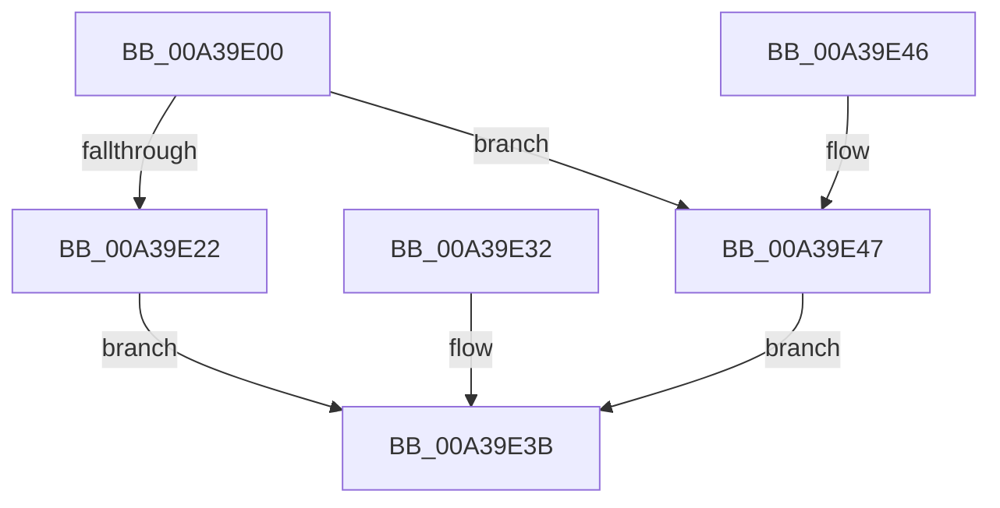

# PiDqSerializationWrite

- RVA: `0x00A39E00`–`0x00A39E4D` (길이 `77` bytes)
- VA: `0x0000000140A39E00`
- 실행 섹션: `PAGE`
- PDB 이름 있음: `예`; PDB Function 태그: `아니요`
- unwind 정보 RVA: `0x000ADF80`
- 디코드: `25`개 명령, `77/77` bytes 표시
- 미해석 바이트: `0` (있으면 어셈블리에 `.byte`로 보존)

> 이 문서는 커널 이미지의 기계어와 PDB 기호를 분석해 생성했습니다. 4번과 5번은 함수 원형과 자료형을 바이너리 사용 방식에서 추정한 C 해석이며 원본 소스 복구 결과는 아닙니다.

## 1. Dependencies

- 직접 호출 지점: **1**; 고유 호출 대상: **1**
- 직접 호출자로 확인된 함수: **0**
- RIP 상대 이미지 참조: **0**

### Outgoing calls
- `0x00A39E28` → [memcpy](../../text/6C/memcpy_function_006C6840.md) (function, `0x006C6840`)

### Direct callers
- 이 함수 시작 RVA로 연결되는 직접 call은 확인되지 않았습니다. 간접 호출은 완전히 역산할 수 없습니다.

### Static image references
- 디코드된 RIP-relative 메모리 참조가 없습니다.

## 2. Other-region calls and transfers

- 다른 실행 섹션으로 향하는 call: **1**
  - `0x00A39E28` → [memcpy](../../text/6C/memcpy_function_006C6840.md) (`PAGE` → `.text`)
- 별도 외부 분기/꼬리 이동을 확인하지 못했습니다.

## 3. Assembly (complete function range)

```asm
00A39E00  48 89 5C 24 10                  mov qword ptr [rsp + 0x10], rbx
00A39E05  48 89 4C 24 08                  mov qword ptr [rsp + 8], rcx
00A39E0A  57                              push rdi
00A39E0B  48 83 EC 20                     sub rsp, 0x20
00A39E0F  41 8B F8                        mov edi, r8d
00A39E12  48 8B D9                        mov rbx, rcx
00A39E15  8B 49 0C                        mov ecx, dword ptr [rcx + 0xc]
00A39E18  8B 43 08                        mov eax, dword ptr [rbx + 8]
00A39E1B  2B C1                           sub eax, ecx
00A39E1D  41 3B C0                        cmp eax, r8d
00A39E20  72 25                           jb 0x140a39e47
00A39E22  44 8B C7                        mov r8d, edi
00A39E25  48 03 0B                        add rcx, qword ptr [rbx]
00A39E28  E8 13 CA C8 FF                  call 0x1406c6840
00A39E2D  01 7B 0C                        add dword ptr [rbx + 0xc], edi
00A39E30  EB 09                           jmp 0x140a39e3b
00A39E32  48 8B 44 24 30                  mov rax, qword ptr [rsp + 0x30]
00A39E37  C6 40 1D 01                     mov byte ptr [rax + 0x1d], 1
00A39E3B  48 8B 5C 24 38                  mov rbx, qword ptr [rsp + 0x38]
00A39E40  48 83 C4 20                     add rsp, 0x20
00A39E44  5F                              pop rdi
00A39E45  C3                              ret
00A39E46  CC                              int3
00A39E47  C6 43 1C 01                     mov byte ptr [rbx + 0x1c], 1
00A39E4B  EB EE                           jmp 0x140a39e3b
```

## 4. C-style interpretation (structured pseudocode)

```c
__int64 __fastcall PiDqSerializationWrite(__int64 a1, __int64 a2, int a3)
{
    __int64 result;
    __int64 v_rsp;
    unsigned __int64 v_stack_p10;
    unsigned __int64 v_stack_p8;

    v_stack_p10 = v_rbx;
    v_stack_p8 = a1;
    v_rsp = (v_rsp) - (32);
    result = (unsigned int)(((unsigned int)(*(unsigned int *)(a1 + 8))) - ((unsigned int)((unsigned int)(*(unsigned int *)(a1 + 12)))));
    if (((unsigned int)(result)) < a3) goto loc_00A39E47;
    a1 = ((unsigned int)(*(unsigned int *)(a1 + 12))) + (*(unsigned __int64 *)(a1));
    result = memcpy(a1, a2, (unsigned int)((unsigned int)((unsigned int)(a3))), a4);
    goto loc_00A39E3B;
loc_00A39E3B:
    v_rsp = (v_rsp) + (32);
    return result;
loc_00A39E47:
    *(unsigned __int8 *)(v_stack_p10 + 28) = 1;
    goto loc_00A39E3B;
}
```

## 5. (Beta) C Style

```c
int64_t PiDqSerializationWrite(void *Arg1, int64_t Arg2, int32_t Arg3)
{
    uint8_t *arg1 = (uint8_t *)Arg1;

    int64_t result;
    int64_t local_rsp;
    uint64_t v_stack_p10;
    uint64_t v_stack_p8;

    v_stack_p10 = local_rbx;
    v_stack_p8 = Arg1;
    local_rsp = (local_rsp) - (32);
    result = (uint32_t)(((uint32_t)(*(uint32_t *)(arg1 + 0x8))) - ((uint32_t)((uint32_t)(*(uint32_t *)(arg1 + 0xC)))));
    if (((uint32_t)(result)) < Arg3) goto loc_00A39E47;
    Arg1 = ((uint32_t)(*(uint32_t *)(arg1 + 0xC))) + (*(uint64_t *)(arg1));
    result = memcpy(Arg1, Arg2, (uint32_t)((uint32_t)((uint32_t)(Arg3))), a4);
    goto loc_00A39E3B;
loc_00A39E3B:
    local_rsp = (local_rsp) + (32);
    return result;
loc_00A39E47:
    *(uint8_t *)(v_stack_p10 + 0x1C) = 1;
    goto loc_00A39E3B;
}
```

### 관측된 메모리 오프셋

구조체 형식이 확인되지 않은 접근은 인자 기준의 오프셋으로만 기록했습니다.

| 기준 인자 | 오프셋 표현 | 폭 (bit) | 접근 |
|---|---:|---:|---|
| `Arg1` | `+ 0x0` | `64` | `R` |
| `Arg1` | `+ 0x8` | `32` | `R` |
| `Arg1` | `+ 0xC` | `32` | `R` |
| `Arg1` | `+ 0xC` | `32` | `R/W` |
| `Arg1` | `+ 0x1C` | `8` | `W` |

## 6. Execution-region graph

[열기: 2D/3D 그래프와 함수 탐색 컨트롤 패널](../../../control-panel.html?section=page&rva=0x00A39E00&view=graph)

- 2D 그래프는 위에서 아래로 흐르고, 3D 그래프는 빈 공간을 드래그해 회전합니다. Shift+드래그는 이동, 휠은 확대·축소, 함수 노드 선택은 대상 보고서 이동입니다.

### Static fallback


