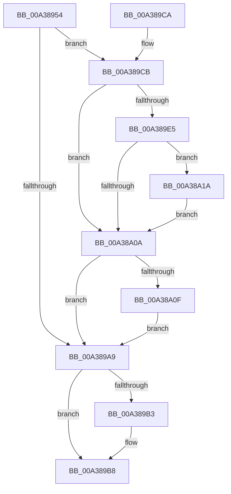

# PiUEventGetDeviceInstanceIdFromUserHandle

- RVA: `0x00A38954`–`0x00A38A23` (길이 `207` bytes)
- VA: `0x0000000140A38954`
- 실행 섹션: `PAGE`
- PDB 이름 있음: `예`; PDB Function 태그: `아니요`
- unwind 정보 RVA: `0x000ADDC8`
- 디코드: `55`개 명령, `207/207` bytes 표시
- 미해석 바이트: `0` (있으면 어셈블리에 `.byte`로 보존)

> 이 문서는 커널 이미지의 기계어와 PDB 기호를 분석해 생성했습니다. 4번과 5번은 함수 원형과 자료형을 바이너리 사용 방식에서 추정한 C 해석이며 원본 소스 복구 결과는 아닙니다.

## 1. Dependencies

- 직접 호출 지점: **5**; 고유 호출 대상: **4**
- 직접 호출자로 확인된 함수: **1**
- RIP 상대 이미지 참조: **1**

### Outgoing calls
- `0x00A3899E` → [ObReferenceObjectByHandle](../86/ObReferenceObjectByHandle_function_00868DB0.md) (function, `0x00868DB0`)
- `0x00A389B3` → [ObfDereferenceObject](../../text/2F/ObfDereferenceObject_function_002F9350.md) (function, `0x002F9350`)
- `0x00A389D5` → [PnpGetRelatedTargetDevice](../../text/27/PnpGetRelatedTargetDevice_function_00271F54.md) (function, `0x00271F54`)
- `0x00A389FC` → [PsIsProcessAppContainer](PsIsProcessAppContainer_function_00A38C44.md) (function, `0x00A38C44`)
- `0x00A38A13` → [ObfDereferenceObject](../../text/2F/ObfDereferenceObject_function_002F9350.md) (function, `0x002F9350`)

### Direct callers
- [PiUEventHandleRegistration](../9C/PiUEventHandleRegistration_function_009C3304.md) at `0x009C34F2`

### Static image references
- `0x00A3897E` → RVA `0x00FC6AE0` (`ALMOSTRO`; read)

## 2. Other-region calls and transfers

- 다른 실행 섹션으로 향하는 call: **3**
  - `0x00A389B3` → [ObfDereferenceObject](../../text/2F/ObfDereferenceObject_function_002F9350.md) (`PAGE` → `.text`)
  - `0x00A389D5` → [PnpGetRelatedTargetDevice](../../text/27/PnpGetRelatedTargetDevice_function_00271F54.md) (`PAGE` → `.text`)
  - `0x00A38A13` → [ObfDereferenceObject](../../text/2F/ObfDereferenceObject_function_002F9350.md) (`PAGE` → `.text`)
- 별도 외부 분기/꼬리 이동을 확인하지 못했습니다.

## 3. Assembly (complete function range)

```asm
00A38954  4C 8B DC                        mov r11, rsp
00A38957  49 89 5B 08                     mov qword ptr [r11 + 8], rbx
00A3895B  49 89 73 10                     mov qword ptr [r11 + 0x10], rsi
00A3895F  57                              push rdi
00A38960  48 83 EC 30                     sub rsp, 0x30
00A38964  65 48 8B 04 25 88 01 00 00      mov rax, qword ptr gs:[0x188]
00A3896D  49 8B F8                        mov rdi, r8
00A38970  49 83 20 00                     and qword ptr [r8], 0
00A38974  48 8B F2                        mov rsi, rdx
00A38977  49 83 63 F0 00                  and qword ptr [r11 - 0x10], 0
00A3897C  33 D2                           xor edx, edx
00A3897E  4C 8B 05 5B E1 58 00            mov r8, qword ptr [rip + 0x58e15b]
00A38985  44 8A 88 32 02 00 00            mov r9b, byte ptr [rax + 0x232]
00A3898C  49 8D 43 20                     lea rax, [r11 + 0x20]
00A38990  49 83 63 18 00                  and qword ptr [r11 + 0x18], 0
00A38995  49 83 63 20 00                  and qword ptr [r11 + 0x20], 0
00A3899A  49 89 43 E8                     mov qword ptr [r11 - 0x18], rax
00A3899E  E8 0D 04 E3 FF                  call 0x140868db0
00A389A3  8B D8                           mov ebx, eax
00A389A5  85 C0                           test eax, eax
00A389A7  79 22                           jns 0x140a389cb
00A389A9  48 8B 4C 24 58                  mov rcx, qword ptr [rsp + 0x58]
00A389AE  48 85 C9                        test rcx, rcx
00A389B1  74 05                           je 0x140a389b8
00A389B3  E8 98 09 8C FF                  call 0x1402f9350
00A389B8  48 8B 74 24 48                  mov rsi, qword ptr [rsp + 0x48]
00A389BD  8B C3                           mov eax, ebx
00A389BF  48 8B 5C 24 40                  mov rbx, qword ptr [rsp + 0x40]
00A389C4  48 83 C4 30                     add rsp, 0x30
00A389C8  5F                              pop rdi
00A389C9  C3                              ret
00A389CA  CC                              int3
00A389CB  48 8B 4C 24 58                  mov rcx, qword ptr [rsp + 0x58]
00A389D0  48 8D 54 24 50                  lea rdx, [rsp + 0x50]
00A389D5  E8 7A 95 83 FF                  call 0x140271f54
00A389DA  48 8B 4C 24 50                  mov rcx, qword ptr [rsp + 0x50]
00A389DF  8B D8                           mov ebx, eax
00A389E1  85 C0                           test eax, eax
00A389E3  78 25                           js 0x140a38a0a
00A389E5  48 83 C1 28                     add rcx, 0x28
00A389E9  48 89 0E                        mov qword ptr [rsi], rcx
00A389EC  65 48 8B 0C 25 88 01 00 00      mov rcx, qword ptr gs:[0x188]
00A389F5  48 8B 89 B8 00 00 00            mov rcx, qword ptr [rcx + 0xb8]
00A389FC  E8 43 02 00 00                  call 0x140a38c44
00A38A01  48 8B 4C 24 50                  mov rcx, qword ptr [rsp + 0x50]
00A38A06  84 C0                           test al, al
00A38A08  75 10                           jne 0x140a38a1a
00A38A0A  48 85 C9                        test rcx, rcx
00A38A0D  74 9A                           je 0x140a389a9
00A38A0F  48 8B 49 20                     mov rcx, qword ptr [rcx + 0x20]
00A38A13  E8 38 09 8C FF                  call 0x1402f9350
00A38A18  EB 8F                           jmp 0x140a389a9
00A38A1A  48 8B 41 20                     mov rax, qword ptr [rcx + 0x20]
00A38A1E  48 89 07                        mov qword ptr [rdi], rax
00A38A21  EB E7                           jmp 0x140a38a0a
```

## 4. C-style interpretation (structured pseudocode)

```c
__int64 __fastcall PiUEventGetDeviceInstanceIdFromUserHandle(__int64 a1, __int64 a2, __int64 a3)
{
    __int64 result;
    __int64 v_rsp;
    unsigned __int64 v_stack_p10;
    unsigned __int64 v_stack_p20;
    unsigned __int64 v_stack_p50;
    unsigned __int64 v_stack_p58;
    unsigned __int64 v_stack_p8;

    *(unsigned __int64 *)(v_rsp + 8) = v_rbx;
    *(unsigned __int64 *)(v_rsp + 16) = v_rsi;
    v_rsp = (v_rsp) - (48);
    a2 = 0;
    *(unsigned __int64 *)(v_rsp - 24) = v_rsp + 32;
    result = ObReferenceObjectByHandle(a1, a2, *(unsigned __int64 *)(v_rip + 5824859), *(unsigned __int8 *)(*(unsigned __int64 *)(gs_base + (0 + 392)) + 562));
    if (!sign_flag) goto loc_00A389CB;
loc_00A389A9:
    if (v_stack_p20 != 0) {
        result = ObfDereferenceObject(v_stack_p20, a2, *(unsigned __int64 *)(v_rip + 5824859), *(unsigned __int8 *)(*(unsigned __int64 *)(gs_base + (0 + 392)) + 562));
    }
    v_rsp = (v_rsp) + (48);
    return (unsigned int)((unsigned int)((unsigned int)((unsigned int)(result))));
loc_00A389CB:
    result = PnpGetRelatedTargetDevice(v_stack_p58, v_stack_p50, *(unsigned __int64 *)(v_rip + 5824859), *(unsigned __int8 *)(*(unsigned __int64 *)(gs_base + (0 + 392)) + 562));
    if (sign_flag) goto loc_00A38A0A;
    a1 = (v_stack_p50) + (40);
    *(unsigned __int64 *)(v_stack_p10) = a1;
    result = PsIsProcessAppContainer(*(unsigned __int64 *)(*(unsigned __int64 *)(gs_base + (0 + 392)) + 184), v_stack_p50, *(unsigned __int64 *)(v_rip + 5824859), *(unsigned __int8 *)(*(unsigned __int64 *)(gs_base + (0 + 392)) + 562));
    if ((unsigned __int8)(result) != 0) goto loc_00A38A1A;
loc_00A38A0A:
    if (v_stack_p50 == 0) goto loc_00A389A9;
    result = ObfDereferenceObject(*(unsigned __int64 *)(v_stack_p50 + 32), v_stack_p50, *(unsigned __int64 *)(v_rip + 5824859), *(unsigned __int8 *)(*(unsigned __int64 *)(gs_base + (0 + 392)) + 562));
    goto loc_00A389A9;
loc_00A38A1A:
    *(unsigned __int64 *)(a3) = *(unsigned __int64 *)(*(unsigned __int64 *)(v_stack_p50 + 32) + 32);
    goto loc_00A38A0A;
}
```

## 5. (Beta) C Style

```c
int64_t PiUEventGetDeviceInstanceIdFromUserHandle(int64_t Arg1, void *Arg2, void *Arg3)
{
    uint8_t *arg2 = (uint8_t *)Arg2;
    uint8_t *arg3 = (uint8_t *)Arg3;

    int64_t result;
    int64_t local_rsp;
    uint64_t v_stack_p10;
    uint64_t v_stack_p20;
    uint64_t v_stack_p50;
    uint64_t v_stack_p58;
    uint64_t v_stack_p8;

    *(uint64_t *)(local_rsp + 0x8) = local_rbx;
    *(uint64_t *)(local_rsp + 0x10) = local_rsi;
    local_rsp = (local_rsp) - (48);
    Arg2 = 0;
    *(uint64_t *)(local_rsp - 0x18) = local_rsp + 32;
    result = ObReferenceObjectByHandle(Arg1, Arg2, *(uint64_t *)(v_rip + 0x58E15B), *(uint8_t *)(*(uint64_t *)(gs_base + (0 + 0x188)) + 0x232));
    if (!sign_flag) goto loc_00A389CB;
loc_00A389A9:
    if (v_stack_p20 != 0) {
        result = ObfDereferenceObject(v_stack_p20, Arg2, *(uint64_t *)(v_rip + 0x58E15B), *(uint8_t *)(*(uint64_t *)(gs_base + (0 + 0x188)) + 0x232));
    }
    local_rsp = (local_rsp) + (48);
    return (uint32_t)((uint32_t)((uint32_t)((uint32_t)(result))));
loc_00A389CB:
    result = PnpGetRelatedTargetDevice(v_stack_p58, v_stack_p50, *(uint64_t *)(v_rip + 0x58E15B), *(uint8_t *)(*(uint64_t *)(gs_base + (0 + 0x188)) + 0x232));
    if (sign_flag) goto loc_00A38A0A;
    Arg1 = (v_stack_p50) + (40);
    *(uint64_t *)(v_stack_p10) = Arg1;
    result = PsIsProcessAppContainer(*(uint64_t *)(*(uint64_t *)(gs_base + (0 + 0x188)) + 0xB8), v_stack_p50, *(uint64_t *)(v_rip + 0x58E15B), *(uint8_t *)(*(uint64_t *)(gs_base + (0 + 0x188)) + 0x232));
    if ((uint8_t)(result) != 0) goto loc_00A38A1A;
loc_00A38A0A:
    if (v_stack_p50 == 0) goto loc_00A389A9;
    result = ObfDereferenceObject(*(uint64_t *)(v_stack_p50 + 0x20), v_stack_p50, *(uint64_t *)(v_rip + 0x58E15B), *(uint8_t *)(*(uint64_t *)(gs_base + (0 + 0x188)) + 0x232));
    goto loc_00A389A9;
loc_00A38A1A:
    *(uint64_t *)(arg3) = *(uint64_t *)(*(uint64_t *)(v_stack_p50 + 0x20) + 0x20);
    goto loc_00A38A0A;
}
```

### 관측된 메모리 오프셋

구조체 형식이 확인되지 않은 접근은 인자 기준의 오프셋으로만 기록했습니다.

| 기준 인자 | 오프셋 표현 | 폭 (bit) | 접근 |
|---|---:|---:|---|
| `Arg2` | `+ 0x0` | `64` | `W` |
| `Arg3` | `+ 0x0` | `64` | `R/W` |
| `Arg3` | `+ 0x0` | `64` | `W` |

## 6. Execution-region graph

[열기: 2D/3D 그래프와 함수 탐색 컨트롤 패널](../../../control-panel.html?section=page&rva=0x00A38954&view=graph)

- 2D 그래프는 위에서 아래로 흐르고, 3D 그래프는 빈 공간을 드래그해 회전합니다. Shift+드래그는 이동, 휠은 확대·축소, 함수 노드 선택은 대상 보고서 이동입니다.

### Static fallback


