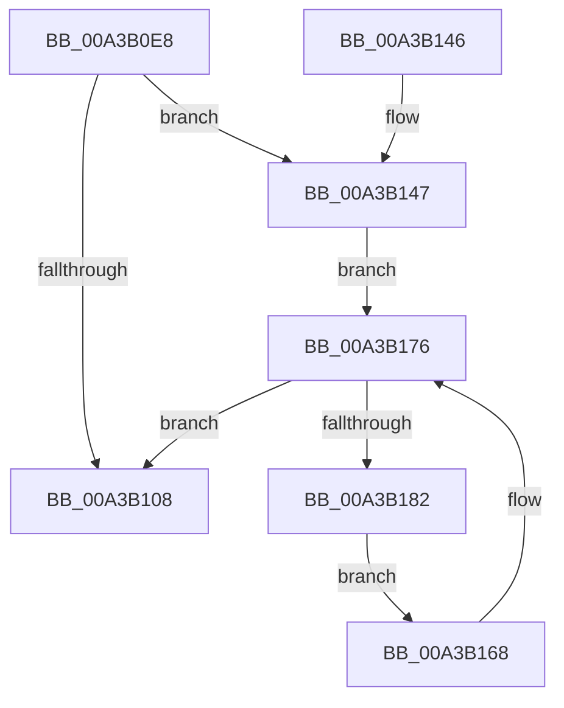

# PopAcquireAdaptiveLock

- RVA: `0x00A3B0E8`–`0x00A3B184` (길이 `156` bytes)
- VA: `0x0000000140A3B0E8`
- 실행 섹션: `PAGE`
- PDB 이름 있음: `예`; PDB Function 태그: `아니요`
- unwind 정보 RVA: `0x000AE24C`
- 디코드: `39`개 명령, `156/156` bytes 표시
- 미해석 바이트: `0` (있으면 어셈블리에 `.byte`로 보존)

> 이 문서는 커널 이미지의 기계어와 PDB 기호를 분석해 생성했습니다. 4번과 5번은 함수 원형과 자료형을 바이너리 사용 방식에서 추정한 C 해석이며 원본 소스 복구 결과는 아닙니다.

## 1. Dependencies

- 직접 호출 지점: **3**; 고유 호출 대상: **3**
- 직접 호출자로 확인된 함수: **7**
- RIP 상대 이미지 참조: **4**

### Outgoing calls
- `0x00A3B122` → [ExAcquireResourceExclusiveLite](../../text/21/ExAcquireResourceExclusiveLite_function_00214E20.md) (function, `0x00214E20`)
- `0x00A3B158` → [PoBlockConsoleSwitchEx](../../text/43/PoBlockConsoleSwitchEx_function_00435CD4.md) (function, `0x00435CD4`)
- `0x00A3B171` → [KeDelayExecutionThread](../../text/20/KeDelayExecutionThread_function_00209550.md) (function, `0x00209550`)

### Direct callers
- [PopActiveLockScreenPowerRequest](../76/PopActiveLockScreenPowerRequest_function_0076B530.md) at `0x0076B53B`
- [PopAdaptivePowerSettingCallback](../76/PopAdaptivePowerSettingCallback_function_0076B7A0.md) at `0x0076B7EB`
- [PopAdaptiveSetSystemInitiatedRebootTargetStateOverride](../76/PopAdaptiveSetSystemInitiatedRebootTargetStateOverride_function_0076B9F0.md) at `0x0076BA17`
- [PopAdaptiveWnfCallback](../76/PopAdaptiveWnfCallback_function_0076BAB0.md) at `0x0076BB2A`
- [PopSessionConnectionChange](../76/PopSessionConnectionChange_function_0076BDEC.md) at `0x0076BE1B`
- [PopSessionConnectionChangeV2](../76/PopSessionConnectionChangeV2_function_0076BEA8.md) at `0x0076BED3`
- [PopSessionWinlogonNotification](../76/PopSessionWinlogonNotification_function_0076BF60.md) at `0x0076BFE7`

### Static image references
- `0x00A3B111` → RVA `0x00F08140` (`.data`; read)
- `0x00A3B132` → RVA `0x00FD82A0` (`PAGEDATA`; write)
- `0x00A3B139` → RVA `0x00F08220` (`.data`; write)
- `0x00A3B176` → RVA `0x00F08238` (`.data`; read)

## 2. Other-region calls and transfers

- 다른 실행 섹션으로 향하는 call: **3**
  - `0x00A3B122` → [ExAcquireResourceExclusiveLite](../../text/21/ExAcquireResourceExclusiveLite_function_00214E20.md) (`PAGE` → `.text`)
  - `0x00A3B158` → [PoBlockConsoleSwitchEx](../../text/43/PoBlockConsoleSwitchEx_function_00435CD4.md) (`PAGE` → `.text`)
  - `0x00A3B171` → [KeDelayExecutionThread](../../text/20/KeDelayExecutionThread_function_00209550.md) (`PAGE` → `.text`)
- 별도 외부 분기/꼬리 이동을 확인하지 못했습니다.

## 3. Assembly (complete function range)

```asm
00A3B0E8  40 53                           push rbx
00A3B0EA  48 83 EC 50                     sub rsp, 0x50
00A3B0EE  33 C0                           xor eax, eax
00A3B0F0  0F 57 C0                        xorps xmm0, xmm0
00A3B0F3  48 89 44 24 40                  mov qword ptr [rsp + 0x40], rax
00A3B0F8  8A D9                           mov bl, cl
00A3B0FA  0F 11 44 24 20                  movups xmmword ptr [rsp + 0x20], xmm0
00A3B0FF  0F 11 44 24 30                  movups xmmword ptr [rsp + 0x30], xmm0
00A3B104  84 C9                           test cl, cl
00A3B106  74 3F                           je 0x140a3b147
00A3B108  65 48 8B 04 25 88 01 00 00      mov rax, qword ptr gs:[0x188]
00A3B111  48 8D 0D 28 D0 4C 00            lea rcx, [rip + 0x4cd028]
00A3B118  B2 01                           mov dl, 1
00A3B11A  66 FF 88 E4 01 00 00            dec word ptr [rax + 0x1e4]
00A3B121  90                              nop
00A3B122  E8 F9 9C 7D FF                  call 0x140214e20
00A3B127  65 48 8B 04 25 88 01 00 00      mov rax, qword ptr gs:[0x188]
00A3B130  84 DB                           test bl, bl
00A3B132  48 89 05 67 D1 59 00            mov qword ptr [rip + 0x59d167], rax
00A3B139  0F 94 05 E0 D0 4C 00            sete byte ptr [rip + 0x4cd0e0]
00A3B140  48 83 C4 50                     add rsp, 0x50
00A3B144  5B                              pop rbx
00A3B145  C3                              ret
00A3B146  CC                              int3
00A3B147  21 44 24 60                     and dword ptr [rsp + 0x60], eax
00A3B14B  48 8D 54 24 60                  lea rdx, [rsp + 0x60]
00A3B150  45 33 C0                        xor r8d, r8d
00A3B153  48 8D 4C 24 20                  lea rcx, [rsp + 0x20]
00A3B158  E8 77 AB 9F FF                  call 0x140435cd4
00A3B15D  48 C7 44 24 68 60 79 FE FF      mov qword ptr [rsp + 0x68], 0xfffffffffffe7960
00A3B166  EB 0E                           jmp 0x140a3b176
00A3B168  4C 8D 44 24 68                  lea r8, [rsp + 0x68]
00A3B16D  33 D2                           xor edx, edx
00A3B16F  33 C9                           xor ecx, ecx
00A3B171  E8 DA E3 7C FF                  call 0x140209550
00A3B176  8B 05 BC D0 4C 00               mov eax, dword ptr [rip + 0x4cd0bc]
00A3B17C  39 44 24 60                     cmp dword ptr [rsp + 0x60], eax
00A3B180  74 86                           je 0x140a3b108
00A3B182  EB E4                           jmp 0x140a3b168
```

## 4. C-style interpretation (structured pseudocode)

```c
__int64 __fastcall PopAcquireAdaptiveLock(unsigned __int8 a1, __int64 a2, int a3)
{
    __int64 result;
    __int64 v_rsp;
    unsigned __int64 v_stack_m18;
    unsigned __int64 v_stack_m28;
    unsigned __int64 v_stack_m38;
    unsigned __int64 v_stack_p20;
    unsigned int v_stack_p60;
    unsigned __int64 v_stack_p68;

    v_rsp = (v_rsp) - (80);
    result = 0;
    v_stack_m18 = 0;
    v_stack_m38 = v_xmm0;
    v_stack_m28 = v_xmm0;
    if (a1 == 0) goto loc_00A3B147;
loc_00A3B108:
    result = ExAcquireResourceExclusiveLite(v_rip + 5034024, 1, a3, a4);
    *(unsigned __int64 *)(v_rip + 5886311) = *(unsigned __int64 *)(gs_base + (0 + 392));
    v_rsp = (v_rsp) + (80);
    return *(unsigned __int64 *)(gs_base + (0 + 392));
loc_00A3B147:
    a3 = 0;
    result = PoBlockConsoleSwitchEx(v_stack_p20, v_stack_p60, a3, a4);
    v_stack_p68 = 0xFFFFFFFFFFFE7960ULL;
    goto loc_00A3B176;
loc_00A3B168:
    a2 = 0;
    a1 = 0;
    result = KeDelayExecutionThread(a1, a2, v_stack_p68, a4);
loc_00A3B176:
    if (v_stack_p60 == ((unsigned int)((unsigned int)(*(unsigned int *)(v_rip + 5034172))))) goto loc_00A3B108;
    goto loc_00A3B168;
}
```

## 5. (Beta) C Style

```c
int64_t PopAcquireAdaptiveLock(uint8_t Arg1, int64_t Arg2, int32_t Arg3)
{
    int64_t result;
    int64_t local_rsp;
    uint64_t v_stack_m18;
    uint64_t v_stack_m28;
    uint64_t v_stack_m38;
    uint64_t v_stack_p20;
    uint32_t v_stack_p60;
    uint64_t v_stack_p68;

    local_rsp = (local_rsp) - (80);
    result = 0;
    v_stack_m18 = 0;
    v_stack_m38 = v_xmm0;
    v_stack_m28 = v_xmm0;
    if (Arg1 == 0) goto loc_00A3B147;
loc_00A3B108:
    result = ExAcquireResourceExclusiveLite(v_rip + 5034024, 1, Arg3, a4);
    *(uint64_t *)(v_rip + 0x59D167) = *(uint64_t *)(gs_base + (0 + 0x188));
    local_rsp = (local_rsp) + (80);
    return *(uint64_t *)(gs_base + (0 + 0x188));
loc_00A3B147:
    Arg3 = 0;
    result = PoBlockConsoleSwitchEx(v_stack_p20, v_stack_p60, Arg3, a4);
    v_stack_p68 = 0xFFFFFFFFFFFE7960ULL;
    goto loc_00A3B176;
loc_00A3B168:
    Arg2 = 0;
    Arg1 = 0;
    result = KeDelayExecutionThread(Arg1, Arg2, v_stack_p68, a4);
loc_00A3B176:
    if (v_stack_p60 == ((uint32_t)((uint32_t)(*(uint32_t *)(v_rip + 0x4CD0BC))))) goto loc_00A3B108;
    goto loc_00A3B168;
}
```

## 6. Execution-region graph

[열기: 2D/3D 그래프와 함수 탐색 컨트롤 패널](../../../control-panel.html?section=page&rva=0x00A3B0E8&view=graph)

- 2D 그래프는 위에서 아래로 흐르고, 3D 그래프는 빈 공간을 드래그해 회전합니다. Shift+드래그는 이동, 휠은 확대·축소, 함수 노드 선택은 대상 보고서 이동입니다.

### Static fallback


