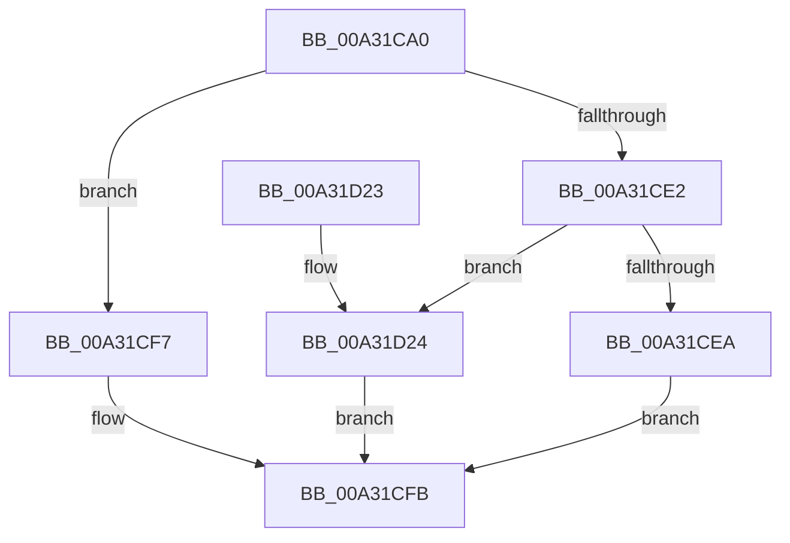

# PopAssessSystemIdleEvent

- RVA: `0x00A31CA0`–`0x00A31D2B` (길이 `139` bytes)
- VA: `0x0000000140A31CA0`
- 실행 섹션: `PAGE`
- PDB 이름 있음: `예`; PDB Function 태그: `아니요`
- unwind 정보 RVA: `0x0008474C`
- 디코드: `40`개 명령, `139/139` bytes 표시
- 미해석 바이트: `0` (있으면 어셈블리에 `.byte`로 보존)

> 이 문서는 커널 이미지의 기계어와 PDB 기호를 분석해 생성했습니다. 4번과 5번은 함수 원형과 자료형을 바이너리 사용 방식에서 추정한 C 해석이며 원본 소스 복구 결과는 아닙니다.

## 1. Dependencies

- 직접 호출 지점: **1**; 고유 호출 대상: **1**
- 직접 호출자로 확인된 함수: **1**
- RIP 상대 이미지 참조: **0**

### Outgoing calls
- `0x00A31D16` → [PopDiagTraceSystemIdleEventAssessment](PopDiagTraceSystemIdleEventAssessment_function_00A31D34.md) (function, `0x00A31D34`)

### Direct callers
- [PopIsSystemIdle](PopIsSystemIdle_function_00A31BD8.md) at `0x00A31C13`

### Static image references
- 디코드된 RIP-relative 메모리 참조가 없습니다.

## 2. Other-region calls and transfers

- 다른 실행 섹션으로 향하는 call: **0**
- 별도 외부 분기/꼬리 이동을 확인하지 못했습니다.

## 3. Assembly (complete function range)

```asm
00A31CA0  40 53                           push rbx
00A31CA2  48 83 EC 30                     sub rsp, 0x30
00A31CA6  4C 8B D1                        mov r10, rcx
00A31CA9  49 B9 08 00 00 00 80 F7 FF FF   movabs r9, 0xfffff78000000008
00A31CB3  4D 8B D8                        mov r11, r8
00A31CB6  48 B8 BD 42 7A E5 D5 94 BF D6   movabs rax, 0xd6bf94d5e57a42bd
00A31CC0  44 8B C2                        mov r8d, edx
00A31CC3  33 DB                           xor ebx, ebx
00A31CC5  4D 8B 09                        mov r9, qword ptr [r9]
00A31CC8  49 F7 E1                        mul r9
00A31CCB  45 8A 4A 10                     mov r9b, byte ptr [r10 + 0x10]
00A31CCF  48 8B CA                        mov rcx, rdx
00A31CD2  48 C1 E9 17                     shr rcx, 0x17
00A31CD6  48 8B D1                        mov rdx, rcx
00A31CD9  49 2B 52 08                     sub rdx, qword ptr [r10 + 8]
00A31CDD  45 84 C9                        test r9b, r9b
00A31CE0  75 15                           jne 0x140a31cf7
00A31CE2  49 89 13                        mov qword ptr [r11], rdx
00A31CE5  45 85 C0                        test r8d, r8d
00A31CE8  74 3A                           je 0x140a31d24
00A31CEA  49 3B D0                        cmp rdx, r8
00A31CED  44 8D 5B 01                     lea r11d, [rbx + 1]
00A31CF1  41 0F 42 DB                     cmovb ebx, r11d
00A31CF5  EB 04                           jmp 0x140a31cfb
00A31CF7  49 83 0B FF                     or qword ptr [r11], 0xffffffffffffffff
00A31CFB  49 89 4A 18                     mov qword ptr [r10 + 0x18], rcx
00A31CFF  41 8B 0A                        mov ecx, dword ptr [r10]
00A31D02  49 89 52 20                     mov qword ptr [r10 + 0x20], rdx
00A31D06  4D 89 42 28                     mov qword ptr [r10 + 0x28], r8
00A31D0A  45 88 4A 30                     mov byte ptr [r10 + 0x30], r9b
00A31D0E  41 89 5A 34                     mov dword ptr [r10 + 0x34], ebx
00A31D12  89 5C 24 20                     mov dword ptr [rsp + 0x20], ebx
00A31D16  E8 19 00 00 00                  call 0x140a31d34
00A31D1B  8B C3                           mov eax, ebx
00A31D1D  48 83 C4 30                     add rsp, 0x30
00A31D21  5B                              pop rbx
00A31D22  C3                              ret
00A31D23  CC                              int3
00A31D24  BB 02 00 00 00                  mov ebx, 2
00A31D29  EB D0                           jmp 0x140a31cfb
```

## 4. C-style interpretation (structured pseudocode)

```c
__int64 __fastcall PopAssessSystemIdleEvent(__int64 a1, __int64 a2, __int64 a3)
{
    __int64 result;
    __int64 v_rbx;
    __int64 v_rsp;
    unsigned int v_stack_m18;

    v_rsp = (v_rsp) - (48);
    v_rbx = 0;
    a1 = (a2) >> (23);
    a2 = (a1) - (*(unsigned __int64 *)(a1 + 8));
    if ((unsigned __int8)(*(unsigned __int8 *)(a1 + 16)) != 0) goto loc_00A31CF7;
    *(unsigned __int64 *)(a3) = a2;
    if ((unsigned int)((unsigned int)((unsigned int)(a2))) == 0) goto loc_00A31D24;
    if (a2 < ((unsigned int)((unsigned int)(a2)))) { v_rbx = (unsigned int)(v_rbx + 1); }
    goto loc_00A31CFB;
loc_00A31CF7:
loc_00A31CFB:
    *(unsigned __int64 *)(a1 + 24) = a1;
    *(unsigned __int64 *)(a1 + 32) = a2;
    *(unsigned __int64 *)(a1 + 40) = (unsigned int)((unsigned int)(a2));
    *(unsigned __int8 *)(a1 + 48) = (unsigned __int8)(*(unsigned __int8 *)(a1 + 16));
    *(unsigned int *)(a1 + 52) = (unsigned int)(v_rbx);
    v_stack_m18 = (unsigned int)(v_rbx);
    result = PopDiagTraceSystemIdleEventAssessment((unsigned int)(*(unsigned int *)(a1)), a2, (unsigned int)((unsigned int)(a2)), *(unsigned __int8 *)(a1 + 16));
    v_rsp = (v_rsp) + (48);
    return (unsigned int)((unsigned int)(v_rbx));
loc_00A31D24:
    goto loc_00A31CFB;
}
```

## 5. (Beta) C Style

```c
int64_t PopAssessSystemIdleEvent(void *Arg1, int64_t Arg2, void *Arg3)
{
    uint8_t *arg1 = (uint8_t *)Arg1;
    uint8_t *arg3 = (uint8_t *)Arg3;

    int64_t result;
    int64_t local_rbx;
    int64_t local_rsp;
    uint32_t v_stack_m18;

    local_rsp = (local_rsp) - (48);
    local_rbx = 0;
    Arg1 = (Arg2) >> (23);
    Arg2 = (Arg1) - (*(uint64_t *)(arg1 + 0x8));
    if ((uint8_t)(*(uint8_t *)(arg1 + 0x10)) != 0) goto loc_00A31CF7;
    *(uint64_t *)(arg3) = Arg2;
    if ((uint32_t)((uint32_t)((uint32_t)(Arg2))) == 0) goto loc_00A31D24;
    if (Arg2 < ((uint32_t)((uint32_t)(Arg2)))) { local_rbx = (uint32_t)(local_rbx + 1); }
    goto loc_00A31CFB;
loc_00A31CF7:
loc_00A31CFB:
    *(void **)(arg1 + 0x18) = Arg1;
    *(uint64_t *)(arg1 + 0x20) = Arg2;
    *(uint64_t *)(arg1 + 0x28) = (uint32_t)((uint32_t)(Arg2));
    *(uint8_t *)(arg1 + 0x30) = (uint8_t)(*(uint8_t *)(arg1 + 0x10));
    *(uint32_t *)(arg1 + 0x34) = (uint32_t)(local_rbx);
    v_stack_m18 = (uint32_t)(local_rbx);
    result = PopDiagTraceSystemIdleEventAssessment((uint32_t)(*(uint32_t *)(arg1)), Arg2, (uint32_t)((uint32_t)(Arg2)), *(uint8_t *)(arg1 + 0x10));
    local_rsp = (local_rsp) + (48);
    return (uint32_t)((uint32_t)(local_rbx));
loc_00A31D24:
    goto loc_00A31CFB;
}
```

### 관측된 메모리 오프셋

구조체 형식이 확인되지 않은 접근은 인자 기준의 오프셋으로만 기록했습니다.

| 기준 인자 | 오프셋 표현 | 폭 (bit) | 접근 |
|---|---:|---:|---|
| `Arg1` | `+ 0x0` | `32` | `R` |
| `Arg1` | `+ 0x8` | `64` | `R` |
| `Arg1` | `+ 0x10` | `8` | `R` |
| `Arg1` | `+ 0x18` | `64` | `W` |
| `Arg1` | `+ 0x20` | `64` | `W` |
| `Arg1` | `+ 0x28` | `64` | `W` |
| `Arg1` | `+ 0x30` | `8` | `W` |
| `Arg1` | `+ 0x34` | `32` | `W` |
| `Arg3` | `+ 0x0` | `64` | `R/W` |
| `Arg3` | `+ 0x0` | `64` | `W` |

## 6. Execution-region graph

[열기: 2D/3D 그래프와 함수 탐색 컨트롤 패널](../../../control-panel.html?section=page&rva=0x00A31CA0&view=graph)

- 2D 그래프는 위에서 아래로 흐르고, 3D 그래프는 빈 공간을 드래그해 회전합니다. Shift+드래그는 이동, 휠은 확대·축소, 함수 노드 선택은 대상 보고서 이동입니다.

### Static fallback


