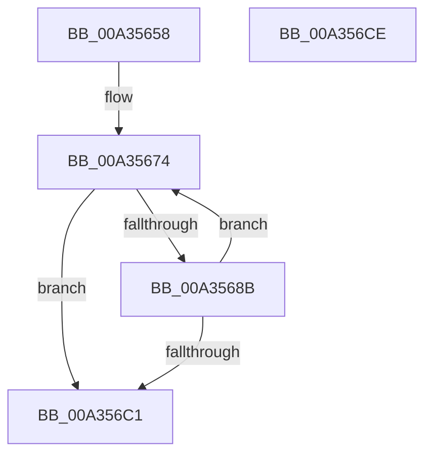

# PopBatteryUpdateCurrentState

- RVA: `0x00A35658`–`0x00A356CF` (길이 `119` bytes)
- VA: `0x0000000140A35658`
- 실행 섹션: `PAGE`
- PDB 이름 있음: `예`; PDB Function 태그: `아니요`
- unwind 정보 RVA: `0x0006E5F8`
- 디코드: `29`개 명령, `119/119` bytes 표시
- 미해석 바이트: `0` (있으면 어셈블리에 `.byte`로 보존)

> 이 문서는 커널 이미지의 기계어와 PDB 기호를 분석해 생성했습니다. 4번과 5번은 함수 원형과 자료형을 바이너리 사용 방식에서 추정한 C 해석이며 원본 소스 복구 결과는 아닙니다.

## 1. Dependencies

- 직접 호출 지점: **2**; 고유 호출 대상: **2**
- 직접 호출자로 확인된 함수: **1**
- RIP 상대 이미지 참조: **2**

### Outgoing calls
- `0x00A35690` → [PopBatteryQueueWork](../../text/4A/PopBatteryQueueWork_function_004AE3DC.md) (function, `0x004AE3DC`)
- `0x00A356B3` → [ExBlockOnAddressPushLock](../../text/2A/ExBlockOnAddressPushLock_function_002A43A0.md) (function, `0x002A43A0`)

### Direct callers
- [PopCurrentPowerStatePrecise](PopCurrentPowerStatePrecise_function_00A35624.md) at `0x00A35634`

### Static image references
- `0x00A35674` → RVA `0x00F0C228` (`.data`; read)
- `0x00A356AC` → RVA `0x00F0C230` (`.data`; read)

## 2. Other-region calls and transfers

- 다른 실행 섹션으로 향하는 call: **2**
  - `0x00A35690` → [PopBatteryQueueWork](../../text/4A/PopBatteryQueueWork_function_004AE3DC.md) (`PAGE` → `.text`)
  - `0x00A356B3` → [ExBlockOnAddressPushLock](../../text/2A/ExBlockOnAddressPushLock_function_002A43A0.md) (`PAGE` → `.text`)
- 별도 외부 분기/꼬리 이동을 확인하지 못했습니다.

## 3. Assembly (complete function range)

```asm
00A35658  48 89 5C 24 08                  mov qword ptr [rsp + 8], rbx
00A3565D  57                              push rdi
00A3565E  48 83 EC 30                     sub rsp, 0x30
00A35662  48 BB 08 00 00 00 80 F7 FF FF   movabs rbx, 0xfffff78000000008
00A3566C  48 8B F9                        mov rdi, rcx
00A3566F  33 D2                           xor edx, edx
00A35671  48 8B 1B                        mov rbx, qword ptr [rbx]
00A35674  48 8B 05 AD 6B 4D 00            mov rax, qword ptr [rip + 0x4d6bad]
00A3567B  48 89 44 24 48                  mov qword ptr [rsp + 0x48], rax
00A35680  48 05 80 F0 FA 02               add rax, 0x2faf080
00A35686  48 3B C3                        cmp rax, rbx
00A35689  77 36                           ja 0x140a356c1
00A3568B  B9 20 00 00 00                  mov ecx, 0x20
00A35690  E8 47 8D A7 FF                  call 0x1404ae3dc
00A35695  41 B9 08 00 00 00               mov r9d, 8
00A3569B  48 89 7C 24 20                  mov qword ptr [rsp + 0x20], rdi
00A356A0  4C 8D 44 24 48                  lea r8, [rsp + 0x48]
00A356A5  48 8D 15 7C 6B 4D 00            lea rdx, [rip + 0x4d6b7c]
00A356AC  48 8D 0D 7D 6B 4D 00            lea rcx, [rip + 0x4d6b7d]
00A356B3  E8 E8 EC 86 FF                  call 0x1402a43a0
00A356B8  8B D0                           mov edx, eax
00A356BA  3D 02 01 00 00                  cmp eax, 0x102
00A356BF  75 B3                           jne 0x140a35674
00A356C1  48 8B 5C 24 40                  mov rbx, qword ptr [rsp + 0x40]
00A356C6  8B C2                           mov eax, edx
00A356C8  48 83 C4 30                     add rsp, 0x30
00A356CC  5F                              pop rdi
00A356CD  C3                              ret
00A356CE  CC                              int3
```

## 4. C-style interpretation (structured pseudocode)

```c
__int64 __fastcall PopBatteryUpdateCurrentState(__int64 a1, int a2)
{
    __int64 result;
    __int64 v_rsp;
    unsigned __int64 v_stack_m18;
    unsigned __int64 v_stack_p10;
    unsigned __int64 v_stack_p8;

    v_stack_p8 = v_rbx;
    v_rsp = (v_rsp) - (48);
    a2 = 0;
loc_00A35674:
    v_stack_p10 = *(unsigned __int64 *)(v_rip + 5073837);
    result = (*(unsigned __int64 *)(v_rip + 5073837)) + (0x2FAF080ULL);
    if (result > (*(unsigned __int64 *)(v_rbx))) goto loc_00A356C1;
    result = PopBatteryQueueWork(32, a2, a3, a4);
    v_stack_m18 = a1;
    result = ExBlockOnAddressPushLock(v_rip + 5073789, v_rip + 5073788, v_stack_p10, 8);
    if (((unsigned int)(result)) != 258) goto loc_00A35674;
loc_00A356C1:
    v_rsp = (v_rsp) + (48);
    return (unsigned int)((unsigned int)((unsigned int)((unsigned int)(result))));
}
```

## 5. (Beta) C Style

```c
int64_t PopBatteryUpdateCurrentState(int64_t Arg1, int32_t Arg2)
{
    int64_t result;
    int64_t local_rsp;
    uint64_t v_stack_m18;
    uint64_t v_stack_p10;
    uint64_t v_stack_p8;

    v_stack_p8 = local_rbx;
    local_rsp = (local_rsp) - (48);
    Arg2 = 0;
loc_00A35674:
    v_stack_p10 = *(uint64_t *)(v_rip + 0x4D6BAD);
    result = (*(uint64_t *)(v_rip + 0x4D6BAD)) + (0x2FAF080ULL);
    if (result > (*(uint64_t *)(local_rbx))) goto loc_00A356C1;
    result = PopBatteryQueueWork(32, Arg2, a3, a4);
    v_stack_m18 = Arg1;
    result = ExBlockOnAddressPushLock(v_rip + 5073789, v_rip + 5073788, v_stack_p10, 8);
    if (((uint32_t)(result)) != 258) goto loc_00A35674;
loc_00A356C1:
    local_rsp = (local_rsp) + (48);
    return (uint32_t)((uint32_t)((uint32_t)((uint32_t)(result))));
}
```

## 6. Execution-region graph

[열기: 2D/3D 그래프와 함수 탐색 컨트롤 패널](../../../control-panel.html?section=page&rva=0x00A35658&view=graph)

- 2D 그래프는 위에서 아래로 흐르고, 3D 그래프는 빈 공간을 드래그해 회전합니다. Shift+드래그는 이동, 휠은 확대·축소, 함수 노드 선택은 대상 보고서 이동입니다.

### Static fallback


