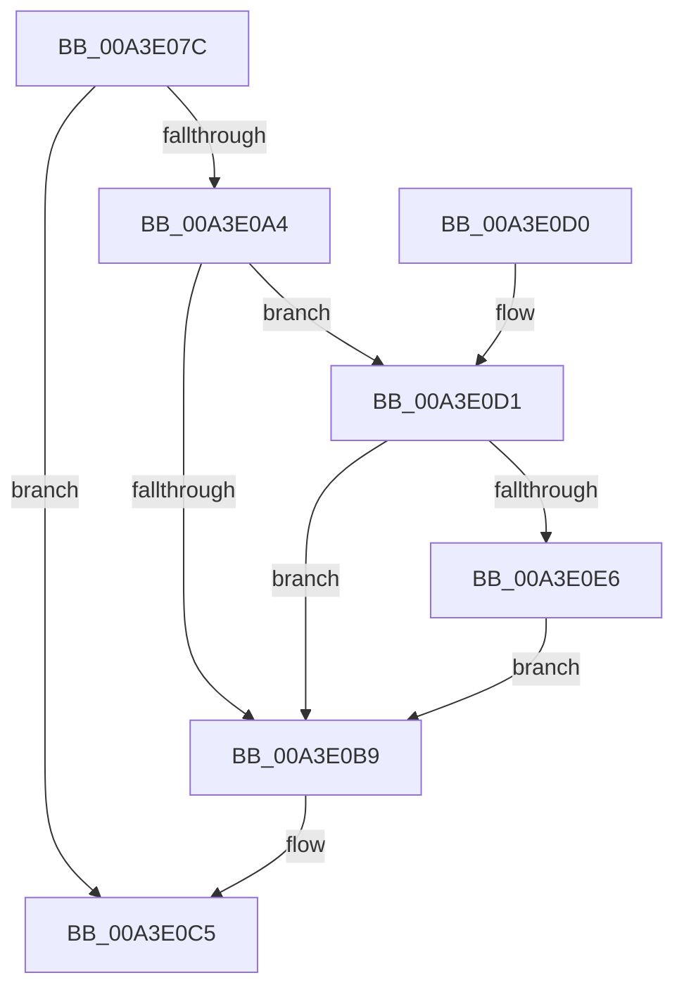

# PopBcdClearPendingResume

- RVA: `0x00A3E07C`–`0x00A3E0F0` (길이 `116` bytes)
- VA: `0x0000000140A3E07C`
- 실행 섹션: `PAGE`
- PDB 이름 있음: `예`; PDB Function 태그: `아니요`
- unwind 정보 RVA: `0x000AE6CC`
- 디코드: `33`개 명령, `116/116` bytes 표시
- 미해석 바이트: `0` (있으면 어셈블리에 `.byte`로 보존)

> 이 문서는 커널 이미지의 기계어와 PDB 기호를 분석해 생성했습니다. 4번과 5번은 함수 원형과 자료형을 바이너리 사용 방식에서 추정한 C 해석이며 원본 소스 복구 결과는 아닙니다.

## 1. Dependencies

- 직접 호출 지점: **5**; 고유 호출 대상: **4**
- 직접 호출자로 확인된 함수: **2**
- RIP 상대 이미지 참조: **1**

### Outgoing calls
- `0x00A3E09B` → [BcdOpenObject](../91/BcdOpenObject_function_00916704.md) (function, `0x00916704`)
- `0x00A3E0AE` → [BiDeleteElement](BiDeleteElement_function_00A3E0F8.md) (function, `0x00A3E0F8`)
- `0x00A3E0BE` → [BcdCloseObject](BcdCloseObject_function_00A3FB08.md) (function, `0x00A3FB08`)
- `0x00A3E0DB` → [BiDeleteElement](BiDeleteElement_function_00A3E0F8.md) (function, `0x00A3E0F8`)
- `0x00A3E0E9` → [BcdFlushStore](../82/BcdFlushStore_function_00823294.md) (function, `0x00823294`)

### Direct callers
- [PopFreeHiberContext](../70/PopFreeHiberContext_function_00704F1C.md) at `0x00704F57`
- [PoInitHiberServices](../75/PoInitHiberServices_function_007537C4.md) at `0x00753887`

### Static image references
- `0x00A3E091` → RVA `0x0001A4D0` (`.rdata`; read)

## 2. Other-region calls and transfers

- 다른 실행 섹션으로 향하는 call: **0**
- 별도 외부 분기/꼬리 이동을 확인하지 못했습니다.

## 3. Assembly (complete function range)

```asm
00A3E07C  48 89 5C 24 08                  mov qword ptr [rsp + 8], rbx
00A3E081  56                              push rsi
00A3E082  48 83 EC 20                     sub rsp, 0x20
00A3E086  48 83 64 24 38 00               and qword ptr [rsp + 0x38], 0
00A3E08C  4C 8D 44 24 38                  lea r8, [rsp + 0x38]
00A3E091  48 8D 15 38 C4 5D FF            lea rdx, [rip - 0xa23bc8]
00A3E098  48 8B F1                        mov rsi, rcx
00A3E09B  E8 64 86 ED FF                  call 0x140916704
00A3E0A0  85 C0                           test eax, eax
00A3E0A2  78 21                           js 0x140a3e0c5
00A3E0A4  48 8B 4C 24 38                  mov rcx, qword ptr [rsp + 0x38]
00A3E0A9  BA 05 00 00 26                  mov edx, 0x26000005
00A3E0AE  E8 45 00 00 00                  call 0x140a3e0f8
00A3E0B3  8B D8                           mov ebx, eax
00A3E0B5  85 C0                           test eax, eax
00A3E0B7  79 18                           jns 0x140a3e0d1
00A3E0B9  48 8B 4C 24 38                  mov rcx, qword ptr [rsp + 0x38]
00A3E0BE  E8 45 1A 00 00                  call 0x140a3fb08
00A3E0C3  8B C3                           mov eax, ebx
00A3E0C5  48 8B 5C 24 30                  mov rbx, qword ptr [rsp + 0x30]
00A3E0CA  48 83 C4 20                     add rsp, 0x20
00A3E0CE  5E                              pop rsi
00A3E0CF  C3                              ret
00A3E0D0  CC                              int3
00A3E0D1  48 8B 4C 24 38                  mov rcx, qword ptr [rsp + 0x38]
00A3E0D6  BA 25 00 00 26                  mov edx, 0x26000025
00A3E0DB  E8 18 00 00 00                  call 0x140a3e0f8
00A3E0E0  8B D8                           mov ebx, eax
00A3E0E2  85 C0                           test eax, eax
00A3E0E4  78 D3                           js 0x140a3e0b9
00A3E0E6  48 8B CE                        mov rcx, rsi
00A3E0E9  E8 A6 51 DE FF                  call 0x140823294
00A3E0EE  EB C9                           jmp 0x140a3e0b9
```

## 4. C-style interpretation (structured pseudocode)

```c
__int64 __fastcall PopBcdClearPendingResume(__int64 a1)
{
    __int64 result;
    __int64 v_rsp;
    unsigned __int64 v_stack_p10;
    unsigned __int64 v_stack_p38;
    unsigned __int64 v_stack_p8;

    v_stack_p8 = v_rbx;
    v_rsp = (v_rsp) - (32);
    result = BcdOpenObject(a1, v_rip - 10632136, v_stack_p10, a4);
    if (sign_flag) goto loc_00A3E0C5;
    result = BiDeleteElement(v_stack_p10, (unsigned int)(0x26000005ULL), v_stack_p10, a4);
    if (!sign_flag) goto loc_00A3E0D1;
loc_00A3E0B9:
    result = BcdCloseObject(v_stack_p10, (unsigned int)(0x26000005ULL), v_stack_p10, a4);
loc_00A3E0C5:
    v_rsp = (v_rsp) + (32);
    return (unsigned int)((unsigned int)((unsigned int)((unsigned int)(result))));
loc_00A3E0D1:
    result = BiDeleteElement(v_stack_p38, (unsigned int)(0x26000025ULL), v_stack_p10, a4);
    if (sign_flag) goto loc_00A3E0B9;
    result = BcdFlushStore(a1, (unsigned int)(0x26000025ULL), v_stack_p10, a4);
    goto loc_00A3E0B9;
}
```

## 5. (Beta) C Style

```c
int64_t PopBcdClearPendingResume(int64_t Arg1)
{
    int64_t result;
    int64_t local_rsp;
    uint64_t v_stack_p10;
    uint64_t v_stack_p38;
    uint64_t v_stack_p8;

    v_stack_p8 = local_rbx;
    local_rsp = (local_rsp) - (32);
    result = BcdOpenObject(Arg1, v_rip - 10632136, v_stack_p10, a4);
    if (sign_flag) goto loc_00A3E0C5;
    result = BiDeleteElement(v_stack_p10, (uint32_t)(0x26000005ULL), v_stack_p10, a4);
    if (!sign_flag) goto loc_00A3E0D1;
loc_00A3E0B9:
    result = BcdCloseObject(v_stack_p10, (uint32_t)(0x26000005ULL), v_stack_p10, a4);
loc_00A3E0C5:
    local_rsp = (local_rsp) + (32);
    return (uint32_t)((uint32_t)((uint32_t)((uint32_t)(result))));
loc_00A3E0D1:
    result = BiDeleteElement(v_stack_p38, (uint32_t)(0x26000025ULL), v_stack_p10, a4);
    if (sign_flag) goto loc_00A3E0B9;
    result = BcdFlushStore(Arg1, (uint32_t)(0x26000025ULL), v_stack_p10, a4);
    goto loc_00A3E0B9;
}
```

## 6. Execution-region graph

[열기: 2D/3D 그래프와 함수 탐색 컨트롤 패널](../../../control-panel.html?section=page&rva=0x00A3E07C&view=graph)

- 2D 그래프는 위에서 아래로 흐르고, 3D 그래프는 빈 공간을 드래그해 회전합니다. Shift+드래그는 이동, 휠은 확대·축소, 함수 노드 선택은 대상 보고서 이동입니다.

### Static fallback


