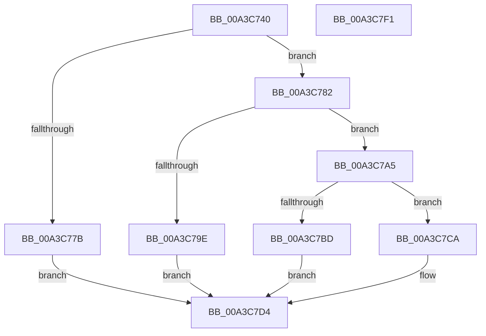

# PopBcdReadElement

- RVA: `0x00A3C740`–`0x00A3C7F2` (길이 `178` bytes)
- VA: `0x0000000140A3C740`
- 실행 섹션: `PAGE`
- PDB 이름 있음: `예`; PDB Function 태그: `아니요`
- unwind 정보 RVA: `0x0005D7BC`
- 디코드: `53`개 명령, `178/178` bytes 표시
- 미해석 바이트: `0` (있으면 어셈블리에 `.byte`로 보존)

> 이 문서는 커널 이미지의 기계어와 PDB 기호를 분석해 생성했습니다. 4번과 5번은 함수 원형과 자료형을 바이너리 사용 방식에서 추정한 C 해석이며 원본 소스 복구 결과는 아닙니다.

## 1. Dependencies

- 직접 호출 지점: **4**; 고유 호출 대상: **3**
- 직접 호출자로 확인된 함수: **4**
- RIP 상대 이미지 참조: **0**

### Outgoing calls
- `0x00A3C76F` → [BcdGetElementData](BcdGetElementData_function_00A3E390.md) (function, `0x00A3E390`)
- `0x00A3C791` → [ExAllocatePool2](../../poolcode/B8/ExAllocatePool2_function_00B820F0.md) (function, `0x00B820F0`)
- `0x00A3C7B2` → [BcdGetElementData](BcdGetElementData_function_00A3E390.md) (function, `0x00A3E390`)
- `0x00A3C7CF` → [ExFreePoolWithTag](../../poolcode/B8/ExFreePoolWithTag_function_00B82870.md) (function, `0x00B82870`)

### Direct callers
- [PopBcdCopyLoaderObjectSettings](../76/PopBcdCopyLoaderObjectSettings_function_0076FFF4.md) at `0x00770049`
- [PopBcdGetApplicationPathFromResumeObject](../77/PopBcdGetApplicationPathFromResumeObject_function_007702AC.md) at `0x007703D6`
- [PopBcdGetApplicationPathFromResumeObject](../77/PopBcdGetApplicationPathFromResumeObject_function_007702AC.md) at `0x007703F1`
- [PopBcdRegenerateResumeObject](../77/PopBcdRegenerateResumeObject_function_007704BC.md) at `0x0077054E`
- [PopBcdRegenerateResumeObject](../77/PopBcdRegenerateResumeObject_function_007704BC.md) at `0x0077056B`
- [PopBcdRegenerateResumeObject](../77/PopBcdRegenerateResumeObject_function_007704BC.md) at `0x00770613`
- [PopBcdSetDefaultResumeObjectElements](PopBcdSetDefaultResumeObjectElements_function_00A3C7F8.md) at `0x00A3C85C`
- [PopBcdSetDefaultResumeObjectElements](PopBcdSetDefaultResumeObjectElements_function_00A3C7F8.md) at `0x00A3C87B`

### Static image references
- 디코드된 RIP-relative 메모리 참조가 없습니다.

## 2. Other-region calls and transfers

- 다른 실행 섹션으로 향하는 call: **2**
  - `0x00A3C791` → [ExAllocatePool2](../../poolcode/B8/ExAllocatePool2_function_00B820F0.md) (`PAGE` → `POOLCODE`)
  - `0x00A3C7CF` → [ExFreePoolWithTag](../../poolcode/B8/ExFreePoolWithTag_function_00B82870.md) (`PAGE` → `POOLCODE`)
- 별도 외부 분기/꼬리 이동을 확인하지 못했습니다.

## 3. Assembly (complete function range)

```asm
00A3C740  48 8B C4                        mov rax, rsp
00A3C743  48 89 58 08                     mov qword ptr [rax + 8], rbx
00A3C747  48 89 68 10                     mov qword ptr [rax + 0x10], rbp
00A3C74B  48 89 70 18                     mov qword ptr [rax + 0x18], rsi
00A3C74F  48 89 78 20                     mov qword ptr [rax + 0x20], rdi
00A3C753  41 56                           push r14
00A3C755  48 83 EC 30                     sub rsp, 0x30
00A3C759  83 60 E8 00                     and dword ptr [rax - 0x18], 0
00A3C75D  49 8B F1                        mov rsi, r9
00A3C760  4D 8B F0                        mov r14, r8
00A3C763  4C 8D 48 E8                     lea r9, [rax - 0x18]
00A3C767  45 33 C0                        xor r8d, r8d
00A3C76A  8B DA                           mov ebx, edx
00A3C76C  48 8B E9                        mov rbp, rcx
00A3C76F  E8 1C 1C 00 00                  call 0x140a3e390
00A3C774  3D 23 00 00 C0                  cmp eax, 0xc0000023
00A3C779  74 07                           je 0x140a3c782
00A3C77B  BB 25 02 00 C0                  mov ebx, 0xc0000225
00A3C780  EB 52                           jmp 0x140a3c7d4
00A3C782  8B 54 24 20                     mov edx, dword ptr [rsp + 0x20]
00A3C786  B9 00 01 00 00                  mov ecx, 0x100
00A3C78B  41 B8 50 42 63 64               mov r8d, 0x64634250
00A3C791  E8 5A 59 14 00                  call 0x140b820f0
00A3C796  48 8B F8                        mov rdi, rax
00A3C799  48 85 C0                        test rax, rax
00A3C79C  75 07                           jne 0x140a3c7a5
00A3C79E  BB 9A 00 00 C0                  mov ebx, 0xc000009a
00A3C7A3  EB 2F                           jmp 0x140a3c7d4
00A3C7A5  4C 8D 4C 24 20                  lea r9, [rsp + 0x20]
00A3C7AA  4C 8B C7                        mov r8, rdi
00A3C7AD  8B D3                           mov edx, ebx
00A3C7AF  48 8B CD                        mov rcx, rbp
00A3C7B2  E8 D9 1B 00 00                  call 0x140a3e390
00A3C7B7  8B D8                           mov ebx, eax
00A3C7B9  85 C0                           test eax, eax
00A3C7BB  78 0D                           js 0x140a3c7ca
00A3C7BD  33 DB                           xor ebx, ebx
00A3C7BF  8B 44 24 20                     mov eax, dword ptr [rsp + 0x20]
00A3C7C3  89 06                           mov dword ptr [rsi], eax
00A3C7C5  49 89 3E                        mov qword ptr [r14], rdi
00A3C7C8  EB 0A                           jmp 0x140a3c7d4
00A3C7CA  33 D2                           xor edx, edx
00A3C7CC  48 8B CF                        mov rcx, rdi
00A3C7CF  E8 9C 60 14 00                  call 0x140b82870
00A3C7D4  48 8B 6C 24 48                  mov rbp, qword ptr [rsp + 0x48]
00A3C7D9  8B C3                           mov eax, ebx
00A3C7DB  48 8B 5C 24 40                  mov rbx, qword ptr [rsp + 0x40]
00A3C7E0  48 8B 74 24 50                  mov rsi, qword ptr [rsp + 0x50]
00A3C7E5  48 8B 7C 24 58                  mov rdi, qword ptr [rsp + 0x58]
00A3C7EA  48 83 C4 30                     add rsp, 0x30
00A3C7EE  41 5E                           pop r14
00A3C7F0  C3                              ret
00A3C7F1  CC                              int3
```

## 4. C-style interpretation (structured pseudocode)

```c
__int64 __fastcall PopBcdReadElement(__int64 a1, int a2, __int64 a3, __int64 a4)
{
    __int64 result;
    __int64 v_rbx;
    __int64 v_rsp;
    unsigned int v_stack_m18;
    unsigned __int64 v_stack_p10;
    unsigned __int64 v_stack_p18;
    unsigned __int64 v_stack_p20;
    unsigned __int64 v_stack_p8;

    *(unsigned __int64 *)(v_rsp + 8) = v_rbx;
    *(unsigned __int64 *)(v_rsp + 16) = v_rbp;
    *(unsigned __int64 *)(v_rsp + 24) = v_rsi;
    *(unsigned __int64 *)(v_rsp + 32) = v_rdi;
    v_rsp = (v_rsp) - (48);
    a3 = 0;
    result = BcdGetElementData(a1, a2, a3, v_rsp - 24);
    if (((unsigned int)(result)) == 0xC0000023ULL) goto loc_00A3C782;
    goto loc_00A3C7D4;
loc_00A3C782:
    result = ExAllocatePool2(256, (unsigned int)(v_stack_m18), (unsigned int)(0x64634250ULL), v_rsp - 24);
    if (result != 0) goto loc_00A3C7A5;
    goto loc_00A3C7D4;
loc_00A3C7A5:
    result = BcdGetElementData(a1, (unsigned int)((unsigned int)((unsigned int)(0xC000009AULL))), result, v_stack_m18);
    if (sign_flag) goto loc_00A3C7CA;
    v_rbx = 0;
    *(unsigned int *)(a4) = (unsigned int)((unsigned int)(v_stack_m18));
    *(unsigned __int64 *)(a3) = result;
    goto loc_00A3C7D4;
loc_00A3C7CA:
    a2 = 0;
    result = ExFreePoolWithTag(result, a2, result, v_stack_m18);
loc_00A3C7D4:
    v_rsp = (v_rsp) + (48);
    return 0;
}
```

## 5. (Beta) C Style

```c
int64_t PopBcdReadElement(int64_t Arg1, int32_t Arg2, void *Arg3, void *Arg4)
{
    uint8_t *arg3 = (uint8_t *)Arg3;
    uint8_t *arg4 = (uint8_t *)Arg4;

    int64_t result;
    int64_t local_rbx;
    int64_t local_rsp;
    uint32_t v_stack_m18;
    uint64_t v_stack_p10;
    uint64_t v_stack_p18;
    uint64_t v_stack_p20;
    uint64_t v_stack_p8;

    *(uint64_t *)(local_rsp + 0x8) = local_rbx;
    *(uint64_t *)(local_rsp + 0x10) = local_rbp;
    *(uint64_t *)(local_rsp + 0x18) = local_rsi;
    *(uint64_t *)(local_rsp + 0x20) = local_rdi;
    local_rsp = (local_rsp) - (48);
    Arg3 = 0;
    result = BcdGetElementData(Arg1, Arg2, Arg3, local_rsp - 24);
    if (((uint32_t)(result)) == 0xC0000023ULL) goto loc_00A3C782;
    goto loc_00A3C7D4;
loc_00A3C782:
    result = ExAllocatePool2(256, (uint32_t)(v_stack_m18), (uint32_t)(0x64634250ULL), local_rsp - 24);
    if (result != 0) goto loc_00A3C7A5;
    goto loc_00A3C7D4;
loc_00A3C7A5:
    result = BcdGetElementData(Arg1, (uint32_t)((uint32_t)((uint32_t)(0xC000009AULL))), result, v_stack_m18);
    if (sign_flag) goto loc_00A3C7CA;
    local_rbx = 0;
    *(uint32_t *)(arg4) = (uint32_t)((uint32_t)(v_stack_m18));
    *(uint64_t *)(arg3) = result;
    goto loc_00A3C7D4;
loc_00A3C7CA:
    Arg2 = 0;
    result = ExFreePoolWithTag(result, Arg2, result, v_stack_m18);
loc_00A3C7D4:
    local_rsp = (local_rsp) + (48);
    return 0;
}
```

### 관측된 메모리 오프셋

구조체 형식이 확인되지 않은 접근은 인자 기준의 오프셋으로만 기록했습니다.

| 기준 인자 | 오프셋 표현 | 폭 (bit) | 접근 |
|---|---:|---:|---|
| `Arg3` | `+ 0x0` | `64` | `W` |
| `Arg4` | `+ 0x0` | `32` | `W` |

## 6. Execution-region graph

[열기: 2D/3D 그래프와 함수 탐색 컨트롤 패널](../../../control-panel.html?section=page&rva=0x00A3C740&view=graph)

- 2D 그래프는 위에서 아래로 흐르고, 3D 그래프는 빈 공간을 드래그해 회전합니다. Shift+드래그는 이동, 휠은 확대·축소, 함수 노드 선택은 대상 보고서 이동입니다.

### Static fallback


