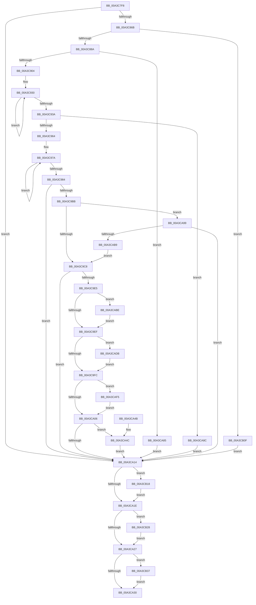

# PopBcdSetDefaultResumeObjectElements

- RVA: `0x00A3C7F8`–`0x00A3CB46` (길이 `846` bytes)
- VA: `0x0000000140A3C7F8`
- 실행 섹션: `PAGE`
- PDB 이름 있음: `예`; PDB Function 태그: `아니요`
- unwind 정보 RVA: `0x000AE4D8`
- 디코드: `219`개 명령, `846/846` bytes 표시
- 미해석 바이트: `0` (있으면 어셈블리에 `.byte`로 보존)

> 이 문서는 커널 이미지의 기계어와 PDB 기호를 분석해 생성했습니다. 4번과 5번은 함수 원형과 자료형을 바이너리 사용 방식에서 추정한 C 해석이며 원본 소스 복구 결과는 아닙니다.

## 1. Dependencies

- 직접 호출 지점: **21**; 고유 호출 대상: **9**
- 직접 호출자로 확인된 함수: **2**
- RIP 상대 이미지 참조: **4**

### Outgoing calls
- `0x00A3C85C` → [PopBcdReadElement](PopBcdReadElement_function_00A3C740.md) (function, `0x00A3C740`)
- `0x00A3C87B` → [PopBcdReadElement](PopBcdReadElement_function_00A3C740.md) (function, `0x00A3C740`)
- `0x00A3C8A1` → [BcdGetElementData](BcdGetElementData_function_00A3E390.md) (function, `0x00A3E390`)
- `0x00A3C8C0` → [BcdGetElementData](BcdGetElementData_function_00A3E390.md) (function, `0x00A3E390`)
- `0x00A3C8DF` → [BcdGetElementData](BcdGetElementData_function_00A3E390.md) (function, `0x00A3E390`)
- `0x00A3C8F3` → [wcsrchr](../../text/50/wcsrchr_function_00501E50.md) (function, `0x00501E50`)
- `0x00A3C953` → [ExAllocatePool2](../../poolcode/B8/ExAllocatePool2_function_00B820F0.md) (function, `0x00B820F0`)
- `0x00A3C973` → [memcpy](../../text/6C/memcpy_function_006C6840.md) (function, `0x006C6840`)
- `0x00A3C993` → [memcpy](../../text/6C/memcpy_function_006C6840.md) (function, `0x006C6840`)
- `0x00A3C9AD` → [BcdSetElementDataWithFlags](BcdSetElementDataWithFlags_function_00A3F080.md) (function, `0x00A3F080`)
- `0x00A3C9BB` → [CmIsStateSeparationEnabled](../../text/4A/CmIsStateSeparationEnabled_function_004A4754.md) (function, `0x004A4754`)
- `0x00A3C9DA` → [BcdSetElementDataWithFlags](BcdSetElementDataWithFlags_function_00A3F080.md) (function, `0x00A3F080`)
- `0x00A3CA09` → [PopBcdSetupResumeObject](PopBcdSetupResumeObject_function_00A3D158.md) (function, `0x00A3D158`)
- `0x00A3CA76` → [BcdSetElementDataWithFlags](BcdSetElementDataWithFlags_function_00A3F080.md) (function, `0x00A3F080`)
- `0x00A3CAAA` → [BcdSetElementDataWithFlags](BcdSetElementDataWithFlags_function_00A3F080.md) (function, `0x00A3F080`)
- `0x00A3CAD1` → [BcdSetElementDataWithFlags](BcdSetElementDataWithFlags_function_00A3F080.md) (function, `0x00A3F080`)
- `0x00A3CAEB` → [BcdSetElementDataWithFlags](BcdSetElementDataWithFlags_function_00A3F080.md) (function, `0x00A3F080`)
- `0x00A3CB05` → [BcdSetElementDataWithFlags](BcdSetElementDataWithFlags_function_00A3F080.md) (function, `0x00A3F080`)
- `0x00A3CB1E` → [ExFreePoolWithTag](../../poolcode/B8/ExFreePoolWithTag_function_00B82870.md) (function, `0x00B82870`)
- `0x00A3CB2D` → [ExFreePoolWithTag](../../poolcode/B8/ExFreePoolWithTag_function_00B82870.md) (function, `0x00B82870`)
- `0x00A3CB3C` → [ExFreePoolWithTag](../../poolcode/B8/ExFreePoolWithTag_function_00B82870.md) (function, `0x00B82870`)

### Direct callers
- [PopBcdEstablishResumeObject](../77/PopBcdEstablishResumeObject_function_007700E4.md) at `0x007701FE`
- [PopBcdRegenerateResumeObject](../77/PopBcdRegenerateResumeObject_function_007704BC.md) at `0x007705C3`

### Static image references
- `0x00A3C904` → RVA `0x00EFF050` (`.data`; read)
- `0x00A3C90B` → RVA `0x00B03DD0` (` ?? ::NNGAKEGL::`string'`; read)
- `0x00A3C912` → RVA `0x00B03DB0` (` ?? ::NNGAKEGL::`string'`; read)
- `0x00A3CA54` → RVA `0x00F475F8` (`.data`; read)

## 2. Other-region calls and transfers

- 다른 실행 섹션으로 향하는 call: **8**
  - `0x00A3C8F3` → [wcsrchr](../../text/50/wcsrchr_function_00501E50.md) (`PAGE` → `.text`)
  - `0x00A3C953` → [ExAllocatePool2](../../poolcode/B8/ExAllocatePool2_function_00B820F0.md) (`PAGE` → `POOLCODE`)
  - `0x00A3C973` → [memcpy](../../text/6C/memcpy_function_006C6840.md) (`PAGE` → `.text`)
  - `0x00A3C993` → [memcpy](../../text/6C/memcpy_function_006C6840.md) (`PAGE` → `.text`)
  - `0x00A3C9BB` → [CmIsStateSeparationEnabled](../../text/4A/CmIsStateSeparationEnabled_function_004A4754.md) (`PAGE` → `.text`)
  - `0x00A3CB1E` → [ExFreePoolWithTag](../../poolcode/B8/ExFreePoolWithTag_function_00B82870.md) (`PAGE` → `POOLCODE`)
  - `0x00A3CB2D` → [ExFreePoolWithTag](../../poolcode/B8/ExFreePoolWithTag_function_00B82870.md) (`PAGE` → `POOLCODE`)
  - `0x00A3CB3C` → [ExFreePoolWithTag](../../poolcode/B8/ExFreePoolWithTag_function_00B82870.md) (`PAGE` → `POOLCODE`)
- 별도 외부 분기/꼬리 이동을 확인하지 못했습니다.

## 3. Assembly (complete function range)

```asm
00A3C7F8  48 8B C4                        mov rax, rsp
00A3C7FB  48 89 58 08                     mov qword ptr [rax + 8], rbx
00A3C7FF  48 89 70 10                     mov qword ptr [rax + 0x10], rsi
00A3C803  4C 89 48 20                     mov qword ptr [rax + 0x20], r9
00A3C807  4C 89 40 18                     mov qword ptr [rax + 0x18], r8
00A3C80B  55                              push rbp
00A3C80C  57                              push rdi
00A3C80D  41 54                           push r12
00A3C80F  41 56                           push r14
00A3C811  41 57                           push r15
00A3C813  48 8B EC                        mov rbp, rsp
00A3C816  48 83 EC 70                     sub rsp, 0x70
00A3C81A  45 33 E4                        xor r12d, r12d
00A3C81D  4C 8D 4D CC                     lea r9, [rbp - 0x34]
00A3C821  4C 8B FA                        mov r15, rdx
00A3C824  66 44 89 65 48                  mov word ptr [rbp + 0x48], r12w
00A3C829  48 8B F9                        mov rdi, rcx
00A3C82C  66 44 89 65 40                  mov word ptr [rbp + 0x40], r12w
00A3C831  49 8B CF                        mov rcx, r15
00A3C834  4C 89 65 F0                     mov qword ptr [rbp - 0x10], r12
00A3C838  4C 8D 45 D8                     lea r8, [rbp - 0x28]
00A3C83C  66 44 89 65 C0                  mov word ptr [rbp - 0x40], r12w
00A3C841  BA 01 00 00 11                  mov edx, 0x11000001
00A3C846  4C 89 65 D8                     mov qword ptr [rbp - 0x28], r12
00A3C84A  44 89 65 CC                     mov dword ptr [rbp - 0x34], r12d
00A3C84E  41 8B F4                        mov esi, r12d
00A3C851  4C 89 65 D0                     mov qword ptr [rbp - 0x30], r12
00A3C855  45 8B F4                        mov r14d, r12d
00A3C858  44 89 65 C8                     mov dword ptr [rbp - 0x38], r12d
00A3C85C  E8 DF FE FF FF                  call 0x140a3c740
00A3C861  8B D8                           mov ebx, eax
00A3C863  85 C0                           test eax, eax
00A3C865  0F 88 A9 01 00 00               js 0x140a3ca14
00A3C86B  4C 8D 4D C8                     lea r9, [rbp - 0x38]
00A3C86F  BA 02 00 00 12                  mov edx, 0x12000002
00A3C874  4C 8D 45 D0                     lea r8, [rbp - 0x30]
00A3C878  49 8B CF                        mov rcx, r15
00A3C87B  E8 C0 FE FF FF                  call 0x140a3c740
00A3C880  8B D8                           mov ebx, eax
00A3C882  85 C0                           test eax, eax
00A3C884  0F 88 85 02 00 00               js 0x140a3cb0f
00A3C88A  4C 8D 4D C8                     lea r9, [rbp - 0x38]
00A3C88E  C7 45 C8 08 00 00 00            mov dword ptr [rbp - 0x38], 8
00A3C895  4C 8D 45 F0                     lea r8, [rbp - 0x10]
00A3C899  BA 52 00 00 15                  mov edx, 0x15000052
00A3C89E  49 8B CF                        mov rcx, r15
00A3C8A1  E8 EA 1A 00 00                  call 0x140a3e390
00A3C8A6  4C 8D 4D C4                     lea r9, [rbp - 0x3c]
00A3C8AA  89 45 E0                        mov dword ptr [rbp - 0x20], eax
00A3C8AD  4C 8D 45 40                     lea r8, [rbp + 0x40]
00A3C8B1  C7 45 C4 02 00 00 00            mov dword ptr [rbp - 0x3c], 2
00A3C8B8  BA 54 00 00 16                  mov edx, 0x16000054
00A3C8BD  49 8B CF                        mov rcx, r15
00A3C8C0  E8 CB 1A 00 00                  call 0x140a3e390
00A3C8C5  4C 8D 4D C4                     lea r9, [rbp - 0x3c]
00A3C8C9  89 45 E4                        mov dword ptr [rbp - 0x1c], eax
00A3C8CC  4C 8D 45 C0                     lea r8, [rbp - 0x40]
00A3C8D0  C7 45 C4 02 00 00 00            mov dword ptr [rbp - 0x3c], 2
00A3C8D7  BA 46 00 00 16                  mov edx, 0x16000046
00A3C8DC  49 8B CF                        mov rcx, r15
00A3C8DF  E8 AC 1A 00 00                  call 0x140a3e390
00A3C8E4  48 8B 75 D0                     mov rsi, qword ptr [rbp - 0x30]
00A3C8E8  41 8D 54 24 5C                  lea edx, [r12 + 0x5c]
00A3C8ED  48 8B CE                        mov rcx, rsi
00A3C8F0  89 45 E8                        mov dword ptr [rbp - 0x18], eax
00A3C8F3  E8 58 55 AC FF                  call 0x140501e50
00A3C8F8  48 8B D8                        mov rbx, rax
00A3C8FB  48 85 C0                        test rax, rax
00A3C8FE  0F 84 81 01 00 00               je 0x140a3ca85
00A3C904  83 3D 45 27 4C 00 02            cmp dword ptr [rip + 0x4c2745], 2
00A3C90B  48 8D 05 BE 74 0C 00            lea rax, [rip + 0xc74be]
00A3C912  4C 8D 25 97 74 0C 00            lea r12, [rip + 0xc7497]
00A3C919  4C 0F 45 E0                     cmovne r12, rax
00A3C91D  48 2B DE                        sub rbx, rsi
00A3C920  48 83 C3 02                     add rbx, 2
00A3C924  49 83 CF FF                     or r15, 0xffffffffffffffff
00A3C928  48 D1 FB                        sar rbx, 1
00A3C92B  49 8B C7                        mov rax, r15
00A3C92E  33 C9                           xor ecx, ecx
00A3C930  48 FF C0                        inc rax
00A3C933  66 41 39 0C 44                  cmp word ptr [r12 + rax*2], cx
00A3C938  75 F6                           jne 0x140a3c930
00A3C93A  03 C3                           add eax, ebx
00A3C93C  B9 00 01 00 00                  mov ecx, 0x100
00A3C941  41 B8 50 42 63 64               mov r8d, 0x64634250
00A3C947  8D 04 45 02 00 00 00            lea eax, [rax*2 + 2]
00A3C94E  8B D0                           mov edx, eax
00A3C950  89 45 D0                        mov dword ptr [rbp - 0x30], eax
00A3C953  E8 98 57 14 00                  call 0x140b820f0
00A3C958  4C 8B F0                        mov r14, rax
00A3C95B  48 85 C0                        test rax, rax
00A3C95E  0F 84 28 01 00 00               je 0x140a3ca8c
00A3C964  8B C3                           mov eax, ebx
00A3C966  48 8B D6                        mov rdx, rsi
00A3C969  49 8B CE                        mov rcx, r14
00A3C96C  48 8D 1C 00                     lea rbx, [rax + rax]
00A3C970  4C 8B C3                        mov r8, rbx
00A3C973  E8 C8 9E C8 FF                  call 0x1406c6840
00A3C978  33 C0                           xor eax, eax
00A3C97A  49 FF C7                        inc r15
00A3C97D  66 43 39 04 7C                  cmp word ptr [r12 + r15*2], ax
00A3C982  75 F6                           jne 0x140a3c97a
00A3C984  4E 8D 04 7D 02 00 00 00         lea r8, [r15*2 + 2]
00A3C98C  49 8B D4                        mov rdx, r12
00A3C98F  4A 8D 0C 33                     lea rcx, [rbx + r14]
00A3C993  E8 A8 9E C8 FF                  call 0x1406c6840
00A3C998  4C 8B 4D D8                     mov r9, qword ptr [rbp - 0x28]
00A3C99C  BA 01 00 00 11                  mov edx, 0x11000001
00A3C9A1  44 8B 7D CC                     mov r15d, dword ptr [rbp - 0x34]
00A3C9A5  48 8B CF                        mov rcx, rdi
00A3C9A8  44 89 7C 24 20                  mov dword ptr [rsp + 0x20], r15d
00A3C9AD  E8 CE 26 00 00                  call 0x140a3f080
00A3C9B2  45 33 E4                        xor r12d, r12d
00A3C9B5  8B D8                           mov ebx, eax
00A3C9B7  85 C0                           test eax, eax
00A3C9B9  78 59                           js 0x140a3ca14
00A3C9BB  E8 94 7D A6 FF                  call 0x1404a4754
00A3C9C0  84 C0                           test al, al
00A3C9C2  0F 85 D1 00 00 00               jne 0x140a3ca99
00A3C9C8  8B 45 D0                        mov eax, dword ptr [rbp - 0x30]
00A3C9CB  4D 8B CE                        mov r9, r14
00A3C9CE  BA 02 00 00 12                  mov edx, 0x12000002
00A3C9D3  89 44 24 20                     mov dword ptr [rsp + 0x20], eax
00A3C9D7  48 8B CF                        mov rcx, rdi
00A3C9DA  E8 A1 26 00 00                  call 0x140a3f080
00A3C9DF  8B D8                           mov ebx, eax
00A3C9E1  85 C0                           test eax, eax
00A3C9E3  78 2F                           js 0x140a3ca14
00A3C9E5  44 39 65 E0                     cmp dword ptr [rbp - 0x20], r12d
00A3C9E9  0F 8D CF 00 00 00               jge 0x140a3cabe
00A3C9EF  8B 5D C4                        mov ebx, dword ptr [rbp - 0x3c]
00A3C9F2  44 39 65 E4                     cmp dword ptr [rbp - 0x1c], r12d
00A3C9F6  0F 8D DF 00 00 00               jge 0x140a3cadb
00A3C9FC  44 39 65 E8                     cmp dword ptr [rbp - 0x18], r12d
00A3CA00  0F 8D EF 00 00 00               jge 0x140a3caf5
00A3CA06  48 8B CF                        mov rcx, rdi
00A3CA09  E8 4A 07 00 00                  call 0x140a3d158
00A3CA0E  8B D8                           mov ebx, eax
00A3CA10  85 C0                           test eax, eax
00A3CA12  79 38                           jns 0x140a3ca4c
00A3CA14  4C 39 65 D8                     cmp qword ptr [rbp - 0x28], r12
00A3CA18  0F 85 FA 00 00 00               jne 0x140a3cb18
00A3CA1E  48 85 F6                        test rsi, rsi
00A3CA21  0F 85 01 01 00 00               jne 0x140a3cb28
00A3CA27  4D 85 F6                        test r14, r14
00A3CA2A  0F 85 07 01 00 00               jne 0x140a3cb37
00A3CA30  4C 8D 5C 24 70                  lea r11, [rsp + 0x70]
00A3CA35  8B C3                           mov eax, ebx
00A3CA37  49 8B 5B 30                     mov rbx, qword ptr [r11 + 0x30]
00A3CA3B  49 8B 73 38                     mov rsi, qword ptr [r11 + 0x38]
00A3CA3F  49 8B E3                        mov rsp, r11
00A3CA42  41 5F                           pop r15
00A3CA44  41 5E                           pop r14
00A3CA46  41 5C                           pop r12
00A3CA48  5F                              pop rdi
00A3CA49  5D                              pop rbp
00A3CA4A  C3                              ret
00A3CA4B  CC                              int3
00A3CA4C  0F B6 45 48                     movzx eax, byte ptr [rbp + 0x48]
00A3CA50  4C 8D 4D 48                     lea r9, [rbp + 0x48]
00A3CA54  44 38 25 9D AB 50 00            cmp byte ptr [rip + 0x50ab9d], r12b
00A3CA5B  B9 01 00 00 00                  mov ecx, 1
00A3CA60  BA 06 00 00 26                  mov edx, 0x26000006
00A3CA65  C7 44 24 20 02 00 00 00         mov dword ptr [rsp + 0x20], 2
00A3CA6D  0F 45 C1                        cmovne eax, ecx
00A3CA70  48 8B CF                        mov rcx, rdi
00A3CA73  88 45 48                        mov byte ptr [rbp + 0x48], al
00A3CA76  E8 05 26 00 00                  call 0x140a3f080
00A3CA7B  85 C0                           test eax, eax
00A3CA7D  8B D8                           mov ebx, eax
00A3CA7F  41 0F 49 DC                     cmovns ebx, r12d
00A3CA83  EB 8F                           jmp 0x140a3ca14
00A3CA85  BB 24 00 00 C0                  mov ebx, 0xc0000024
00A3CA8A  EB 88                           jmp 0x140a3ca14
00A3CA8C  BB 9A 00 00 C0                  mov ebx, 0xc000009a
00A3CA91  45 33 E4                        xor r12d, r12d
00A3CA94  E9 7B FF FF FF                  jmp 0x140a3ca14
00A3CA99  4C 8B 4D D8                     mov r9, qword ptr [rbp - 0x28]
00A3CA9D  BA 05 00 00 21                  mov edx, 0x21000005
00A3CAA2  48 8B CF                        mov rcx, rdi
00A3CAA5  44 89 7C 24 20                  mov dword ptr [rsp + 0x20], r15d
00A3CAAA  E8 D1 25 00 00                  call 0x140a3f080
00A3CAAF  8B D8                           mov ebx, eax
00A3CAB1  85 C0                           test eax, eax
00A3CAB3  0F 88 5B FF FF FF               js 0x140a3ca14
00A3CAB9  E9 0A FF FF FF                  jmp 0x140a3c9c8
00A3CABE  8B 45 C8                        mov eax, dword ptr [rbp - 0x38]
00A3CAC1  4C 8D 4D F0                     lea r9, [rbp - 0x10]
00A3CAC5  BA 52 00 00 15                  mov edx, 0x15000052
00A3CACA  89 44 24 20                     mov dword ptr [rsp + 0x20], eax
00A3CACE  48 8B CF                        mov rcx, rdi
00A3CAD1  E8 AA 25 00 00                  call 0x140a3f080
00A3CAD6  E9 14 FF FF FF                  jmp 0x140a3c9ef
00A3CADB  4C 8D 4D 40                     lea r9, [rbp + 0x40]
00A3CADF  89 5C 24 20                     mov dword ptr [rsp + 0x20], ebx
00A3CAE3  BA 54 00 00 16                  mov edx, 0x16000054
00A3CAE8  48 8B CF                        mov rcx, rdi
00A3CAEB  E8 90 25 00 00                  call 0x140a3f080
00A3CAF0  E9 07 FF FF FF                  jmp 0x140a3c9fc
00A3CAF5  4C 8D 4D C0                     lea r9, [rbp - 0x40]
00A3CAF9  89 5C 24 20                     mov dword ptr [rsp + 0x20], ebx
00A3CAFD  BA 46 00 00 16                  mov edx, 0x16000046
00A3CB02  48 8B CF                        mov rcx, rdi
00A3CB05  E8 76 25 00 00                  call 0x140a3f080
00A3CB0A  E9 F7 FE FF FF                  jmp 0x140a3ca06
00A3CB0F  48 8B 75 D0                     mov rsi, qword ptr [rbp - 0x30]
00A3CB13  E9 FC FE FF FF                  jmp 0x140a3ca14
00A3CB18  48 8B 4D D8                     mov rcx, qword ptr [rbp - 0x28]
00A3CB1C  33 D2                           xor edx, edx
00A3CB1E  E8 4D 5D 14 00                  call 0x140b82870
00A3CB23  E9 F6 FE FF FF                  jmp 0x140a3ca1e
00A3CB28  33 D2                           xor edx, edx
00A3CB2A  48 8B CE                        mov rcx, rsi
00A3CB2D  E8 3E 5D 14 00                  call 0x140b82870
00A3CB32  E9 F0 FE FF FF                  jmp 0x140a3ca27
00A3CB37  33 D2                           xor edx, edx
00A3CB39  49 8B CE                        mov rcx, r14
00A3CB3C  E8 2F 5D 14 00                  call 0x140b82870
00A3CB41  E9 EA FE FF FF                  jmp 0x140a3ca30
```

## 4. C-style interpretation (structured pseudocode)

```c
__int64 __fastcall PopBcdSetDefaultResumeObjectElements(__int64 a1, __int64 a2, __int64 a3, __int64 a4)
{
    __int64 result;
    __int64 v_r12;
    __int64 v_r15;
    __int64 v_rbx;
    __int64 v_rsp;
    unsigned __int64 v_stack_m28;
    unsigned __int64 v_stack_m38;
    unsigned int v_stack_m40;
    unsigned int v_stack_m44;
    unsigned int v_stack_m48;
    unsigned __int64 v_stack_m50;
    unsigned __int64 v_stack_m58;
    unsigned __int64 v_stack_m5C;
    unsigned int v_stack_m60;
    unsigned __int64 v_stack_m64;
    unsigned __int16 v_stack_m68;
    unsigned int v_stack_m78;
    unsigned __int16 v_stack_p18;
    unsigned __int16 v_stack_p20;

    *(unsigned __int64 *)(v_rsp + 8) = v_rbx;
    *(unsigned __int64 *)(v_rsp + 16) = v_rsi;
    *(unsigned __int64 *)(v_rsp + 32) = a4;
    *(unsigned __int64 *)(v_rsp + 24) = a3;
    v_rsp = (v_rsp) - (112);
    v_r12 = 0;
    v_stack_p20 = 0;
    v_stack_p18 = 0;
    v_stack_m38 = 0;
    v_stack_m68 = 0;
    v_stack_m50 = 0;
    v_stack_m5C = 0;
    v_stack_m58 = 0;
    v_stack_m60 = 0;
    result = PopBcdReadElement(a2, (unsigned int)(0x11000001ULL), v_stack_m50, v_stack_m5C);
    if (sign_flag) goto loc_00A3CA14;
    result = PopBcdReadElement(a2, (unsigned int)(0x12000002ULL), v_stack_m58, v_stack_m60);
    if (sign_flag) goto loc_00A3CB0F;
    v_stack_m60 = 8;
    result = BcdGetElementData(a2, (unsigned int)(0x15000052ULL), v_stack_m38, v_stack_m60);
    v_stack_m48 = (unsigned int)(result);
    v_stack_m64 = 2;
    result = BcdGetElementData(a2, (unsigned int)(0x16000054ULL), v_stack_p18, v_stack_m64);
    v_stack_m44 = (unsigned int)(result);
    v_stack_m64 = 2;
    result = BcdGetElementData(a2, (unsigned int)(0x16000046ULL), v_stack_m68, v_stack_m64);
    v_stack_m40 = (unsigned int)(result);
    result = wcsrchr(v_stack_m58, v_r12 + 92, v_stack_m68, v_stack_m64);
    if (result == 0) goto loc_00A3CA85;
    v_r12 = v_rip + 816279;
    if ((*(unsigned int *)(v_rip + 4990789)) != 2) { v_r12 = v_rip + 816318; }
    v_rbx = (result) - (v_stack_m58);
    v_rbx = (v_rbx) + (2);
    v_r15 = (a2) | (-1);
    v_rbx = (v_rbx) >> (1);
    a1 = 0;
loc_00A3C930:
    result = (v_r15) + 1;
    if ((*(unsigned __int16 *)(v_r12 + result * 2)) != 0) goto loc_00A3C930;
    result = (unsigned int)((result) + ((unsigned int)(v_rbx)));
    v_stack_m58 = (unsigned int)(result * 2 + 2);
    result = ExAllocatePool2(256, (unsigned int)((unsigned int)(result * 2 + 2)), (unsigned int)(0x64634250ULL), v_stack_m64);
    if (result == 0) goto loc_00A3CA8C;
    result = memcpy(result, v_stack_m58, (unsigned int)((unsigned int)(v_rbx)) + (unsigned int)((unsigned int)(v_rbx)) * 1, v_stack_m64);
    result = 0;
loc_00A3C97A:
    v_r15 = (v_r15) + 1;
    if ((*(unsigned __int16 *)(v_r12 + v_r15 * 2)) != 0) goto loc_00A3C97A;
    result = memcpy((unsigned int)((unsigned int)(v_rbx)) + (unsigned int)((unsigned int)(v_rbx)) * 1 + result * 1, v_r12, v_r15 * 2 + 2, v_stack_m64);
    v_stack_m78 = (unsigned int)((unsigned int)(v_stack_m5C));
    result = BcdSetElementDataWithFlags(0, (unsigned int)(0x11000001ULL), v_r15 * 2 + 2, v_stack_m50);
    v_r12 = 0;
    if (sign_flag) goto loc_00A3CA14;
    result = CmIsStateSeparationEnabled(0, (unsigned int)(0x11000001ULL), v_r15 * 2 + 2, v_stack_m50);
    if ((unsigned __int8)(result) != 0) goto loc_00A3CA99;
loc_00A3C9C8:
    v_stack_m78 = (unsigned int)((unsigned int)(v_stack_m58));
    result = BcdSetElementDataWithFlags(0, (unsigned int)(0x12000002ULL), v_r15 * 2 + 2, result);
    if (sign_flag) goto loc_00A3CA14;
    if (v_stack_m48 >= 0) goto loc_00A3CABE;
loc_00A3C9EF:
    if (v_stack_m44 >= 0) goto loc_00A3CADB;
loc_00A3C9FC:
    if (v_stack_m40 >= 0) goto loc_00A3CAF5;
loc_00A3CA06:
    result = PopBcdSetupResumeObject(0, (unsigned int)(0x12000002ULL), v_r15 * 2 + 2, result);
    if (!sign_flag) goto loc_00A3CA4C;
loc_00A3CA14:
    if (v_stack_m50 != 0) goto loc_00A3CB18;
loc_00A3CA1E:
    if (v_stack_m58 != 0) goto loc_00A3CB28;
loc_00A3CA27:
    if (result != 0) goto loc_00A3CB37;
loc_00A3CA30:
    return (unsigned int)((unsigned int)((unsigned int)((unsigned int)(result))));
loc_00A3CA4C:
    v_stack_m50 = 2;
    result = v_stack_p20;
    if ((*(unsigned __int8 *)(v_rip + 5286813)) != 0) { result = 1; }
    v_stack_p20 = (unsigned __int8)(result);
    result = BcdSetElementDataWithFlags(0, (unsigned int)(0x26000006ULL), v_r15 * 2 + 2, v_stack_p20);
    v_rbx = (unsigned int)((unsigned int)(result));
    if (!sign_flag) { v_rbx = 0; }
    goto loc_00A3CA14;
loc_00A3CA85:
    goto loc_00A3CA14;
loc_00A3CA8C:
    v_r12 = 0;
    goto loc_00A3CA14;
loc_00A3CA99:
    v_stack_m50 = (unsigned int)((unsigned int)(v_stack_m5C));
    result = BcdSetElementDataWithFlags(0, (unsigned int)(0x21000005ULL), v_r15 * 2 + 2, v_stack_m50);
    if (sign_flag) goto loc_00A3CA14;
    goto loc_00A3C9C8;
loc_00A3CABE:
    v_stack_m50 = (unsigned int)((unsigned int)(v_stack_m60));
    result = BcdSetElementDataWithFlags(0, (unsigned int)(0x15000052ULL), v_r15 * 2 + 2, v_stack_m38);
    goto loc_00A3C9EF;
loc_00A3CADB:
    v_stack_m50 = (unsigned int)((unsigned int)((unsigned int)(result)));
    result = BcdSetElementDataWithFlags(0, (unsigned int)(0x16000054ULL), v_r15 * 2 + 2, v_stack_p18);
    goto loc_00A3C9FC;
loc_00A3CAF5:
    v_stack_m50 = (unsigned int)((unsigned int)((unsigned int)(result)));
    result = BcdSetElementDataWithFlags(0, (unsigned int)(0x16000046ULL), v_r15 * 2 + 2, v_stack_m68);
    goto loc_00A3CA06;
loc_00A3CB0F:
    goto loc_00A3CA14;
loc_00A3CB18:
    a2 = 0;
    result = ExFreePoolWithTag(v_stack_m50, a2, v_r15 * 2 + 2, v_stack_m68);
    goto loc_00A3CA1E;
loc_00A3CB28:
    a2 = 0;
    result = ExFreePoolWithTag(v_stack_m58, a2, v_r15 * 2 + 2, v_stack_m68);
    goto loc_00A3CA27;
loc_00A3CB37:
    a2 = 0;
    result = ExFreePoolWithTag(result, a2, v_r15 * 2 + 2, v_stack_m68);
    goto loc_00A3CA30;
}
```

## 5. (Beta) C Style

```c
int64_t PopBcdSetDefaultResumeObjectElements(int64_t Arg1, int64_t Arg2, int64_t Arg3, int64_t Arg4)
{
    int64_t result;
    int64_t local_r12;
    int64_t local_r15;
    int64_t local_rbx;
    int64_t local_rsp;
    uint64_t v_stack_m28;
    uint64_t v_stack_m38;
    uint32_t v_stack_m40;
    uint32_t v_stack_m44;
    uint32_t v_stack_m48;
    uint64_t v_stack_m50;
    uint64_t v_stack_m58;
    uint64_t v_stack_m5C;
    uint32_t v_stack_m60;
    uint64_t v_stack_m64;
    uint16_t v_stack_m68;
    uint32_t v_stack_m78;
    uint16_t v_stack_p18;
    uint16_t v_stack_p20;

    *(uint64_t *)(local_rsp + 0x8) = local_rbx;
    *(uint64_t *)(local_rsp + 0x10) = local_rsi;
    *(uint64_t *)(local_rsp + 0x20) = Arg4;
    *(uint64_t *)(local_rsp + 0x18) = Arg3;
    local_rsp = (local_rsp) - (112);
    local_r12 = 0;
    v_stack_p20 = 0;
    v_stack_p18 = 0;
    v_stack_m38 = 0;
    v_stack_m68 = 0;
    v_stack_m50 = 0;
    v_stack_m5C = 0;
    v_stack_m58 = 0;
    v_stack_m60 = 0;
    result = PopBcdReadElement(Arg2, (uint32_t)(0x11000001ULL), v_stack_m50, v_stack_m5C);
    if (sign_flag) goto loc_00A3CA14;
    result = PopBcdReadElement(Arg2, (uint32_t)(0x12000002ULL), v_stack_m58, v_stack_m60);
    if (sign_flag) goto loc_00A3CB0F;
    v_stack_m60 = 8;
    result = BcdGetElementData(Arg2, (uint32_t)(0x15000052ULL), v_stack_m38, v_stack_m60);
    v_stack_m48 = (uint32_t)(result);
    v_stack_m64 = 2;
    result = BcdGetElementData(Arg2, (uint32_t)(0x16000054ULL), v_stack_p18, v_stack_m64);
    v_stack_m44 = (uint32_t)(result);
    v_stack_m64 = 2;
    result = BcdGetElementData(Arg2, (uint32_t)(0x16000046ULL), v_stack_m68, v_stack_m64);
    v_stack_m40 = (uint32_t)(result);
    result = wcsrchr(v_stack_m58, local_r12 + 92, v_stack_m68, v_stack_m64);
    if (result == 0) goto loc_00A3CA85;
    local_r12 = v_rip + 816279;
    if ((*(uint32_t *)(v_rip + 0x4C2745)) != 2) { local_r12 = v_rip + 816318; }
    local_rbx = (result) - (v_stack_m58);
    local_rbx = (local_rbx) + (2);
    local_r15 = (Arg2) | (-1);
    local_rbx = (local_rbx) >> (1);
    Arg1 = 0;
loc_00A3C930:
    result = (local_r15) + 1;
    if ((*(uint16_t *)(local_r12 + result * 2)) != 0) goto loc_00A3C930;
    result = (uint32_t)((result) + ((uint32_t)(local_rbx)));
    v_stack_m58 = (uint32_t)(result * 2 + 2);
    result = ExAllocatePool2(256, (uint32_t)((uint32_t)(result * 2 + 2)), (uint32_t)(0x64634250ULL), v_stack_m64);
    if (result == 0) goto loc_00A3CA8C;
    result = memcpy(result, v_stack_m58, (uint32_t)((uint32_t)(local_rbx)) + (uint32_t)((uint32_t)(local_rbx)) * 1, v_stack_m64);
    result = 0;
loc_00A3C97A:
    local_r15 = (local_r15) + 1;
    if ((*(uint16_t *)(local_r12 + local_r15 * 2)) != 0) goto loc_00A3C97A;
    result = memcpy((uint32_t)((uint32_t)(local_rbx)) + (uint32_t)((uint32_t)(local_rbx)) * 1 + result * 1, local_r12, local_r15 * 2 + 2, v_stack_m64);
    v_stack_m78 = (uint32_t)((uint32_t)(v_stack_m5C));
    result = BcdSetElementDataWithFlags(0, (uint32_t)(0x11000001ULL), local_r15 * 2 + 2, v_stack_m50);
    local_r12 = 0;
    if (sign_flag) goto loc_00A3CA14;
    result = CmIsStateSeparationEnabled(0, (uint32_t)(0x11000001ULL), local_r15 * 2 + 2, v_stack_m50);
    if ((uint8_t)(result) != 0) goto loc_00A3CA99;
loc_00A3C9C8:
    v_stack_m78 = (uint32_t)((uint32_t)(v_stack_m58));
    result = BcdSetElementDataWithFlags(0, (uint32_t)(0x12000002ULL), local_r15 * 2 + 2, result);
    if (sign_flag) goto loc_00A3CA14;
    if (v_stack_m48 >= 0) goto loc_00A3CABE;
loc_00A3C9EF:
    if (v_stack_m44 >= 0) goto loc_00A3CADB;
loc_00A3C9FC:
    if (v_stack_m40 >= 0) goto loc_00A3CAF5;
loc_00A3CA06:
    result = PopBcdSetupResumeObject(0, (uint32_t)(0x12000002ULL), local_r15 * 2 + 2, result);
    if (!sign_flag) goto loc_00A3CA4C;
loc_00A3CA14:
    if (v_stack_m50 != 0) goto loc_00A3CB18;
loc_00A3CA1E:
    if (v_stack_m58 != 0) goto loc_00A3CB28;
loc_00A3CA27:
    if (result != 0) goto loc_00A3CB37;
loc_00A3CA30:
    return (uint32_t)((uint32_t)((uint32_t)((uint32_t)(result))));
loc_00A3CA4C:
    v_stack_m50 = 2;
    result = v_stack_p20;
    if ((*(uint8_t *)(v_rip + 0x50AB9D)) != 0) { result = 1; }
    v_stack_p20 = (uint8_t)(result);
    result = BcdSetElementDataWithFlags(0, (uint32_t)(0x26000006ULL), local_r15 * 2 + 2, v_stack_p20);
    local_rbx = (uint32_t)((uint32_t)(result));
    if (!sign_flag) { local_rbx = 0; }
    goto loc_00A3CA14;
loc_00A3CA85:
    goto loc_00A3CA14;
loc_00A3CA8C:
    local_r12 = 0;
    goto loc_00A3CA14;
loc_00A3CA99:
    v_stack_m50 = (uint32_t)((uint32_t)(v_stack_m5C));
    result = BcdSetElementDataWithFlags(0, (uint32_t)(0x21000005ULL), local_r15 * 2 + 2, v_stack_m50);
    if (sign_flag) goto loc_00A3CA14;
    goto loc_00A3C9C8;
loc_00A3CABE:
    v_stack_m50 = (uint32_t)((uint32_t)(v_stack_m60));
    result = BcdSetElementDataWithFlags(0, (uint32_t)(0x15000052ULL), local_r15 * 2 + 2, v_stack_m38);
    goto loc_00A3C9EF;
loc_00A3CADB:
    v_stack_m50 = (uint32_t)((uint32_t)((uint32_t)(result)));
    result = BcdSetElementDataWithFlags(0, (uint32_t)(0x16000054ULL), local_r15 * 2 + 2, v_stack_p18);
    goto loc_00A3C9FC;
loc_00A3CAF5:
    v_stack_m50 = (uint32_t)((uint32_t)((uint32_t)(result)));
    result = BcdSetElementDataWithFlags(0, (uint32_t)(0x16000046ULL), local_r15 * 2 + 2, v_stack_m68);
    goto loc_00A3CA06;
loc_00A3CB0F:
    goto loc_00A3CA14;
loc_00A3CB18:
    Arg2 = 0;
    result = ExFreePoolWithTag(v_stack_m50, Arg2, local_r15 * 2 + 2, v_stack_m68);
    goto loc_00A3CA1E;
loc_00A3CB28:
    Arg2 = 0;
    result = ExFreePoolWithTag(v_stack_m58, Arg2, local_r15 * 2 + 2, v_stack_m68);
    goto loc_00A3CA27;
loc_00A3CB37:
    Arg2 = 0;
    result = ExFreePoolWithTag(result, Arg2, local_r15 * 2 + 2, v_stack_m68);
    goto loc_00A3CA30;
}
```

## 6. Execution-region graph

[열기: 2D/3D 그래프와 함수 탐색 컨트롤 패널](../../../control-panel.html?section=page&rva=0x00A3C7F8&view=graph)

- 2D 그래프는 위에서 아래로 흐르고, 3D 그래프는 빈 공간을 드래그해 회전합니다. Shift+드래그는 이동, 휠은 확대·축소, 함수 노드 선택은 대상 보고서 이동입니다.

### Static fallback


