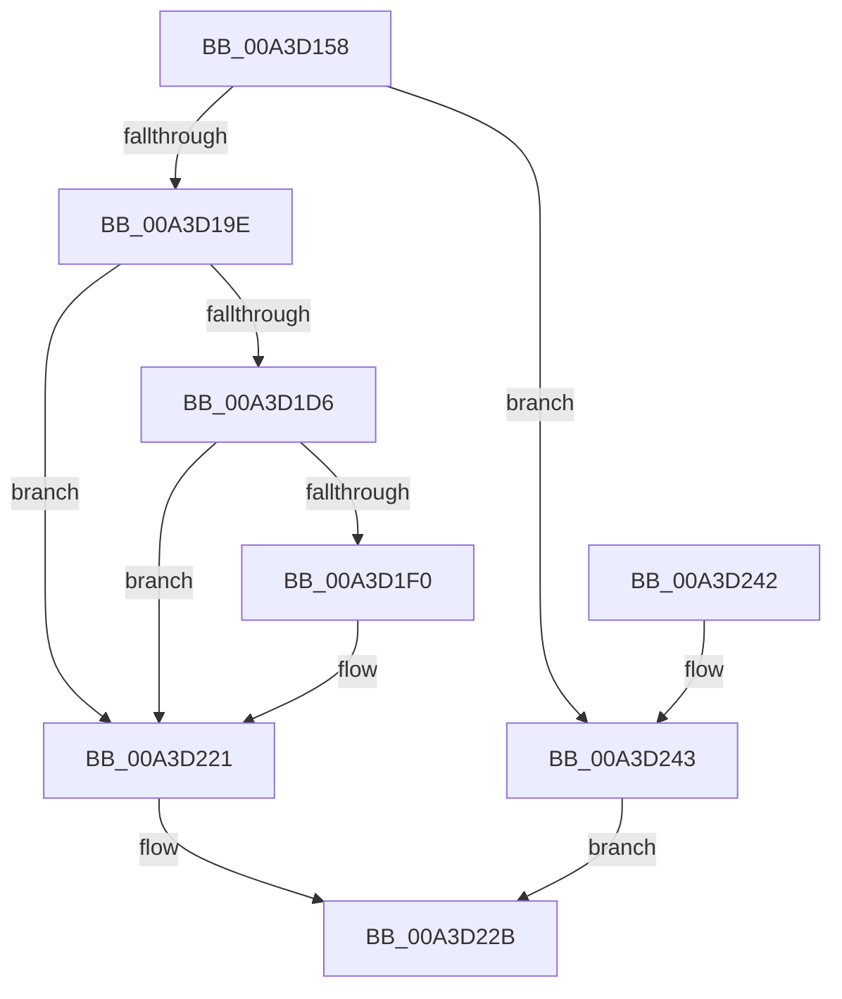

# PopBcdSetupResumeObject

- RVA: `0x00A3D158`–`0x00A3D24A` (길이 `242` bytes)
- VA: `0x0000000140A3D158`
- 실행 섹션: `PAGE`
- PDB 이름 있음: `예`; PDB Function 태그: `아니요`
- unwind 정보 RVA: `0x00073820`
- 디코드: `63`개 명령, `242/242` bytes 표시
- 미해석 바이트: `0` (있으면 어셈블리에 `.byte`로 보존)

> 이 문서는 커널 이미지의 기계어와 PDB 기호를 분석해 생성했습니다. 4번과 5번은 함수 원형과 자료형을 바이너리 사용 방식에서 추정한 C 해석이며 원본 소스 복구 결과는 아닙니다.

## 1. Dependencies

- 직접 호출 지점: **7**; 고유 호출 대상: **5**
- 직접 호출자로 확인된 함수: **2**
- RIP 상대 이미지 참조: **3**

### Outgoing calls
- `0x00A3D18D` → [ExAllocatePool2](../../poolcode/B8/ExAllocatePool2_function_00B820F0.md) (function, `0x00B820F0`)
- `0x00A3D1B7` → [memcpy](../../text/6C/memcpy_function_006C6840.md) (function, `0x006C6840`)
- `0x00A3D1CB` → [BcdSetElementDataWithFlags](BcdSetElementDataWithFlags_function_00A3F080.md) (function, `0x00A3F080`)
- `0x00A3D1E5` → [BcdSetElementDataWithFlags](BcdSetElementDataWithFlags_function_00A3F080.md) (function, `0x00A3F080`)
- `0x00A3D1FC` → [RtlInitUnicodeString](../../text/42/RtlInitUnicodeString_function_0042A780.md) (function, `0x0042A780`)
- `0x00A3D21A` → [BcdSetElementDataWithFlags](BcdSetElementDataWithFlags_function_00A3F080.md) (function, `0x00A3F080`)
- `0x00A3D226` → [ExFreePoolWithTag](../../poolcode/B8/ExFreePoolWithTag_function_00B82870.md) (function, `0x00B82870`)

### Direct callers
- [PopBcdSetPendingResume](../77/PopBcdSetPendingResume_function_007706F8.md) at `0x00770730`
- [PopBcdSetDefaultResumeObjectElements](PopBcdSetDefaultResumeObjectElements_function_00A3C7F8.md) at `0x00A3CA09`

### Static image references
- `0x00A3D16C` → RVA `0x00F0CFD0` (`.data`; read)
- `0x00A3D1B0` → RVA `0x00F0CFD8` (`.data`; read)
- `0x00A3D1F0` → RVA `0x00B01F00` (` ?? ::NNGAKEGL::`string'`; read)

## 2. Other-region calls and transfers

- 다른 실행 섹션으로 향하는 call: **4**
  - `0x00A3D18D` → [ExAllocatePool2](../../poolcode/B8/ExAllocatePool2_function_00B820F0.md) (`PAGE` → `POOLCODE`)
  - `0x00A3D1B7` → [memcpy](../../text/6C/memcpy_function_006C6840.md) (`PAGE` → `.text`)
  - `0x00A3D1FC` → [RtlInitUnicodeString](../../text/42/RtlInitUnicodeString_function_0042A780.md) (`PAGE` → `.text`)
  - `0x00A3D226` → [ExFreePoolWithTag](../../poolcode/B8/ExFreePoolWithTag_function_00B82870.md) (`PAGE` → `POOLCODE`)
- 별도 외부 분기/꼬리 이동을 확인하지 못했습니다.

## 3. Assembly (complete function range)

```asm
00A3D158  48 8B C4                        mov rax, rsp
00A3D15B  48 89 58 08                     mov qword ptr [rax + 8], rbx
00A3D15F  48 89 68 10                     mov qword ptr [rax + 0x10], rbp
00A3D163  48 89 70 18                     mov qword ptr [rax + 0x18], rsi
00A3D167  57                              push rdi
00A3D168  48 83 EC 40                     sub rsp, 0x40
00A3D16C  0F B7 35 5D FE 4C 00            movzx esi, word ptr [rip + 0x4cfe5d]
00A3D173  48 8B E9                        mov rbp, rcx
00A3D176  0F 57 C0                        xorps xmm0, xmm0
00A3D179  83 C6 16                        add esi, 0x16
00A3D17C  8B D6                           mov edx, esi
00A3D17E  B9 00 01 00 00                  mov ecx, 0x100
00A3D183  41 B8 50 42 63 64               mov r8d, 0x64634250
00A3D189  0F 11 40 E8                     movups xmmword ptr [rax - 0x18], xmm0
00A3D18D  E8 5E 4F 14 00                  call 0x140b820f0
00A3D192  48 8B F8                        mov rdi, rax
00A3D195  48 85 C0                        test rax, rax
00A3D198  0F 84 A5 00 00 00               je 0x140a3d243
00A3D19E  C7 00 02 00 00 00               mov dword ptr [rax], 2
00A3D1A4  48 8D 48 14                     lea rcx, [rax + 0x14]
00A3D1A8  44 0F B7 05 20 FE 4C 00         movzx r8d, word ptr [rip + 0x4cfe20]
00A3D1B0  48 8B 15 21 FE 4C 00            mov rdx, qword ptr [rip + 0x4cfe21]
00A3D1B7  E8 84 96 C8 FF                  call 0x1406c6840
00A3D1BC  4C 8B CF                        mov r9, rdi
00A3D1BF  89 74 24 20                     mov dword ptr [rsp + 0x20], esi
00A3D1C3  BA 01 00 00 21                  mov edx, 0x21000001
00A3D1C8  48 8B CD                        mov rcx, rbp
00A3D1CB  E8 B0 1E 00 00                  call 0x140a3f080
00A3D1D0  8B D8                           mov ebx, eax
00A3D1D2  85 C0                           test eax, eax
00A3D1D4  78 4B                           js 0x140a3d221
00A3D1D6  4C 8B CF                        mov r9, rdi
00A3D1D9  89 74 24 20                     mov dword ptr [rsp + 0x20], esi
00A3D1DD  BA 26 00 00 21                  mov edx, 0x21000026
00A3D1E2  48 8B CD                        mov rcx, rbp
00A3D1E5  E8 96 1E 00 00                  call 0x140a3f080
00A3D1EA  8B D8                           mov ebx, eax
00A3D1EC  85 C0                           test eax, eax
00A3D1EE  78 31                           js 0x140a3d221
00A3D1F0  48 8D 15 09 4D 0C 00            lea rdx, [rip + 0xc4d09]
00A3D1F7  48 8D 4C 24 30                  lea rcx, [rsp + 0x30]
00A3D1FC  E8 7F D5 9E FF                  call 0x14042a780
00A3D201  0F B7 44 24 30                  movzx eax, word ptr [rsp + 0x30]
00A3D206  BA 02 00 00 22                  mov edx, 0x22000002
00A3D20B  4C 8B 4C 24 38                  mov r9, qword ptr [rsp + 0x38]
00A3D210  83 C0 02                        add eax, 2
00A3D213  48 8B CD                        mov rcx, rbp
00A3D216  89 44 24 20                     mov dword ptr [rsp + 0x20], eax
00A3D21A  E8 61 1E 00 00                  call 0x140a3f080
00A3D21F  8B D8                           mov ebx, eax
00A3D221  33 D2                           xor edx, edx
00A3D223  48 8B CF                        mov rcx, rdi
00A3D226  E8 45 56 14 00                  call 0x140b82870
00A3D22B  48 8B 6C 24 58                  mov rbp, qword ptr [rsp + 0x58]
00A3D230  8B C3                           mov eax, ebx
00A3D232  48 8B 5C 24 50                  mov rbx, qword ptr [rsp + 0x50]
00A3D237  48 8B 74 24 60                  mov rsi, qword ptr [rsp + 0x60]
00A3D23C  48 83 C4 40                     add rsp, 0x40
00A3D240  5F                              pop rdi
00A3D241  C3                              ret
00A3D242  CC                              int3
00A3D243  BB 9A 00 00 C0                  mov ebx, 0xc000009a
00A3D248  EB E1                           jmp 0x140a3d22b
```

## 4. C-style interpretation (structured pseudocode)

```c
__int64 __fastcall PopBcdSetupResumeObject(__int64 a1)
{
    __int64 result;
    __int64 v_rbx;
    __int64 v_rsi;
    __int64 v_rsp;
    unsigned __int64 v_stack_m10;
    unsigned __int64 v_stack_m18;
    unsigned int v_stack_m28;
    unsigned __int64 v_stack_p10;
    unsigned __int64 v_stack_p18;
    unsigned __int64 v_stack_p8;

    *(unsigned __int64 *)(v_rsp + 8) = v_rbx;
    *(unsigned __int64 *)(v_rsp + 16) = v_rbp;
    *(unsigned __int64 *)(v_rsp + 24) = v_rsi;
    v_rsp = (v_rsp) - (64);
    v_rsi = (unsigned int)((*(unsigned __int16 *)(v_rip + 5045853)) + (22));
    *(unsigned __int64 *)(v_rsp - 24) = v_xmm0;
    result = ExAllocatePool2(256, (unsigned int)((unsigned int)(v_rsi)), (unsigned int)(0x64634250ULL), a4);
    if (result == 0) goto loc_00A3D243;
    *(unsigned int *)(result) = 2;
    result = memcpy(result + 20, *(unsigned __int64 *)(v_rip + 5045793), *(unsigned __int16 *)(v_rip + 5045792), a4);
    v_stack_m28 = (unsigned int)(v_rsi);
    result = BcdSetElementDataWithFlags(a1, (unsigned int)(0x21000001ULL), *(unsigned __int16 *)(v_rip + 5045792), result);
    if (sign_flag) goto loc_00A3D221;
    v_stack_m28 = (unsigned int)(v_rsi);
    result = BcdSetElementDataWithFlags(a1, (unsigned int)(0x21000026ULL), *(unsigned __int16 *)(v_rip + 5045792), result);
    v_rbx = (unsigned int)((unsigned int)(result));
    if (!(sign_flag)) {
        a2 = v_rip + 806153;
        a1 = v_stack_m18;
        result = RtlInitUnicodeString(a1, a2, *(unsigned __int16 *)(v_rip + 5045792), result);
        result = v_stack_m18;
        a2 = 0x22000002ULL;
        a4 = v_stack_m10;
        result = (unsigned int)((result) + (2));
        a1 = a1;
        v_stack_m28 = (unsigned int)(result);
        result = BcdSetElementDataWithFlags(a1, a2, *(unsigned __int16 *)(v_rip + 5045792), a4);
        v_rbx = (unsigned int)(result);
    }
    a2 = 0;
    result = ExFreePoolWithTag(result, a2, *(unsigned __int16 *)(v_rip + 5045792), a4);
loc_00A3D22B:
    v_rsp = (v_rsp) + (64);
    return (unsigned int)((unsigned int)(v_rbx));
loc_00A3D243:
    goto loc_00A3D22B;
}
```

## 5. (Beta) C Style

```c
int64_t PopBcdSetupResumeObject(int64_t Arg1)
{
    int64_t result;
    int64_t local_rbx;
    int64_t local_rsi;
    int64_t local_rsp;
    uint64_t v_stack_m10;
    uint64_t v_stack_m18;
    uint32_t v_stack_m28;
    uint64_t v_stack_p10;
    uint64_t v_stack_p18;
    uint64_t v_stack_p8;

    *(uint64_t *)(local_rsp + 0x8) = local_rbx;
    *(uint64_t *)(local_rsp + 0x10) = local_rbp;
    *(uint64_t *)(local_rsp + 0x18) = local_rsi;
    local_rsp = (local_rsp) - (64);
    local_rsi = (uint32_t)((*(uint16_t *)(v_rip + 0x4CFE5D)) + (22));
    *(uint64_t *)(local_rsp - 0x18) = v_xmm0;
    result = ExAllocatePool2(256, (uint32_t)((uint32_t)(local_rsi)), (uint32_t)(0x64634250ULL), a4);
    if (result == 0) goto loc_00A3D243;
    *(uint32_t *)(result) = 2;
    result = memcpy(result + 20, *(uint64_t *)(v_rip + 0x4CFE21), *(uint16_t *)(v_rip + 0x4CFE20), a4);
    v_stack_m28 = (uint32_t)(local_rsi);
    result = BcdSetElementDataWithFlags(Arg1, (uint32_t)(0x21000001ULL), *(uint16_t *)(v_rip + 0x4CFE20), result);
    if (sign_flag) goto loc_00A3D221;
    v_stack_m28 = (uint32_t)(local_rsi);
    result = BcdSetElementDataWithFlags(Arg1, (uint32_t)(0x21000026ULL), *(uint16_t *)(v_rip + 0x4CFE20), result);
    local_rbx = (uint32_t)((uint32_t)(result));
    if (!(sign_flag)) {
        a2 = v_rip + 806153;
        Arg1 = v_stack_m18;
        result = RtlInitUnicodeString(Arg1, a2, *(uint16_t *)(v_rip + 0x4CFE20), result);
        result = v_stack_m18;
        a2 = 0x22000002ULL;
        a4 = v_stack_m10;
        result = (uint32_t)((result) + (2));
        Arg1 = Arg1;
        v_stack_m28 = (uint32_t)(result);
        result = BcdSetElementDataWithFlags(Arg1, a2, *(uint16_t *)(v_rip + 0x4CFE20), a4);
        local_rbx = (uint32_t)(result);
    }
    a2 = 0;
    result = ExFreePoolWithTag(result, a2, *(uint16_t *)(v_rip + 0x4CFE20), a4);
loc_00A3D22B:
    local_rsp = (local_rsp) + (64);
    return (uint32_t)((uint32_t)(local_rbx));
loc_00A3D243:
    goto loc_00A3D22B;
}
```

## 6. Execution-region graph

[열기: 2D/3D 그래프와 함수 탐색 컨트롤 패널](../../../control-panel.html?section=page&rva=0x00A3D158&view=graph)

- 2D 그래프는 위에서 아래로 흐르고, 3D 그래프는 빈 공간을 드래그해 회전합니다. Shift+드래그는 이동, 휠은 확대·축소, 함수 노드 선택은 대상 보고서 이동입니다.

### Static fallback


