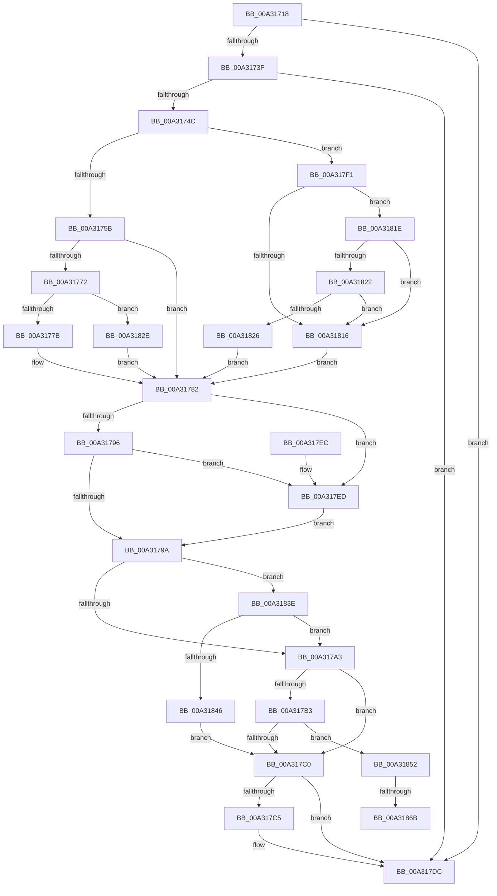

# PopCheckResiliencyScenarios

- RVA: `0x00A31718`–`0x00A3187D` (길이 `357` bytes)
- VA: `0x0000000140A31718`
- 실행 섹션: `PAGE`
- PDB 이름 있음: `예`; PDB Function 태그: `예`
- unwind 정보 RVA: `0x000AD238`
- 디코드: `86`개 명령, `357/357` bytes 표시
- 미해석 바이트: `0` (있으면 어셈블리에 `.byte`로 보존)

> 이 문서는 커널 이미지의 기계어와 PDB 기호를 분석해 생성했습니다. 4번과 5번은 함수 원형과 자료형을 바이너리 사용 방식에서 추정한 C 해석이며 원본 소스 복구 결과는 아닙니다.

## 1. Dependencies

- 직접 호출 지점: **9**; 고유 호출 대상: **7**
- 직접 호출자로 확인된 함수: **8**
- RIP 상대 이미지 참조: **17**

### Outgoing calls
- `0x00A31769` → [PopDeepSleepEnabled](../../text/49/PopDeepSleepEnabled_function_0049E5E0.md) (function, `0x0049E5E0`)
- `0x00A31782` → [PopDeepSleepEnabled](../../text/49/PopDeepSleepEnabled_function_0049E5E0.md) (function, `0x0049E5E0`)
- `0x00A317A5` → [PopDeepSleepSetDisengageReason](../../text/38/PopDeepSleepSetDisengageReason_function_0038FEC4.md) (function, `0x0038FEC4`)
- `0x00A317B3` → [PopDeepSleepEnabled](../../text/49/PopDeepSleepEnabled_function_0049E5E0.md) (function, `0x0049E5E0`)
- `0x00A317D7` → [PopEnsureCoalescingWorkerWillRun](../../text/4C/PopEnsureCoalescingWorkerWillRun_function_004C266C.md) (function, `0x004C266C`)
- `0x00A3182E` → [PpmGetDeepSleepPlatformStateIndex](../../text/4B/PpmGetDeepSleepPlatformStateIndex_function_004B09F0.md) (function, `0x004B09F0`)
- `0x00A31848` → [PopDeepSleepClearDisengageReason](../../text/39/PopDeepSleepClearDisengageReason_function_0039010C.md) (function, `0x0039010C`)
- `0x00A31859` → [PpmAcquireLock](../../text/2D/PpmAcquireLock_function_002D9AA4.md) (function, `0x002D9AA4`)
- `0x00A31872` → [PoFxSendSystemLatencyUpdate](../../text/46/PoFxSendSystemLatencyUpdate_function_0046A008.md) (function, `0x0046A008`)

### Direct callers
- [PopCoalescingSetActiveState](../../text/4B/PopCoalescingSetActiveState_function_004B7E18.md) at `0x004B7E3D`
- [PopCoalescingPowerSettingCallback](../75/PopCoalescingPowerSettingCallback_function_0075C170.md) at `0x0075C1E0`
- [PopDeepSleepPowerSettingCallback](../76/PopDeepSleepPowerSettingCallback_function_00765360.md) at `0x007653A5`
- [PopUpdateConsoleDisplayState](PopUpdateConsoleDisplayState_function_00A31298.md) at `0x00A312CD`
- [PdcPoResiliencyClient](PdcPoResiliencyClient_function_00A314B0.md) at `0x00A31509`
- [PopPdcIdleResiliencyCallback](PopPdcIdleResiliencyCallback_function_00A31518.md) at `0x00A31580`
- [PopPowerRequestCallbackExecutionRequired](PopPowerRequestCallbackExecutionRequired_function_00A31660.md) at `0x00A316D0`
- [PopTransitionSystemPowerStateEx](../../pagelk/B7/PopTransitionSystemPowerStateEx_function_00B7E8C0.md) at `0x00B7EADA`

### Static image references
- `0x00A31727` → RVA `0x00FC6CCC` (`ALMOSTRO`; read)
- `0x00A31732` → RVA `0x00FC6AF0` (`ALMOSTRO`; read)
- `0x00A3173F` → RVA `0x00FC6ADF` (`ALMOSTRO`; read)
- `0x00A3174C` → RVA `0x00F0CED4` (`.data`; read)
- `0x00A3175B` → RVA `0x00F0C720` (`.data`; read)
- `0x00A31762` → RVA `0x00F0C8D8` (`.data`; read)
- `0x00A3177B` → RVA `0x00E0B3B4` (`.data`; read/write)
- `0x00A31787` → RVA `0x00FC6E38` (`ALMOSTRO`; read)
- `0x00A317C5` → RVA `0x00F0E068` (`.data`; read)
- `0x00A317D1` → RVA `0x00F0E068` (`.data`; write)
- `0x00A317F1` → RVA `0x00F0BC70` (`.data`; read)
- `0x00A317FB` → RVA `0x00E67A50` (`.data`; read)
- `0x00A31805` → RVA `0x00F0BD41` (`.data`; read)
- `0x00A31833` → RVA `0x00E0B3B4` (`.data`; write)
- `0x00A31852` → RVA `0x00F0E760` (`.data`; read)
- `0x00A3185E` → RVA `0x00F092F0` (`.data`; read)
- `0x00A3186B` → RVA `0x00F092F0` (`.data`; write)

## 2. Other-region calls and transfers

- 다른 실행 섹션으로 향하는 call: **9**
  - `0x00A31769` → [PopDeepSleepEnabled](../../text/49/PopDeepSleepEnabled_function_0049E5E0.md) (`PAGE` → `.text`)
  - `0x00A31782` → [PopDeepSleepEnabled](../../text/49/PopDeepSleepEnabled_function_0049E5E0.md) (`PAGE` → `.text`)
  - `0x00A317A5` → [PopDeepSleepSetDisengageReason](../../text/38/PopDeepSleepSetDisengageReason_function_0038FEC4.md) (`PAGE` → `.text`)
  - `0x00A317B3` → [PopDeepSleepEnabled](../../text/49/PopDeepSleepEnabled_function_0049E5E0.md) (`PAGE` → `.text`)
  - `0x00A317D7` → [PopEnsureCoalescingWorkerWillRun](../../text/4C/PopEnsureCoalescingWorkerWillRun_function_004C266C.md) (`PAGE` → `.text`)
  - `0x00A3182E` → [PpmGetDeepSleepPlatformStateIndex](../../text/4B/PpmGetDeepSleepPlatformStateIndex_function_004B09F0.md) (`PAGE` → `.text`)
  - `0x00A31848` → [PopDeepSleepClearDisengageReason](../../text/39/PopDeepSleepClearDisengageReason_function_0039010C.md) (`PAGE` → `.text`)
  - `0x00A31859` → [PpmAcquireLock](../../text/2D/PpmAcquireLock_function_002D9AA4.md) (`PAGE` → `.text`)
  - `0x00A31872` → [PoFxSendSystemLatencyUpdate](../../text/46/PoFxSendSystemLatencyUpdate_function_0046A008.md) (`PAGE` → `.text`)
- call이 아닌 외부 분기/꼬리 이동: **2**
  - `0x00A31865` → [sub_00B39B7E](../B3/Unknown_function_00B39B7E.md) (`tail-transfer`)
  - `0x00A31878` → [sub_00B39B7E](../B3/Unknown_function_00B39B7E.md) (`tail-transfer`)

## 3. Assembly (complete function range)

```asm
00A31718  48 89 5C 24 08                  mov qword ptr [rsp + 8], rbx
00A3171D  48 89 74 24 10                  mov qword ptr [rsp + 0x10], rsi
00A31722  57                              push rdi
00A31723  48 83 EC 20                     sub rsp, 0x20
00A31727  83 3D 9E 55 59 00 00            cmp dword ptr [rip + 0x59559e], 0
00A3172E  40 0F 95 C6                     setne sil
00A31732  80 3D B7 53 59 00 00            cmp byte ptr [rip + 0x5953b7], 0
00A31739  0F 85 9D 00 00 00               jne 0x140a317dc
00A3173F  80 3D 99 53 59 00 00            cmp byte ptr [rip + 0x595399], 0
00A31746  0F 85 90 00 00 00               jne 0x140a317dc
00A3174C  80 3D 81 B7 4D 00 00            cmp byte ptr [rip + 0x4db781], 0
00A31753  B3 01                           mov bl, 1
00A31755  0F 84 96 00 00 00               je 0x140a317f1
00A3175B  40 8A 3D BE AF 4D 00            mov dil, byte ptr [rip + 0x4dafbe]
00A31762  44 8A 05 6F B1 4D 00            mov r8b, byte ptr [rip + 0x4db16f]
00A31769  E8 72 CE A6 FF                  call 0x14049e5e0
00A3176E  84 C0                           test al, al
00A31770  74 10                           je 0x140a31782
00A31772  40 84 FF                        test dil, dil
00A31775  0F 85 B3 00 00 00               jne 0x140a3182e
00A3177B  83 0D 32 9C 3D 00 FF            or dword ptr [rip + 0x3d9c32], 0xffffffff
00A31782  E8 59 CE A6 FF                  call 0x14049e5e0
00A31787  83 3D AA 56 59 00 00            cmp dword ptr [rip + 0x5956aa], 0
00A3178E  0F 95 C1                        setne cl
00A31791  45 84 C0                        test r8b, r8b
00A31794  74 57                           je 0x140a317ed
00A31796  84 C9                           test cl, cl
00A31798  74 53                           je 0x140a317ed
00A3179A  40 84 FF                        test dil, dil
00A3179D  0F 85 9B 00 00 00               jne 0x140a3183e
00A317A3  33 C9                           xor ecx, ecx
00A317A5  E8 1A E7 95 FF                  call 0x14038fec4
00A317AA  80 3D 23 B7 4D 00 00            cmp byte ptr [rip + 0x4db723], 0
00A317B1  74 0D                           je 0x140a317c0
00A317B3  E8 28 CE A6 FF                  call 0x14049e5e0
00A317B8  84 C0                           test al, al
00A317BA  0F 84 92 00 00 00               je 0x140a31852
00A317C0  40 3A DE                        cmp bl, sil
00A317C3  74 17                           je 0x140a317dc
00A317C5  8A 05 9D C8 4D 00               mov al, byte ptr [rip + 0x4dc89d]
00A317CB  02 DB                           add bl, bl
00A317CD  24 FD                           and al, 0xfd
00A317CF  0A C3                           or al, bl
00A317D1  88 05 91 C8 4D 00               mov byte ptr [rip + 0x4dc891], al
00A317D7  E8 90 0E A9 FF                  call 0x1404c266c
00A317DC  48 8B 5C 24 30                  mov rbx, qword ptr [rsp + 0x30]
00A317E1  48 8B 74 24 38                  mov rsi, qword ptr [rsp + 0x38]
00A317E6  48 83 C4 20                     add rsp, 0x20
00A317EA  5F                              pop rdi
00A317EB  C3                              ret
00A317EC  CC                              int3
00A317ED  32 DB                           xor bl, bl
00A317EF  EB A9                           jmp 0x140a3179a
00A317F1  83 3D 78 A4 4D 00 00            cmp dword ptr [rip + 0x4da478], 0
00A317F8  0F 95 C0                        setne al
00A317FB  83 3D 4E 62 43 00 00            cmp dword ptr [rip + 0x43624e], 0
00A31802  0F 95 C2                        setne dl
00A31805  80 3D 35 A5 4D 00 03            cmp byte ptr [rip + 0x4da535], 3
00A3180C  0F 94 C1                        sete cl
00A3180F  40 32 FF                        xor dil, dil
00A31812  84 C0                           test al, al
00A31814  74 08                           je 0x140a3181e
00A31816  45 32 C0                        xor r8b, r8b
00A31819  E9 64 FF FF FF                  jmp 0x140a31782
00A3181E  84 D2                           test dl, dl
00A31820  75 F4                           jne 0x140a31816
00A31822  84 C9                           test cl, cl
00A31824  75 F0                           jne 0x140a31816
00A31826  44 8A C3                        mov r8b, bl
00A31829  E9 54 FF FF FF                  jmp 0x140a31782
00A3182E  E8 BD F1 A7 FF                  call 0x1404b09f0
00A31833  89 05 7B 9B 3D 00               mov dword ptr [rip + 0x3d9b7b], eax
00A31839  E9 44 FF FF FF                  jmp 0x140a31782
00A3183E  84 C0                           test al, al
00A31840  0F 84 5D FF FF FF               je 0x140a317a3
00A31846  33 C9                           xor ecx, ecx
00A31848  E8 BF E8 95 FF                  call 0x14039010c
00A3184D  E9 6E FF FF FF                  jmp 0x140a317c0
00A31852  48 8D 0D 07 CF 4D 00            lea rcx, [rip + 0x4dcf07]
00A31859  E8 46 82 8A FF                  call 0x1402d9aa4
00A3185E  40 38 3D 8B 7A 4D 00            cmp byte ptr [rip + 0x4d7a8b], dil
00A31865  0F 84 13 83 10 00               je 0x140b39b7e
00A3186B  40 88 3D 7E 7A 4D 00            mov byte ptr [rip + 0x4d7a7e], dil
00A31872  E8 91 87 A3 FF                  call 0x14046a008
00A31877  90                              nop
00A31878  E9 01 83 10 00                  jmp 0x140b39b7e
```

## 4. C-style interpretation (structured pseudocode)

```c
__int64 __fastcall PopCheckResiliencyScenarios(void)
{
    __int64 result;
    __int64 v_rbx;
    __int64 v_rdi;
    __int64 v_rsi;
    __int64 v_rsp;
    unsigned __int64 v_stack_p10;
    unsigned __int64 v_stack_p8;

    v_stack_p8 = v_rbx;
    v_stack_p10 = v_rsi;
    v_rsp = (v_rsp) - (32);
    v_rsi = ((*(unsigned int *)(v_rip + 5854622)) != 0) ? 1 : 0;
    if ((*(unsigned __int8 *)(v_rip + 5854135)) != 0) goto loc_00A317DC;
    if ((*(unsigned __int8 *)(v_rip + 5854105)) != 0) goto loc_00A317DC;
    if ((*(unsigned __int8 *)(v_rip + 5093249)) == 0) goto loc_00A317F1;
    result = PopDeepSleepEnabled(a1, a2, *(unsigned __int8 *)(v_rip + 5091695), a4);
    if ((unsigned __int8)(result) == 0) goto loc_00A31782;
    if ((unsigned __int8)(*(unsigned __int8 *)(v_rip + 5091262)) != 0) goto loc_00A3182E;
loc_00A31782:
    result = PopDeepSleepEnabled(a1, a2, *(unsigned __int8 *)(v_rip + 5091695), a4);
    a1 = ((*(unsigned int *)(v_rip + 5854890)) != 0) ? 1 : 0;
    if ((unsigned __int8)(*(unsigned __int8 *)(v_rip + 5091695)) == 0) goto loc_00A317ED;
    if ((unsigned __int8)(a1) == 0) goto loc_00A317ED;
loc_00A3179A:
    if ((unsigned __int8)(*(unsigned __int8 *)(v_rip + 5091262)) != 0) goto loc_00A3183E;
loc_00A317A3:
    a1 = 0;
    result = PopDeepSleepSetDisengageReason(a1, a2, *(unsigned __int8 *)(v_rip + 5091695), a4);
    if ((*(unsigned __int8 *)(v_rip + 5093155)) == 0) goto loc_00A317C0;
    result = PopDeepSleepEnabled(a1, a2, *(unsigned __int8 *)(v_rip + 5091695), a4);
    if ((unsigned __int8)(result) == 0) goto loc_00A31852;
loc_00A317C0:
    v_rbx = 1;
    if (1 != ((unsigned __int8)(v_rsi))) {
        result = *(unsigned __int8 *)(v_rip + 5097629);
        v_rbx = (unsigned __int8)((1) + (1));
        result = (unsigned __int8)((result) & (253));
        result = (unsigned __int8)((result) | ((unsigned __int8)(v_rbx)));
        *(unsigned __int8 *)(v_rip + 5097617) = (unsigned __int8)(result);
        result = PopEnsureCoalescingWorkerWillRun(a1, a2, *(unsigned __int8 *)(v_rip + 5091695), a4);
    }
    v_rsp = (v_rsp) + (32);
    return result;
loc_00A317ED:
    v_rbx = 0;
    goto loc_00A3179A;
loc_00A317F1:
    result = ((*(unsigned int *)(v_rip + 5088376)) != 0) ? 1 : 0;
    a2 = ((*(unsigned int *)(v_rip + 4416078)) != 0) ? 1 : 0;
    a1 = ((*(unsigned __int8 *)(v_rip + 5088565)) == 3) ? 1 : 0;
    v_rdi = 0;
    if ((unsigned __int8)(result) == 0) goto loc_00A3181E;
loc_00A31816:
    a3 = 0;
    goto loc_00A31782;
loc_00A3181E:
    if ((unsigned __int8)(a2) != 0) goto loc_00A31816;
    if ((unsigned __int8)(a1) != 0) goto loc_00A31816;
    goto loc_00A31782;
loc_00A3182E:
    result = PpmGetDeepSleepPlatformStateIndex(a1, a2, 0, a4);
    *(unsigned int *)(v_rip + 4037499) = (unsigned int)(result);
    goto loc_00A31782;
loc_00A3183E:
    if ((unsigned __int8)(result) == 0) goto loc_00A317A3;
    a1 = 0;
    result = PopDeepSleepClearDisengageReason(a1, a2, 0, a4);
    goto loc_00A317C0;
loc_00A31852:
    result = PpmAcquireLock(v_rip + 5099271, a2, 0, a4);
    *(unsigned __int8 *)(v_rip + 5077630) = 0;
    result = PoFxSendSystemLatencyUpdate(v_rip + 5099271, a2, 0, a4);
}
```

## 5. (Beta) C Style

```c
void PopCheckResiliencyScenarios(void)
{
    int64_t result;
    int64_t local_rbx;
    int64_t local_rdi;
    int64_t local_rsi;
    int64_t local_rsp;
    uint64_t v_stack_p10;
    uint64_t v_stack_p8;

    v_stack_p8 = local_rbx;
    v_stack_p10 = local_rsi;
    local_rsp = (local_rsp) - (32);
    local_rsi = ((*(uint32_t *)(v_rip + 0x59559E)) != 0) ? 1 : 0;
    if ((*(uint8_t *)(v_rip + 0x5953B7)) != 0) goto loc_00A317DC;
    if ((*(uint8_t *)(v_rip + 0x595399)) != 0) goto loc_00A317DC;
    if ((*(uint8_t *)(v_rip + 0x4DB781)) == 0) goto loc_00A317F1;
    result = PopDeepSleepEnabled(a1, a2, *(uint8_t *)(v_rip + 0x4DB16F), a4);
    if ((uint8_t)(result) == 0) goto loc_00A31782;
    if ((uint8_t)(*(uint8_t *)(v_rip + 0x4DAFBE)) != 0) goto loc_00A3182E;
loc_00A31782:
    result = PopDeepSleepEnabled(a1, a2, *(uint8_t *)(v_rip + 0x4DB16F), a4);
    a1 = ((*(uint32_t *)(v_rip + 0x5956AA)) != 0) ? 1 : 0;
    if ((uint8_t)(*(uint8_t *)(v_rip + 0x4DB16F)) == 0) goto loc_00A317ED;
    if ((uint8_t)(a1) == 0) goto loc_00A317ED;
loc_00A3179A:
    if ((uint8_t)(*(uint8_t *)(v_rip + 0x4DAFBE)) != 0) goto loc_00A3183E;
loc_00A317A3:
    a1 = 0;
    result = PopDeepSleepSetDisengageReason(a1, a2, *(uint8_t *)(v_rip + 0x4DB16F), a4);
    if ((*(uint8_t *)(v_rip + 0x4DB723)) == 0) goto loc_00A317C0;
    result = PopDeepSleepEnabled(a1, a2, *(uint8_t *)(v_rip + 0x4DB16F), a4);
    if ((uint8_t)(result) == 0) goto loc_00A31852;
loc_00A317C0:
    local_rbx = 1;
    if (1 != ((uint8_t)(local_rsi))) {
        result = *(uint8_t *)(v_rip + 0x4DC89D);
        local_rbx = (uint8_t)((1) + (1));
        result = (uint8_t)((result) & (253));
        result = (uint8_t)((result) | ((uint8_t)(local_rbx)));
        *(uint8_t *)(v_rip + 0x4DC891) = (uint8_t)(result);
        result = PopEnsureCoalescingWorkerWillRun(a1, a2, *(uint8_t *)(v_rip + 0x4DB16F), a4);
    }
    local_rsp = (local_rsp) + (32);
    return result;
loc_00A317ED:
    local_rbx = 0;
    goto loc_00A3179A;
loc_00A317F1:
    result = ((*(uint32_t *)(v_rip + 0x4DA478)) != 0) ? 1 : 0;
    a2 = ((*(uint32_t *)(v_rip + 0x43624E)) != 0) ? 1 : 0;
    a1 = ((*(uint8_t *)(v_rip + 0x4DA535)) == 3) ? 1 : 0;
    local_rdi = 0;
    if ((uint8_t)(result) == 0) goto loc_00A3181E;
loc_00A31816:
    a3 = 0;
    goto loc_00A31782;
loc_00A3181E:
    if ((uint8_t)(a2) != 0) goto loc_00A31816;
    if ((uint8_t)(a1) != 0) goto loc_00A31816;
    goto loc_00A31782;
loc_00A3182E:
    result = PpmGetDeepSleepPlatformStateIndex(a1, a2, 0, a4);
    *(uint32_t *)(v_rip + 0x3D9B7B) = (uint32_t)(result);
    goto loc_00A31782;
loc_00A3183E:
    if ((uint8_t)(result) == 0) goto loc_00A317A3;
    a1 = 0;
    result = PopDeepSleepClearDisengageReason(a1, a2, 0, a4);
    goto loc_00A317C0;
loc_00A31852:
    result = PpmAcquireLock(v_rip + 5099271, a2, 0, a4);
    *(uint8_t *)(v_rip + 0x4D7A7E) = 0;
    result = PoFxSendSystemLatencyUpdate(v_rip + 5099271, a2, 0, a4);
}
```

## 6. Execution-region graph

[열기: 2D/3D 그래프와 함수 탐색 컨트롤 패널](../../../control-panel.html?section=page&rva=0x00A31718&view=graph)

- 2D 그래프는 위에서 아래로 흐르고, 3D 그래프는 빈 공간을 드래그해 회전합니다. Shift+드래그는 이동, 휠은 확대·축소, 함수 노드 선택은 대상 보고서 이동입니다.

### Static fallback


