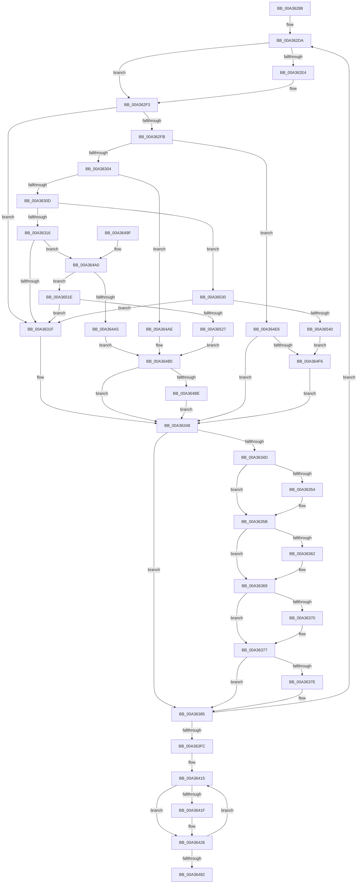

# PopConfigureHeteroThresholds

- RVA: `0x00A36288`–`0x00A36542` (길이 `698` bytes)
- VA: `0x0000000140A36288`
- 실행 섹션: `PAGE`
- PDB 이름 있음: `예`; PDB Function 태그: `아니요`
- unwind 정보 RVA: `0x000AD9A8`
- 디코드: `173`개 명령, `698/698` bytes 표시
- 미해석 바이트: `0` (있으면 어셈블리에 `.byte`로 보존)

> 이 문서는 커널 이미지의 기계어와 PDB 기호를 분석해 생성했습니다. 4번과 5번은 함수 원형과 자료형을 바이너리 사용 방식에서 추정한 C 해석이며 원본 소스 복구 결과는 아닙니다.

## 1. Dependencies

- 직접 호출 지점: **1**; 고유 호출 대상: **1**
- 직접 호출자로 확인된 함수: **1**
- RIP 상대 이미지 참조: **9**

### Outgoing calls
- `0x00A363FC` → [Feature_UpperThresholdInheritance__private_ReportDeviceUsage](../../text/4A/Feature_UpperThresholdInheritance__private_ReportDeviceUsage_function_004AEE8C.md) (function, `0x004AEE8C`)

### Direct callers
- [PopConfigureHeteroPolicies](PopConfigureHeteroPolicies_function_00A35B30.md) at `0x00A35E37`

### Static image references
- `0x00A362A8` → RVA `0x00E0B3F4` (`.data`; read)
- `0x00A3631F` → RVA `0x00E08380` (`.data`; read)
- `0x00A3632F` → RVA `0x00F0CE0C` (`.data`; read)
- `0x00A36405` → RVA `0x00E0B3FC` (`.data`; read)
- `0x00A364A5` → RVA `0x00F07798` (`.data`; read)
- `0x00A364AE` → RVA `0x00F07788` (`.data`; read)
- `0x00A364E6` → RVA `0x00F07790` (`.data`; read)
- `0x00A36527` → RVA `0x00F077A0` (`.data`; read)
- `0x00A36530` → RVA `0x00F07780` (`.data`; read)

## 2. Other-region calls and transfers

- 다른 실행 섹션으로 향하는 call: **1**
  - `0x00A363FC` → [Feature_UpperThresholdInheritance__private_ReportDeviceUsage](../../text/4A/Feature_UpperThresholdInheritance__private_ReportDeviceUsage_function_004AEE8C.md) (`PAGE` → `.text`)
- 별도 외부 분기/꼬리 이동을 확인하지 못했습니다.

## 3. Assembly (complete function range)

```asm
00A36288  48 8B C4                        mov rax, rsp
00A3628B  48 89 58 08                     mov qword ptr [rax + 8], rbx
00A3628F  48 89 68 10                     mov qword ptr [rax + 0x10], rbp
00A36293  48 89 70 18                     mov qword ptr [rax + 0x18], rsi
00A36297  57                              push rdi
00A36298  41 54                           push r12
00A3629A  41 55                           push r13
00A3629C  41 56                           push r14
00A3629E  41 57                           push r15
00A362A0  48 83 EC 30                     sub rsp, 0x30
00A362A4  44 0F B6 DA                     movzx r11d, dl
00A362A8  4C 8D 3D 45 51 3D 00            lea r15, [rip + 0x3d5145]
00A362AF  40 32 ED                        xor bpl, bpl
00A362B2  45 32 F6                        xor r14b, r14b
00A362B5  45 33 C9                        xor r9d, r9d
00A362B8  0F 57 C0                        xorps xmm0, xmm0
00A362BB  0F 11 40 C8                     movups xmmword ptr [rax - 0x38], xmm0
00A362BF  4C 8B 50 C8                     mov r10, qword ptr [rax - 0x38]
00A362C3  48 8B D9                        mov rbx, rcx
00A362C6  41 8A FB                        mov dil, r11b
00A362C9  41 8A F3                        mov sil, r11b
00A362CC  45 8D 69 07                     lea r13d, [r9 + 7]
00A362D0  49 B8 00 00 00 00 00 00 00 F0   movabs r8, 0xf000000000000000
00A362DA  41 80 3F 00                     cmp byte ptr [r15], 0
00A362DE  45 8B 67 FC                     mov r12d, dword ptr [r15 - 4]
00A362E2  75 0F                           jne 0x140a362f3
00A362E4  40 32 ED                        xor bpl, bpl
00A362E7  45 32 F6                        xor r14b, r14b
00A362EA  45 33 C9                        xor r9d, r9d
00A362ED  41 8A FB                        mov dil, r11b
00A362F0  41 8A F3                        mov sil, r11b
00A362F3  41 8B C4                        mov eax, r12d
00A362F6  45 85 E4                        test r12d, r12d
00A362F9  74 24                           je 0x140a3631f
00A362FB  83 E8 01                        sub eax, 1
00A362FE  0F 84 E2 01 00 00               je 0x140a364e6
00A36304  83 E8 01                        sub eax, 1
00A36307  0F 84 A1 01 00 00               je 0x140a364ae
00A3630D  83 E8 01                        sub eax, 1
00A36310  0F 84 1A 02 00 00               je 0x140a36530
00A36316  83 E8 01                        sub eax, 1
00A36319  0F 85 81 01 00 00               jne 0x140a364a0
00A3631F  4C 8B 0D 5A 20 3D 00            mov r9, qword ptr [rip + 0x3d205a]
00A36326  4C 8B 54 24 20                  mov r10, qword ptr [rsp + 0x20]
00A3632B  49 83 C1 28                     add r9, 0x28
00A3632F  48 63 05 D6 6A 4D 00            movsxd rax, dword ptr [rip + 0x4d6ad6]
00A36336  48 69 C8 E8 01 00 00            imul rcx, rax, 0x1e8
00A3633D  4C 03 C9                        add r9, rcx
00A36340  4D 0B D0                        or r10, r8
00A36343  4C 89 54 24 20                  mov qword ptr [rsp + 0x20], r10
00A36348  4D 85 C9                        test r9, r9
00A3634B  74 38                           je 0x140a36385
00A3634D  49 0F BA E2 3C                  bt r10, 0x3c
00A36352  73 07                           jae 0x140a3635b
00A36354  41 8A B9 C6 01 00 00            mov dil, byte ptr [r9 + 0x1c6]
00A3635B  49 0F BA E2 3D                  bt r10, 0x3d
00A36360  73 07                           jae 0x140a36369
00A36362  41 8A A9 C4 01 00 00            mov bpl, byte ptr [r9 + 0x1c4]
00A36369  49 0F BA E2 3E                  bt r10, 0x3e
00A3636E  73 07                           jae 0x140a36377
00A36370  41 8A B1 C7 01 00 00            mov sil, byte ptr [r9 + 0x1c7]
00A36377  49 0F BA E2 3F                  bt r10, 0x3f
00A3637C  73 07                           jae 0x140a36385
00A3637E  45 8A B1 C5 01 00 00            mov r14b, byte ptr [r9 + 0x1c5]
00A36385  45 3A F3                        cmp r14b, r11b
00A36388  45 0F B6 C6                     movzx r8d, r14b
00A3638C  40 0F B6 D5                     movzx edx, bpl
00A36390  45 0F 47 C3                     cmova r8d, r11d
00A36394  40 0F B6 CE                     movzx ecx, sil
00A36398  41 3A EB                        cmp bpl, r11b
00A3639B  41 0F 47 D3                     cmova edx, r11d
00A3639F  41 3A F3                        cmp sil, r11b
00A363A2  0F B6 C2                        movzx eax, dl
00A363A5  41 0F 47 CB                     cmova ecx, r11d
00A363A9  41 3A FB                        cmp dil, r11b
00A363AC  0F B6 F1                        movzx esi, cl
00A363AF  40 0F B6 CF                     movzx ecx, dil
00A363B3  44 8B F6                        mov r14d, esi
00A363B6  41 0F 47 CB                     cmova ecx, r11d
00A363BA  42 88 74 63 4D                  mov byte ptr [rbx + r12*2 + 0x4d], sil
00A363BF  0F B6 F9                        movzx edi, cl
00A363C2  40 3A D7                        cmp dl, dil
00A363C5  42 88 7C 63 4C                  mov byte ptr [rbx + r12*2 + 0x4c], dil
00A363CA  8B EF                           mov ebp, edi
00A363CC  0F 46 E8                        cmovbe ebp, eax
00A363CF  44 3A C6                        cmp r8b, sil
00A363D2  41 0F B6 C0                     movzx eax, r8b
00A363D6  49 B8 00 00 00 00 00 00 00 F0   movabs r8, 0xf000000000000000
00A363E0  44 0F 46 F0                     cmovbe r14d, eax
00A363E4  42 88 6C 63 5A                  mov byte ptr [rbx + r12*2 + 0x5a], bpl
00A363E9  49 83 C7 08                     add r15, 8
00A363ED  46 88 74 63 5B                  mov byte ptr [rbx + r12*2 + 0x5b], r14b
00A363F2  49 83 ED 01                     sub r13, 1
00A363F6  0F 85 DE FE FF FF               jne 0x140a362da
00A363FC  E8 8B 8A A7 FF                  call 0x1404aee8c
00A36401  44 8A 53 4C                     mov r10b, byte ptr [rbx + 0x4c]
00A36405  4C 8D 0D F0 4F 3D 00            lea r9, [rip + 0x3d4ff0]
00A3640C  8A 53 4D                        mov dl, byte ptr [rbx + 0x4d]
00A3640F  41 BB 06 00 00 00               mov r11d, 6
00A36415  41 80 39 00                     cmp byte ptr [r9], 0
00A36419  41 8B 41 FC                     mov eax, dword ptr [r9 - 4]
00A3641D  75 07                           jne 0x140a36426
00A3641F  44 8A 53 4C                     mov r10b, byte ptr [rbx + 0x4c]
00A36423  8A 53 4D                        mov dl, byte ptr [rbx + 0x4d]
00A36426  0F B6 4C 43 4C                  movzx ecx, byte ptr [rbx + rax*2 + 0x4c]
00A3642B  4C 8B C0                        mov r8, rax
00A3642E  41 3A CA                        cmp cl, r10b
00A36431  41 0F B6 C2                     movzx eax, r10b
00A36435  0F 43 C8                        cmovae ecx, eax
00A36438  42 0F B6 44 43 4D               movzx eax, byte ptr [rbx + r8*2 + 0x4d]
00A3643E  3A C2                           cmp al, dl
00A36440  44 0F B6 D1                     movzx r10d, cl
00A36444  42 0F B6 4C 43 5A               movzx ecx, byte ptr [rbx + r8*2 + 0x5a]
00A3644A  0F 43 C2                        cmovae eax, edx
00A3644D  46 88 54 43 4C                  mov byte ptr [rbx + r8*2 + 0x4c], r10b
00A36452  0F B6 D0                        movzx edx, al
00A36455  41 3A CA                        cmp cl, r10b
00A36458  41 8B C2                        mov eax, r10d
00A3645B  42 88 54 43 4D                  mov byte ptr [rbx + r8*2 + 0x4d], dl
00A36460  0F 42 C1                        cmovb eax, ecx
00A36463  42 88 44 43 5A                  mov byte ptr [rbx + r8*2 + 0x5a], al
00A36468  42 0F B6 44 43 5B               movzx eax, byte ptr [rbx + r8*2 + 0x5b]
00A3646E  3A C2                           cmp al, dl
00A36470  0F 43 C2                        cmovae eax, edx
00A36473  49 83 C1 08                     add r9, 8
00A36477  42 88 44 43 5B                  mov byte ptr [rbx + r8*2 + 0x5b], al
00A3647C  49 83 EB 01                     sub r11, 1
00A36480  75 93                           jne 0x140a36415
00A36482  48 8B 5C 24 60                  mov rbx, qword ptr [rsp + 0x60]
00A36487  48 8B 6C 24 68                  mov rbp, qword ptr [rsp + 0x68]
00A3648C  48 8B 74 24 70                  mov rsi, qword ptr [rsp + 0x70]
00A36491  48 83 C4 30                     add rsp, 0x30
00A36495  41 5F                           pop r15
00A36497  41 5E                           pop r14
00A36499  41 5D                           pop r13
00A3649B  41 5C                           pop r12
00A3649D  5F                              pop rdi
00A3649E  C3                              ret
00A3649F  CC                              int3
00A364A0  83 E8 01                        sub eax, 1
00A364A3  75 79                           jne 0x140a3651e
00A364A5  48 8B 15 EC 12 4D 00            mov rdx, qword ptr [rip + 0x4d12ec]
00A364AC  EB 07                           jmp 0x140a364b5
00A364AE  48 8B 15 D3 12 4D 00            mov rdx, qword ptr [rip + 0x4d12d3]
00A364B5  48 85 D2                        test rdx, rdx
00A364B8  0F 84 8A FE FF FF               je 0x140a36348
00A364BE  48 63 05 47 69 4D 00            movsxd rax, dword ptr [rip + 0x4d6947]
00A364C5  4C 69 C8 E8 01 00 00            imul r9, rax, 0x1e8
00A364CC  49 83 C1 28                     add r9, 0x28
00A364D0  4C 03 CA                        add r9, rdx
00A364D3  41 0F 10 01                     movups xmm0, xmmword ptr [r9]
00A364D7  0F 11 44 24 20                  movups xmmword ptr [rsp + 0x20], xmm0
00A364DC  66 49 0F 7E C2                  movq r10, xmm0
00A364E1  E9 62 FE FF FF                  jmp 0x140a36348
00A364E6  48 8B 15 A3 12 4D 00            mov rdx, qword ptr [rip + 0x4d12a3]
00A364ED  48 85 D2                        test rdx, rdx
00A364F0  0F 84 52 FE FF FF               je 0x140a36348
00A364F6  48 63 05 0F 69 4D 00            movsxd rax, dword ptr [rip + 0x4d690f]
00A364FD  4C 69 C8 E8 01 00 00            imul r9, rax, 0x1e8
00A36504  49 83 C1 28                     add r9, 0x28
00A36508  4C 03 CA                        add r9, rdx
00A3650B  41 0F 10 01                     movups xmm0, xmmword ptr [r9]
00A3650F  66 49 0F 7E C2                  movq r10, xmm0
00A36514  0F 11 44 24 20                  movups xmmword ptr [rsp + 0x20], xmm0
00A36519  E9 2A FE FF FF                  jmp 0x140a36348
00A3651E  83 F8 01                        cmp eax, 1
00A36521  0F 85 F8 FD FF FF               jne 0x140a3631f
00A36527  48 8B 15 72 12 4D 00            mov rdx, qword ptr [rip + 0x4d1272]
00A3652E  EB 85                           jmp 0x140a364b5
00A36530  48 8B 15 49 12 4D 00            mov rdx, qword ptr [rip + 0x4d1249]
00A36537  48 85 D2                        test rdx, rdx
00A3653A  0F 84 DF FD FF FF               je 0x140a3631f
00A36540  EB B4                           jmp 0x140a364f6
```

## 4. C-style interpretation (structured pseudocode)

```c
__int64 __fastcall PopConfigureHeteroThresholds(__int64 a1, unsigned __int8 a2, __int64 a3, int a4)
{
    __int64 result;
    __int64 v_r10;
    __int64 v_r11;
    __int64 v_r13;
    __int64 v_r14;
    __int64 v_r15;
    __int64 v_rbp;
    __int64 v_rdi;
    __int64 v_rsi;
    __int64 v_rsp;
    unsigned __int64 v_stack_m38;
    unsigned __int64 v_stack_p10;
    unsigned __int64 v_stack_p18;
    unsigned __int64 v_stack_p20;
    unsigned __int64 v_stack_p8;

    *(unsigned __int64 *)(v_rsp + 8) = v_rbx;
    *(unsigned __int64 *)(v_rsp + 16) = v_rbp;
    *(unsigned __int64 *)(v_rsp + 24) = v_rsi;
    v_rsp = (v_rsp) - (48);
    v_rbp = 0;
    v_r14 = 0;
    a4 = 0;
    *(unsigned __int64 *)(v_rsp - 56) = v_xmm0;
loc_00A362DA:
    v_rsi = a2;
    v_rdi = a2;
    if ((*(unsigned __int8 *)(v_rip + 4018501)) == 0) {
        v_rbp = 0;
        v_r14 = 0;
        a4 = 0;
        v_rdi = a2;
        v_rsi = a2;
    }
    if ((unsigned int)((unsigned int)(*(unsigned int *)(v_rip + 4018501 - 4))) == 0) goto loc_00A3631F;
    result = (unsigned int)(((unsigned int)((unsigned int)((unsigned int)(*(unsigned int *)(v_rip + 4018501 - 4))))) - (1));
    if (condition_is_equal) goto loc_00A364E6;
    result = (unsigned int)((result) - (1));
    if (condition_is_equal) goto loc_00A364AE;
    result = (unsigned int)((result) - (1));
    if (condition_is_equal) goto loc_00A36530;
    result = (unsigned int)((result) - (1));
    if (condition_is_not_equal) goto loc_00A364A0;
loc_00A3631F:
    a4 = (*(unsigned __int64 *)(v_rip + 4005978)) + (40);
    a1 = (a1) * ((int)(*(unsigned int *)(v_rip + 5073622)));
    a4 = (a4) + (a1);
    v_r10 = (v_stack_m38) | (a3);
    v_stack_m38 = v_r10;
loc_00A36348:
    if (a4 == 0) goto loc_00A36385;
    if (!(condition_is_above_or_equal)) {
        v_rdi = *(unsigned __int8 *)(a4 + 454);
    }
    if (!(condition_is_above_or_equal)) {
        v_rbp = *(unsigned __int8 *)(a4 + 452);
    }
    if (!(condition_is_above_or_equal)) {
        v_rsi = *(unsigned __int8 *)(a4 + 455);
    }
    if (!(condition_is_above_or_equal)) {
        v_r14 = *(unsigned __int8 *)(a4 + 453);
    }
    a3 = (unsigned __int8)(v_r14);
    if (((unsigned __int8)(v_r14)) > a2) { a3 = a2; }
    a2 = (unsigned __int8)(v_rbp);
    if (((unsigned __int8)(v_rbp)) > a2) { a2 = a2; }
    a1 = (unsigned __int8)(v_rsi);
    if (((unsigned __int8)(v_rsi)) > a2) { a1 = a2; }
    a1 = (unsigned __int8)(v_rdi);
    if (((unsigned __int8)(v_rdi)) > a2) { a1 = a2; }
    *(unsigned __int8 *)(a1 + (unsigned int)(*(unsigned int *)(v_rip + 4018501 - 4)) * 2 + 77) = (unsigned __int8)((unsigned __int8)(a1));
    *(unsigned __int8 *)(a1 + (unsigned int)(*(unsigned int *)(v_rip + 4018501 - 4)) * 2 + 76) = (unsigned __int8)((unsigned __int8)(a1));
    v_rbp = (unsigned int)((unsigned int)((unsigned __int8)(a1)));
    if (a2 <= ((unsigned __int8)((unsigned __int8)(a1)))) { v_rbp = a2; }
    v_r14 = (unsigned int)((unsigned int)((unsigned __int8)(a1)));
    if (((unsigned __int8)(a3)) <= ((unsigned __int8)((unsigned __int8)(a1)))) { v_r14 = (unsigned int)((unsigned __int8)(a3)); }
    *(unsigned __int8 *)(a1 + (unsigned int)(*(unsigned int *)(v_rip + 4018501 - 4)) * 2 + 90) = (unsigned __int8)(v_rbp);
    v_r15 = (v_rip + 4018501) + (8);
    *(unsigned __int8 *)(a1 + (unsigned int)(*(unsigned int *)(v_rip + 4018501 - 4)) * 2 + 91) = (unsigned __int8)(v_r14);
    v_r13 = (a4 + 7) - (1);
    if (condition_is_not_equal) goto loc_00A362DA;
    result = Feature_UpperThresholdInheritance__private_ReportDeviceUsage(a1, a2, a3, a4);
loc_00A36415:
    v_r10 = *(unsigned __int8 *)(a1 + 76);
    if ((*(unsigned __int8 *)(v_rip + 4018160)) == 0) {
        v_r10 = *(unsigned __int8 *)(a1 + 76);
        a2 = *(unsigned __int8 *)(a1 + 77);
    }
    a1 = *(unsigned __int8 *)(a1 + (unsigned int)(*(unsigned int *)(v_rip + 4018160 - 4)) * 2 + 76);
    if (((unsigned __int8)(*(unsigned __int8 *)(a1 + (unsigned int)(*(unsigned int *)(v_rip + 4018160 - 4)) * 2 + 76))) >= ((unsigned __int8)(v_r10))) { a1 = (unsigned int)((unsigned __int8)(v_r10)); }
    result = *(unsigned __int8 *)(a1 + (unsigned int)(*(unsigned int *)(v_rip + 4018160 - 4)) * 2 + 77);
    if (((unsigned __int8)(*(unsigned __int8 *)(a1 + (unsigned int)(*(unsigned int *)(v_rip + 4018160 - 4)) * 2 + 77))) >= a2) { result = a2; }
    *(unsigned __int8 *)(a1 + (unsigned int)(*(unsigned int *)(v_rip + 4018160 - 4)) * 2 + 76) = (unsigned __int8)((unsigned __int8)(a1));
    *(unsigned __int8 *)(a1 + (unsigned int)(*(unsigned int *)(v_rip + 4018160 - 4)) * 2 + 77) = (unsigned __int8)((unsigned __int8)(result));
    result = (unsigned int)((unsigned int)((unsigned __int8)(a1)));
    if (((unsigned __int8)(*(unsigned __int8 *)(a1 + (unsigned int)(*(unsigned int *)(v_rip + 4018160 - 4)) * 2 + 90))) < ((unsigned __int8)((unsigned __int8)(a1)))) { result = (unsigned int)(*(unsigned __int8 *)(a1 + (unsigned int)(*(unsigned int *)(v_rip + 4018160 - 4)) * 2 + 90)); }
    *(unsigned __int8 *)(a1 + (unsigned int)(*(unsigned int *)(v_rip + 4018160 - 4)) * 2 + 90) = (unsigned __int8)(result);
    result = *(unsigned __int8 *)(a1 + (unsigned int)(*(unsigned int *)(v_rip + 4018160 - 4)) * 2 + 91);
    if (((unsigned __int8)(*(unsigned __int8 *)(a1 + (unsigned int)(*(unsigned int *)(v_rip + 4018160 - 4)) * 2 + 91))) >= ((unsigned __int8)((unsigned __int8)(result)))) { result = (unsigned int)((unsigned __int8)(result)); }
    a4 = (v_rip + 4018160) + (8);
    *(unsigned __int8 *)(a1 + (unsigned int)(*(unsigned int *)(v_rip + 4018160 - 4)) * 2 + 91) = (unsigned __int8)(result);
    v_r11 = (6) - (1);
    if (condition_is_not_equal) goto loc_00A36415;
    v_rsp = (v_rsp) + (48);
    return result;
loc_00A364A0:
    result = (unsigned int)((result) - (1));
    if (condition_is_not_equal) goto loc_00A3651E;
    goto loc_00A364B5;
loc_00A364AE:
loc_00A364B5:
    if (*(unsigned __int64 *)(v_rip + 5051091) == 0) goto loc_00A36348;
    a4 = (a4) * ((int)(*(unsigned int *)(v_rip + 5073223)));
    a4 = (a4) + (40);
    a4 = (a4) + (*(unsigned __int64 *)(v_rip + 5051091));
    v_stack_p20 = v_xmm0;
    goto loc_00A36348;
loc_00A364E6:
    if (*(unsigned __int64 *)(v_rip + 5051043) == 0) goto loc_00A36348;
loc_00A364F6:
    a4 = (a4) * ((int)(*(unsigned int *)(v_rip + 5073167)));
    a4 = (a4) + (40);
    a4 = (a4) + (*(unsigned __int64 *)(v_rip + 5051043));
    v_stack_p20 = v_xmm0;
    goto loc_00A36348;
loc_00A3651E:
    if (((unsigned int)((int)(*(unsigned int *)(v_rip + 5073167)))) != 1) goto loc_00A3631F;
    goto loc_00A364B5;
loc_00A36530:
    if (*(unsigned __int64 *)(v_rip + 5050953) == 0) goto loc_00A3631F;
    goto loc_00A364F6;
}
```

## 5. (Beta) C Style

```c
int64_t PopConfigureHeteroThresholds(void *Arg1, uint8_t Arg2, int64_t Arg3, int32_t Arg4)
{
    uint8_t *arg1 = (uint8_t *)Arg1;

    int64_t result;
    int64_t local_r10;
    int64_t local_r11;
    int64_t local_r13;
    int64_t local_r14;
    int64_t local_r15;
    int64_t local_rbp;
    int64_t local_rdi;
    int64_t local_rsi;
    int64_t local_rsp;
    uint64_t v_stack_m38;
    uint64_t v_stack_p10;
    uint64_t v_stack_p18;
    uint64_t v_stack_p20;
    uint64_t v_stack_p8;

    *(uint64_t *)(local_rsp + 0x8) = local_rbx;
    *(uint64_t *)(local_rsp + 0x10) = local_rbp;
    *(uint64_t *)(local_rsp + 0x18) = local_rsi;
    local_rsp = (local_rsp) - (48);
    local_rbp = 0;
    local_r14 = 0;
    Arg4 = 0;
    *(uint64_t *)(local_rsp - 0x38) = v_xmm0;
loc_00A362DA:
    local_rsi = Arg2;
    local_rdi = Arg2;
    if ((*(uint8_t *)(v_rip + 0x3D5145)) == 0) {
        local_rbp = 0;
        local_r14 = 0;
        Arg4 = 0;
        local_rdi = Arg2;
        local_rsi = Arg2;
    }
    if ((uint32_t)((uint32_t)(*(uint32_t *)(v_rip + 0x3D5145 - 0x4))) == 0) goto loc_00A3631F;
    result = (uint32_t)(((uint32_t)((uint32_t)((uint32_t)(*(uint32_t *)(v_rip + 0x3D5145 - 0x4))))) - (1));
    if (condition_is_equal) goto loc_00A364E6;
    result = (uint32_t)((result) - (1));
    if (condition_is_equal) goto loc_00A364AE;
    result = (uint32_t)((result) - (1));
    if (condition_is_equal) goto loc_00A36530;
    result = (uint32_t)((result) - (1));
    if (condition_is_not_equal) goto loc_00A364A0;
loc_00A3631F:
    Arg4 = (*(uint64_t *)(v_rip + 0x3D205A)) + (40);
    Arg1 = (Arg1) * ((int32_t)(*(uint32_t *)(v_rip + 0x4D6AD6)));
    Arg4 = (Arg4) + (Arg1);
    local_r10 = (v_stack_m38) | (Arg3);
    v_stack_m38 = local_r10;
loc_00A36348:
    if (Arg4 == 0) goto loc_00A36385;
    if (!(condition_is_above_or_equal)) {
        local_rdi = *(uint8_t *)(Arg4 + 0x1C6);
    }
    if (!(condition_is_above_or_equal)) {
        local_rbp = *(uint8_t *)(Arg4 + 0x1C4);
    }
    if (!(condition_is_above_or_equal)) {
        local_rsi = *(uint8_t *)(Arg4 + 0x1C7);
    }
    if (!(condition_is_above_or_equal)) {
        local_r14 = *(uint8_t *)(Arg4 + 0x1C5);
    }
    Arg3 = (uint8_t)(local_r14);
    if (((uint8_t)(local_r14)) > Arg2) { Arg3 = Arg2; }
    Arg2 = (uint8_t)(local_rbp);
    if (((uint8_t)(local_rbp)) > Arg2) { Arg2 = Arg2; }
    Arg1 = (uint8_t)(local_rsi);
    if (((uint8_t)(local_rsi)) > Arg2) { Arg1 = Arg2; }
    Arg1 = (uint8_t)(local_rdi);
    if (((uint8_t)(local_rdi)) > Arg2) { Arg1 = Arg2; }
    *(uint8_t *)(arg1 + (uint32_t)(*(uint32_t *)(v_rip + 0x3D5145 - 0x4)) * 2 + 0x4D) = (uint8_t)((uint8_t)(Arg1));
    *(uint8_t *)(arg1 + (uint32_t)(*(uint32_t *)(v_rip + 0x3D5145 - 0x4)) * 2 + 0x4C) = (uint8_t)((uint8_t)(Arg1));
    local_rbp = (uint32_t)((uint32_t)((uint8_t)(Arg1)));
    if (Arg2 <= ((uint8_t)((uint8_t)(Arg1)))) { local_rbp = Arg2; }
    local_r14 = (uint32_t)((uint32_t)((uint8_t)(Arg1)));
    if (((uint8_t)(Arg3)) <= ((uint8_t)((uint8_t)(Arg1)))) { local_r14 = (uint32_t)((uint8_t)(Arg3)); }
    *(uint8_t *)(arg1 + (uint32_t)(*(uint32_t *)(v_rip + 0x3D5145 - 0x4)) * 2 + 0x5A) = (uint8_t)(local_rbp);
    local_r15 = (v_rip + 4018501) + (8);
    *(uint8_t *)(arg1 + (uint32_t)(*(uint32_t *)(v_rip + 0x3D5145 - 0x4)) * 2 + 0x5B) = (uint8_t)(local_r14);
    local_r13 = (Arg4 + 7) - (1);
    if (condition_is_not_equal) goto loc_00A362DA;
    result = Feature_UpperThresholdInheritance__private_ReportDeviceUsage(Arg1, Arg2, Arg3, Arg4);
loc_00A36415:
    local_r10 = *(uint8_t *)(arg1 + 0x4C);
    if ((*(uint8_t *)(v_rip + 0x3D4FF0)) == 0) {
        local_r10 = *(uint8_t *)(arg1 + 0x4C);
        Arg2 = *(uint8_t *)(arg1 + 0x4D);
    }
    Arg1 = *(uint8_t *)(arg1 + (uint32_t)(*(uint32_t *)(v_rip + 0x3D4FF0 - 0x4)) * 2 + 0x4C);
    if (((uint8_t)(*(uint8_t *)(arg1 + (uint32_t)(*(uint32_t *)(v_rip + 0x3D4FF0 - 0x4)) * 2 + 0x4C))) >= ((uint8_t)(local_r10))) { Arg1 = (uint32_t)((uint8_t)(local_r10)); }
    result = *(uint8_t *)(arg1 + (uint32_t)(*(uint32_t *)(v_rip + 0x3D4FF0 - 0x4)) * 2 + 0x4D);
    if (((uint8_t)(*(uint8_t *)(arg1 + (uint32_t)(*(uint32_t *)(v_rip + 0x3D4FF0 - 0x4)) * 2 + 0x4D))) >= Arg2) { result = Arg2; }
    *(uint8_t *)(arg1 + (uint32_t)(*(uint32_t *)(v_rip + 0x3D4FF0 - 0x4)) * 2 + 0x4C) = (uint8_t)((uint8_t)(Arg1));
    *(uint8_t *)(arg1 + (uint32_t)(*(uint32_t *)(v_rip + 0x3D4FF0 - 0x4)) * 2 + 0x4D) = (uint8_t)((uint8_t)(result));
    result = (uint32_t)((uint32_t)((uint8_t)(Arg1)));
    if (((uint8_t)(*(uint8_t *)(arg1 + (uint32_t)(*(uint32_t *)(v_rip + 0x3D4FF0 - 0x4)) * 2 + 0x5A))) < ((uint8_t)((uint8_t)(Arg1)))) { result = (uint32_t)(*(uint8_t *)(arg1 + (uint32_t)(*(uint32_t *)(v_rip + 0x3D4FF0 - 0x4)) * 2 + 0x5A)); }
    *(uint8_t *)(arg1 + (uint32_t)(*(uint32_t *)(v_rip + 0x3D4FF0 - 0x4)) * 2 + 0x5A) = (uint8_t)(result);
    result = *(uint8_t *)(arg1 + (uint32_t)(*(uint32_t *)(v_rip + 0x3D4FF0 - 0x4)) * 2 + 0x5B);
    if (((uint8_t)(*(uint8_t *)(arg1 + (uint32_t)(*(uint32_t *)(v_rip + 0x3D4FF0 - 0x4)) * 2 + 0x5B))) >= ((uint8_t)((uint8_t)(result)))) { result = (uint32_t)((uint8_t)(result)); }
    Arg4 = (v_rip + 4018160) + (8);
    *(uint8_t *)(arg1 + (uint32_t)(*(uint32_t *)(v_rip + 0x3D4FF0 - 0x4)) * 2 + 0x5B) = (uint8_t)(result);
    local_r11 = (6) - (1);
    if (condition_is_not_equal) goto loc_00A36415;
    local_rsp = (local_rsp) + (48);
    return result;
loc_00A364A0:
    result = (uint32_t)((result) - (1));
    if (condition_is_not_equal) goto loc_00A3651E;
    goto loc_00A364B5;
loc_00A364AE:
loc_00A364B5:
    if (*(uint64_t *)(v_rip + 0x4D12D3) == 0) goto loc_00A36348;
    Arg4 = (Arg4) * ((int32_t)(*(uint32_t *)(v_rip + 0x4D6947)));
    Arg4 = (Arg4) + (40);
    Arg4 = (Arg4) + (*(uint64_t *)(v_rip + 0x4D12D3));
    v_stack_p20 = v_xmm0;
    goto loc_00A36348;
loc_00A364E6:
    if (*(uint64_t *)(v_rip + 0x4D12A3) == 0) goto loc_00A36348;
loc_00A364F6:
    Arg4 = (Arg4) * ((int32_t)(*(uint32_t *)(v_rip + 0x4D690F)));
    Arg4 = (Arg4) + (40);
    Arg4 = (Arg4) + (*(uint64_t *)(v_rip + 0x4D12A3));
    v_stack_p20 = v_xmm0;
    goto loc_00A36348;
loc_00A3651E:
    if (((uint32_t)((int32_t)(*(uint32_t *)(v_rip + 0x4D690F)))) != 1) goto loc_00A3631F;
    goto loc_00A364B5;
loc_00A36530:
    if (*(uint64_t *)(v_rip + 0x4D1249) == 0) goto loc_00A3631F;
    goto loc_00A364F6;
}
```

### 관측된 메모리 오프셋

구조체 형식이 확인되지 않은 접근은 인자 기준의 오프셋으로만 기록했습니다.

| 기준 인자 | 오프셋 표현 | 폭 (bit) | 접근 |
|---|---:|---:|---|
| `Arg1` | `+ 0x4C` | `8` | `R` |
| `Arg1` | `+ 0x4C + r12*2` | `8` | `W` |
| `Arg1` | `+ 0x4C + r8*2` | `8` | `W` |
| `Arg1` | `+ 0x4C + rax*2` | `8` | `R` |
| `Arg1` | `+ 0x4D` | `8` | `R` |
| `Arg1` | `+ 0x4D + r12*2` | `8` | `W` |
| `Arg1` | `+ 0x4D + r8*2` | `8` | `R` |
| `Arg1` | `+ 0x4D + r8*2` | `8` | `W` |
| `Arg1` | `+ 0x5A + r12*2` | `8` | `W` |
| `Arg1` | `+ 0x5A + r8*2` | `8` | `R` |
| `Arg1` | `+ 0x5A + r8*2` | `8` | `W` |
| `Arg1` | `+ 0x5B + r12*2` | `8` | `W` |
| `Arg1` | `+ 0x5B + r8*2` | `8` | `R` |
| `Arg1` | `+ 0x5B + r8*2` | `8` | `W` |

## 6. Execution-region graph

[열기: 2D/3D 그래프와 함수 탐색 컨트롤 패널](../../../control-panel.html?section=page&rva=0x00A36288&view=graph)

- 2D 그래프는 위에서 아래로 흐르고, 3D 그래프는 빈 공간을 드래그해 회전합니다. Shift+드래그는 이동, 휠은 확대·축소, 함수 노드 선택은 대상 보고서 이동입니다.

### Static fallback


