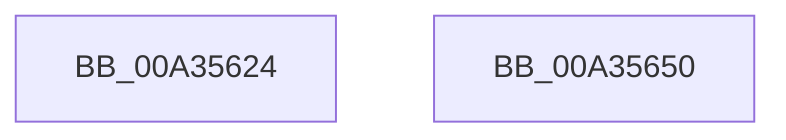

# PopCurrentPowerStatePrecise

- RVA: `0x00A35624`–`0x00A35651` (길이 `45` bytes)
- VA: `0x0000000140A35624`
- 실행 섹션: `PAGE`
- PDB 이름 있음: `예`; PDB Function 태그: `아니요`
- unwind 정보 RVA: `0x0005CAAC`
- 디코드: `15`개 명령, `45/45` bytes 표시
- 미해석 바이트: `0` (있으면 어셈블리에 `.byte`로 보존)

> 이 문서는 커널 이미지의 기계어와 PDB 기호를 분석해 생성했습니다. 4번과 5번은 함수 원형과 자료형을 바이너리 사용 방식에서 추정한 C 해석이며 원본 소스 복구 결과는 아닙니다.

## 1. Dependencies

- 직접 호출 지점: **2**; 고유 호출 대상: **2**
- 직접 호출자로 확인된 함수: **5**
- RIP 상대 이미지 참조: **0**

### Outgoing calls
- `0x00A35634` → [PopBatteryUpdateCurrentState](PopBatteryUpdateCurrentState_function_00A35658.md) (function, `0x00A35658`)
- `0x00A3563E` → [PopCurrentPowerState](PopCurrentPowerState_function_00A356D8.md) (function, `0x00A356D8`)

### Direct callers
- [NtPowerInformation](../95/NtPowerInformation_function_00955D80.md) at `0x00957A9F`
- [PopSleepstudyStartNextSession](../AC/PopSleepstudyStartNextSession_function_00AC4720.md) at `0x00AC488C`
- [PopCheckPowerSourceAfterRtcWakeTimerWorker](../../pagelk/B7/PopCheckPowerSourceAfterRtcWakeTimerWorker_function_00B70AB0.md) at `0x00B70ACC`
- [PopValidateRTCWake](../../pagelk/B7/PopValidateRTCWake_function_00B7CDE4.md) at `0x00B7CE62`
- [PopTransitionSystemPowerStateEx](../../pagelk/B7/PopTransitionSystemPowerStateEx_function_00B7E8C0.md) at `0x00B7EA60`
- [PopTransitionSystemPowerStateEx](../../pagelk/B7/PopTransitionSystemPowerStateEx_function_00B7E8C0.md) at `0x00B7EF7C`

### Static image references
- 디코드된 RIP-relative 메모리 참조가 없습니다.

## 2. Other-region calls and transfers

- 다른 실행 섹션으로 향하는 call: **0**
- 별도 외부 분기/꼬리 이동을 확인하지 못했습니다.

## 3. Assembly (complete function range)

```asm
00A35624  48 89 5C 24 08                  mov qword ptr [rsp + 8], rbx
00A35629  57                              push rdi
00A3562A  48 83 EC 20                     sub rsp, 0x20
00A3562E  48 8B F9                        mov rdi, rcx
00A35631  48 8B CA                        mov rcx, rdx
00A35634  E8 1F 00 00 00                  call 0x140a35658
00A35639  48 8B CF                        mov rcx, rdi
00A3563C  8B D8                           mov ebx, eax
00A3563E  E8 95 00 00 00                  call 0x140a356d8
00A35643  8B C3                           mov eax, ebx
00A35645  48 8B 5C 24 30                  mov rbx, qword ptr [rsp + 0x30]
00A3564A  48 83 C4 20                     add rsp, 0x20
00A3564E  5F                              pop rdi
00A3564F  C3                              ret
00A35650  CC                              int3
```

## 4. C-style interpretation (structured pseudocode)

```c
__int64 __fastcall PopCurrentPowerStatePrecise(__int64 a1, __int64 a2)
{
    __int64 result;
    __int64 v_rsp;
    unsigned __int64 v_stack_p8;

    v_stack_p8 = v_rbx;
    v_rsp = (v_rsp) - (32);
    result = PopBatteryUpdateCurrentState(a2, a2, a3, a4);
    result = PopCurrentPowerState(a1, a2, a3, a4);
    v_rsp = (v_rsp) + (32);
    return (unsigned int)((unsigned int)((unsigned int)((unsigned int)(result))));
}
```

## 5. (Beta) C Style

```c
int64_t PopCurrentPowerStatePrecise(int64_t Arg1, int64_t Arg2)
{
    int64_t result;
    int64_t local_rsp;
    uint64_t v_stack_p8;

    v_stack_p8 = local_rbx;
    local_rsp = (local_rsp) - (32);
    result = PopBatteryUpdateCurrentState(Arg2, Arg2, a3, a4);
    result = PopCurrentPowerState(Arg1, Arg2, a3, a4);
    local_rsp = (local_rsp) + (32);
    return (uint32_t)((uint32_t)((uint32_t)((uint32_t)(result))));
}
```

## 6. Execution-region graph

[열기: 2D/3D 그래프와 함수 탐색 컨트롤 패널](../../../control-panel.html?section=page&rva=0x00A35624&view=graph)

- 2D 그래프는 위에서 아래로 흐르고, 3D 그래프는 빈 공간을 드래그해 회전합니다. Shift+드래그는 이동, 휠은 확대·축소, 함수 노드 선택은 대상 보고서 이동입니다.

### Static fallback


