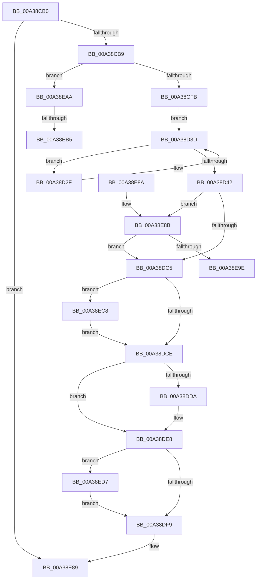

# PopDiagTraceControlCallback

- RVA: `0x00A38CB0`–`0x00A38EE3` (길이 `563` bytes)
- VA: `0x0000000140A38CB0`
- 실행 섹션: `PAGE`
- PDB 이름 있음: `예`; PDB Function 태그: `예`
- unwind 정보 RVA: `0x000ADE44`
- 디코드: `131`개 명령, `563/563` bytes 표시
- 미해석 바이트: `0` (있으면 어셈블리에 `.byte`로 보존)

> 이 문서는 커널 이미지의 기계어와 PDB 기호를 분석해 생성했습니다. 4번과 5번은 함수 원형과 자료형을 바이너리 사용 방식에서 추정한 C 해석이며 원본 소스 복구 결과는 아닙니다.

## 1. Dependencies

- 직접 호출 지점: **31**; 고유 호출 대상: **26**
- 직접 호출자로 확인된 함수: **0**
- RIP 상대 이미지 참조: **12**

### Outgoing calls
- `0x00A38CFB` → [ExTraceTimerResolution](../../text/4B/ExTraceTimerResolution_function_004B348C.md) (function, `0x004B348C`)
- `0x00A38D0E` → [PopDiagTraceSystemLatencyUpdate](../../text/47/PopDiagTraceSystemLatencyUpdate_function_0047A78C.md) (function, `0x0047A78C`)
- `0x00A38D1A` → [PopAcquireRwLockShared](../../text/2D/PopAcquireRwLockShared_function_002D9A40.md) (function, `0x002D9A40`)
- `0x00A38D35` → [PopDiagTracePowerRequestCreate](PopDiagTracePowerRequestCreate_function_00A38EEC.md) (function, `0x00A38EEC`)
- `0x00A38D49` → [PopReleaseRwLock](../../text/2D/PopReleaseRwLock_function_002DFBBC.md) (function, `0x002DFBBC`)
- `0x00A38D8C` → [EtwWrite](../../text/41/EtwWrite_function_0041C720.md) (function, `0x0041C720`)
- `0x00A38D91` → [PopRundownPowerSettings](PopRundownPowerSettings_function_00A39360.md) (function, `0x00A39360`)
- `0x00A38D96` → [PopThermalTraceRundownEvents](../../text/4A/PopThermalTraceRundownEvents_function_004AF1A8.md) (function, `0x004AF1A8`)
- `0x00A38DA0` → [PopAcquirePolicyLock](../../pagelk/B7/PopAcquirePolicyLock_function_00B783C0.md) (function, `0x00B783C0`)
- `0x00A38DAD` → [PopLoggingInformation](PopLoggingInformation_function_00A395B0.md) (function, `0x00A395B0`)
- `0x00A38DB4` → [PopReleasePolicyLock](../../pagelk/B7/PopReleasePolicyLock_function_00B78410.md) (function, `0x00B78410`)
- `0x00A38DE3` → [ExQueueWorkItem](../../text/2F/ExQueueWorkItem_function_002F9520.md) (function, `0x002F9520`)
- `0x00A38DF9` → [PopDiagTracePlatformRoleRundown](PopDiagTracePlatformRoleRundown_function_00A392B0.md) (function, `0x00A392B0`)
- `0x00A38DFE` → [PopRundownThermalRequests](PopRundownThermalRequests_function_00A396B0.md) (function, `0x00A396B0`)
- `0x00A38E03` → [PopRundownPowerLimitRequests](PopRundownPowerLimitRequests_function_00A398C4.md) (function, `0x00A398C4`)
- `0x00A38E08` → [PopAcquirePolicyLock](../../pagelk/B7/PopAcquirePolicyLock_function_00B783C0.md) (function, `0x00B783C0`)
- `0x00A38E0D` → [PopTraceStandbyConnectivityRundown](PopTraceStandbyConnectivityRundown_function_00A39A08.md) (function, `0x00A39A08`)
- `0x00A38E12` → [PopDiagTraceDeviceComplianceRundown](PopDiagTraceDeviceComplianceRundown_function_00A3976C.md) (function, `0x00A3976C`)
- `0x00A38E17` → [PopReleasePolicyLock](../../pagelk/B7/PopReleasePolicyLock_function_00B78410.md) (function, `0x00B78410`)
- `0x00A38E1C` → [PopDiagTraceDynamicTickStatusRundown](PopDiagTraceDynamicTickStatusRundown_function_00A39830.md) (function, `0x00A39830`)
- `0x00A38E21` → [PopDiagTraceDeepSleepConstraintRundown](../../text/4B/PopDiagTraceDeepSleepConstraintRundown_function_004BCDDC.md) (function, `0x004BCDDC`)
- `0x00A38E2D` → [PopAcquireRwLockExclusive](../../text/43/PopAcquireRwLockExclusive_function_00430B44.md) (function, `0x00430B44`)
- `0x00A38E32` → [PopDiagTracePowerStateEventRundown](PopDiagTracePowerStateEventRundown_function_00A394D4.md) (function, `0x00A394D4`)
- `0x00A38E3E` → [PopReleaseRwLock](../../text/2D/PopReleaseRwLock_function_002DFBBC.md) (function, `0x002DFBBC`)
- `0x00A38E4A` → [PopAcquireRwLockExclusive](../../text/43/PopAcquireRwLockExclusive_function_00430B44.md) (function, `0x00430B44`)
- `0x00A38E4F` → [PopDiagTraceSystemIdleRundown](PopDiagTraceSystemIdleRundown_function_00A3997C.md) (function, `0x00A3997C`)
- `0x00A38E5B` → [PopReleaseRwLock](../../text/2D/PopReleaseRwLock_function_002DFBBC.md) (function, `0x002DFBBC`)
- `0x00A38E67` → [_security_check_cookie](../../text/6A/_security_check_cookie_function_006AC640.md) (function, `0x006AC640`)
- `0x00A38EBD` → [PopTransitionTelemetryOsState](../A9/PopTransitionTelemetryOsState_function_00A9DD40.md) (function, `0x00A9DD40`)
- `0x00A38ECD` → [ExFreePoolWithTag](../../poolcode/B8/ExFreePoolWithTag_function_00B82870.md) (function, `0x00B82870`)
- `0x00A38ED9` → [PopDiagTraceFxRundown](../../text/43/PopDiagTraceFxRundown_function_0043A028.md) (function, `0x0043A028`)

### Direct callers
- 이 함수 시작 RVA로 연결되는 직접 call은 확인되지 않았습니다. 간접 호출은 완전히 역산할 수 없습니다.

### Static image references
- `0x00A38CD8` → RVA `0x00E0A740` (`.data`; read)
- `0x00A38CEA` → RVA `0x00E07748` (`.data`; read)
- `0x00A38D00` → RVA `0x00E0B3E8` (`.data`; read)
- `0x00A38D13` → RVA `0x00F0ED20` (`.data`; read)
- `0x00A38D1F` → RVA `0x00F0ED40` (`.data`; read)
- `0x00A38D4E` → RVA `0x00F0B408` (`.data`; read)
- `0x00A38D55` → RVA `0x0001A3F0` (`.rdata`; read)
- `0x00A38D65` → RVA `0x00F0CE0C` (`.data`; read)
- `0x00A38DD0` → RVA `0x00F0B420` (`.data`; read)
- `0x00A38DDC` → RVA `0x00F0B440` (`.data`; read)
- `0x00A38E26` → RVA `0x00F09700` (`.data`; read)
- `0x00A38E43` → RVA `0x00F093E0` (`.data`; read)

## 2. Other-region calls and transfers

- 다른 실행 섹션으로 향하는 call: **19**
  - `0x00A38CFB` → [ExTraceTimerResolution](../../text/4B/ExTraceTimerResolution_function_004B348C.md) (`PAGE` → `.text`)
  - `0x00A38D0E` → [PopDiagTraceSystemLatencyUpdate](../../text/47/PopDiagTraceSystemLatencyUpdate_function_0047A78C.md) (`PAGE` → `.text`)
  - `0x00A38D1A` → [PopAcquireRwLockShared](../../text/2D/PopAcquireRwLockShared_function_002D9A40.md) (`PAGE` → `.text`)
  - `0x00A38D49` → [PopReleaseRwLock](../../text/2D/PopReleaseRwLock_function_002DFBBC.md) (`PAGE` → `.text`)
  - `0x00A38D8C` → [EtwWrite](../../text/41/EtwWrite_function_0041C720.md) (`PAGE` → `.text`)
  - `0x00A38D96` → [PopThermalTraceRundownEvents](../../text/4A/PopThermalTraceRundownEvents_function_004AF1A8.md) (`PAGE` → `.text`)
  - `0x00A38DA0` → [PopAcquirePolicyLock](../../pagelk/B7/PopAcquirePolicyLock_function_00B783C0.md) (`PAGE` → `PAGELK`)
  - `0x00A38DB4` → [PopReleasePolicyLock](../../pagelk/B7/PopReleasePolicyLock_function_00B78410.md) (`PAGE` → `PAGELK`)
  - `0x00A38DE3` → [ExQueueWorkItem](../../text/2F/ExQueueWorkItem_function_002F9520.md) (`PAGE` → `.text`)
  - `0x00A38E08` → [PopAcquirePolicyLock](../../pagelk/B7/PopAcquirePolicyLock_function_00B783C0.md) (`PAGE` → `PAGELK`)
  - `0x00A38E17` → [PopReleasePolicyLock](../../pagelk/B7/PopReleasePolicyLock_function_00B78410.md) (`PAGE` → `PAGELK`)
  - `0x00A38E21` → [PopDiagTraceDeepSleepConstraintRundown](../../text/4B/PopDiagTraceDeepSleepConstraintRundown_function_004BCDDC.md) (`PAGE` → `.text`)
  - `0x00A38E2D` → [PopAcquireRwLockExclusive](../../text/43/PopAcquireRwLockExclusive_function_00430B44.md) (`PAGE` → `.text`)
  - `0x00A38E3E` → [PopReleaseRwLock](../../text/2D/PopReleaseRwLock_function_002DFBBC.md) (`PAGE` → `.text`)
  - `0x00A38E4A` → [PopAcquireRwLockExclusive](../../text/43/PopAcquireRwLockExclusive_function_00430B44.md) (`PAGE` → `.text`)
  - `0x00A38E5B` → [PopReleaseRwLock](../../text/2D/PopReleaseRwLock_function_002DFBBC.md) (`PAGE` → `.text`)
  - `0x00A38E67` → [_security_check_cookie](../../text/6A/_security_check_cookie_function_006AC640.md) (`PAGE` → `.text`)
  - `0x00A38ECD` → [ExFreePoolWithTag](../../poolcode/B8/ExFreePoolWithTag_function_00B82870.md) (`PAGE` → `POOLCODE`)
  - `0x00A38ED9` → [PopDiagTraceFxRundown](../../text/43/PopDiagTraceFxRundown_function_0043A028.md) (`PAGE` → `.text`)
- call이 아닌 외부 분기/꼬리 이동: **3**
  - `0x00A38EA5` → [sub_00B3A29A + 0x1B](../B3/Unknown_function_00B3A29A.md) (`tail-transfer`)
  - `0x00A38EAF` → [sub_00B3A29A](../B3/Unknown_function_00B3A29A.md) (`tail-transfer`)
  - `0x00A38EC3` → [sub_00B3A29A](../B3/Unknown_function_00B3A29A.md) (`tail-transfer`)

## 3. Assembly (complete function range)

```asm
00A38CB0  83 FA 02                        cmp edx, 2
00A38CB3  0F 85 D0 01 00 00               jne 0x140a38e89
00A38CB9  48 89 5C 24 08                  mov qword ptr [rsp + 8], rbx
00A38CBE  48 89 74 24 10                  mov qword ptr [rsp + 0x10], rsi
00A38CC3  48 89 7C 24 18                  mov qword ptr [rsp + 0x18], rdi
00A38CC8  55                              push rbp
00A38CC9  41 54                           push r12
00A38CCB  41 55                           push r13
00A38CCD  41 56                           push r14
00A38CCF  41 57                           push r15
00A38CD1  48 8B EC                        mov rbp, rsp
00A38CD4  48 83 EC 60                     sub rsp, 0x60
00A38CD8  48 8B 05 61 1A 3D 00            mov rax, qword ptr [rip + 0x3d1a61]
00A38CDF  48 33 C4                        xor rax, rsp
00A38CE2  48 89 45 F0                     mov qword ptr [rbp - 0x10], rax
00A38CE6  83 65 D0 00                     and dword ptr [rbp - 0x30], 0
00A38CEA  48 8D 05 57 EA 3C 00            lea rax, [rip + 0x3cea57]
00A38CF1  48 39 45 60                     cmp qword ptr [rbp + 0x60], rax
00A38CF5  0F 84 AF 01 00 00               je 0x140a38eaa
00A38CFB  E8 8C A7 A7 FF                  call 0x1404b348c
00A38D00  8B 15 E2 26 3D 00               mov edx, dword ptr [rip + 0x3d26e2]
00A38D06  BF 01 00 00 00                  mov edi, 1
00A38D0B  40 8A CF                        mov cl, dil
00A38D0E  E8 79 1A A4 FF                  call 0x14047a78c
00A38D13  48 8D 0D 06 60 4D 00            lea rcx, [rip + 0x4d6006]
00A38D1A  E8 21 0D 8A FF                  call 0x1402d9a40
00A38D1F  48 8B 1D 1A 60 4D 00            mov rbx, qword ptr [rip + 0x4d601a]
00A38D26  48 8D 35 13 60 4D 00            lea rsi, [rip + 0x4d6013]
00A38D2D  EB 0E                           jmp 0x140a38d3d
00A38D2F  48 8B D3                        mov rdx, rbx
00A38D32  40 8A CF                        mov cl, dil
00A38D35  E8 B2 01 00 00                  call 0x140a38eec
00A38D3A  48 8B 1B                        mov rbx, qword ptr [rbx]
00A38D3D  48 3B DE                        cmp rbx, rsi
00A38D40  75 ED                           jne 0x140a38d2f
00A38D42  48 8D 0D D7 5F 4D 00            lea rcx, [rip + 0x4d5fd7]
00A38D49  E8 6E 6E 8A FF                  call 0x1402dfbbc
00A38D4E  48 8B 0D B3 26 4D 00            mov rcx, qword ptr [rip + 0x4d26b3]
00A38D55  48 8D 15 94 16 5E FF            lea rdx, [rip - 0xa1e96c]
00A38D5C  33 C0                           xor eax, eax
00A38D5E  C7 45 E8 04 00 00 00            mov dword ptr [rbp - 0x18], 4
00A38D65  39 05 A1 40 4D 00               cmp dword ptr [rip + 0x4d40a1], eax
00A38D6B  44 8B CF                        mov r9d, edi
00A38D6E  0F 94 C0                        sete al
00A38D71  83 65 EC 00                     and dword ptr [rbp - 0x14], 0
00A38D75  89 45 D4                        mov dword ptr [rbp - 0x2c], eax
00A38D78  45 33 C0                        xor r8d, r8d
00A38D7B  48 8D 45 D4                     lea rax, [rbp - 0x2c]
00A38D7F  48 89 45 E0                     mov qword ptr [rbp - 0x20], rax
00A38D83  48 8D 45 E0                     lea rax, [rbp - 0x20]
00A38D87  48 89 44 24 20                  mov qword ptr [rsp + 0x20], rax
00A38D8C  E8 8F 39 9E FF                  call 0x14041c720
00A38D91  E8 CA 05 00 00                  call 0x140a39360
00A38D96  E8 0D 64 A7 FF                  call 0x1404af1a8
00A38D9B  48 83 65 D8 00                  and qword ptr [rbp - 0x28], 0
00A38DA0  E8 1B F6 13 00                  call 0x140b783c0
00A38DA5  48 8D 55 D0                     lea rdx, [rbp - 0x30]
00A38DA9  48 8D 4D D8                     lea rcx, [rbp - 0x28]
00A38DAD  E8 FE 07 00 00                  call 0x140a395b0
00A38DB2  8B D8                           mov ebx, eax
00A38DB4  E8 57 F6 13 00                  call 0x140b78410
00A38DB9  48 8B 75 D8                     mov rsi, qword ptr [rbp - 0x28]
00A38DBD  85 DB                           test ebx, ebx
00A38DBF  0F 89 C6 00 00 00               jns 0x140a38e8b
00A38DC5  48 85 F6                        test rsi, rsi
00A38DC8  0F 85 FA 00 00 00               jne 0x140a38ec8
00A38DCE  33 C0                           xor eax, eax
00A38DD0  F0 0F B1 3D 48 26 4D 00         lock cmpxchg dword ptr [rip + 0x4d2648], edi
00A38DD8  75 0E                           jne 0x140a38de8
00A38DDA  8B D7                           mov edx, edi
00A38DDC  48 8D 0D 5D 26 4D 00            lea rcx, [rip + 0x4d265d]
00A38DE3  E8 38 07 8C FF                  call 0x1402f9520
00A38DE8  48 8D 05 19 26 4D 00            lea rax, [rip + 0x4d2619]
00A38DEF  48 39 45 60                     cmp qword ptr [rbp + 0x60], rax
00A38DF3  0F 84 DE 00 00 00               je 0x140a38ed7
00A38DF9  E8 B2 04 00 00                  call 0x140a392b0
00A38DFE  E8 AD 08 00 00                  call 0x140a396b0
00A38E03  E8 BC 0A 00 00                  call 0x140a398c4
00A38E08  E8 B3 F5 13 00                  call 0x140b783c0
00A38E0D  E8 F6 0B 00 00                  call 0x140a39a08
00A38E12  E8 55 09 00 00                  call 0x140a3976c
00A38E17  E8 F4 F5 13 00                  call 0x140b78410
00A38E1C  E8 0F 0A 00 00                  call 0x140a39830
00A38E21  E8 B6 3F A8 FF                  call 0x1404bcddc
00A38E26  48 8D 0D D3 08 4D 00            lea rcx, [rip + 0x4d08d3]
00A38E2D  E8 12 7D 9F FF                  call 0x140430b44
00A38E32  E8 9D 06 00 00                  call 0x140a394d4
00A38E37  48 8D 0D C2 08 4D 00            lea rcx, [rip + 0x4d08c2]
00A38E3E  E8 79 6D 8A FF                  call 0x1402dfbbc
00A38E43  48 8D 0D 96 05 4D 00            lea rcx, [rip + 0x4d0596]
00A38E4A  E8 F5 7C 9F FF                  call 0x140430b44
00A38E4F  E8 28 0B 00 00                  call 0x140a3997c
00A38E54  48 8D 0D 85 05 4D 00            lea rcx, [rip + 0x4d0585]
00A38E5B  E8 5C 6D 8A FF                  call 0x1402dfbbc
00A38E60  48 8B 4D F0                     mov rcx, qword ptr [rbp - 0x10]
00A38E64  48 33 CC                        xor rcx, rsp
00A38E67  E8 D4 37 C7 FF                  call 0x1406ac640
00A38E6C  4C 8D 5C 24 60                  lea r11, [rsp + 0x60]
00A38E71  49 8B 5B 30                     mov rbx, qword ptr [r11 + 0x30]
00A38E75  49 8B 73 38                     mov rsi, qword ptr [r11 + 0x38]
00A38E79  49 8B 7B 40                     mov rdi, qword ptr [r11 + 0x40]
00A38E7D  49 8B E3                        mov rsp, r11
00A38E80  41 5F                           pop r15
00A38E82  41 5E                           pop r14
00A38E84  41 5D                           pop r13
00A38E86  41 5C                           pop r12
00A38E88  5D                              pop rbp
00A38E89  C3                              ret
00A38E8A  CC                              int3
00A38E8B  44 8B 3E                        mov r15d, dword ptr [rsi]
00A38E8E  4C 8D 76 04                     lea r14, [rsi + 4]
00A38E92  45 33 E4                        xor r12d, r12d
00A38E95  45 85 FF                        test r15d, r15d
00A38E98  0F 84 27 FF FF FF               je 0x140a38dc5
00A38E9E  44 8B 6D D0                     mov r13d, dword ptr [rbp - 0x30]
00A38EA2  4C 03 EE                        add r13, rsi
00A38EA5  E9 0B 14 10 00                  jmp 0x140b3a2b5
00A38EAA  49 0F BA E1 2F                  bt r9, 0x2f
00A38EAF  0F 83 E5 13 10 00               jae 0x140b3a29a
00A38EB5  BA 01 00 00 00                  mov edx, 1
00A38EBA  8D 4A 04                        lea ecx, [rdx + 4]
00A38EBD  E8 7E 4E 06 00                  call 0x140a9dd40
00A38EC2  90                              nop
00A38EC3  E9 D2 13 10 00                  jmp 0x140b3a29a
00A38EC8  33 D2                           xor edx, edx
00A38ECA  48 8B CE                        mov rcx, rsi
00A38ECD  E8 9E 99 14 00                  call 0x140b82870
00A38ED2  E9 F7 FE FF FF                  jmp 0x140a38dce
00A38ED7  33 C9                           xor ecx, ecx
00A38ED9  E8 4A 11 A0 FF                  call 0x14043a028
00A38EDE  E9 16 FF FF FF                  jmp 0x140a38df9
```

## 4. C-style interpretation (structured pseudocode)

```c
__int64 __fastcall PopDiagTraceControlCallback(__int64 a1, int a2, int a3, __int64 a4, __int64 a5, __int64 a6, __int64 a7)
{
    __int64 result;
    __int64 v_r12;
    __int64 v_r13;
    __int64 v_rsp;
    unsigned __int64 v_stack_m28;
    unsigned __int64 v_stack_m38;
    unsigned int v_stack_m3C;
    unsigned int v_stack_m40;
    unsigned __int64 v_stack_m48;
    unsigned __int64 v_stack_m50;
    unsigned int v_stack_m54;
    unsigned int v_stack_m58;
    unsigned __int64 v_stack_m68;
    unsigned __int64 v_stack_p10;
    unsigned __int64 v_stack_p18;
    unsigned __int64 v_stack_p8;

    if (a2 != 2) goto loc_00A38E89;
    v_stack_p8 = v_rbx;
    v_stack_p10 = v_rsi;
    v_stack_p18 = v_rdi;
    v_rsp = (v_rsp) - (96);
    result = (*(unsigned __int64 *)(v_rip + 4004449)) ^ (v_rsp);
    v_stack_m38 = result;
    if (a7 == (v_rip + 3992151)) goto loc_00A38EAA;
    result = ExTraceTimerResolution(a1, a2, a3, a4);
    result = PopDiagTraceSystemLatencyUpdate(1, (unsigned int)(*(unsigned int *)(v_rip + 4007650)), a3, a4);
    result = PopAcquireRwLockShared(v_rip + 5070854, (unsigned int)(*(unsigned int *)(v_rip + 4007650)), a3, a4);
    goto loc_00A38D3D;
loc_00A38D2F:
    result = PopDiagTracePowerRequestCreate(1, *(unsigned __int64 *)(v_rip + 5070874), a3, a4);
loc_00A38D3D:
    if ((*(unsigned __int64 *)(*(unsigned __int64 *)(v_rip + 5070874))) != (v_rip + 5070867)) goto loc_00A38D2F;
    result = PopReleaseRwLock(v_rip + 5070807, *(unsigned __int64 *)(v_rip + 5070874), a3, a4);
    result = 0;
    v_stack_m40 = 4;
    result = ((*(unsigned int *)(v_rip + 5062817)) == 0) ? 1 : 0;
    v_stack_m54 = (unsigned int)(result);
    a3 = 0;
    v_stack_m48 = v_stack_m54;
    v_stack_m68 = v_stack_m48;
    result = EtwWrite(*(unsigned __int64 *)(v_rip + 5056179), v_rip - 10611052, a3, 1);
    result = PopRundownPowerSettings(*(unsigned __int64 *)(v_rip + 5056179), v_rip - 10611052, a3, 1);
    result = PopThermalTraceRundownEvents(*(unsigned __int64 *)(v_rip + 5056179), v_rip - 10611052, a3, 1);
    result = PopAcquirePolicyLock(*(unsigned __int64 *)(v_rip + 5056179), v_rip - 10611052, a3, 1);
    result = PopLoggingInformation(v_stack_m50, v_stack_m58, a3, 1);
    result = PopReleasePolicyLock(v_stack_m50, v_stack_m58, a3, 1);
    if (!sign_flag) goto loc_00A38E8B;
loc_00A38DC5:
    if (v_stack_m50 != 0) goto loc_00A38EC8;
loc_00A38DCE:
    result = 0;
    if (!(condition_is_not_equal)) {
        a2 = 1;
        a1 = v_rip + 5056093;
        result = ExQueueWorkItem(a1, a2, a3, 1);
    }
    if (a7 == (v_rip + 5056025)) goto loc_00A38ED7;
loc_00A38DF9:
    result = PopDiagTracePlatformRoleRundown(a1, a2, a3, 1);
    result = PopRundownThermalRequests(a1, a2, a3, 1);
    result = PopRundownPowerLimitRequests(a1, a2, a3, 1);
    result = PopAcquirePolicyLock(a1, a2, a3, 1);
    result = PopTraceStandbyConnectivityRundown(a1, a2, a3, 1);
    result = PopDiagTraceDeviceComplianceRundown(a1, a2, a3, 1);
    result = PopReleasePolicyLock(a1, a2, a3, 1);
    result = PopDiagTraceDynamicTickStatusRundown(a1, a2, a3, 1);
    result = PopDiagTraceDeepSleepConstraintRundown(a1, a2, a3, 1);
    result = PopAcquireRwLockExclusive(v_rip + 5048531, a2, a3, 1);
    result = PopDiagTracePowerStateEventRundown(v_rip + 5048531, a2, a3, 1);
    result = PopReleaseRwLock(v_rip + 5048514, a2, a3, 1);
    result = PopAcquireRwLockExclusive(v_rip + 5047702, a2, a3, 1);
    result = PopDiagTraceSystemIdleRundown(v_rip + 5047702, a2, a3, 1);
    result = PopReleaseRwLock(v_rip + 5047685, a2, a3, 1);
    a1 = (v_stack_m38) ^ (v_rsp);
    result = _security_check_cookie(a1, a2, a3, 1);
loc_00A38E89:
    return result;
loc_00A38E8B:
    v_r12 = 0;
    if ((unsigned int)((unsigned int)(*(unsigned int *)(*(unsigned __int64 *)(v_stack_m28 + 56)))) == 0) goto loc_00A38DC5;
    v_r13 = ((unsigned int)(v_stack_m58)) + (*(unsigned __int64 *)(v_stack_m28 + 56));
loc_00A38EAA:
    result = PopTransitionTelemetryOsState(1 + 4, 1, a3, 1);
loc_00A38EC8:
    a2 = 0;
    result = ExFreePoolWithTag(*(unsigned __int64 *)(v_stack_m28 + 56), a2, a3, 1);
    goto loc_00A38DCE;
loc_00A38ED7:
    a1 = 0;
    result = PopDiagTraceFxRundown(a1, a2, a3, 1);
    goto loc_00A38DF9;
}
```

## 5. (Beta) C Style

```c
int64_t PopDiagTraceControlCallback(int64_t Arg1, int32_t Arg2, int32_t Arg3, int64_t Arg4, uint64_t Arg5, uint64_t Arg6, int64_t Arg7)
{
    int64_t result;
    int64_t local_r12;
    int64_t local_r13;
    int64_t local_rsp;
    uint64_t v_stack_m28;
    uint64_t v_stack_m38;
    uint32_t v_stack_m3C;
    uint32_t v_stack_m40;
    uint64_t v_stack_m48;
    uint64_t v_stack_m50;
    uint32_t v_stack_m54;
    uint32_t v_stack_m58;
    uint64_t v_stack_m68;
    uint64_t v_stack_p10;
    uint64_t v_stack_p18;
    uint64_t v_stack_p8;

    if (Arg2 != 2) goto loc_00A38E89;
    v_stack_p8 = local_rbx;
    v_stack_p10 = local_rsi;
    v_stack_p18 = local_rdi;
    local_rsp = (local_rsp) - (96);
    result = (*(uint64_t *)(v_rip + 0x3D1A61)) ^ (local_rsp);
    v_stack_m38 = result;
    if (Arg7 == (v_rip + 3992151)) goto loc_00A38EAA;
    result = ExTraceTimerResolution(Arg1, Arg2, Arg3, Arg4);
    result = PopDiagTraceSystemLatencyUpdate(1, (uint32_t)(*(uint32_t *)(v_rip + 0x3D26E2)), Arg3, Arg4);
    result = PopAcquireRwLockShared(v_rip + 5070854, (uint32_t)(*(uint32_t *)(v_rip + 0x3D26E2)), Arg3, Arg4);
    goto loc_00A38D3D;
loc_00A38D2F:
    result = PopDiagTracePowerRequestCreate(1, *(uint64_t *)(v_rip + 0x4D601A), Arg3, Arg4);
loc_00A38D3D:
    if ((*(uint64_t *)(*(uint64_t *)(v_rip + 0x4D601A))) != (v_rip + 5070867)) goto loc_00A38D2F;
    result = PopReleaseRwLock(v_rip + 5070807, *(uint64_t *)(v_rip + 0x4D601A), Arg3, Arg4);
    result = 0;
    v_stack_m40 = 4;
    result = ((*(uint32_t *)(v_rip + 0x4D40A1)) == 0) ? 1 : 0;
    v_stack_m54 = (uint32_t)(result);
    Arg3 = 0;
    v_stack_m48 = v_stack_m54;
    v_stack_m68 = v_stack_m48;
    result = EtwWrite(*(uint64_t *)(v_rip + 0x4D26B3), v_rip - 10611052, Arg3, 1);
    result = PopRundownPowerSettings(*(uint64_t *)(v_rip + 0x4D26B3), v_rip - 10611052, Arg3, 1);
    result = PopThermalTraceRundownEvents(*(uint64_t *)(v_rip + 0x4D26B3), v_rip - 10611052, Arg3, 1);
    result = PopAcquirePolicyLock(*(uint64_t *)(v_rip + 0x4D26B3), v_rip - 10611052, Arg3, 1);
    result = PopLoggingInformation(v_stack_m50, v_stack_m58, Arg3, 1);
    result = PopReleasePolicyLock(v_stack_m50, v_stack_m58, Arg3, 1);
    if (!sign_flag) goto loc_00A38E8B;
loc_00A38DC5:
    if (v_stack_m50 != 0) goto loc_00A38EC8;
loc_00A38DCE:
    result = 0;
    if (!(condition_is_not_equal)) {
        Arg2 = 1;
        Arg1 = v_rip + 5056093;
        result = ExQueueWorkItem(Arg1, Arg2, Arg3, 1);
    }
    if (Arg7 == (v_rip + 5056025)) goto loc_00A38ED7;
loc_00A38DF9:
    result = PopDiagTracePlatformRoleRundown(Arg1, Arg2, Arg3, 1);
    result = PopRundownThermalRequests(Arg1, Arg2, Arg3, 1);
    result = PopRundownPowerLimitRequests(Arg1, Arg2, Arg3, 1);
    result = PopAcquirePolicyLock(Arg1, Arg2, Arg3, 1);
    result = PopTraceStandbyConnectivityRundown(Arg1, Arg2, Arg3, 1);
    result = PopDiagTraceDeviceComplianceRundown(Arg1, Arg2, Arg3, 1);
    result = PopReleasePolicyLock(Arg1, Arg2, Arg3, 1);
    result = PopDiagTraceDynamicTickStatusRundown(Arg1, Arg2, Arg3, 1);
    result = PopDiagTraceDeepSleepConstraintRundown(Arg1, Arg2, Arg3, 1);
    result = PopAcquireRwLockExclusive(v_rip + 5048531, Arg2, Arg3, 1);
    result = PopDiagTracePowerStateEventRundown(v_rip + 5048531, Arg2, Arg3, 1);
    result = PopReleaseRwLock(v_rip + 5048514, Arg2, Arg3, 1);
    result = PopAcquireRwLockExclusive(v_rip + 5047702, Arg2, Arg3, 1);
    result = PopDiagTraceSystemIdleRundown(v_rip + 5047702, Arg2, Arg3, 1);
    result = PopReleaseRwLock(v_rip + 5047685, Arg2, Arg3, 1);
    Arg1 = (v_stack_m38) ^ (local_rsp);
    result = _security_check_cookie(Arg1, Arg2, Arg3, 1);
loc_00A38E89:
    return result;
loc_00A38E8B:
    local_r12 = 0;
    if ((uint32_t)((uint32_t)(*(uint32_t *)(*(uint64_t *)(v_stack_m28 + 0x38)))) == 0) goto loc_00A38DC5;
    local_r13 = ((uint32_t)(v_stack_m58)) + (*(uint64_t *)(v_stack_m28 + 0x38));
loc_00A38EAA:
    result = PopTransitionTelemetryOsState(1 + 4, 1, Arg3, 1);
loc_00A38EC8:
    Arg2 = 0;
    result = ExFreePoolWithTag(*(uint64_t *)(v_stack_m28 + 0x38), Arg2, Arg3, 1);
    goto loc_00A38DCE;
loc_00A38ED7:
    Arg1 = 0;
    result = PopDiagTraceFxRundown(Arg1, Arg2, Arg3, 1);
    goto loc_00A38DF9;
}
```

## 6. Execution-region graph

[열기: 2D/3D 그래프와 함수 탐색 컨트롤 패널](../../../control-panel.html?section=page&rva=0x00A38CB0&view=graph)

- 2D 그래프는 위에서 아래로 흐르고, 3D 그래프는 빈 공간을 드래그해 회전합니다. Shift+드래그는 이동, 휠은 확대·축소, 함수 노드 선택은 대상 보고서 이동입니다.

### Static fallback


