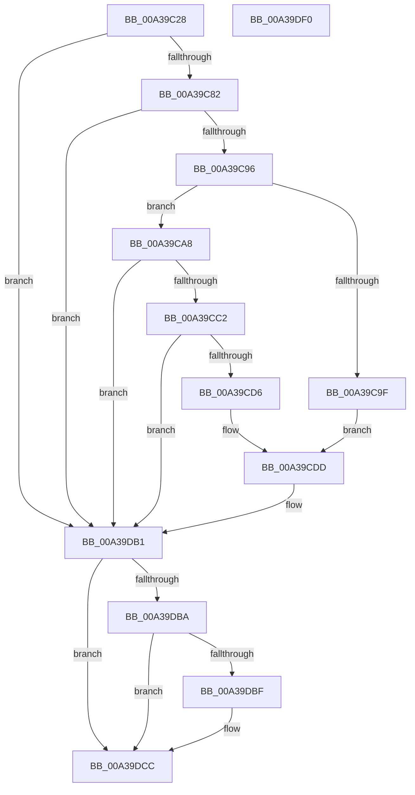

# PopDiagTraceCoolingExtension

- RVA: `0x00A39C28`–`0x00A39DF1` (길이 `457` bytes)
- VA: `0x0000000140A39C28`
- 실행 섹션: `PAGE`
- PDB 이름 있음: `예`; PDB Function 태그: `아니요`
- unwind 정보 RVA: `0x000ADA64`
- 디코드: `110`개 명령, `457/457` bytes 표시
- 미해석 바이트: `0` (있으면 어셈블리에 `.byte`로 보존)

> 이 문서는 커널 이미지의 기계어와 PDB 기호를 분석해 생성했습니다. 4번과 5번은 함수 원형과 자료형을 바이너리 사용 방식에서 추정한 C 해석이며 원본 소스 복구 결과는 아닙니다.

## 1. Dependencies

- 직접 호출 지점: **7**; 고유 호출 대상: **6**
- 직접 호출자로 확인된 함수: **6**
- RIP 상대 이미지 참조: **3**

### Outgoing calls
- `0x00A39C89` → [EtwEventEnabled](../../text/39/EtwEventEnabled_function_00392450.md) (function, `0x00392450`)
- `0x00A39C96` → [Feature_Servicing_CoolingFrameworkDeviceCleanupFix__private_IsEnabledDeviceUsageNoInline](../../text/5D/Feature_Servicing_CoolingFrameworkDeviceCleanupFix__private_IsEnabledDeviceUsageNoInline_function_005D1004.md) (function, `0x005D1004`)
- `0x00A39CB1` → [IoGetDeviceAttachmentBaseRefWithTag](../../text/27/IoGetDeviceAttachmentBaseRefWithTag_function_00272788.md) (function, `0x00272788`)
- `0x00A39DAC` → [EtwWrite](../../text/41/EtwWrite_function_0041C720.md) (function, `0x0041C720`)
- `0x00A39DB1` → [Feature_Servicing_CoolingFrameworkDeviceCleanupFix__private_IsEnabledDeviceUsageNoInline](../../text/5D/Feature_Servicing_CoolingFrameworkDeviceCleanupFix__private_IsEnabledDeviceUsageNoInline_function_005D1004.md) (function, `0x005D1004`)
- `0x00A39DC7` → [ObfDereferenceObjectWithTag](../../text/2F/ObfDereferenceObjectWithTag_function_002F78E0.md) (function, `0x002F78E0`)
- `0x00A39DD3` → [_security_check_cookie](../../text/6A/_security_check_cookie_function_006AC640.md) (function, `0x006AC640`)

### Direct callers
- [PopAssociateThermalRequest](../75/PopAssociateThermalRequest_function_00756E78.md) at `0x00756FFF`
- [PopCoolingExtensionPnpNotification](../75/PopCoolingExtensionPnpNotification_function_00757110.md) at `0x007571DE`
- [PopDisableCoolingExtension](../75/PopDisableCoolingExtension_function_00757208.md) at `0x00757256`
- [PopHandleCancelQueryRemove](../75/PopHandleCancelQueryRemove_function_0075730C.md) at `0x007573A9`
- [PopRundownThermalRequests](PopRundownThermalRequests_function_00A396B0.md) at `0x00A3972E`
- [PopDeactiveThermalRequest](../AD/PopDeactiveThermalRequest_function_00ADF634.md) at `0x00ADF74D`

### Static image references
- `0x00A39C42` → RVA `0x00E0A740` (`.data`; read)
- `0x00A39C56` → RVA `0x00E67858` (`.data`; read)
- `0x00A39C82` → RVA `0x00F0B408` (`.data`; read)

## 2. Other-region calls and transfers

- 다른 실행 섹션으로 향하는 call: **7**
  - `0x00A39C89` → [EtwEventEnabled](../../text/39/EtwEventEnabled_function_00392450.md) (`PAGE` → `.text`)
  - `0x00A39C96` → [Feature_Servicing_CoolingFrameworkDeviceCleanupFix__private_IsEnabledDeviceUsageNoInline](../../text/5D/Feature_Servicing_CoolingFrameworkDeviceCleanupFix__private_IsEnabledDeviceUsageNoInline_function_005D1004.md) (`PAGE` → `.text`)
  - `0x00A39CB1` → [IoGetDeviceAttachmentBaseRefWithTag](../../text/27/IoGetDeviceAttachmentBaseRefWithTag_function_00272788.md) (`PAGE` → `.text`)
  - `0x00A39DAC` → [EtwWrite](../../text/41/EtwWrite_function_0041C720.md) (`PAGE` → `.text`)
  - `0x00A39DB1` → [Feature_Servicing_CoolingFrameworkDeviceCleanupFix__private_IsEnabledDeviceUsageNoInline](../../text/5D/Feature_Servicing_CoolingFrameworkDeviceCleanupFix__private_IsEnabledDeviceUsageNoInline_function_005D1004.md) (`PAGE` → `.text`)
  - `0x00A39DC7` → [ObfDereferenceObjectWithTag](../../text/2F/ObfDereferenceObjectWithTag_function_002F78E0.md) (`PAGE` → `.text`)
  - `0x00A39DD3` → [_security_check_cookie](../../text/6A/_security_check_cookie_function_006AC640.md) (`PAGE` → `.text`)
- 별도 외부 분기/꼬리 이동을 확인하지 못했습니다.

## 3. Assembly (complete function range)

```asm
00A39C28  48 89 5C 24 18                  mov qword ptr [rsp + 0x18], rbx
00A39C2D  48 89 74 24 20                  mov qword ptr [rsp + 0x20], rsi
00A39C32  55                              push rbp
00A39C33  57                              push rdi
00A39C34  41 56                           push r14
00A39C36  48 8D 6C 24 B9                  lea rbp, [rsp - 0x47]
00A39C3B  48 81 EC D0 00 00 00            sub rsp, 0xd0
00A39C42  48 8B 05 F7 0A 3D 00            mov rax, qword ptr [rip + 0x3d0af7]
00A39C49  48 33 C4                        xor rax, rsp
00A39C4C  48 89 45 37                     mov qword ptr [rbp + 0x37], rax
00A39C50  45 33 F6                        xor r14d, r14d
00A39C53  48 8B F2                        mov rsi, rdx
00A39C56  44 38 35 FB DB 42 00            cmp byte ptr [rip + 0x42dbfb], r14b
00A39C5D  48 8B F9                        mov rdi, rcx
00A39C60  44 89 75 B7                     mov dword ptr [rbp - 0x49], r14d
00A39C64  41 8B DE                        mov ebx, r14d
00A39C67  44 89 75 B3                     mov dword ptr [rbp - 0x4d], r14d
00A39C6B  66 44 89 75 AB                  mov word ptr [rbp - 0x55], r14w
00A39C70  44 89 75 AF                     mov dword ptr [rbp - 0x51], r14d
00A39C74  44 88 75 A7                     mov byte ptr [rbp - 0x59], r14b
00A39C78  4C 89 75 BF                     mov qword ptr [rbp - 0x41], r14
00A39C7C  0F 84 2F 01 00 00               je 0x140a39db1
00A39C82  48 8B 0D 7F 17 4D 00            mov rcx, qword ptr [rip + 0x4d177f]
00A39C89  E8 C2 87 95 FF                  call 0x140392450
00A39C8E  84 C0                           test al, al
00A39C90  0F 84 1B 01 00 00               je 0x140a39db1
00A39C96  E8 69 73 B9 FF                  call 0x1405d1004
00A39C9B  85 C0                           test eax, eax
00A39C9D  74 09                           je 0x140a39ca8
00A39C9F  48 8D 97 A0 00 00 00            lea rdx, [rdi + 0xa0]
00A39CA6  EB 35                           jmp 0x140a39cdd
00A39CA8  48 8B 4F 40                     mov rcx, qword ptr [rdi + 0x40]
00A39CAC  BA 50 6F 44 67                  mov edx, 0x67446f50
00A39CB1  E8 D2 8A 83 FF                  call 0x140272788
00A39CB6  48 8B D8                        mov rbx, rax
00A39CB9  48 85 C0                        test rax, rax
00A39CBC  0F 84 EF 00 00 00               je 0x140a39db1
00A39CC2  48 8B 88 38 01 00 00            mov rcx, qword ptr [rax + 0x138]
00A39CC9  48 8B 41 28                     mov rax, qword ptr [rcx + 0x28]
00A39CCD  48 85 C0                        test rax, rax
00A39CD0  0F 84 DB 00 00 00               je 0x140a39db1
00A39CD6  48 8D 90 80 00 00 00            lea rdx, [rax + 0x80]
00A39CDD  0F B7 0A                        movzx ecx, word ptr [rdx]
00A39CE0  41 8B C6                        mov eax, r14d
00A39CE3  66 D1 E9                        shr cx, 1
00A39CE6  41 B9 07 00 00 00               mov r9d, 7
00A39CEC  4C 39 B7 90 00 00 00            cmp qword ptr [rdi + 0x90], r14
00A39CF3  66 89 4D AB                     mov word ptr [rbp - 0x55], cx
00A39CF7  0F 95 C0                        setne al
00A39CFA  48 89 7D BF                     mov qword ptr [rbp - 0x41], rdi
00A39CFE  4C 39 B7 98 00 00 00            cmp qword ptr [rdi + 0x98], r14
00A39D05  89 45 B3                        mov dword ptr [rbp - 0x4d], eax
00A39D08  41 8B C6                        mov eax, r14d
00A39D0B  0F 95 C0                        setne al
00A39D0E  48 C7 45 CF 04 00 00 00         mov qword ptr [rbp - 0x31], 4
00A39D16  44 38 77 51                     cmp byte ptr [rdi + 0x51], r14b
00A39D1A  89 45 AF                        mov dword ptr [rbp - 0x51], eax
00A39D1D  41 8B C6                        mov eax, r14d
00A39D20  0F 95 C0                        setne al
00A39D23  48 C7 45 DF 04 00 00 00         mov qword ptr [rbp - 0x21], 4
00A39D2B  89 45 B7                        mov dword ptr [rbp - 0x49], eax
00A39D2E  45 33 C0                        xor r8d, r8d
00A39D31  8A 47 52                        mov al, byte ptr [rdi + 0x52]
00A39D34  88 45 A7                        mov byte ptr [rbp - 0x59], al
00A39D37  48 8D 45 AF                     lea rax, [rbp - 0x51]
00A39D3B  48 89 45 C7                     mov qword ptr [rbp - 0x39], rax
00A39D3F  48 8D 45 B3                     lea rax, [rbp - 0x4d]
00A39D43  48 89 45 D7                     mov qword ptr [rbp - 0x29], rax
00A39D47  48 8D 45 A7                     lea rax, [rbp - 0x59]
00A39D4B  48 89 45 E7                     mov qword ptr [rbp - 0x19], rax
00A39D4F  48 8D 45 B7                     lea rax, [rbp - 0x49]
00A39D53  48 89 45 F7                     mov qword ptr [rbp - 9], rax
00A39D57  48 8D 45 BF                     lea rax, [rbp - 0x41]
00A39D5B  48 89 45 07                     mov qword ptr [rbp + 7], rax
00A39D5F  48 8D 45 AB                     lea rax, [rbp - 0x55]
00A39D63  48 89 45 17                     mov qword ptr [rbp + 0x17], rax
00A39D67  48 C7 45 EF 01 00 00 00         mov qword ptr [rbp - 0x11], 1
00A39D6F  48 C7 45 FF 04 00 00 00         mov qword ptr [rbp - 1], 4
00A39D77  48 C7 45 0F 08 00 00 00         mov qword ptr [rbp + 0xf], 8
00A39D7F  48 C7 45 1F 02 00 00 00         mov qword ptr [rbp + 0x1f], 2
00A39D87  48 8B 42 08                     mov rax, qword ptr [rdx + 8]
00A39D8B  0F B7 0A                        movzx ecx, word ptr [rdx]
00A39D8E  48 8B D6                        mov rdx, rsi
00A39D91  48 89 45 27                     mov qword ptr [rbp + 0x27], rax
00A39D95  48 8D 45 C7                     lea rax, [rbp - 0x39]
00A39D99  89 4D 2F                        mov dword ptr [rbp + 0x2f], ecx
00A39D9C  48 8B 0D 65 16 4D 00            mov rcx, qword ptr [rip + 0x4d1665]
00A39DA3  48 89 44 24 20                  mov qword ptr [rsp + 0x20], rax
00A39DA8  44 89 75 33                     mov dword ptr [rbp + 0x33], r14d
00A39DAC  E8 6F 29 9E FF                  call 0x14041c720
00A39DB1  E8 4E 72 B9 FF                  call 0x1405d1004
00A39DB6  85 C0                           test eax, eax
00A39DB8  75 12                           jne 0x140a39dcc
00A39DBA  48 85 DB                        test rbx, rbx
00A39DBD  74 0D                           je 0x140a39dcc
00A39DBF  BA 50 6F 44 67                  mov edx, 0x67446f50
00A39DC4  48 8B CB                        mov rcx, rbx
00A39DC7  E8 14 DB 8B FF                  call 0x1402f78e0
00A39DCC  48 8B 4D 37                     mov rcx, qword ptr [rbp + 0x37]
00A39DD0  48 33 CC                        xor rcx, rsp
00A39DD3  E8 68 28 C7 FF                  call 0x1406ac640
00A39DD8  4C 8D 9C 24 D0 00 00 00         lea r11, [rsp + 0xd0]
00A39DE0  49 8B 5B 30                     mov rbx, qword ptr [r11 + 0x30]
00A39DE4  49 8B 73 38                     mov rsi, qword ptr [r11 + 0x38]
00A39DE8  49 8B E3                        mov rsp, r11
00A39DEB  41 5E                           pop r14
00A39DED  5F                              pop rdi
00A39DEE  5D                              pop rbp
00A39DEF  C3                              ret
00A39DF0  CC                              int3
```

## 4. C-style interpretation (structured pseudocode)

```c
__int64 __fastcall PopDiagTraceCoolingExtension(__int64 a1, __int64 a2, int a3)
{
    __int64 result;
    __int64 v_r14;
    __int64 v_rsp;
    unsigned __int64 v_stack_m18;
    unsigned __int64 v_stack_m28;
    unsigned int v_stack_m2C;
    unsigned int v_stack_m30;
    unsigned __int64 v_stack_m38;
    unsigned __int64 v_stack_m40;
    unsigned __int64 v_stack_m48;
    unsigned __int64 v_stack_m50;
    unsigned __int64 v_stack_m58;
    unsigned __int64 v_stack_m5F;
    unsigned __int64 v_stack_m60;
    unsigned __int64 v_stack_m68;
    unsigned __int64 v_stack_m70;
    unsigned __int64 v_stack_m78;
    unsigned __int64 v_stack_m80;
    unsigned __int64 v_stack_m88;
    unsigned __int64 v_stack_m90;
    unsigned __int64 v_stack_m98;
    unsigned __int64 v_stack_mA0;
    unsigned int v_stack_mA8;
    unsigned int v_stack_mAC;
    unsigned int v_stack_mB0;
    unsigned __int16 v_stack_mB4;
    unsigned __int8 v_stack_mB8;
    unsigned __int64 v_stack_mC8;
    unsigned __int64 v_stack_p18;
    unsigned __int64 v_stack_p20;

    v_stack_p18 = v_rbx;
    v_stack_p20 = v_rsi;
    v_rsp = (v_rsp) - (208);
    result = (*(unsigned __int64 *)(v_rip + 4000503)) ^ (v_rsp);
    v_stack_m28 = result;
    v_r14 = 0;
    v_stack_mA8 = 0;
    v_stack_mAC = 0;
    v_stack_mB4 = 0;
    v_stack_mB0 = 0;
    v_stack_mB8 = 0;
    v_stack_mA0 = 0;
    if ((*(unsigned __int8 *)(v_rip + 4381691)) == 0) goto loc_00A39DB1;
    result = EtwEventEnabled(*(unsigned __int64 *)(v_rip + 5052287), a2, a3, a4);
    if ((unsigned __int8)(result) == 0) goto loc_00A39DB1;
    result = Feature_Servicing_CoolingFrameworkDeviceCleanupFix__private_IsEnabledDeviceUsageNoInline(*(unsigned __int64 *)(v_rip + 5052287), a2, a3, a4);
    if ((unsigned int)(result) == 0) goto loc_00A39CA8;
    goto loc_00A39CDD;
loc_00A39CA8:
    result = IoGetDeviceAttachmentBaseRefWithTag(*(unsigned __int64 *)(a1 + 64), (unsigned int)(0x67446F50ULL), a3, a4);
    if (result == 0) goto loc_00A39DB1;
    if (*(unsigned __int64 *)(*(unsigned __int64 *)(result + 312) + 40) == 0) goto loc_00A39DB1;
loc_00A39CDD:
    a1 = (unsigned __int16)((*(unsigned __int16 *)(*(unsigned __int64 *)(*(unsigned __int64 *)(result + 312) + 40) + 128)) >> (1));
    v_stack_mB4 = (unsigned __int16)(a1);
    result = ((*(unsigned __int64 *)(a1 + 144)) != 0) ? 1 : 0;
    v_stack_mA0 = a1;
    v_stack_mAC = (unsigned int)(result);
    result = ((*(unsigned __int64 *)(a1 + 152)) != 0) ? 1 : 0;
    v_stack_m90 = 4;
    v_stack_mB0 = (unsigned int)(result);
    result = ((*(unsigned __int8 *)(a1 + 81)) != 0) ? 1 : 0;
    v_stack_m80 = 4;
    v_stack_mA8 = (unsigned int)(result);
    a3 = 0;
    v_stack_mB8 = (unsigned __int8)(*(unsigned __int8 *)(a1 + 82));
    v_stack_m98 = v_stack_mB0;
    v_stack_m88 = v_stack_mAC;
    v_stack_m78 = v_stack_mB8;
    v_stack_m68 = v_stack_mA8;
    v_stack_m58 = v_stack_mA0;
    v_stack_m48 = v_stack_mB4;
    v_stack_m70 = 1;
    v_stack_m60 = 4;
    v_stack_m50 = 8;
    v_stack_m40 = 2;
    v_stack_m38 = *(unsigned __int64 *)(*(unsigned __int64 *)(*(unsigned __int64 *)(result + 312) + 40) + 128 + 8);
    v_stack_m30 = (unsigned int)(*(unsigned __int16 *)(*(unsigned __int64 *)(*(unsigned __int64 *)(result + 312) + 40) + 128));
    v_stack_mC8 = v_stack_m98;
    v_stack_m2C = 0;
    result = EtwWrite(*(unsigned __int64 *)(v_rip + 5052005), a2, a3, 7);
loc_00A39DB1:
    result = Feature_Servicing_CoolingFrameworkDeviceCleanupFix__private_IsEnabledDeviceUsageNoInline(*(unsigned __int64 *)(v_rip + 5052005), a2, a3, 7);
    if ((unsigned int)(result) != 0) goto loc_00A39DCC;
    if (result != 0) {
        a2 = 0x67446F50ULL;
        a1 = result;
        result = ObfDereferenceObjectWithTag(a1, a2, a3, 7);
    }
    a1 = (v_stack_m28) ^ (v_rsp);
    result = _security_check_cookie(a1, a2, a3, 7);
    return result;
}
```

## 5. (Beta) C Style

```c
int64_t PopDiagTraceCoolingExtension(void *Arg1, int64_t Arg2, int32_t Arg3)
{
    uint8_t *arg1 = (uint8_t *)Arg1;

    int64_t result;
    int64_t local_r14;
    int64_t local_rsp;
    uint64_t v_stack_m18;
    uint64_t v_stack_m28;
    uint32_t v_stack_m2C;
    uint32_t v_stack_m30;
    uint64_t v_stack_m38;
    uint64_t v_stack_m40;
    uint64_t v_stack_m48;
    uint64_t v_stack_m50;
    uint64_t v_stack_m58;
    uint64_t v_stack_m5F;
    uint64_t v_stack_m60;
    uint64_t v_stack_m68;
    uint64_t v_stack_m70;
    uint64_t v_stack_m78;
    uint64_t v_stack_m80;
    uint64_t v_stack_m88;
    uint64_t v_stack_m90;
    uint64_t v_stack_m98;
    uint64_t v_stack_mA0;
    uint32_t v_stack_mA8;
    uint32_t v_stack_mAC;
    uint32_t v_stack_mB0;
    uint16_t v_stack_mB4;
    uint8_t v_stack_mB8;
    uint64_t v_stack_mC8;
    uint64_t v_stack_p18;
    uint64_t v_stack_p20;

    v_stack_p18 = local_rbx;
    v_stack_p20 = local_rsi;
    local_rsp = (local_rsp) - (208);
    result = (*(uint64_t *)(v_rip + 0x3D0AF7)) ^ (local_rsp);
    v_stack_m28 = result;
    local_r14 = 0;
    v_stack_mA8 = 0;
    v_stack_mAC = 0;
    v_stack_mB4 = 0;
    v_stack_mB0 = 0;
    v_stack_mB8 = 0;
    v_stack_mA0 = 0;
    if ((*(uint8_t *)(v_rip + 0x42DBFB)) == 0) goto loc_00A39DB1;
    result = EtwEventEnabled(*(uint64_t *)(v_rip + 0x4D177F), Arg2, Arg3, a4);
    if ((uint8_t)(result) == 0) goto loc_00A39DB1;
    result = Feature_Servicing_CoolingFrameworkDeviceCleanupFix__private_IsEnabledDeviceUsageNoInline(*(uint64_t *)(v_rip + 0x4D177F), Arg2, Arg3, a4);
    if ((uint32_t)(result) == 0) goto loc_00A39CA8;
    goto loc_00A39CDD;
loc_00A39CA8:
    result = IoGetDeviceAttachmentBaseRefWithTag(*(uint64_t *)(arg1 + 0x40), (uint32_t)(0x67446F50ULL), Arg3, a4);
    if (result == 0) goto loc_00A39DB1;
    if (*(uint64_t *)(*(uint64_t *)(result + 0x138) + 0x28) == 0) goto loc_00A39DB1;
loc_00A39CDD:
    Arg1 = (uint16_t)((*(uint16_t *)(*(uint64_t *)(*(uint64_t *)(result + 0x138) + 0x28) + 0x80)) >> (1));
    v_stack_mB4 = (uint16_t)(Arg1);
    result = ((*(uint64_t *)(arg1 + 0x90)) != 0) ? 1 : 0;
    v_stack_mA0 = Arg1;
    v_stack_mAC = (uint32_t)(result);
    result = ((*(uint64_t *)(arg1 + 0x98)) != 0) ? 1 : 0;
    v_stack_m90 = 4;
    v_stack_mB0 = (uint32_t)(result);
    result = ((*(uint8_t *)(arg1 + 0x51)) != 0) ? 1 : 0;
    v_stack_m80 = 4;
    v_stack_mA8 = (uint32_t)(result);
    Arg3 = 0;
    v_stack_mB8 = (uint8_t)(*(uint8_t *)(arg1 + 0x52));
    v_stack_m98 = v_stack_mB0;
    v_stack_m88 = v_stack_mAC;
    v_stack_m78 = v_stack_mB8;
    v_stack_m68 = v_stack_mA8;
    v_stack_m58 = v_stack_mA0;
    v_stack_m48 = v_stack_mB4;
    v_stack_m70 = 1;
    v_stack_m60 = 4;
    v_stack_m50 = 8;
    v_stack_m40 = 2;
    v_stack_m38 = *(uint64_t *)(*(uint64_t *)(*(uint64_t *)(result + 0x138) + 0x28) + 0x80 + 0x8);
    v_stack_m30 = (uint32_t)(*(uint16_t *)(*(uint64_t *)(*(uint64_t *)(result + 0x138) + 0x28) + 0x80));
    v_stack_mC8 = v_stack_m98;
    v_stack_m2C = 0;
    result = EtwWrite(*(uint64_t *)(v_rip + 0x4D1665), Arg2, Arg3, 7);
loc_00A39DB1:
    result = Feature_Servicing_CoolingFrameworkDeviceCleanupFix__private_IsEnabledDeviceUsageNoInline(*(uint64_t *)(v_rip + 0x4D1665), Arg2, Arg3, 7);
    if ((uint32_t)(result) != 0) goto loc_00A39DCC;
    if (result != 0) {
        Arg2 = 0x67446F50ULL;
        Arg1 = result;
        result = ObfDereferenceObjectWithTag(Arg1, Arg2, Arg3, 7);
    }
    Arg1 = (v_stack_m28) ^ (local_rsp);
    result = _security_check_cookie(Arg1, Arg2, Arg3, 7);
    return result;
}
```

### 관측된 메모리 오프셋

구조체 형식이 확인되지 않은 접근은 인자 기준의 오프셋으로만 기록했습니다.

| 기준 인자 | 오프셋 표현 | 폭 (bit) | 접근 |
|---|---:|---:|---|
| `Arg1` | `+ 0x40` | `64` | `R` |
| `Arg1` | `+ 0x51` | `8` | `R` |
| `Arg1` | `+ 0x52` | `8` | `R` |
| `Arg1` | `+ 0x90` | `64` | `R` |
| `Arg1` | `+ 0x98` | `64` | `R` |
| `Arg1` | `+ 0xA0` | `64` | `R` |

## 6. Execution-region graph

[열기: 2D/3D 그래프와 함수 탐색 컨트롤 패널](../../../control-panel.html?section=page&rva=0x00A39C28&view=graph)

- 2D 그래프는 위에서 아래로 흐르고, 3D 그래프는 빈 공간을 드래그해 회전합니다. Shift+드래그는 이동, 휠은 확대·축소, 함수 노드 선택은 대상 보고서 이동입니다.

### Static fallback


