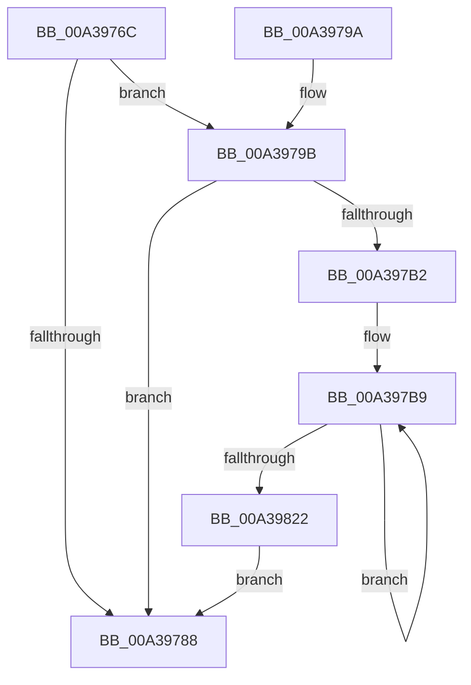

# PopDiagTraceDeviceComplianceRundown

- RVA: `0x00A3976C`–`0x00A39827` (길이 `187` bytes)
- VA: `0x0000000140A3976C`
- 실행 섹션: `PAGE`
- PDB 이름 있음: `예`; PDB Function 태그: `아니요`
- unwind 정보 RVA: `0x000ADF2C`
- 디코드: `41`개 명령, `187/187` bytes 표시
- 미해석 바이트: `0` (있으면 어셈블리에 `.byte`로 보존)

> 이 문서는 커널 이미지의 기계어와 PDB 기호를 분석해 생성했습니다. 4번과 5번은 함수 원형과 자료형을 바이너리 사용 방식에서 추정한 C 해석이며 원본 소스 복구 결과는 아닙니다.

## 1. Dependencies

- 직접 호출 지점: **3**; 고유 호출 대상: **3**
- 직접 호출자로 확인된 함수: **1**
- RIP 상대 이미지 참조: **5**

### Outgoing calls
- `0x00A39790` → [_security_check_cookie](../../text/6A/_security_check_cookie_function_006AC640.md) (function, `0x006AC640`)
- `0x00A397A9` → [EtwEventEnabled](../../text/39/EtwEventEnabled_function_00392450.md) (function, `0x00392450`)
- `0x00A3980E` → [EtwWrite](../../text/41/EtwWrite_function_0041C720.md) (function, `0x0041C720`)

### Direct callers
- [PopDiagTraceControlCallback](PopDiagTraceControlCallback_function_00A38CB0.md) at `0x00A38E12`

### Static image references
- `0x00A39770` → RVA `0x00E0A740` (`.data`; read)
- `0x00A3977F` → RVA `0x00E67858` (`.data`; read)
- `0x00A3979B` → RVA `0x00F0B408` (`.data`; read)
- `0x00A397A2` → RVA `0x0001A410` (`.rdata`; read)
- `0x00A397DA` → RVA `0x00E679C0` (`.data`; read)

## 2. Other-region calls and transfers

- 다른 실행 섹션으로 향하는 call: **3**
  - `0x00A39790` → [_security_check_cookie](../../text/6A/_security_check_cookie_function_006AC640.md) (`PAGE` → `.text`)
  - `0x00A397A9` → [EtwEventEnabled](../../text/39/EtwEventEnabled_function_00392450.md) (`PAGE` → `.text`)
  - `0x00A3980E` → [EtwWrite](../../text/41/EtwWrite_function_0041C720.md) (`PAGE` → `.text`)
- 별도 외부 분기/꼬리 이동을 확인하지 못했습니다.

## 3. Assembly (complete function range)

```asm
00A3976C  48 83 EC 68                     sub rsp, 0x68
00A39770  48 8B 05 C9 0F 3D 00            mov rax, qword ptr [rip + 0x3d0fc9]
00A39777  48 33 C4                        xor rax, rsp
00A3977A  48 89 44 24 58                  mov qword ptr [rsp + 0x58], rax
00A3977F  80 3D D2 E0 42 00 00            cmp byte ptr [rip + 0x42e0d2], 0
00A39786  75 13                           jne 0x140a3979b
00A39788  48 8B 4C 24 58                  mov rcx, qword ptr [rsp + 0x58]
00A3978D  48 33 CC                        xor rcx, rsp
00A39790  E8 AB 2E C7 FF                  call 0x1406ac640
00A39795  48 83 C4 68                     add rsp, 0x68
00A39799  C3                              ret
00A3979A  CC                              int3
00A3979B  48 8B 0D 66 1C 4D 00            mov rcx, qword ptr [rip + 0x4d1c66]
00A397A2  48 8D 15 67 0C 5E FF            lea rdx, [rip - 0xa1f399]
00A397A9  E8 A2 8C 95 FF                  call 0x140392450
00A397AE  84 C0                           test al, al
00A397B0  74 D6                           je 0x140a39788
00A397B2  83 64 24 30 00                  and dword ptr [rsp + 0x30], 0
00A397B7  33 C0                           xor eax, eax
00A397B9  83 64 24 44 00                  and dword ptr [rsp + 0x44], 0
00A397BE  48 8D 4C 24 30                  lea rcx, [rsp + 0x30]
00A397C3  83 64 24 54 00                  and dword ptr [rsp + 0x54], 0
00A397C8  48 8D 15 41 0C 5E FF            lea rdx, [rip - 0xa1f3bf]
00A397CF  48 89 4C 24 38                  mov qword ptr [rsp + 0x38], rcx
00A397D4  41 B9 02 00 00 00               mov r9d, 2
00A397DA  48 8D 0D DF E1 42 00            lea rcx, [rip + 0x42e1df]
00A397E1  C7 44 24 40 04 00 00 00         mov dword ptr [rsp + 0x40], 4
00A397E9  48 8D 04 81                     lea rax, [rcx + rax*4]
00A397ED  C7 44 24 50 04 00 00 00         mov dword ptr [rsp + 0x50], 4
00A397F5  48 8B 0D 0C 1C 4D 00            mov rcx, qword ptr [rip + 0x4d1c0c]
00A397FC  45 33 C0                        xor r8d, r8d
00A397FF  48 89 44 24 48                  mov qword ptr [rsp + 0x48], rax
00A39804  48 8D 44 24 38                  lea rax, [rsp + 0x38]
00A39809  48 89 44 24 20                  mov qword ptr [rsp + 0x20], rax
00A3980E  E8 0D 2F 9E FF                  call 0x14041c720
00A39813  8B 44 24 30                     mov eax, dword ptr [rsp + 0x30]
00A39817  FF C0                           inc eax
00A39819  89 44 24 30                     mov dword ptr [rsp + 0x30], eax
00A3981D  83 F8 05                        cmp eax, 5
00A39820  72 97                           jb 0x140a397b9
00A39822  E9 61 FF FF FF                  jmp 0x140a39788
```

## 4. C-style interpretation (structured pseudocode)

```c
__int64 __fastcall PopDiagTraceDeviceComplianceRundown(__int64 a1, __int64 a2, int a3)
{
    __int64 result;
    __int64 v_rsp;
    unsigned __int64 v_stack_m10;
    unsigned __int64 v_stack_p20;
    unsigned int v_stack_p30;
    unsigned __int64 v_stack_p38;
    unsigned int v_stack_p40;
    unsigned int v_stack_p44;
    unsigned __int64 v_stack_p48;
    unsigned int v_stack_p50;
    unsigned int v_stack_p54;

    v_rsp = (v_rsp) - (104);
    result = (*(unsigned __int64 *)(v_rip + 4001737)) ^ (v_rsp);
    v_stack_m10 = result;
    if ((*(unsigned __int8 *)(v_rip + 4382930)) != 0) goto loc_00A3979B;
loc_00A39788:
    a1 = (v_stack_m10) ^ (v_rsp);
    result = _security_check_cookie(a1, a2, a3, a4);
    v_rsp = (v_rsp) + (104);
    return result;
loc_00A3979B:
    result = EtwEventEnabled(*(unsigned __int64 *)(v_rip + 5053542), v_rip - 10613657, a3, a4);
    if ((unsigned __int8)(result) == 0) goto loc_00A39788;
    result = 0;
loc_00A397B9:
    v_stack_p38 = v_stack_p30;
    v_stack_p40 = 4;
    v_stack_p50 = 4;
    a3 = 0;
    v_stack_p48 = v_rip + 4383199 + result * 4;
    v_stack_p20 = v_stack_p38;
    result = EtwWrite(*(unsigned __int64 *)(v_rip + 5053452), v_rip - 10613695, a3, 2);
    result = (unsigned int)(((unsigned int)(v_stack_p30)) + 1);
    v_stack_p30 = (unsigned int)(result);
    if (((unsigned int)(result)) < 5) goto loc_00A397B9;
    goto loc_00A39788;
}
```

## 5. (Beta) C Style

```c
int64_t PopDiagTraceDeviceComplianceRundown(int64_t Arg1, int64_t Arg2, int32_t Arg3)
{
    int64_t result;
    int64_t local_rsp;
    uint64_t v_stack_m10;
    uint64_t v_stack_p20;
    uint32_t v_stack_p30;
    uint64_t v_stack_p38;
    uint32_t v_stack_p40;
    uint32_t v_stack_p44;
    uint64_t v_stack_p48;
    uint32_t v_stack_p50;
    uint32_t v_stack_p54;

    local_rsp = (local_rsp) - (104);
    result = (*(uint64_t *)(v_rip + 0x3D0FC9)) ^ (local_rsp);
    v_stack_m10 = result;
    if ((*(uint8_t *)(v_rip + 0x42E0D2)) != 0) goto loc_00A3979B;
loc_00A39788:
    Arg1 = (v_stack_m10) ^ (local_rsp);
    result = _security_check_cookie(Arg1, Arg2, Arg3, a4);
    local_rsp = (local_rsp) + (104);
    return result;
loc_00A3979B:
    result = EtwEventEnabled(*(uint64_t *)(v_rip + 0x4D1C66), v_rip - 10613657, Arg3, a4);
    if ((uint8_t)(result) == 0) goto loc_00A39788;
    result = 0;
loc_00A397B9:
    v_stack_p38 = v_stack_p30;
    v_stack_p40 = 4;
    v_stack_p50 = 4;
    Arg3 = 0;
    v_stack_p48 = v_rip + 4383199 + result * 4;
    v_stack_p20 = v_stack_p38;
    result = EtwWrite(*(uint64_t *)(v_rip + 0x4D1C0C), v_rip - 10613695, Arg3, 2);
    result = (uint32_t)(((uint32_t)(v_stack_p30)) + 1);
    v_stack_p30 = (uint32_t)(result);
    if (((uint32_t)(result)) < 5) goto loc_00A397B9;
    goto loc_00A39788;
}
```

## 6. Execution-region graph

[열기: 2D/3D 그래프와 함수 탐색 컨트롤 패널](../../../control-panel.html?section=page&rva=0x00A3976C&view=graph)

- 2D 그래프는 위에서 아래로 흐르고, 3D 그래프는 빈 공간을 드래그해 회전합니다. Shift+드래그는 이동, 휠은 확대·축소, 함수 노드 선택은 대상 보고서 이동입니다.

### Static fallback


