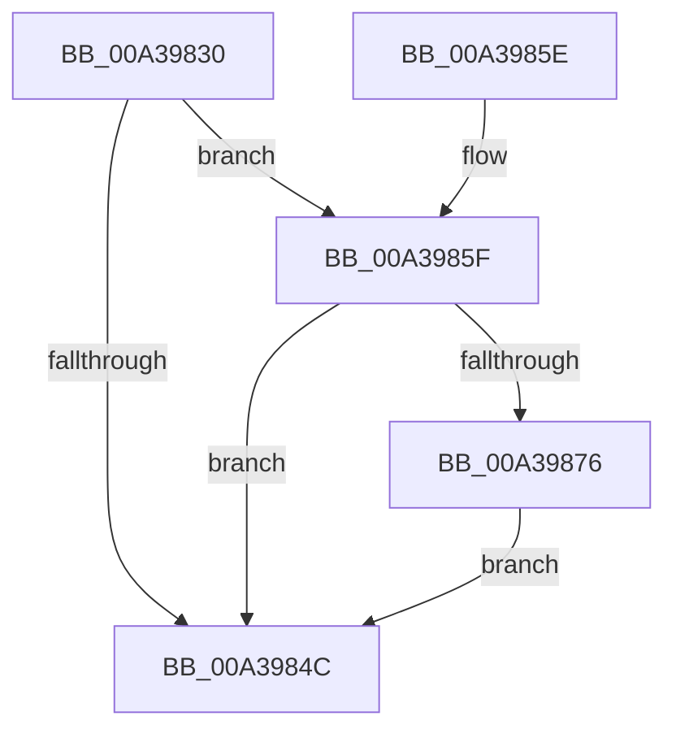

# PopDiagTraceDynamicTickStatusRundown

- RVA: `0x00A39830`–`0x00A398BB` (길이 `139` bytes)
- VA: `0x0000000140A39830`
- 실행 섹션: `PAGE`
- PDB 이름 있음: `예`; PDB Function 태그: `아니요`
- unwind 정보 RVA: `0x000ADF40`
- 디코드: `31`개 명령, `139/139` bytes 표시
- 미해석 바이트: `0` (있으면 어셈블리에 `.byte`로 보존)

> 이 문서는 커널 이미지의 기계어와 PDB 기호를 분석해 생성했습니다. 4번과 5번은 함수 원형과 자료형을 바이너리 사용 방식에서 추정한 C 해석이며 원본 소스 복구 결과는 아닙니다.

## 1. Dependencies

- 직접 호출 지점: **4**; 고유 호출 대상: **4**
- 직접 호출자로 확인된 함수: **1**
- RIP 상대 이미지 참조: **4**

### Outgoing calls
- `0x00A39854` → [_security_check_cookie](../../text/6A/_security_check_cookie_function_006AC640.md) (function, `0x006AC640`)
- `0x00A3986D` → [EtwEventEnabled](../../text/39/EtwEventEnabled_function_00392450.md) (function, `0x00392450`)
- `0x00A39876` → [KeGetDynamicTickDisableReason](../../text/4F/KeGetDynamicTickDisableReason_function_004FAD04.md) (function, `0x004FAD04`)
- `0x00A398B4` → [EtwWrite](../../text/41/EtwWrite_function_0041C720.md) (function, `0x0041C720`)

### Direct callers
- [PopDiagTraceControlCallback](PopDiagTraceControlCallback_function_00A38CB0.md) at `0x00A38E1C`

### Static image references
- `0x00A39834` → RVA `0x00E0A740` (`.data`; read)
- `0x00A39843` → RVA `0x00E67858` (`.data`; read)
- `0x00A3985F` → RVA `0x00F0B408` (`.data`; read)
- `0x00A39866` → RVA `0x0001A430` (`.rdata`; read)

## 2. Other-region calls and transfers

- 다른 실행 섹션으로 향하는 call: **4**
  - `0x00A39854` → [_security_check_cookie](../../text/6A/_security_check_cookie_function_006AC640.md) (`PAGE` → `.text`)
  - `0x00A3986D` → [EtwEventEnabled](../../text/39/EtwEventEnabled_function_00392450.md) (`PAGE` → `.text`)
  - `0x00A39876` → [KeGetDynamicTickDisableReason](../../text/4F/KeGetDynamicTickDisableReason_function_004FAD04.md) (`PAGE` → `.text`)
  - `0x00A398B4` → [EtwWrite](../../text/41/EtwWrite_function_0041C720.md) (`PAGE` → `.text`)
- 별도 외부 분기/꼬리 이동을 확인하지 못했습니다.

## 3. Assembly (complete function range)

```asm
00A39830  48 83 EC 58                     sub rsp, 0x58
00A39834  48 8B 05 05 0F 3D 00            mov rax, qword ptr [rip + 0x3d0f05]
00A3983B  48 33 C4                        xor rax, rsp
00A3983E  48 89 44 24 48                  mov qword ptr [rsp + 0x48], rax
00A39843  80 3D 0E E0 42 00 00            cmp byte ptr [rip + 0x42e00e], 0
00A3984A  75 13                           jne 0x140a3985f
00A3984C  48 8B 4C 24 48                  mov rcx, qword ptr [rsp + 0x48]
00A39851  48 33 CC                        xor rcx, rsp
00A39854  E8 E7 2D C7 FF                  call 0x1406ac640
00A39859  48 83 C4 58                     add rsp, 0x58
00A3985D  C3                              ret
00A3985E  CC                              int3
00A3985F  48 8B 0D A2 1B 4D 00            mov rcx, qword ptr [rip + 0x4d1ba2]
00A39866  48 8D 15 C3 0B 5E FF            lea rdx, [rip - 0xa1f43d]
00A3986D  E8 DE 8B 95 FF                  call 0x140392450
00A39872  84 C0                           test al, al
00A39874  74 D6                           je 0x140a3984c
00A39876  E8 89 14 AC FF                  call 0x1404fad04
00A3987B  83 64 24 44 00                  and dword ptr [rsp + 0x44], 0
00A39880  48 8D 15 A9 0B 5E FF            lea rdx, [rip - 0xa1f457]
00A39887  48 8B 0D 7A 1B 4D 00            mov rcx, qword ptr [rip + 0x4d1b7a]
00A3988E  41 B9 01 00 00 00               mov r9d, 1
00A39894  88 44 24 30                     mov byte ptr [rsp + 0x30], al
00A39898  45 33 C0                        xor r8d, r8d
00A3989B  48 8D 44 24 30                  lea rax, [rsp + 0x30]
00A398A0  44 89 4C 24 40                  mov dword ptr [rsp + 0x40], r9d
00A398A5  48 89 44 24 38                  mov qword ptr [rsp + 0x38], rax
00A398AA  48 8D 44 24 38                  lea rax, [rsp + 0x38]
00A398AF  48 89 44 24 20                  mov qword ptr [rsp + 0x20], rax
00A398B4  E8 67 2E 9E FF                  call 0x14041c720
00A398B9  EB 91                           jmp 0x140a3984c
```

## 4. C-style interpretation (structured pseudocode)

```c
__int64 __fastcall PopDiagTraceDynamicTickStatusRundown(__int64 a1, __int64 a2, int a3)
{
    __int64 result;
    __int64 v_rsp;
    unsigned __int64 v_stack_m10;
    unsigned __int64 v_stack_p20;
    unsigned __int8 v_stack_p30;
    unsigned __int64 v_stack_p38;
    unsigned int v_stack_p40;
    unsigned int v_stack_p44;

    v_rsp = (v_rsp) - (88);
    result = (*(unsigned __int64 *)(v_rip + 4001541)) ^ (v_rsp);
    v_stack_m10 = result;
    if ((*(unsigned __int8 *)(v_rip + 4382734)) != 0) goto loc_00A3985F;
loc_00A3984C:
    a1 = (v_stack_m10) ^ (v_rsp);
    result = _security_check_cookie(a1, a2, a3, a4);
    v_rsp = (v_rsp) + (88);
    return result;
loc_00A3985F:
    result = EtwEventEnabled(*(unsigned __int64 *)(v_rip + 5053346), v_rip - 10613821, a3, a4);
    if ((unsigned __int8)(result) == 0) goto loc_00A3984C;
    result = KeGetDynamicTickDisableReason(*(unsigned __int64 *)(v_rip + 5053346), v_rip - 10613821, a3, a4);
    v_stack_p30 = (unsigned __int8)(result);
    a3 = 0;
    v_stack_p40 = 1;
    v_stack_p38 = v_stack_p30;
    v_stack_p20 = v_stack_p38;
    result = EtwWrite(*(unsigned __int64 *)(v_rip + 5053306), v_rip - 10613847, a3, 1);
    goto loc_00A3984C;
}
```

## 5. (Beta) C Style

```c
int64_t PopDiagTraceDynamicTickStatusRundown(int64_t Arg1, int64_t Arg2, int32_t Arg3)
{
    int64_t result;
    int64_t local_rsp;
    uint64_t v_stack_m10;
    uint64_t v_stack_p20;
    uint8_t v_stack_p30;
    uint64_t v_stack_p38;
    uint32_t v_stack_p40;
    uint32_t v_stack_p44;

    local_rsp = (local_rsp) - (88);
    result = (*(uint64_t *)(v_rip + 0x3D0F05)) ^ (local_rsp);
    v_stack_m10 = result;
    if ((*(uint8_t *)(v_rip + 0x42E00E)) != 0) goto loc_00A3985F;
loc_00A3984C:
    Arg1 = (v_stack_m10) ^ (local_rsp);
    result = _security_check_cookie(Arg1, Arg2, Arg3, a4);
    local_rsp = (local_rsp) + (88);
    return result;
loc_00A3985F:
    result = EtwEventEnabled(*(uint64_t *)(v_rip + 0x4D1BA2), v_rip - 10613821, Arg3, a4);
    if ((uint8_t)(result) == 0) goto loc_00A3984C;
    result = KeGetDynamicTickDisableReason(*(uint64_t *)(v_rip + 0x4D1BA2), v_rip - 10613821, Arg3, a4);
    v_stack_p30 = (uint8_t)(result);
    Arg3 = 0;
    v_stack_p40 = 1;
    v_stack_p38 = v_stack_p30;
    v_stack_p20 = v_stack_p38;
    result = EtwWrite(*(uint64_t *)(v_rip + 0x4D1B7A), v_rip - 10613847, Arg3, 1);
    goto loc_00A3984C;
}
```

## 6. Execution-region graph

[열기: 2D/3D 그래프와 함수 탐색 컨트롤 패널](../../../control-panel.html?section=page&rva=0x00A39830&view=graph)

- 2D 그래프는 위에서 아래로 흐르고, 3D 그래프는 빈 공간을 드래그해 회전합니다. Shift+드래그는 이동, 휠은 확대·축소, 함수 노드 선택은 대상 보고서 이동입니다.

### Static fallback


