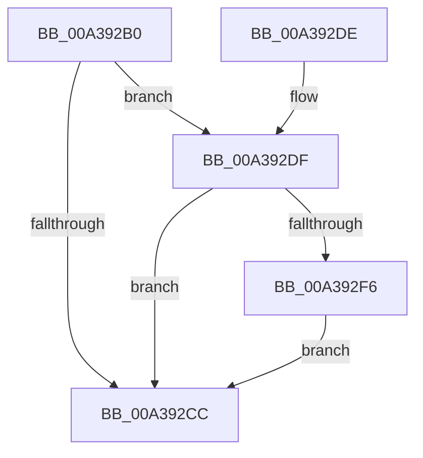

# PopDiagTracePlatformRoleRundown

- RVA: `0x00A392B0`–`0x00A39337` (길이 `135` bytes)
- VA: `0x0000000140A392B0`
- 실행 섹션: `PAGE`
- PDB 이름 있음: `예`; PDB Function 태그: `아니요`
- unwind 정보 RVA: `0x000ADEA0`
- 디코드: `29`개 명령, `135/135` bytes 표시
- 미해석 바이트: `0` (있으면 어셈블리에 `.byte`로 보존)

> 이 문서는 커널 이미지의 기계어와 PDB 기호를 분석해 생성했습니다. 4번과 5번은 함수 원형과 자료형을 바이너리 사용 방식에서 추정한 C 해석이며 원본 소스 복구 결과는 아닙니다.

## 1. Dependencies

- 직접 호출 지점: **3**; 고유 호출 대상: **3**
- 직접 호출자로 확인된 함수: **1**
- RIP 상대 이미지 참조: **5**

### Outgoing calls
- `0x00A392D4` → [_security_check_cookie](../../text/6A/_security_check_cookie_function_006AC640.md) (function, `0x006AC640`)
- `0x00A392ED` → [EtwEventEnabled](../../text/39/EtwEventEnabled_function_00392450.md) (function, `0x00392450`)
- `0x00A39330` → [EtwWrite](../../text/41/EtwWrite_function_0041C720.md) (function, `0x0041C720`)

### Direct callers
- [PopDiagTraceControlCallback](PopDiagTraceControlCallback_function_00A38CB0.md) at `0x00A38DF9`

### Static image references
- `0x00A392B4` → RVA `0x00E0A740` (`.data`; read)
- `0x00A392C3` → RVA `0x00E67858` (`.data`; read)
- `0x00A392DF` → RVA `0x00F0B408` (`.data`; read)
- `0x00A392E6` → RVA `0x0001A420` (`.rdata`; read)
- `0x00A392FB` → RVA `0x00FC6CD8` (`ALMOSTRO`; read)

## 2. Other-region calls and transfers

- 다른 실행 섹션으로 향하는 call: **3**
  - `0x00A392D4` → [_security_check_cookie](../../text/6A/_security_check_cookie_function_006AC640.md) (`PAGE` → `.text`)
  - `0x00A392ED` → [EtwEventEnabled](../../text/39/EtwEventEnabled_function_00392450.md) (`PAGE` → `.text`)
  - `0x00A39330` → [EtwWrite](../../text/41/EtwWrite_function_0041C720.md) (`PAGE` → `.text`)
- 별도 외부 분기/꼬리 이동을 확인하지 못했습니다.

## 3. Assembly (complete function range)

```asm
00A392B0  48 83 EC 58                     sub rsp, 0x58
00A392B4  48 8B 05 85 14 3D 00            mov rax, qword ptr [rip + 0x3d1485]
00A392BB  48 33 C4                        xor rax, rsp
00A392BE  48 89 44 24 40                  mov qword ptr [rsp + 0x40], rax
00A392C3  80 3D 8E E5 42 00 00            cmp byte ptr [rip + 0x42e58e], 0
00A392CA  75 13                           jne 0x140a392df
00A392CC  48 8B 4C 24 40                  mov rcx, qword ptr [rsp + 0x40]
00A392D1  48 33 CC                        xor rcx, rsp
00A392D4  E8 67 33 C7 FF                  call 0x1406ac640
00A392D9  48 83 C4 58                     add rsp, 0x58
00A392DD  C3                              ret
00A392DE  CC                              int3
00A392DF  48 8B 0D 22 21 4D 00            mov rcx, qword ptr [rip + 0x4d2122]
00A392E6  48 8D 15 33 11 5E FF            lea rdx, [rip - 0xa1eecd]
00A392ED  E8 5E 91 95 FF                  call 0x140392450
00A392F2  84 C0                           test al, al
00A392F4  74 D6                           je 0x140a392cc
00A392F6  83 64 24 3C 00                  and dword ptr [rsp + 0x3c], 0
00A392FB  48 8D 05 D6 D9 58 00            lea rax, [rip + 0x58d9d6]
00A39302  48 8B 0D FF 20 4D 00            mov rcx, qword ptr [rip + 0x4d20ff]
00A39309  48 8D 15 10 11 5E FF            lea rdx, [rip - 0xa1eef0]
00A39310  48 89 44 24 30                  mov qword ptr [rsp + 0x30], rax
00A39315  41 B9 01 00 00 00               mov r9d, 1
00A3931B  48 8D 44 24 30                  lea rax, [rsp + 0x30]
00A39320  C7 44 24 38 04 00 00 00         mov dword ptr [rsp + 0x38], 4
00A39328  45 33 C0                        xor r8d, r8d
00A3932B  48 89 44 24 20                  mov qword ptr [rsp + 0x20], rax
00A39330  E8 EB 33 9E FF                  call 0x14041c720
00A39335  EB 95                           jmp 0x140a392cc
```

## 4. C-style interpretation (structured pseudocode)

```c
__int64 __fastcall PopDiagTracePlatformRoleRundown(__int64 a1, __int64 a2, int a3)
{
    __int64 result;
    __int64 v_rsp;
    unsigned __int64 v_stack_m18;
    unsigned __int64 v_stack_p20;
    unsigned __int64 v_stack_p30;
    unsigned int v_stack_p38;
    unsigned int v_stack_p3C;

    v_rsp = (v_rsp) - (88);
    result = (*(unsigned __int64 *)(v_rip + 4002949)) ^ (v_rsp);
    v_stack_m18 = result;
    if ((*(unsigned __int8 *)(v_rip + 4384142)) != 0) goto loc_00A392DF;
loc_00A392CC:
    a1 = (v_stack_m18) ^ (v_rsp);
    result = _security_check_cookie(a1, a2, a3, a4);
    v_rsp = (v_rsp) + (88);
    return result;
loc_00A392DF:
    result = EtwEventEnabled(*(unsigned __int64 *)(v_rip + 5054754), v_rip - 10612429, a3, a4);
    if ((unsigned __int8)(result) == 0) goto loc_00A392CC;
    v_stack_p30 = v_rip + 5822934;
    v_stack_p38 = 4;
    a3 = 0;
    v_stack_p20 = v_stack_p30;
    result = EtwWrite(*(unsigned __int64 *)(v_rip + 5054719), v_rip - 10612464, a3, 1);
    goto loc_00A392CC;
}
```

## 5. (Beta) C Style

```c
int64_t PopDiagTracePlatformRoleRundown(int64_t Arg1, int64_t Arg2, int32_t Arg3)
{
    int64_t result;
    int64_t local_rsp;
    uint64_t v_stack_m18;
    uint64_t v_stack_p20;
    uint64_t v_stack_p30;
    uint32_t v_stack_p38;
    uint32_t v_stack_p3C;

    local_rsp = (local_rsp) - (88);
    result = (*(uint64_t *)(v_rip + 0x3D1485)) ^ (local_rsp);
    v_stack_m18 = result;
    if ((*(uint8_t *)(v_rip + 0x42E58E)) != 0) goto loc_00A392DF;
loc_00A392CC:
    Arg1 = (v_stack_m18) ^ (local_rsp);
    result = _security_check_cookie(Arg1, Arg2, Arg3, a4);
    local_rsp = (local_rsp) + (88);
    return result;
loc_00A392DF:
    result = EtwEventEnabled(*(uint64_t *)(v_rip + 0x4D2122), v_rip - 10612429, Arg3, a4);
    if ((uint8_t)(result) == 0) goto loc_00A392CC;
    v_stack_p30 = v_rip + 5822934;
    v_stack_p38 = 4;
    Arg3 = 0;
    v_stack_p20 = v_stack_p30;
    result = EtwWrite(*(uint64_t *)(v_rip + 0x4D20FF), v_rip - 10612464, Arg3, 1);
    goto loc_00A392CC;
}
```

## 6. Execution-region graph

[열기: 2D/3D 그래프와 함수 탐색 컨트롤 패널](../../../control-panel.html?section=page&rva=0x00A392B0&view=graph)

- 2D 그래프는 위에서 아래로 흐르고, 3D 그래프는 빈 공간을 드래그해 회전합니다. Shift+드래그는 이동, 휠은 확대·축소, 함수 노드 선택은 대상 보고서 이동입니다.

### Static fallback


