# PopDiagTracePowerRequestCreate

- RVA: `0x00A38EEC`–`0x00A392A8` (길이 `956` bytes)
- VA: `0x0000000140A38EEC`
- 실행 섹션: `PAGE`
- PDB 이름 있음: `예`; PDB Function 태그: `아니요`
- unwind 정보 RVA: `0x000ADE7C`
- 디코드: `233`개 명령, `956/956` bytes 표시
- 미해석 바이트: `0` (있으면 어셈블리에 `.byte`로 보존)

> 이 문서는 커널 이미지의 기계어와 PDB 기호를 분석해 생성했습니다. 4번과 5번은 함수 원형과 자료형을 바이너리 사용 방식에서 추정한 C 해석이며 원본 소스 복구 결과는 아닙니다.

## 1. Dependencies

- 직접 호출 지점: **8**; 고유 호출 대상: **7**
- 직접 호출자로 확인된 함수: **2**
- RIP 상대 이미지 참조: **5**

### Outgoing calls
- `0x00A38F65` → [EtwEventEnabled](../../text/39/EtwEventEnabled_function_00392450.md) (function, `0x00392450`)
- `0x00A38FCC` → [PoStoreRequester](../../text/23/PoStoreRequester_function_002304D4.md) (function, `0x002304D4`)
- `0x00A38FE1` → [ExAllocatePool2](../../poolcode/B8/ExAllocatePool2_function_00B820F0.md) (function, `0x00B820F0`)
- `0x00A39006` → [PoStoreRequester](../../text/23/PoStoreRequester_function_002304D4.md) (function, `0x002304D4`)
- `0x00A39023` → [PopGetCallerContextFromBuffer](PopGetCallerContextFromBuffer_function_00A39AAC.md) (function, `0x00A39AAC`)
- `0x00A3926D` → [EtwWrite](../../text/41/EtwWrite_function_0041C720.md) (function, `0x0041C720`)
- `0x00A3927A` → [ExFreePoolWithTag](../../poolcode/B8/ExFreePoolWithTag_function_00B82870.md) (function, `0x00B82870`)
- `0x00A39289` → [_security_check_cookie](../../text/6A/_security_check_cookie_function_006AC640.md) (function, `0x006AC640`)

### Direct callers
- [PopPowerRequestCreateCommon](../../text/23/PopPowerRequestCreateCommon_function_00230150.md) at `0x0023036E`
- [PopDiagTraceControlCallback](PopDiagTraceControlCallback_function_00A38CB0.md) at `0x00A38D35`

### Static image references
- `0x00A38F0A` → RVA `0x00E0A740` (`.data`; read)
- `0x00A38F22` → RVA `0x00E67858` (`.data`; read)
- `0x00A38F4B` → RVA `0x00F0B408` (`.data`; read)
- `0x00A38F52` → RVA `0x0001A460` (`.rdata`; read)
- `0x00A38F5E` → RVA `0x0001A450` (`.rdata`; read)

## 2. Other-region calls and transfers

- 다른 실행 섹션으로 향하는 call: **7**
  - `0x00A38F65` → [EtwEventEnabled](../../text/39/EtwEventEnabled_function_00392450.md) (`PAGE` → `.text`)
  - `0x00A38FCC` → [PoStoreRequester](../../text/23/PoStoreRequester_function_002304D4.md) (`PAGE` → `.text`)
  - `0x00A38FE1` → [ExAllocatePool2](../../poolcode/B8/ExAllocatePool2_function_00B820F0.md) (`PAGE` → `POOLCODE`)
  - `0x00A39006` → [PoStoreRequester](../../text/23/PoStoreRequester_function_002304D4.md) (`PAGE` → `.text`)
  - `0x00A3926D` → [EtwWrite](../../text/41/EtwWrite_function_0041C720.md) (`PAGE` → `.text`)
  - `0x00A3927A` → [ExFreePoolWithTag](../../poolcode/B8/ExFreePoolWithTag_function_00B82870.md) (`PAGE` → `POOLCODE`)
  - `0x00A39289` → [_security_check_cookie](../../text/6A/_security_check_cookie_function_006AC640.md) (`PAGE` → `.text`)
- 별도 외부 분기/꼬리 이동을 확인하지 못했습니다.

## 3. Assembly (complete function range)

```asm
00A38EEC  48 8B C4                        mov rax, rsp
00A38EEF  48 89 58 08                     mov qword ptr [rax + 8], rbx
00A38EF3  48 89 70 18                     mov qword ptr [rax + 0x18], rsi
00A38EF7  48 89 78 20                     mov qword ptr [rax + 0x20], rdi
00A38EFB  55                              push rbp
00A38EFC  48 8D A8 E8 FE FF FF            lea rbp, [rax - 0x118]
00A38F03  48 81 EC 10 02 00 00            sub rsp, 0x210
00A38F0A  48 8B 05 2F 18 3D 00            mov rax, qword ptr [rip + 0x3d182f]
00A38F11  48 33 C4                        xor rax, rsp
00A38F14  48 89 85 08 01 00 00            mov qword ptr [rbp + 0x108], rax
00A38F1B  33 F6                           xor esi, esi
00A38F1D  48 89 54 24 60                  mov qword ptr [rsp + 0x60], rdx
00A38F22  40 38 35 2F E9 42 00            cmp byte ptr [rip + 0x42e92f], sil
00A38F29  0F 57 C0                        xorps xmm0, xmm0
00A38F2C  40 8A F9                        mov dil, cl
00A38F2F  66 89 74 24 30                  mov word ptr [rsp + 0x30], si
00A38F34  0F 11 45 80                     movups xmmword ptr [rbp - 0x80], xmm0
00A38F38  66 89 74 24 34                  mov word ptr [rsp + 0x34], si
00A38F3D  0F 11 45 90                     movups xmmword ptr [rbp - 0x70], xmm0
00A38F41  89 74 24 74                     mov dword ptr [rsp + 0x74], esi
00A38F45  0F 84 34 03 00 00               je 0x140a3927f
00A38F4B  48 8B 0D B6 24 4D 00            mov rcx, qword ptr [rip + 0x4d24b6]
00A38F52  48 8D 15 07 15 5E FF            lea rdx, [rip - 0xa1eaf9]
00A38F59  40 84 FF                        test dil, dil
00A38F5C  74 07                           je 0x140a38f65
00A38F5E  48 8D 15 EB 14 5E FF            lea rdx, [rip - 0xa1eb15]
00A38F65  E8 E6 94 95 FF                  call 0x140392450
00A38F6A  84 C0                           test al, al
00A38F6C  0F 84 0D 03 00 00               je 0x140a3927f
00A38F72  4C 8B 54 24 60                  mov r10, qword ptr [rsp + 0x60]
00A38F77  4C 8D 44 24 68                  lea r8, [rsp + 0x68]
00A38F7C  45 33 C9                        xor r9d, r9d
00A38F7F  48 89 74 24 68                  mov qword ptr [rsp + 0x68], rsi
00A38F84  33 D2                           xor edx, edx
00A38F86  C7 44 24 70 00 00 16 00         mov dword ptr [rsp + 0x70], 0x160000
00A38F8E  49 8B 42 60                     mov rax, qword ptr [r10 + 0x60]
00A38F92  8B 08                           mov ecx, dword ptr [rax]
00A38F94  48 8D 85 F0 00 00 00            lea rax, [rbp + 0xf0]
00A38F9B  89 4C 24 38                     mov dword ptr [rsp + 0x38], ecx
00A38F9F  89 74 24 3C                     mov dword ptr [rsp + 0x3c], esi
00A38FA3  89 74 24 40                     mov dword ptr [rsp + 0x40], esi
00A38FA7  89 74 24 44                     mov dword ptr [rsp + 0x44], esi
00A38FAB  89 74 24 48                     mov dword ptr [rsp + 0x48], esi
00A38FAF  89 74 24 4C                     mov dword ptr [rsp + 0x4c], esi
00A38FB3  89 74 24 50                     mov dword ptr [rsp + 0x50], esi
00A38FB7  89 74 24 5C                     mov dword ptr [rsp + 0x5c], esi
00A38FBB  89 74 24 58                     mov dword ptr [rsp + 0x58], esi
00A38FBF  89 74 24 54                     mov dword ptr [rsp + 0x54], esi
00A38FC3  49 8B 4A 60                     mov rcx, qword ptr [r10 + 0x60]
00A38FC7  48 89 44 24 78                  mov qword ptr [rsp + 0x78], rax
00A38FCC  E8 03 75 7F FF                  call 0x1402304d4
00A38FD1  48 8B 54 24 68                  mov rdx, qword ptr [rsp + 0x68]
00A38FD6  41 B8 54 56 45 50               mov r8d, 0x50455654
00A38FDC  B9 00 01 00 00                  mov ecx, 0x100
00A38FE1  E8 0A 91 14 00                  call 0x140b820f0
00A38FE6  48 8B D8                        mov rbx, rax
00A38FE9  48 85 C0                        test rax, rax
00A38FEC  0F 84 8D 02 00 00               je 0x140a3927f
00A38FF2  48 8B 4C 24 60                  mov rcx, qword ptr [rsp + 0x60]
00A38FF7  4C 8D 44 24 68                  lea r8, [rsp + 0x68]
00A38FFC  45 33 C9                        xor r9d, r9d
00A38FFF  48 8B D0                        mov rdx, rax
00A39002  48 8B 49 60                     mov rcx, qword ptr [rcx + 0x60]
00A39006  E8 C9 74 7F FF                  call 0x1402304d4
00A3900B  85 C0                           test eax, eax
00A3900D  0F 88 5F 02 00 00               js 0x140a39272
00A39013  4C 8D 4D 90                     lea r9, [rbp - 0x70]
00A39017  48 8B CB                        mov rcx, rbx
00A3901A  4C 8D 45 80                     lea r8, [rbp - 0x80]
00A3901E  48 8D 54 24 70                  lea rdx, [rsp + 0x70]
00A39023  E8 84 0A 00 00                  call 0x140a39aac
00A39028  4C 8B 44 24 60                  mov r8, qword ptr [rsp + 0x60]
00A3902D  39 74 24 38                     cmp dword ptr [rsp + 0x38], esi
00A39031  74 0F                           je 0x140a39042
00A39033  8B 43 18                        mov eax, dword ptr [rbx + 0x18]
00A39036  89 44 24 3C                     mov dword ptr [rsp + 0x3c], eax
00A3903A  41 8B 40 10                     mov eax, dword ptr [r8 + 0x10]
00A3903E  89 44 24 40                     mov dword ptr [rsp + 0x40], eax
00A39042  41 BA 01 00 00 00               mov r10d, 1
00A39048  49 39 70 60                     cmp qword ptr [r8 + 0x60], rsi
00A3904C  75 05                           jne 0x140a39053
00A3904E  44 89 54 24 44                  mov dword ptr [rsp + 0x44], r10d
00A39053  41 8B 40 14                     mov eax, dword ptr [r8 + 0x14]
00A39057  41 B9 02 00 00 00               mov r9d, 2
00A3905D  41 84 C1                        test r9b, al
00A39060  74 05                           je 0x140a39067
00A39062  44 89 54 24 48                  mov dword ptr [rsp + 0x48], r10d
00A39067  41 8B 40 14                     mov eax, dword ptr [r8 + 0x14]
00A3906B  41 84 C2                        test r10b, al
00A3906E  74 05                           je 0x140a39075
00A39070  44 89 54 24 4C                  mov dword ptr [rsp + 0x4c], r10d
00A39075  41 8B 40 14                     mov eax, dword ptr [r8 + 0x14]
00A39079  41 BB 04 00 00 00               mov r11d, 4
00A3907F  41 84 C3                        test r11b, al
00A39082  74 05                           je 0x140a39089
00A39084  44 89 54 24 50                  mov dword ptr [rsp + 0x50], r10d
00A39089  41 8B 40 14                     mov eax, dword ptr [r8 + 0x14]
00A3908D  A8 08                           test al, 8
00A3908F  74 05                           je 0x140a39096
00A39091  44 89 54 24 54                  mov dword ptr [rsp + 0x54], r10d
00A39096  41 8B 40 14                     mov eax, dword ptr [r8 + 0x14]
00A3909A  A8 10                           test al, 0x10
00A3909C  74 05                           je 0x140a390a3
00A3909E  44 89 54 24 58                  mov dword ptr [rsp + 0x58], r10d
00A390A3  41 8B 40 14                     mov eax, dword ptr [r8 + 0x14]
00A390A7  A8 20                           test al, 0x20
00A390A9  74 05                           je 0x140a390b0
00A390AB  44 89 54 24 5C                  mov dword ptr [rsp + 0x5c], r10d
00A390B0  0F B7 4D 80                     movzx ecx, word ptr [rbp - 0x80]
00A390B4  48 8D 44 24 60                  lea rax, [rsp + 0x60]
00A390B9  0F B7 55 90                     movzx edx, word ptr [rbp - 0x70]
00A390BD  48 89 45 A0                     mov qword ptr [rbp - 0x60], rax
00A390C1  48 8D 44 24 38                  lea rax, [rsp + 0x38]
00A390C6  48 89 45 B0                     mov qword ptr [rbp - 0x50], rax
00A390CA  48 8D 44 24 3C                  lea rax, [rsp + 0x3c]
00A390CF  48 89 45 C0                     mov qword ptr [rbp - 0x40], rax
00A390D3  48 8D 44 24 40                  lea rax, [rsp + 0x40]
00A390D8  48 89 45 D0                     mov qword ptr [rbp - 0x30], rax
00A390DC  48 8D 44 24 44                  lea rax, [rsp + 0x44]
00A390E1  48 89 45 E0                     mov qword ptr [rbp - 0x20], rax
00A390E5  48 8D 44 24 48                  lea rax, [rsp + 0x48]
00A390EA  48 89 45 F0                     mov qword ptr [rbp - 0x10], rax
00A390EE  48 8D 44 24 4C                  lea rax, [rsp + 0x4c]
00A390F3  48 89 45 00                     mov qword ptr [rbp], rax
00A390F7  48 8D 44 24 50                  lea rax, [rsp + 0x50]
00A390FC  48 89 45 10                     mov qword ptr [rbp + 0x10], rax
00A39100  49 8D 40 2C                     lea rax, [r8 + 0x2c]
00A39104  48 89 45 20                     mov qword ptr [rbp + 0x20], rax
00A39108  49 8D 40 28                     lea rax, [r8 + 0x28]
00A3910C  48 89 45 30                     mov qword ptr [rbp + 0x30], rax
00A39110  49 8D 40 30                     lea rax, [r8 + 0x30]
00A39114  48 89 45 40                     mov qword ptr [rbp + 0x40], rax
00A39118  48 8D 44 24 30                  lea rax, [rsp + 0x30]
00A3911D  66 D1 E9                        shr cx, 1
00A39120  66 D1 EA                        shr dx, 1
00A39123  48 89 45 50                     mov qword ptr [rbp + 0x50], rax
00A39127  48 8D 44 24 34                  lea rax, [rsp + 0x34]
00A3912C  4C 89 4D 58                     mov qword ptr [rbp + 0x58], r9
00A39130  4C 89 4D 68                     mov qword ptr [rbp + 0x68], r9
00A39134  41 B9 0D 00 00 00               mov r9d, 0xd
00A3913A  48 89 45 60                     mov qword ptr [rbp + 0x60], rax
00A3913E  66 89 4C 24 30                  mov word ptr [rsp + 0x30], cx
00A39143  66 89 54 24 34                  mov word ptr [rsp + 0x34], dx
00A39148  48 C7 45 A8 08 00 00 00         mov qword ptr [rbp - 0x58], 8
00A39150  4C 89 5D B8                     mov qword ptr [rbp - 0x48], r11
00A39154  4C 89 5D C8                     mov qword ptr [rbp - 0x38], r11
00A39158  4C 89 5D D8                     mov qword ptr [rbp - 0x28], r11
00A3915C  4C 89 5D E8                     mov qword ptr [rbp - 0x18], r11
00A39160  4C 89 5D F8                     mov qword ptr [rbp - 8], r11
00A39164  4C 89 5D 08                     mov qword ptr [rbp + 8], r11
00A39168  4C 89 5D 18                     mov qword ptr [rbp + 0x18], r11
00A3916C  4C 89 5D 28                     mov qword ptr [rbp + 0x28], r11
00A39170  4C 89 5D 38                     mov qword ptr [rbp + 0x38], r11
00A39174  4C 89 5D 48                     mov qword ptr [rbp + 0x48], r11
00A39178  66 85 C9                        test cx, cx
00A3917B  74 19                           je 0x140a39196
00A3917D  48 8B 45 88                     mov rax, qword ptr [rbp - 0x78]
00A39181  41 B9 0E 00 00 00               mov r9d, 0xe
00A39187  48 89 45 70                     mov qword ptr [rbp + 0x70], rax
00A3918B  0F B7 C1                        movzx eax, cx
00A3918E  03 C0                           add eax, eax
00A39190  89 75 7C                        mov dword ptr [rbp + 0x7c], esi
00A39193  89 45 78                        mov dword ptr [rbp + 0x78], eax
00A39196  66 85 D2                        test dx, dx
00A39199  74 1F                           je 0x140a391ba
00A3919B  48 8B 45 98                     mov rax, qword ptr [rbp - 0x68]
00A3919F  41 8B C9                        mov ecx, r9d
00A391A2  48 03 C9                        add rcx, rcx
00A391A5  48 89 44 CD A0                  mov qword ptr [rbp + rcx*8 - 0x60], rax
00A391AA  0F B7 C2                        movzx eax, dx
00A391AD  03 C0                           add eax, eax
00A391AF  89 74 CD AC                     mov dword ptr [rbp + rcx*8 - 0x54], esi
00A391B3  89 44 CD A8                     mov dword ptr [rbp + rcx*8 - 0x58], eax
00A391B7  45 03 CA                        add r9d, r10d
00A391BA  41 8B C1                        mov eax, r9d
00A391BD  48 8D 4C 24 54                  lea rcx, [rsp + 0x54]
00A391C2  48 03 C0                        add rax, rax
00A391C5  48 8D 15 84 12 5E FF            lea rdx, [rip - 0xa1ed7c]
00A391CC  45 03 CA                        add r9d, r10d
00A391CF  48 89 4C C5 A0                  mov qword ptr [rbp + rax*8 - 0x60], rcx
00A391D4  48 8D 4C 24 58                  lea rcx, [rsp + 0x58]
00A391D9  4C 89 5C C5 A8                  mov qword ptr [rbp + rax*8 - 0x58], r11
00A391DE  41 8B C1                        mov eax, r9d
00A391E1  45 03 CA                        add r9d, r10d
00A391E4  48 03 C0                        add rax, rax
00A391E7  48 89 4C C5 A0                  mov qword ptr [rbp + rax*8 - 0x60], rcx
00A391EC  48 8D 4C 24 5C                  lea rcx, [rsp + 0x5c]
00A391F1  4C 89 5C C5 A8                  mov qword ptr [rbp + rax*8 - 0x58], r11
00A391F6  41 8B C1                        mov eax, r9d
00A391F9  45 03 CA                        add r9d, r10d
00A391FC  48 03 C0                        add rax, rax
00A391FF  48 89 4C C5 A0                  mov qword ptr [rbp + rax*8 - 0x60], rcx
00A39204  4C 89 5C C5 A8                  mov qword ptr [rbp + rax*8 - 0x58], r11
00A39209  49 8D 40 34                     lea rax, [r8 + 0x34]
00A3920D  41 8B C9                        mov ecx, r9d
00A39210  45 03 CA                        add r9d, r10d
00A39213  48 03 C9                        add rcx, rcx
00A39216  48 89 44 CD A0                  mov qword ptr [rbp + rcx*8 - 0x60], rax
00A3921B  49 8D 40 38                     lea rax, [r8 + 0x38]
00A3921F  4C 89 5C CD A8                  mov qword ptr [rbp + rcx*8 - 0x58], r11
00A39224  41 8B C9                        mov ecx, r9d
00A39227  45 03 CA                        add r9d, r10d
00A3922A  48 03 C9                        add rcx, rcx
00A3922D  48 89 44 CD A0                  mov qword ptr [rbp + rcx*8 - 0x60], rax
00A39232  49 8D 40 3C                     lea rax, [r8 + 0x3c]
00A39236  4C 89 5C CD A8                  mov qword ptr [rbp + rcx*8 - 0x58], r11
00A3923B  45 33 C0                        xor r8d, r8d
00A3923E  41 8B C9                        mov ecx, r9d
00A39241  45 03 CA                        add r9d, r10d
00A39244  48 03 C9                        add rcx, rcx
00A39247  48 89 44 CD A0                  mov qword ptr [rbp + rcx*8 - 0x60], rax
00A3924C  48 8D 45 A0                     lea rax, [rbp - 0x60]
00A39250  4C 89 5C CD A8                  mov qword ptr [rbp + rcx*8 - 0x58], r11
00A39255  48 8B 0D AC 21 4D 00            mov rcx, qword ptr [rip + 0x4d21ac]
00A3925C  48 89 44 24 20                  mov qword ptr [rsp + 0x20], rax
00A39261  40 84 FF                        test dil, dil
00A39264  75 07                           jne 0x140a3926d
00A39266  48 8D 15 F3 11 5E FF            lea rdx, [rip - 0xa1ee0d]
00A3926D  E8 AE 34 9E FF                  call 0x14041c720
00A39272  BA 54 56 45 50                  mov edx, 0x50455654
00A39277  48 8B CB                        mov rcx, rbx
00A3927A  E8 F1 95 14 00                  call 0x140b82870
00A3927F  48 8B 8D 08 01 00 00            mov rcx, qword ptr [rbp + 0x108]
00A39286  48 33 CC                        xor rcx, rsp
00A39289  E8 B2 33 C7 FF                  call 0x1406ac640
00A3928E  4C 8D 9C 24 10 02 00 00         lea r11, [rsp + 0x210]
00A39296  49 8B 5B 10                     mov rbx, qword ptr [r11 + 0x10]
00A3929A  49 8B 73 20                     mov rsi, qword ptr [r11 + 0x20]
00A3929E  49 8B 7B 28                     mov rdi, qword ptr [r11 + 0x28]
00A392A2  49 8B E3                        mov rsp, r11
00A392A5  5D                              pop rbp
00A392A6  C3                              ret
00A392A7  CC                              int3
```

## 4. C-style interpretation (structured pseudocode)

```c
__int64 __fastcall PopDiagTracePowerRequestCreate(unsigned __int8 a1, __int64 a2, __int64 a3, int a4)
{
    __int64 result;
    __int64 v_rsi;
    __int64 v_rsp;
    unsigned __int64 v_stack_m1A0;
    unsigned int v_stack_m1A4;
    unsigned int v_stack_m1A8;
    unsigned __int64 v_stack_m1B0;
    unsigned __int64 v_stack_m1B8;
    unsigned int v_stack_m1BC;
    unsigned int v_stack_m1C0;
    unsigned int v_stack_m1C4;
    unsigned int v_stack_m1C8;
    unsigned int v_stack_m1CC;
    unsigned int v_stack_m1D0;
    unsigned int v_stack_m1D4;
    unsigned int v_stack_m1D8;
    unsigned int v_stack_m1DC;
    unsigned int v_stack_m1E0;
    unsigned __int16 v_stack_m1E4;
    unsigned __int16 v_stack_m1E8;
    unsigned __int64 v_stack_m1F8;
    unsigned __int64 v_stack_m8;

    *(unsigned __int64 *)(v_rsp + 8) = v_rbx;
    *(unsigned __int64 *)(v_rsp + 24) = v_rsi;
    *(unsigned __int64 *)(v_rsp + 32) = v_rdi;
    v_rsp = (v_rsp) - (528);
    result = (*(unsigned __int64 *)(v_rip + 4003887)) ^ (v_rsp);
    *(unsigned __int64 *)(v_rsp - 280 + 264) = result;
    v_rsi = 0;
    v_stack_m1B8 = a2;
    v_stack_m1E8 = 0;
    *(unsigned __int64 *)(v_rsp - 280 - 128) = v_xmm0;
    v_stack_m1E4 = 0;
    *(unsigned __int64 *)(v_rsp - 280 - 112) = v_xmm0;
    v_stack_m1A4 = 0;
    if ((*(unsigned __int8 *)(v_rip + 4385071)) == 0) goto loc_00A3927F;
    if (a1 != 0) {
        a2 = v_rip - 10611477;
    }
    result = EtwEventEnabled(*(unsigned __int64 *)(v_rip + 5055670), a2, a3, a4);
    if ((unsigned __int8)(result) == 0) goto loc_00A3927F;
    a4 = 0;
    v_stack_m1B0 = 0;
    a2 = 0;
    v_stack_m1A8 = 0x160000ULL;
    v_stack_m1E0 = (unsigned int)((unsigned int)(*(unsigned int *)(*(unsigned __int64 *)(v_stack_m1B8 + 96))));
    v_stack_m1DC = 0;
    v_stack_m1D8 = 0;
    v_stack_m1D4 = 0;
    v_stack_m1D0 = 0;
    v_stack_m1CC = 0;
    v_stack_m1C8 = 0;
    v_stack_m1BC = 0;
    v_stack_m1C0 = 0;
    v_stack_m1C4 = 0;
    v_stack_m1A0 = v_rsp - 280 + 240;
    result = PoStoreRequester(*(unsigned __int64 *)(v_stack_m1B8 + 96), a2, v_stack_m1B0, a4);
    result = ExAllocatePool2(256, v_stack_m1B0, (unsigned int)(0x50455654ULL), a4);
    if (result == 0) goto loc_00A3927F;
    a4 = 0;
    result = PoStoreRequester(*(unsigned __int64 *)(v_stack_m1B8 + 96), result, v_stack_m1B0, a4);
    if (sign_flag) goto loc_00A39272;
    result = PopGetCallerContextFromBuffer(result, v_stack_m1A8, v_rsp - 280 - 128, v_rsp - 280 - 112);
    if (v_stack_m1E0 != 0) {
        result = *(unsigned int *)(result + 24);
        v_stack_m1DC = (unsigned int)(result);
        result = *(unsigned int *)(v_stack_m1B8 + 16);
        v_stack_m1D8 = (unsigned int)(result);
    }
    if ((*(unsigned __int64 *)(v_stack_m1B8 + 96)) == 0) {
        v_stack_m1D4 = 1;
    }
    if (((2) & ((unsigned __int8)((unsigned int)(*(unsigned int *)(v_stack_m1B8 + 20))))) != 0) {
        v_stack_m1D0 = 1;
    }
    if (((1) & ((unsigned __int8)((unsigned int)(*(unsigned int *)(v_stack_m1B8 + 20))))) != 0) {
        v_stack_m1CC = 1;
    }
    if (((4) & ((unsigned __int8)((unsigned int)(*(unsigned int *)(v_stack_m1B8 + 20))))) != 0) {
        v_stack_m1C8 = 1;
    }
    if ((((unsigned __int8)((unsigned int)(*(unsigned int *)(v_stack_m1B8 + 20)))) & (8)) != 0) {
        v_stack_m1C4 = 1;
    }
    if ((((unsigned __int8)((unsigned int)(*(unsigned int *)(v_stack_m1B8 + 20)))) & (16)) != 0) {
        v_stack_m1C0 = 1;
    }
    if ((((unsigned __int8)((unsigned int)(*(unsigned int *)(v_stack_m1B8 + 20)))) & (32)) != 0) {
        v_stack_m1BC = 1;
    }
    *(unsigned __int64 *)(v_rsp - 280 - 96) = v_stack_m1B8;
    *(unsigned __int64 *)(v_rsp - 280 - 80) = v_stack_m1E0;
    *(unsigned __int64 *)(v_rsp - 280 - 64) = v_stack_m1DC;
    *(unsigned __int64 *)(v_rsp - 280 - 48) = v_stack_m1D8;
    *(unsigned __int64 *)(v_rsp - 280 - 32) = v_stack_m1D4;
    *(unsigned __int64 *)(v_rsp - 280 - 16) = v_stack_m1D0;
    *(unsigned __int64 *)(v_rsp - 280) = v_stack_m1CC;
    *(unsigned __int64 *)(v_rsp - 280 + 16) = v_stack_m1C8;
    *(unsigned __int64 *)(v_rsp - 280 + 32) = v_stack_m1B8 + 44;
    *(unsigned __int64 *)(v_rsp - 280 + 48) = v_stack_m1B8 + 40;
    *(unsigned __int64 *)(v_rsp - 280 + 64) = v_stack_m1B8 + 48;
    a1 = (unsigned __int16)((*(unsigned __int16 *)(v_rsp - 280 - 128)) >> (1));
    a2 = (unsigned __int16)((*(unsigned __int16 *)(v_rsp - 280 - 112)) >> (1));
    *(unsigned __int64 *)(v_rsp - 280 + 80) = v_stack_m1E8;
    *(unsigned __int64 *)(v_rsp - 280 + 88) = 2;
    *(unsigned __int64 *)(v_rsp - 280 + 104) = 2;
    *(unsigned __int64 *)(v_rsp - 280 + 96) = v_stack_m1E4;
    v_stack_m1E8 = a1;
    v_stack_m1E4 = (unsigned __int16)(a2);
    *(unsigned __int64 *)(v_rsp - 280 - 88) = 8;
    *(unsigned __int64 *)(v_rsp - 280 - 72) = 4;
    *(unsigned __int64 *)(v_rsp - 280 - 56) = 4;
    *(unsigned __int64 *)(v_rsp - 280 - 40) = 4;
    *(unsigned __int64 *)(v_rsp - 280 - 24) = 4;
    *(unsigned __int64 *)(v_rsp - 280 - 8) = 4;
    *(unsigned __int64 *)(v_rsp - 280 + 8) = 4;
    *(unsigned __int64 *)(v_rsp - 280 + 24) = 4;
    *(unsigned __int64 *)(v_rsp - 280 + 40) = 4;
    *(unsigned __int64 *)(v_rsp - 280 + 56) = 4;
    *(unsigned __int64 *)(v_rsp - 280 + 72) = 4;
    result = v_stack_m1E4;
    if (a1 != 0) {
        result = *(unsigned __int64 *)(v_rsp - 280 - 120);
        a4 = 14;
        *(unsigned __int64 *)(v_rsp - 280 + 112) = result;
        result = a1;
        result = (unsigned int)((result) + ((unsigned int)(result)));
        *(unsigned int *)(v_rsp - 280 + 124) = 0;
        *(unsigned int *)(v_rsp - 280 + 120) = (unsigned int)(result);
    }
    if ((unsigned __int16)(a2) != 0) {
        result = *(unsigned __int64 *)(v_rsp - 280 - 104);
        a1 = a4;
        a1 = (a1) + (a1);
        *(unsigned __int64 *)(v_rsp - 280 + a1 * 8 - 96) = result;
        result = (unsigned __int16)(a2);
        result = (unsigned int)((result) + ((unsigned int)(result)));
        *(unsigned int *)(v_rsp - 280 + a1 * 8 - 84) = 0;
        *(unsigned int *)(v_rsp - 280 + a1 * 8 - 88) = (unsigned int)(result);
        a4 = (unsigned int)((a4) + (1));
    }
    result = ((unsigned int)(a4)) + ((unsigned int)(a4));
    a4 = (unsigned int)((a4) + (1));
    *(unsigned __int64 *)(v_rsp - 280 + result * 8 - 96) = v_stack_m1C4;
    *(unsigned __int64 *)(v_rsp - 280 + result * 8 - 88) = 4;
    a4 = (unsigned int)((a4) + (1));
    result = ((unsigned int)(a4)) + ((unsigned int)(a4));
    *(unsigned __int64 *)(v_rsp - 280 + result * 8 - 96) = v_stack_m1C0;
    *(unsigned __int64 *)(v_rsp - 280 + result * 8 - 88) = 4;
    a4 = (unsigned int)((a4) + (1));
    result = ((unsigned int)(a4)) + ((unsigned int)(a4));
    *(unsigned __int64 *)(v_rsp - 280 + result * 8 - 96) = v_stack_m1BC;
    *(unsigned __int64 *)(v_rsp - 280 + result * 8 - 88) = 4;
    a4 = (unsigned int)((a4) + (1));
    a1 = ((unsigned int)(a4)) + ((unsigned int)(a4));
    *(unsigned __int64 *)(v_rsp - 280 + a1 * 8 - 96) = v_stack_m1B8 + 52;
    *(unsigned __int64 *)(v_rsp - 280 + a1 * 8 - 88) = 4;
    a4 = (unsigned int)((a4) + (1));
    a1 = ((unsigned int)(a4)) + ((unsigned int)(a4));
    *(unsigned __int64 *)(v_rsp - 280 + a1 * 8 - 96) = v_stack_m1B8 + 56;
    *(unsigned __int64 *)(v_rsp - 280 + a1 * 8 - 88) = 4;
    a3 = 0;
    a4 = (unsigned int)((a4) + (1));
    a1 = ((unsigned int)(a4)) + ((unsigned int)(a4));
    *(unsigned __int64 *)(v_rsp - 280 + a1 * 8 - 96) = v_stack_m1B8 + 60;
    *(unsigned __int64 *)(v_rsp - 280 + a1 * 8 - 88) = 4;
    v_stack_m1F8 = v_rsp - 280 - 96;
    if (a1 == 0) {
        a2 = v_rip - 10612237;
    }
    result = EtwWrite(*(unsigned __int64 *)(v_rip + 5054892), a2, a3, a4);
loc_00A39272:
    result = ExFreePoolWithTag(result, (unsigned int)(0x50455654ULL), a3, a4);
loc_00A3927F:
    a1 = (*(unsigned __int64 *)(v_rsp - 280 + 264)) ^ (v_rsp);
    result = _security_check_cookie(a1, (unsigned int)(0x50455654ULL), a3, a4);
    return result;
}
```

## 5. (Beta) C Style

```c
int64_t PopDiagTracePowerRequestCreate(uint8_t Arg1, int64_t Arg2, int64_t Arg3, int32_t Arg4)
{
    int64_t result;
    int64_t local_rsi;
    int64_t local_rsp;
    uint64_t v_stack_m1A0;
    uint32_t v_stack_m1A4;
    uint32_t v_stack_m1A8;
    uint64_t v_stack_m1B0;
    uint64_t v_stack_m1B8;
    uint32_t v_stack_m1BC;
    uint32_t v_stack_m1C0;
    uint32_t v_stack_m1C4;
    uint32_t v_stack_m1C8;
    uint32_t v_stack_m1CC;
    uint32_t v_stack_m1D0;
    uint32_t v_stack_m1D4;
    uint32_t v_stack_m1D8;
    uint32_t v_stack_m1DC;
    uint32_t v_stack_m1E0;
    uint16_t v_stack_m1E4;
    uint16_t v_stack_m1E8;
    uint64_t v_stack_m1F8;
    uint64_t v_stack_m8;

    *(uint64_t *)(local_rsp + 0x8) = local_rbx;
    *(uint64_t *)(local_rsp + 0x18) = local_rsi;
    *(uint64_t *)(local_rsp + 0x20) = local_rdi;
    local_rsp = (local_rsp) - (528);
    result = (*(uint64_t *)(v_rip + 0x3D182F)) ^ (local_rsp);
    *(uint64_t *)(local_rsp - 0x118 + 0x108) = result;
    local_rsi = 0;
    v_stack_m1B8 = Arg2;
    v_stack_m1E8 = 0;
    *(uint64_t *)(local_rsp - 0x118 - 0x80) = v_xmm0;
    v_stack_m1E4 = 0;
    *(uint64_t *)(local_rsp - 0x118 - 0x70) = v_xmm0;
    v_stack_m1A4 = 0;
    if ((*(uint8_t *)(v_rip + 0x42E92F)) == 0) goto loc_00A3927F;
    if (Arg1 != 0) {
        Arg2 = v_rip - 10611477;
    }
    result = EtwEventEnabled(*(uint64_t *)(v_rip + 0x4D24B6), Arg2, Arg3, Arg4);
    if ((uint8_t)(result) == 0) goto loc_00A3927F;
    Arg4 = 0;
    v_stack_m1B0 = 0;
    Arg2 = 0;
    v_stack_m1A8 = 0x160000ULL;
    v_stack_m1E0 = (uint32_t)((uint32_t)(*(uint32_t *)(*(uint64_t *)(v_stack_m1B8 + 0x60))));
    v_stack_m1DC = 0;
    v_stack_m1D8 = 0;
    v_stack_m1D4 = 0;
    v_stack_m1D0 = 0;
    v_stack_m1CC = 0;
    v_stack_m1C8 = 0;
    v_stack_m1BC = 0;
    v_stack_m1C0 = 0;
    v_stack_m1C4 = 0;
    v_stack_m1A0 = local_rsp - 280 + 240;
    result = PoStoreRequester(*(uint64_t *)(v_stack_m1B8 + 0x60), Arg2, v_stack_m1B0, Arg4);
    result = ExAllocatePool2(256, v_stack_m1B0, (uint32_t)(0x50455654ULL), Arg4);
    if (result == 0) goto loc_00A3927F;
    Arg4 = 0;
    result = PoStoreRequester(*(uint64_t *)(v_stack_m1B8 + 0x60), result, v_stack_m1B0, Arg4);
    if (sign_flag) goto loc_00A39272;
    result = PopGetCallerContextFromBuffer(result, v_stack_m1A8, local_rsp - 280 - 128, local_rsp - 280 - 112);
    if (v_stack_m1E0 != 0) {
        result = *(uint32_t *)(result + 0x18);
        v_stack_m1DC = (uint32_t)(result);
        result = *(uint32_t *)(v_stack_m1B8 + 0x10);
        v_stack_m1D8 = (uint32_t)(result);
    }
    if ((*(uint64_t *)(v_stack_m1B8 + 0x60)) == 0) {
        v_stack_m1D4 = 1;
    }
    if (((2) & ((uint8_t)((uint32_t)(*(uint32_t *)(v_stack_m1B8 + 0x14))))) != 0) {
        v_stack_m1D0 = 1;
    }
    if (((1) & ((uint8_t)((uint32_t)(*(uint32_t *)(v_stack_m1B8 + 0x14))))) != 0) {
        v_stack_m1CC = 1;
    }
    if (((4) & ((uint8_t)((uint32_t)(*(uint32_t *)(v_stack_m1B8 + 0x14))))) != 0) {
        v_stack_m1C8 = 1;
    }
    if ((((uint8_t)((uint32_t)(*(uint32_t *)(v_stack_m1B8 + 0x14)))) & (8)) != 0) {
        v_stack_m1C4 = 1;
    }
    if ((((uint8_t)((uint32_t)(*(uint32_t *)(v_stack_m1B8 + 0x14)))) & (16)) != 0) {
        v_stack_m1C0 = 1;
    }
    if ((((uint8_t)((uint32_t)(*(uint32_t *)(v_stack_m1B8 + 0x14)))) & (32)) != 0) {
        v_stack_m1BC = 1;
    }
    *(uint64_t *)(local_rsp - 0x118 - 0x60) = v_stack_m1B8;
    *(uint64_t *)(local_rsp - 0x118 - 0x50) = v_stack_m1E0;
    *(uint64_t *)(local_rsp - 0x118 - 0x40) = v_stack_m1DC;
    *(uint64_t *)(local_rsp - 0x118 - 0x30) = v_stack_m1D8;
    *(uint64_t *)(local_rsp - 0x118 - 0x20) = v_stack_m1D4;
    *(uint64_t *)(local_rsp - 0x118 - 0x10) = v_stack_m1D0;
    *(uint64_t *)(local_rsp - 0x118) = v_stack_m1CC;
    *(uint64_t *)(local_rsp - 0x118 + 0x10) = v_stack_m1C8;
    *(uint64_t *)(local_rsp - 0x118 + 0x20) = v_stack_m1B8 + 44;
    *(uint64_t *)(local_rsp - 0x118 + 0x30) = v_stack_m1B8 + 40;
    *(uint64_t *)(local_rsp - 0x118 + 0x40) = v_stack_m1B8 + 48;
    Arg1 = (uint16_t)((*(uint16_t *)(local_rsp - 0x118 - 0x80)) >> (1));
    Arg2 = (uint16_t)((*(uint16_t *)(local_rsp - 0x118 - 0x70)) >> (1));
    *(uint64_t *)(local_rsp - 0x118 + 0x50) = v_stack_m1E8;
    *(uint64_t *)(local_rsp - 0x118 + 0x58) = 2;
    *(uint64_t *)(local_rsp - 0x118 + 0x68) = 2;
    *(uint64_t *)(local_rsp - 0x118 + 0x60) = v_stack_m1E4;
    v_stack_m1E8 = Arg1;
    v_stack_m1E4 = (uint16_t)(Arg2);
    *(uint64_t *)(local_rsp - 0x118 - 0x58) = 8;
    *(uint64_t *)(local_rsp - 0x118 - 0x48) = 4;
    *(uint64_t *)(local_rsp - 0x118 - 0x38) = 4;
    *(uint64_t *)(local_rsp - 0x118 - 0x28) = 4;
    *(uint64_t *)(local_rsp - 0x118 - 0x18) = 4;
    *(uint64_t *)(local_rsp - 0x118 - 0x8) = 4;
    *(uint64_t *)(local_rsp - 0x118 + 0x8) = 4;
    *(uint64_t *)(local_rsp - 0x118 + 0x18) = 4;
    *(uint64_t *)(local_rsp - 0x118 + 0x28) = 4;
    *(uint64_t *)(local_rsp - 0x118 + 0x38) = 4;
    *(uint64_t *)(local_rsp - 0x118 + 0x48) = 4;
    result = v_stack_m1E4;
    if (Arg1 != 0) {
        result = *(uint64_t *)(local_rsp - 0x118 - 0x78);
        Arg4 = 14;
        *(uint64_t *)(local_rsp - 0x118 + 0x70) = result;
        result = Arg1;
        result = (uint32_t)((result) + ((uint32_t)(result)));
        *(uint32_t *)(local_rsp - 0x118 + 0x7C) = 0;
        *(uint32_t *)(local_rsp - 0x118 + 0x78) = (uint32_t)(result);
    }
    if ((uint16_t)(Arg2) != 0) {
        result = *(uint64_t *)(local_rsp - 0x118 - 0x68);
        Arg1 = Arg4;
        Arg1 = (Arg1) + (Arg1);
        *(uint64_t *)(local_rsp - 0x118 + Arg1 * 8 - 0x60) = result;
        result = (uint16_t)(Arg2);
        result = (uint32_t)((result) + ((uint32_t)(result)));
        *(uint32_t *)(local_rsp - 0x118 + Arg1 * 8 - 0x54) = 0;
        *(uint32_t *)(local_rsp - 0x118 + Arg1 * 8 - 0x58) = (uint32_t)(result);
        Arg4 = (uint32_t)((Arg4) + (1));
    }
    result = ((uint32_t)(Arg4)) + ((uint32_t)(Arg4));
    Arg4 = (uint32_t)((Arg4) + (1));
    *(uint64_t *)(local_rsp - 0x118 + result * 8 - 0x60) = v_stack_m1C4;
    *(uint64_t *)(local_rsp - 0x118 + result * 8 - 0x58) = 4;
    Arg4 = (uint32_t)((Arg4) + (1));
    result = ((uint32_t)(Arg4)) + ((uint32_t)(Arg4));
    *(uint64_t *)(local_rsp - 0x118 + result * 8 - 0x60) = v_stack_m1C0;
    *(uint64_t *)(local_rsp - 0x118 + result * 8 - 0x58) = 4;
    Arg4 = (uint32_t)((Arg4) + (1));
    result = ((uint32_t)(Arg4)) + ((uint32_t)(Arg4));
    *(uint64_t *)(local_rsp - 0x118 + result * 8 - 0x60) = v_stack_m1BC;
    *(uint64_t *)(local_rsp - 0x118 + result * 8 - 0x58) = 4;
    Arg4 = (uint32_t)((Arg4) + (1));
    Arg1 = ((uint32_t)(Arg4)) + ((uint32_t)(Arg4));
    *(uint64_t *)(local_rsp - 0x118 + Arg1 * 8 - 0x60) = v_stack_m1B8 + 52;
    *(uint64_t *)(local_rsp - 0x118 + Arg1 * 8 - 0x58) = 4;
    Arg4 = (uint32_t)((Arg4) + (1));
    Arg1 = ((uint32_t)(Arg4)) + ((uint32_t)(Arg4));
    *(uint64_t *)(local_rsp - 0x118 + Arg1 * 8 - 0x60) = v_stack_m1B8 + 56;
    *(uint64_t *)(local_rsp - 0x118 + Arg1 * 8 - 0x58) = 4;
    Arg3 = 0;
    Arg4 = (uint32_t)((Arg4) + (1));
    Arg1 = ((uint32_t)(Arg4)) + ((uint32_t)(Arg4));
    *(uint64_t *)(local_rsp - 0x118 + Arg1 * 8 - 0x60) = v_stack_m1B8 + 60;
    *(uint64_t *)(local_rsp - 0x118 + Arg1 * 8 - 0x58) = 4;
    v_stack_m1F8 = local_rsp - 280 - 96;
    if (Arg1 == 0) {
        Arg2 = v_rip - 10612237;
    }
    result = EtwWrite(*(uint64_t *)(v_rip + 0x4D21AC), Arg2, Arg3, Arg4);
loc_00A39272:
    result = ExFreePoolWithTag(result, (uint32_t)(0x50455654ULL), Arg3, Arg4);
loc_00A3927F:
    Arg1 = (*(uint64_t *)(local_rsp - 0x118 + 0x108)) ^ (local_rsp);
    result = _security_check_cookie(Arg1, (uint32_t)(0x50455654ULL), Arg3, Arg4);
    return result;
}
```

## 6. Execution-region graph

[열기: 2D/3D 그래프와 함수 탐색 컨트롤 패널](../../../control-panel.html?section=page&rva=0x00A38EEC&view=graph)

- 2D 그래프는 위에서 아래로 흐르고, 3D 그래프는 빈 공간을 드래그해 회전합니다. Shift+드래그는 이동, 휠은 확대·축소, 함수 노드 선택은 대상 보고서 이동입니다.

### Static fallback

```mermaid
flowchart TD
  bb_00A38EEC[BB_00A38EEC]
  bb_00A38F4B[BB_00A38F4B]
  bb_00A38F5E[BB_00A38F5E]
  bb_00A38F65[BB_00A38F65]
  bb_00A38F72[BB_00A38F72]
  bb_00A38FF2[BB_00A38FF2]
  bb_00A39013[BB_00A39013]
  bb_00A39033[BB_00A39033]
  bb_00A39042[BB_00A39042]
  bb_00A3904E[BB_00A3904E]
  bb_00A39053[BB_00A39053]
  bb_00A39062[BB_00A39062]
  bb_00A39067[BB_00A39067]
  bb_00A39070[BB_00A39070]
  bb_00A39075[BB_00A39075]
  bb_00A39084[BB_00A39084]
  bb_00A39089[BB_00A39089]
  bb_00A39091[BB_00A39091]
  bb_00A39096[BB_00A39096]
  bb_00A3909E[BB_00A3909E]
  bb_00A390A3[BB_00A390A3]
  bb_00A390AB[BB_00A390AB]
  bb_00A390B0[BB_00A390B0]
  bb_00A3917D[BB_00A3917D]
  bb_00A39196[BB_00A39196]
  bb_00A3919B[BB_00A3919B]
  bb_00A391BA[BB_00A391BA]
  bb_00A39266[BB_00A39266]
  bb_00A3926D[BB_00A3926D]
  bb_00A39272[BB_00A39272]
  bb_00A3927F[BB_00A3927F]
  bb_00A392A7[BB_00A392A7]
  bb_00A38EEC -->|branch| bb_00A3927F
  bb_00A38EEC -->|fallthrough| bb_00A38F4B
  bb_00A38F4B -->|branch| bb_00A38F65
  bb_00A38F4B -->|fallthrough| bb_00A38F5E
  bb_00A38F5E -->|flow| bb_00A38F65
  bb_00A38F65 -->|branch| bb_00A3927F
  bb_00A38F65 -->|fallthrough| bb_00A38F72
  bb_00A38F72 -->|branch| bb_00A3927F
  bb_00A38F72 -->|fallthrough| bb_00A38FF2
  bb_00A38FF2 -->|branch| bb_00A39272
  bb_00A38FF2 -->|fallthrough| bb_00A39013
  bb_00A39013 -->|branch| bb_00A39042
  bb_00A39013 -->|fallthrough| bb_00A39033
  bb_00A39033 -->|flow| bb_00A39042
  bb_00A39042 -->|branch| bb_00A39053
  bb_00A39042 -->|fallthrough| bb_00A3904E
  bb_00A3904E -->|flow| bb_00A39053
  bb_00A39053 -->|branch| bb_00A39067
  bb_00A39053 -->|fallthrough| bb_00A39062
  bb_00A39062 -->|flow| bb_00A39067
  bb_00A39067 -->|branch| bb_00A39075
  bb_00A39067 -->|fallthrough| bb_00A39070
  bb_00A39070 -->|flow| bb_00A39075
  bb_00A39075 -->|branch| bb_00A39089
  bb_00A39075 -->|fallthrough| bb_00A39084
  bb_00A39084 -->|flow| bb_00A39089
  bb_00A39089 -->|branch| bb_00A39096
  bb_00A39089 -->|fallthrough| bb_00A39091
  bb_00A39091 -->|flow| bb_00A39096
  bb_00A39096 -->|branch| bb_00A390A3
  bb_00A39096 -->|fallthrough| bb_00A3909E
  bb_00A3909E -->|flow| bb_00A390A3
  bb_00A390A3 -->|branch| bb_00A390B0
  bb_00A390A3 -->|fallthrough| bb_00A390AB
  bb_00A390AB -->|flow| bb_00A390B0
  bb_00A390B0 -->|branch| bb_00A39196
  bb_00A390B0 -->|fallthrough| bb_00A3917D
  bb_00A3917D -->|flow| bb_00A39196
  bb_00A39196 -->|branch| bb_00A391BA
  bb_00A39196 -->|fallthrough| bb_00A3919B
  bb_00A3919B -->|flow| bb_00A391BA
  bb_00A391BA -->|branch| bb_00A3926D
  bb_00A391BA -->|fallthrough| bb_00A39266
  bb_00A39266 -->|flow| bb_00A3926D
  bb_00A3926D -->|flow| bb_00A39272
  bb_00A39272 -->|flow| bb_00A3927F
```


