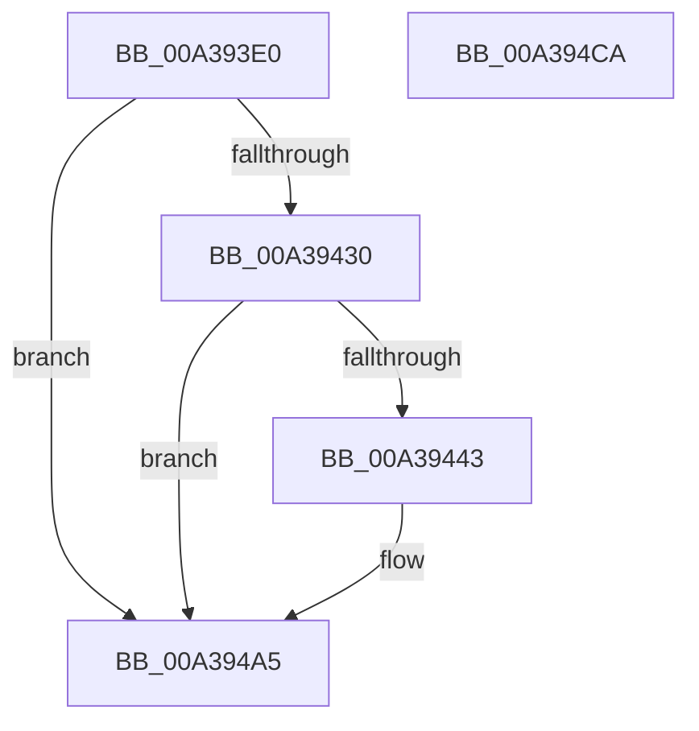

# PopDiagTracePowerSetting

- RVA: `0x00A393E0`–`0x00A394CB` (길이 `235` bytes)
- VA: `0x0000000140A393E0`
- 실행 섹션: `PAGE`
- PDB 이름 있음: `예`; PDB Function 태그: `아니요`
- unwind 정보 RVA: `0x000ADEB4`
- 디코드: `58`개 명령, `235/235` bytes 표시
- 미해석 바이트: `0` (있으면 어셈블리에 `.byte`로 보존)

> 이 문서는 커널 이미지의 기계어와 PDB 기호를 분석해 생성했습니다. 4번과 5번은 함수 원형과 자료형을 바이너리 사용 방식에서 추정한 C 해석이며 원본 소스 복구 결과는 아닙니다.

## 1. Dependencies

- 직접 호출 지점: **3**; 고유 호출 대상: **3**
- 직접 호출자로 확인된 함수: **2**
- RIP 상대 이미지 참조: **5**

### Outgoing calls
- `0x00A3943A` → [EtwEventEnabled](../../text/39/EtwEventEnabled_function_00392450.md) (function, `0x00392450`)
- `0x00A394A0` → [EtwWrite](../../text/41/EtwWrite_function_0041C720.md) (function, `0x0041C720`)
- `0x00A394AC` → [_security_check_cookie](../../text/6A/_security_check_cookie_function_006AC640.md) (function, `0x006AC640`)

### Direct callers
- [PopTracePowerSettingChange](PopTracePowerSettingChange_function_00A39340.md) at `0x00A3934C`
- [PopRundownPowerSettings](PopRundownPowerSettings_function_00A39360.md) at `0x00A393AD`

### Static image references
- `0x00A393FF` → RVA `0x00E0A740` (`.data`; read)
- `0x00A3940F` → RVA `0x0001A3D0` (`.rdata`; read)
- `0x00A39416` → RVA `0x0001A3C0` (`.rdata`; read)
- `0x00A39427` → RVA `0x00E67858` (`.data`; read)
- `0x00A39430` → RVA `0x00F0B408` (`.data`; read)

## 2. Other-region calls and transfers

- 다른 실행 섹션으로 향하는 call: **3**
  - `0x00A3943A` → [EtwEventEnabled](../../text/39/EtwEventEnabled_function_00392450.md) (`PAGE` → `.text`)
  - `0x00A394A0` → [EtwWrite](../../text/41/EtwWrite_function_0041C720.md) (`PAGE` → `.text`)
  - `0x00A394AC` → [_security_check_cookie](../../text/6A/_security_check_cookie_function_006AC640.md) (`PAGE` → `.text`)
- 별도 외부 분기/꼬리 이동을 확인하지 못했습니다.

## 3. Assembly (complete function range)

```asm
00A393E0  48 8B C4                        mov rax, rsp
00A393E3  48 89 58 08                     mov qword ptr [rax + 8], rbx
00A393E7  48 89 70 10                     mov qword ptr [rax + 0x10], rsi
00A393EB  48 89 78 20                     mov qword ptr [rax + 0x20], rdi
00A393EF  44 89 40 18                     mov dword ptr [rax + 0x18], r8d
00A393F3  55                              push rbp
00A393F4  48 8D 68 A1                     lea rbp, [rax - 0x5f]
00A393F8  48 81 EC 90 00 00 00            sub rsp, 0x90
00A393FF  48 8B 05 3A 13 3D 00            mov rax, qword ptr [rip + 0x3d133a]
00A39406  48 33 C4                        xor rax, rsp
00A39409  48 89 45 47                     mov qword ptr [rbp + 0x47], rax
00A3940D  84 C9                           test cl, cl
00A3940F  48 8D 05 BA 0F 5E FF            lea rax, [rip - 0xa1f046]
00A39416  48 8D 1D A3 0F 5E FF            lea rbx, [rip - 0xa1f05d]
00A3941D  49 8B F9                        mov rdi, r9
00A39420  48 0F 44 D8                     cmove rbx, rax
00A39424  48 8B F2                        mov rsi, rdx
00A39427  80 3D 2A E4 42 00 00            cmp byte ptr [rip + 0x42e42a], 0
00A3942E  74 75                           je 0x140a394a5
00A39430  48 8B 0D D1 1F 4D 00            mov rcx, qword ptr [rip + 0x4d1fd1]
00A39437  48 8B D3                        mov rdx, rbx
00A3943A  E8 11 90 95 FF                  call 0x140392450
00A3943F  84 C0                           test al, al
00A39441  74 62                           je 0x140a394a5
00A39443  83 65 F7 00                     and dword ptr [rbp - 9], 0
00A39447  48 8D 45 77                     lea rax, [rbp + 0x77]
00A3944B  83 65 13 00                     and dword ptr [rbp + 0x13], 0
00A3944F  41 B9 04 00 00 00               mov r9d, 4
00A39455  83 65 23 00                     and dword ptr [rbp + 0x23], 0
00A39459  45 33 C0                        xor r8d, r8d
00A3945C  83 65 33 00                     and dword ptr [rbp + 0x33], 0
00A39460  48 8B D3                        mov rdx, rbx
00A39463  83 65 43 00                     and dword ptr [rbp + 0x43], 0
00A39467  48 8B 0D 9A 1F 4D 00            mov rcx, qword ptr [rip + 0x4d1f9a]
00A3946E  48 89 45 17                     mov qword ptr [rbp + 0x17], rax
00A39472  8B 45 77                        mov eax, dword ptr [rbp + 0x77]
00A39475  89 45 2F                        mov dword ptr [rbp + 0x2f], eax
00A39478  48 8D 45 F7                     lea rax, [rbp - 9]
00A3947C  48 89 45 37                     mov qword ptr [rbp + 0x37], rax
00A39480  48 8D 45 07                     lea rax, [rbp + 7]
00A39484  48 89 44 24 20                  mov qword ptr [rsp + 0x20], rax
00A39489  48 89 75 07                     mov qword ptr [rbp + 7], rsi
00A3948D  C7 45 0F 10 00 00 00            mov dword ptr [rbp + 0xf], 0x10
00A39494  44 89 4D 1F                     mov dword ptr [rbp + 0x1f], r9d
00A39498  48 89 7D 27                     mov qword ptr [rbp + 0x27], rdi
00A3949C  44 89 4D 3F                     mov dword ptr [rbp + 0x3f], r9d
00A394A0  E8 7B 32 9E FF                  call 0x14041c720
00A394A5  48 8B 4D 47                     mov rcx, qword ptr [rbp + 0x47]
00A394A9  48 33 CC                        xor rcx, rsp
00A394AC  E8 8F 31 C7 FF                  call 0x1406ac640
00A394B1  4C 8D 9C 24 90 00 00 00         lea r11, [rsp + 0x90]
00A394B9  49 8B 5B 10                     mov rbx, qword ptr [r11 + 0x10]
00A394BD  49 8B 73 18                     mov rsi, qword ptr [r11 + 0x18]
00A394C1  49 8B 7B 28                     mov rdi, qword ptr [r11 + 0x28]
00A394C5  49 8B E3                        mov rsp, r11
00A394C8  5D                              pop rbp
00A394C9  C3                              ret
00A394CA  CC                              int3
```

## 4. C-style interpretation (structured pseudocode)

```c
__int64 __fastcall PopDiagTracePowerSetting(unsigned __int8 a1, __int64 a2, int a3, __int64 a4)
{
    __int64 result;
    __int64 v_rbx;
    __int64 v_rsp;
    unsigned __int64 v_stack_m78;
    unsigned __int64 v_stack_m8;

    *(unsigned __int64 *)(v_rsp + 8) = v_rbx;
    *(unsigned __int64 *)(v_rsp + 16) = v_rsi;
    *(unsigned __int64 *)(v_rsp + 32) = v_rdi;
    *(unsigned int *)(v_rsp + 24) = a3;
    v_rsp = (v_rsp) - (144);
    result = (*(unsigned __int64 *)(v_rip + 4002618)) ^ (v_rsp);
    *(unsigned __int64 *)(v_rsp - 95 + 71) = result;
    v_rbx = v_rip - 10612829;
    if (a1 == 0) { v_rbx = v_rip - 10612806; }
    if ((*(unsigned __int8 *)(v_rip + 4383786)) == 0) goto loc_00A394A5;
    result = EtwEventEnabled(*(unsigned __int64 *)(v_rip + 5054417), v_rbx, a3, a4);
    if ((unsigned __int8)(result) != 0) {
        result = v_rsp - 95 + 119;
        a4 = 4;
        a3 = 0;
        a2 = v_rbx;
        a1 = *(unsigned __int64 *)(v_rip + 5054362);
        *(unsigned __int64 *)(v_rsp - 95 + 23) = result;
        result = *(unsigned int *)(v_rsp - 95 + 119);
        *(unsigned int *)(v_rsp - 95 + 47) = (unsigned int)(result);
        result = v_rsp - 95 - 9;
        *(unsigned __int64 *)(v_rsp - 95 + 55) = result;
        result = v_rsp - 95 + 7;
        v_stack_m78 = result;
        *(unsigned __int64 *)(v_rsp - 95 + 7) = a2;
        *(unsigned int *)(v_rsp - 95 + 15) = 16;
        *(unsigned int *)(v_rsp - 95 + 31) = (unsigned int)(a4);
        *(unsigned __int64 *)(v_rsp - 95 + 39) = a4;
        *(unsigned int *)(v_rsp - 95 + 63) = (unsigned int)(a4);
        result = EtwWrite(a1, a2, a3, a4);
    }
    a1 = (*(unsigned __int64 *)(v_rsp - 95 + 71)) ^ (v_rsp);
    result = _security_check_cookie(a1, a2, a3, a4);
    return result;
}
```

## 5. (Beta) C Style

```c
int64_t PopDiagTracePowerSetting(uint8_t Arg1, int64_t Arg2, int32_t Arg3, int64_t Arg4)
{
    int64_t result;
    int64_t local_rbx;
    int64_t local_rsp;
    uint64_t v_stack_m78;
    uint64_t v_stack_m8;

    *(uint64_t *)(local_rsp + 0x8) = local_rbx;
    *(uint64_t *)(local_rsp + 0x10) = local_rsi;
    *(uint64_t *)(local_rsp + 0x20) = local_rdi;
    *(uint32_t *)(local_rsp + 0x18) = Arg3;
    local_rsp = (local_rsp) - (144);
    result = (*(uint64_t *)(v_rip + 0x3D133A)) ^ (local_rsp);
    *(uint64_t *)(local_rsp - 0x5F + 0x47) = result;
    local_rbx = v_rip - 10612829;
    if (Arg1 == 0) { local_rbx = v_rip - 10612806; }
    if ((*(uint8_t *)(v_rip + 0x42E42A)) == 0) goto loc_00A394A5;
    result = EtwEventEnabled(*(uint64_t *)(v_rip + 0x4D1FD1), local_rbx, Arg3, Arg4);
    if ((uint8_t)(result) != 0) {
        result = local_rsp - 95 + 119;
        Arg4 = 4;
        Arg3 = 0;
        Arg2 = local_rbx;
        Arg1 = *(uint64_t *)(v_rip + 0x4D1F9A);
        *(uint64_t *)(local_rsp - 0x5F + 0x17) = result;
        result = *(uint32_t *)(local_rsp - 0x5F + 0x77);
        *(uint32_t *)(local_rsp - 0x5F + 0x2F) = (uint32_t)(result);
        result = local_rsp - 95 - 9;
        *(uint64_t *)(local_rsp - 0x5F + 0x37) = result;
        result = local_rsp - 95 + 7;
        v_stack_m78 = result;
        *(uint64_t *)(local_rsp - 0x5F + 0x7) = Arg2;
        *(uint32_t *)(local_rsp - 0x5F + 0xF) = 16;
        *(uint32_t *)(local_rsp - 0x5F + 0x1F) = (uint32_t)(Arg4);
        *(uint64_t *)(local_rsp - 0x5F + 0x27) = Arg4;
        *(uint32_t *)(local_rsp - 0x5F + 0x3F) = (uint32_t)(Arg4);
        result = EtwWrite(Arg1, Arg2, Arg3, Arg4);
    }
    Arg1 = (*(uint64_t *)(local_rsp - 0x5F + 0x47)) ^ (local_rsp);
    result = _security_check_cookie(Arg1, Arg2, Arg3, Arg4);
    return result;
}
```

## 6. Execution-region graph

[열기: 2D/3D 그래프와 함수 탐색 컨트롤 패널](../../../control-panel.html?section=page&rva=0x00A393E0&view=graph)

- 2D 그래프는 위에서 아래로 흐르고, 3D 그래프는 빈 공간을 드래그해 회전합니다. Shift+드래그는 이동, 휠은 확대·축소, 함수 노드 선택은 대상 보고서 이동입니다.

### Static fallback


