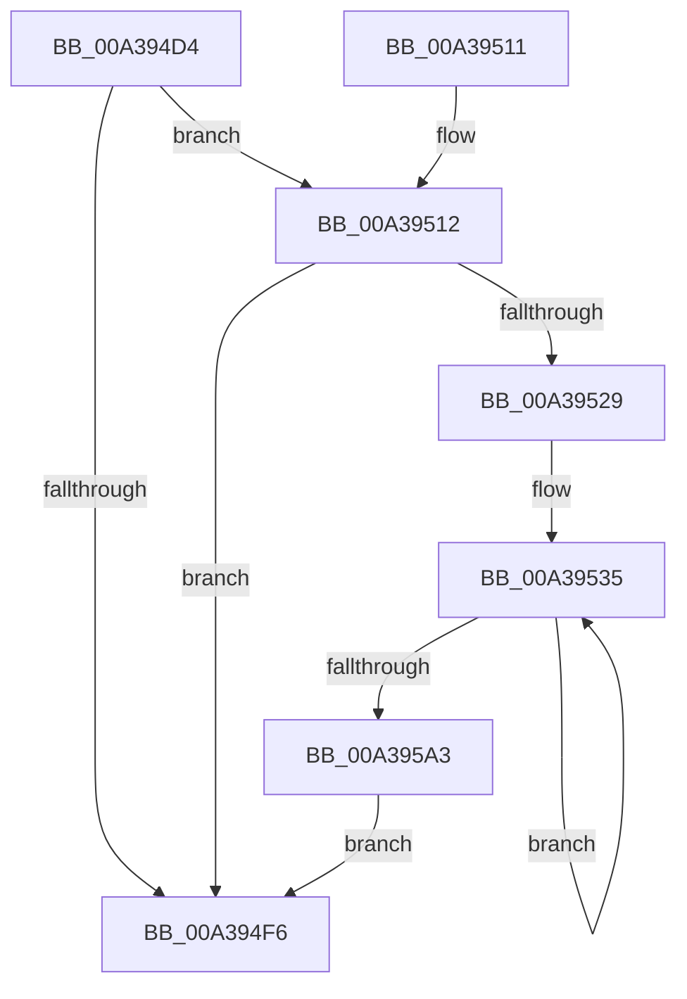

# PopDiagTracePowerStateEventRundown

- RVA: `0x00A394D4`–`0x00A395A8` (길이 `212` bytes)
- VA: `0x0000000140A394D4`
- 실행 섹션: `PAGE`
- PDB 이름 있음: `예`; PDB Function 태그: `아니요`
- unwind 정보 RVA: `0x000ADED8`
- 디코드: `45`개 명령, `212/212` bytes 표시
- 미해석 바이트: `0` (있으면 어셈블리에 `.byte`로 보존)

> 이 문서는 커널 이미지의 기계어와 PDB 기호를 분석해 생성했습니다. 4번과 5번은 함수 원형과 자료형을 바이너리 사용 방식에서 추정한 C 해석이며 원본 소스 복구 결과는 아닙니다.

## 1. Dependencies

- 직접 호출 지점: **3**; 고유 호출 대상: **3**
- 직접 호출자로 확인된 함수: **1**
- RIP 상대 이미지 참조: **5**

### Outgoing calls
- `0x00A394FE` → [_security_check_cookie](../../text/6A/_security_check_cookie_function_006AC640.md) (function, `0x006AC640`)
- `0x00A39520` → [EtwEventEnabled](../../text/39/EtwEventEnabled_function_00392450.md) (function, `0x00392450`)
- `0x00A39594` → [EtwWrite](../../text/41/EtwWrite_function_0041C720.md) (function, `0x0041C720`)

### Direct callers
- [PopDiagTraceControlCallback](PopDiagTraceControlCallback_function_00A38CB0.md) at `0x00A38E32`

### Static image references
- `0x00A394DE` → RVA `0x00E0A740` (`.data`; read)
- `0x00A394ED` → RVA `0x00E67858` (`.data`; read)
- `0x00A39512` → RVA `0x00F0B408` (`.data`; read)
- `0x00A39519` → RVA `0x0001A3E0` (`.rdata`; read)
- `0x00A39529` → RVA `0x00FD8FF0` (`PAGEDATA`; read)

## 2. Other-region calls and transfers

- 다른 실행 섹션으로 향하는 call: **3**
  - `0x00A394FE` → [_security_check_cookie](../../text/6A/_security_check_cookie_function_006AC640.md) (`PAGE` → `.text`)
  - `0x00A39520` → [EtwEventEnabled](../../text/39/EtwEventEnabled_function_00392450.md) (`PAGE` → `.text`)
  - `0x00A39594` → [EtwWrite](../../text/41/EtwWrite_function_0041C720.md) (`PAGE` → `.text`)
- 별도 외부 분기/꼬리 이동을 확인하지 못했습니다.

## 3. Assembly (complete function range)

```asm
00A394D4  48 89 5C 24 08                  mov qword ptr [rsp + 8], rbx
00A394D9  57                              push rdi
00A394DA  48 83 EC 70                     sub rsp, 0x70
00A394DE  48 8B 05 5B 12 3D 00            mov rax, qword ptr [rip + 0x3d125b]
00A394E5  48 33 C4                        xor rax, rsp
00A394E8  48 89 44 24 60                  mov qword ptr [rsp + 0x60], rax
00A394ED  80 3D 64 E3 42 00 00            cmp byte ptr [rip + 0x42e364], 0
00A394F4  75 1C                           jne 0x140a39512
00A394F6  48 8B 4C 24 60                  mov rcx, qword ptr [rsp + 0x60]
00A394FB  48 33 CC                        xor rcx, rsp
00A394FE  E8 3D 31 C7 FF                  call 0x1406ac640
00A39503  48 8B 9C 24 80 00 00 00         mov rbx, qword ptr [rsp + 0x80]
00A3950B  48 83 C4 70                     add rsp, 0x70
00A3950F  5F                              pop rdi
00A39510  C3                              ret
00A39511  CC                              int3
00A39512  48 8B 0D EF 1E 4D 00            mov rcx, qword ptr [rip + 0x4d1eef]
00A39519  48 8D 15 C0 0E 5E FF            lea rdx, [rip - 0xa1f140]
00A39520  E8 2B 8F 95 FF                  call 0x140392450
00A39525  84 C0                           test al, al
00A39527  74 CD                           je 0x140a394f6
00A39529  48 8D 1D C0 FA 59 00            lea rbx, [rip + 0x59fac0]
00A39530  BF 38 00 00 00                  mov edi, 0x38
00A39535  48 8B 0D CC 1E 4D 00            mov rcx, qword ptr [rip + 0x4d1ecc]
00A3953C  48 8D 43 E0                     lea rax, [rbx - 0x20]
00A39540  83 64 24 3C 00                  and dword ptr [rsp + 0x3c], 0
00A39545  48 8D 15 94 0E 5E FF            lea rdx, [rip - 0xa1f16c]
00A3954C  83 64 24 4C 00                  and dword ptr [rsp + 0x4c], 0
00A39551  41 B9 03 00 00 00               mov r9d, 3
00A39557  83 64 24 5C 00                  and dword ptr [rsp + 0x5c], 0
00A3955C  45 33 C0                        xor r8d, r8d
00A3955F  48 89 44 24 30                  mov qword ptr [rsp + 0x30], rax
00A39564  48 8D 43 F0                     lea rax, [rbx - 0x10]
00A39568  48 89 44 24 40                  mov qword ptr [rsp + 0x40], rax
00A3956D  48 8D 44 24 30                  lea rax, [rsp + 0x30]
00A39572  48 89 44 24 20                  mov qword ptr [rsp + 0x20], rax
00A39577  C7 44 24 38 04 00 00 00         mov dword ptr [rsp + 0x38], 4
00A3957F  C7 44 24 48 04 00 00 00         mov dword ptr [rsp + 0x48], 4
00A39587  48 89 5C 24 50                  mov qword ptr [rsp + 0x50], rbx
00A3958C  C7 44 24 58 08 00 00 00         mov dword ptr [rsp + 0x58], 8
00A39594  E8 87 31 9E FF                  call 0x14041c720
00A39599  48 83 C3 30                     add rbx, 0x30
00A3959D  48 83 EF 01                     sub rdi, 1
00A395A1  75 92                           jne 0x140a39535
00A395A3  E9 4E FF FF FF                  jmp 0x140a394f6
```

## 4. C-style interpretation (structured pseudocode)

```c
__int64 __fastcall PopDiagTracePowerStateEventRundown(__int64 a1, __int64 a2, int a3)
{
    __int64 result;
    __int64 v_rbx;
    __int64 v_rdi;
    __int64 v_rsp;
    unsigned __int64 v_stack_m18;
    unsigned __int64 v_stack_p20;
    unsigned __int64 v_stack_p30;
    unsigned int v_stack_p38;
    unsigned int v_stack_p3C;
    unsigned __int64 v_stack_p40;
    unsigned int v_stack_p48;
    unsigned int v_stack_p4C;
    unsigned __int64 v_stack_p50;
    unsigned int v_stack_p58;
    unsigned int v_stack_p5C;
    unsigned __int64 v_stack_p8;

    v_stack_p8 = v_rbx;
    v_rsp = (v_rsp) - (112);
    result = (*(unsigned __int64 *)(v_rip + 4002395)) ^ (v_rsp);
    v_stack_m18 = result;
    if ((*(unsigned __int8 *)(v_rip + 4383588)) != 0) goto loc_00A39512;
loc_00A394F6:
    a1 = (v_stack_m18) ^ (v_rsp);
    result = _security_check_cookie(a1, a2, a3, a4);
    v_rsp = (v_rsp) + (112);
    return result;
loc_00A39512:
    result = EtwEventEnabled(*(unsigned __int64 *)(v_rip + 5054191), v_rip - 10613056, a3, a4);
    if ((unsigned __int8)(result) == 0) goto loc_00A394F6;
loc_00A39535:
    a3 = 0;
    v_stack_p30 = v_rip + 5896896 - 32;
    v_stack_p40 = v_rip + 5896896 - 16;
    v_stack_p20 = v_stack_p30;
    v_stack_p38 = 4;
    v_stack_p48 = 4;
    v_stack_p50 = v_rip + 5896896;
    v_stack_p58 = 8;
    result = EtwWrite(*(unsigned __int64 *)(v_rip + 5054156), v_rip - 10613100, a3, 3);
    v_rbx = (v_rip + 5896896) + (48);
    v_rdi = (56) - (1);
    if (condition_is_not_equal) goto loc_00A39535;
    goto loc_00A394F6;
}
```

## 5. (Beta) C Style

```c
int64_t PopDiagTracePowerStateEventRundown(int64_t Arg1, int64_t Arg2, int32_t Arg3)
{
    int64_t result;
    int64_t local_rbx;
    int64_t local_rdi;
    int64_t local_rsp;
    uint64_t v_stack_m18;
    uint64_t v_stack_p20;
    uint64_t v_stack_p30;
    uint32_t v_stack_p38;
    uint32_t v_stack_p3C;
    uint64_t v_stack_p40;
    uint32_t v_stack_p48;
    uint32_t v_stack_p4C;
    uint64_t v_stack_p50;
    uint32_t v_stack_p58;
    uint32_t v_stack_p5C;
    uint64_t v_stack_p8;

    v_stack_p8 = local_rbx;
    local_rsp = (local_rsp) - (112);
    result = (*(uint64_t *)(v_rip + 0x3D125B)) ^ (local_rsp);
    v_stack_m18 = result;
    if ((*(uint8_t *)(v_rip + 0x42E364)) != 0) goto loc_00A39512;
loc_00A394F6:
    Arg1 = (v_stack_m18) ^ (local_rsp);
    result = _security_check_cookie(Arg1, Arg2, Arg3, a4);
    local_rsp = (local_rsp) + (112);
    return result;
loc_00A39512:
    result = EtwEventEnabled(*(uint64_t *)(v_rip + 0x4D1EEF), v_rip - 10613056, Arg3, a4);
    if ((uint8_t)(result) == 0) goto loc_00A394F6;
loc_00A39535:
    Arg3 = 0;
    v_stack_p30 = v_rip + 5896896 - 32;
    v_stack_p40 = v_rip + 5896896 - 16;
    v_stack_p20 = v_stack_p30;
    v_stack_p38 = 4;
    v_stack_p48 = 4;
    v_stack_p50 = v_rip + 5896896;
    v_stack_p58 = 8;
    result = EtwWrite(*(uint64_t *)(v_rip + 0x4D1ECC), v_rip - 10613100, Arg3, 3);
    local_rbx = (v_rip + 5896896) + (48);
    local_rdi = (56) - (1);
    if (condition_is_not_equal) goto loc_00A39535;
    goto loc_00A394F6;
}
```

## 6. Execution-region graph

[열기: 2D/3D 그래프와 함수 탐색 컨트롤 패널](../../../control-panel.html?section=page&rva=0x00A394D4&view=graph)

- 2D 그래프는 위에서 아래로 흐르고, 3D 그래프는 빈 공간을 드래그해 회전합니다. Shift+드래그는 이동, 휠은 확대·축소, 함수 노드 선택은 대상 보고서 이동입니다.

### Static fallback


