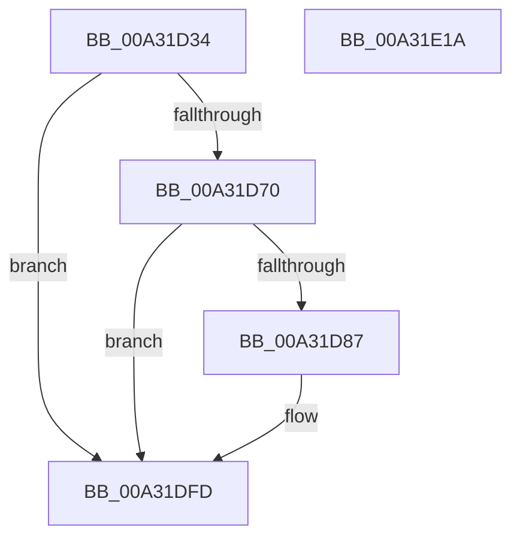

# PopDiagTraceSystemIdleEventAssessment

- RVA: `0x00A31D34`–`0x00A31E1B` (길이 `231` bytes)
- VA: `0x0000000140A31D34`
- 실행 섹션: `PAGE`
- PDB 이름 있음: `예`; PDB Function 태그: `아니요`
- unwind 정보 RVA: `0x000AD284`
- 디코드: `56`개 명령, `231/231` bytes 표시
- 미해석 바이트: `0` (있으면 어셈블리에 `.byte`로 보존)

> 이 문서는 커널 이미지의 기계어와 PDB 기호를 분석해 생성했습니다. 4번과 5번은 함수 원형과 자료형을 바이너리 사용 방식에서 추정한 C 해석이며 원본 소스 복구 결과는 아닙니다.

## 1. Dependencies

- 직접 호출 지점: **3**; 고유 호출 대상: **3**
- 직접 호출자로 확인된 함수: **1**
- RIP 상대 이미지 참조: **4**

### Outgoing calls
- `0x00A31D7E` → [EtwEventEnabled](../../text/39/EtwEventEnabled_function_00392450.md) (function, `0x00392450`)
- `0x00A31DF8` → [EtwWrite](../../text/41/EtwWrite_function_0041C720.md) (function, `0x0041C720`)
- `0x00A31E04` → [_security_check_cookie](../../text/6A/_security_check_cookie_function_006AC640.md) (function, `0x006AC640`)

### Direct callers
- [PopAssessSystemIdleEvent](PopAssessSystemIdleEvent_function_00A31CA0.md) at `0x00A31D16`

### Static image references
- `0x00A31D51` → RVA `0x00E0A740` (`.data`; read)
- `0x00A31D5F` → RVA `0x00E67858` (`.data`; read)
- `0x00A31D70` → RVA `0x00F0B408` (`.data`; read)
- `0x00A31D77` → RVA `0x0001A280` (`.rdata`; read)

## 2. Other-region calls and transfers

- 다른 실행 섹션으로 향하는 call: **3**
  - `0x00A31D7E` → [EtwEventEnabled](../../text/39/EtwEventEnabled_function_00392450.md) (`PAGE` → `.text`)
  - `0x00A31DF8` → [EtwWrite](../../text/41/EtwWrite_function_0041C720.md) (`PAGE` → `.text`)
  - `0x00A31E04` → [_security_check_cookie](../../text/6A/_security_check_cookie_function_006AC640.md) (`PAGE` → `.text`)
- 별도 외부 분기/꼬리 이동을 확인하지 못했습니다.

## 3. Assembly (complete function range)

```asm
00A31D34  48 8B C4                        mov rax, rsp
00A31D37  48 89 58 20                     mov qword ptr [rax + 0x20], rbx
00A31D3B  44 89 40 18                     mov dword ptr [rax + 0x18], r8d
00A31D3F  89 50 10                        mov dword ptr [rax + 0x10], edx
00A31D42  89 48 08                        mov dword ptr [rax + 8], ecx
00A31D45  55                              push rbp
00A31D46  48 8D 68 A9                     lea rbp, [rax - 0x57]
00A31D4A  48 81 EC A0 00 00 00            sub rsp, 0xa0
00A31D51  48 8B 05 E8 89 3D 00            mov rax, qword ptr [rip + 0x3d89e8]
00A31D58  48 33 C4                        xor rax, rsp
00A31D5B  48 89 45 3F                     mov qword ptr [rbp + 0x3f], rax
00A31D5F  80 3D F2 5A 43 00 00            cmp byte ptr [rip + 0x435af2], 0
00A31D66  41 0F B6 D9                     movzx ebx, r9b
00A31D6A  0F 84 8D 00 00 00               je 0x140a31dfd
00A31D70  48 8B 0D 91 96 4D 00            mov rcx, qword ptr [rip + 0x4d9691]
00A31D77  48 8D 15 02 85 5E FF            lea rdx, [rip - 0xa17afe]
00A31D7E  E8 CD 06 96 FF                  call 0x140392450
00A31D83  84 C0                           test al, al
00A31D85  74 76                           je 0x140a31dfd
00A31D87  83 65 FB 00                     and dword ptr [rbp - 5], 0
00A31D8B  48 8D 45 5F                     lea rax, [rbp + 0x5f]
00A31D8F  83 65 0B 00                     and dword ptr [rbp + 0xb], 0
00A31D93  48 8D 15 E6 84 5E FF            lea rdx, [rip - 0xa17b1a]
00A31D9A  83 65 1B 00                     and dword ptr [rbp + 0x1b], 0
00A31D9E  B9 04 00 00 00                  mov ecx, 4
00A31DA3  83 65 2B 00                     and dword ptr [rbp + 0x2b], 0
00A31DA7  45 33 C0                        xor r8d, r8d
00A31DAA  83 65 3B 00                     and dword ptr [rbp + 0x3b], 0
00A31DAE  48 89 45 EF                     mov qword ptr [rbp - 0x11], rax
00A31DB2  48 8D 45 67                     lea rax, [rbp + 0x67]
00A31DB6  48 89 45 FF                     mov qword ptr [rbp - 1], rax
00A31DBA  44 8D 49 01                     lea r9d, [rcx + 1]
00A31DBE  48 8D 45 6F                     lea rax, [rbp + 0x6f]
00A31DC2  89 4D F7                        mov dword ptr [rbp - 9], ecx
00A31DC5  48 89 45 0F                     mov qword ptr [rbp + 0xf], rax
00A31DC9  48 8D 45 DF                     lea rax, [rbp - 0x21]
00A31DCD  48 89 45 1F                     mov qword ptr [rbp + 0x1f], rax
00A31DD1  48 8D 45 7F                     lea rax, [rbp + 0x7f]
00A31DD5  48 89 45 2F                     mov qword ptr [rbp + 0x2f], rax
00A31DD9  48 8D 45 EF                     lea rax, [rbp - 0x11]
00A31DDD  89 4D 07                        mov dword ptr [rbp + 7], ecx
00A31DE0  89 4D 17                        mov dword ptr [rbp + 0x17], ecx
00A31DE3  89 4D 27                        mov dword ptr [rbp + 0x27], ecx
00A31DE6  89 4D 37                        mov dword ptr [rbp + 0x37], ecx
00A31DE9  48 8B 0D 18 96 4D 00            mov rcx, qword ptr [rip + 0x4d9618]
00A31DF0  48 89 44 24 20                  mov qword ptr [rsp + 0x20], rax
00A31DF5  89 5D DF                        mov dword ptr [rbp - 0x21], ebx
00A31DF8  E8 23 A9 9E FF                  call 0x14041c720
00A31DFD  48 8B 4D 3F                     mov rcx, qword ptr [rbp + 0x3f]
00A31E01  48 33 CC                        xor rcx, rsp
00A31E04  E8 37 A8 C7 FF                  call 0x1406ac640
00A31E09  48 8B 9C 24 C8 00 00 00         mov rbx, qword ptr [rsp + 0xc8]
00A31E11  48 81 C4 A0 00 00 00            add rsp, 0xa0
00A31E18  5D                              pop rbp
00A31E19  C3                              ret
00A31E1A  CC                              int3
```

## 4. C-style interpretation (structured pseudocode)

```c
__int64 __fastcall PopDiagTraceSystemIdleEventAssessment(int a1, int a2, int a3, unsigned __int8 a4)
{
    __int64 result;
    __int64 v_rsp;
    unsigned __int64 v_stack_m88;
    unsigned __int64 v_stack_p20;

    *(unsigned __int64 *)(v_rsp + 32) = v_rbx;
    *(unsigned int *)(v_rsp + 24) = a3;
    *(unsigned int *)(v_rsp + 16) = a2;
    *(unsigned int *)(v_rsp + 8) = a1;
    v_rsp = (v_rsp) - (160);
    result = (*(unsigned __int64 *)(v_rip + 4033000)) ^ (v_rsp);
    *(unsigned __int64 *)(v_rsp - 87 + 63) = result;
    if ((*(unsigned __int8 *)(v_rip + 4414194)) == 0) goto loc_00A31DFD;
    result = EtwEventEnabled(*(unsigned __int64 *)(v_rip + 5084817), v_rip - 10582782, a3, a4);
    if ((unsigned __int8)(result) != 0) {
        result = v_rsp - 87 + 95;
        a2 = v_rip - 10582810;
        a1 = 4;
        a3 = 0;
        *(unsigned __int64 *)(v_rsp - 87 - 17) = result;
        result = v_rsp - 87 + 103;
        *(unsigned __int64 *)(v_rsp - 87 - 1) = result;
        a4 = a1 + 1;
        result = v_rsp - 87 + 111;
        *(unsigned int *)(v_rsp - 87 - 9) = a1;
        *(unsigned __int64 *)(v_rsp - 87 + 15) = result;
        result = v_rsp - 87 - 33;
        *(unsigned __int64 *)(v_rsp - 87 + 31) = result;
        result = v_rsp - 87 + 127;
        *(unsigned __int64 *)(v_rsp - 87 + 47) = result;
        result = v_rsp - 87 - 17;
        *(unsigned int *)(v_rsp - 87 + 7) = a1;
        *(unsigned int *)(v_rsp - 87 + 23) = a1;
        *(unsigned int *)(v_rsp - 87 + 39) = a1;
        *(unsigned int *)(v_rsp - 87 + 55) = a1;
        a1 = *(unsigned __int64 *)(v_rip + 5084696);
        v_stack_m88 = result;
        *(unsigned int *)(v_rsp - 87 - 33) = a4;
        result = EtwWrite(a1, a2, a3, a4);
    }
    a1 = (*(unsigned __int64 *)(v_rsp - 87 + 63)) ^ (v_rsp);
    result = _security_check_cookie(a1, a2, a3, a4);
    v_rsp = (v_rsp) + (160);
    return result;
}
```

## 5. (Beta) C Style

```c
int64_t PopDiagTraceSystemIdleEventAssessment(int32_t Arg1, int32_t Arg2, int32_t Arg3, uint8_t Arg4)
{
    int64_t result;
    int64_t local_rsp;
    uint64_t v_stack_m88;
    uint64_t v_stack_p20;

    *(uint64_t *)(local_rsp + 0x20) = local_rbx;
    *(uint32_t *)(local_rsp + 0x18) = Arg3;
    *(uint32_t *)(local_rsp + 0x10) = Arg2;
    *(uint32_t *)(local_rsp + 0x8) = Arg1;
    local_rsp = (local_rsp) - (160);
    result = (*(uint64_t *)(v_rip + 0x3D89E8)) ^ (local_rsp);
    *(uint64_t *)(local_rsp - 0x57 + 0x3F) = result;
    if ((*(uint8_t *)(v_rip + 0x435AF2)) == 0) goto loc_00A31DFD;
    result = EtwEventEnabled(*(uint64_t *)(v_rip + 0x4D9691), v_rip - 10582782, Arg3, Arg4);
    if ((uint8_t)(result) != 0) {
        result = local_rsp - 87 + 95;
        Arg2 = v_rip - 10582810;
        Arg1 = 4;
        Arg3 = 0;
        *(uint64_t *)(local_rsp - 0x57 - 0x11) = result;
        result = local_rsp - 87 + 103;
        *(uint64_t *)(local_rsp - 0x57 - 0x1) = result;
        Arg4 = Arg1 + 1;
        result = local_rsp - 87 + 111;
        *(uint32_t *)(local_rsp - 0x57 - 0x9) = Arg1;
        *(uint64_t *)(local_rsp - 0x57 + 0xF) = result;
        result = local_rsp - 87 - 33;
        *(uint64_t *)(local_rsp - 0x57 + 0x1F) = result;
        result = local_rsp - 87 + 127;
        *(uint64_t *)(local_rsp - 0x57 + 0x2F) = result;
        result = local_rsp - 87 - 17;
        *(uint32_t *)(local_rsp - 0x57 + 0x7) = Arg1;
        *(uint32_t *)(local_rsp - 0x57 + 0x17) = Arg1;
        *(uint32_t *)(local_rsp - 0x57 + 0x27) = Arg1;
        *(uint32_t *)(local_rsp - 0x57 + 0x37) = Arg1;
        Arg1 = *(uint64_t *)(v_rip + 0x4D9618);
        v_stack_m88 = result;
        *(uint32_t *)(local_rsp - 0x57 - 0x21) = Arg4;
        result = EtwWrite(Arg1, Arg2, Arg3, Arg4);
    }
    Arg1 = (*(uint64_t *)(local_rsp - 0x57 + 0x3F)) ^ (local_rsp);
    result = _security_check_cookie(Arg1, Arg2, Arg3, Arg4);
    local_rsp = (local_rsp) + (160);
    return result;
}
```

## 6. Execution-region graph

[열기: 2D/3D 그래프와 함수 탐색 컨트롤 패널](../../../control-panel.html?section=page&rva=0x00A31D34&view=graph)

- 2D 그래프는 위에서 아래로 흐르고, 3D 그래프는 빈 공간을 드래그해 회전합니다. Shift+드래그는 이동, 휠은 확대·축소, 함수 노드 선택은 대상 보고서 이동입니다.

### Static fallback


