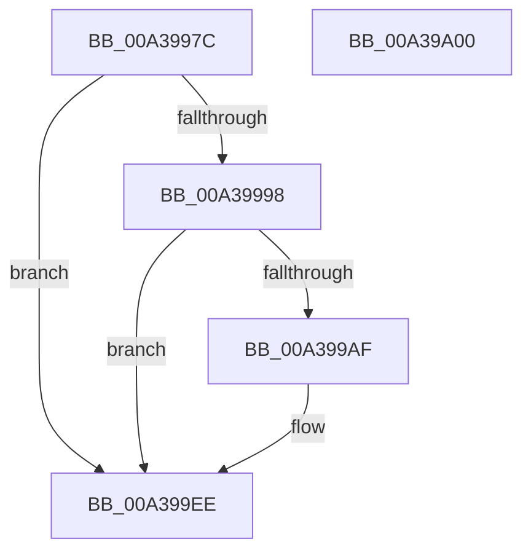

# PopDiagTraceSystemIdleRundown

- RVA: `0x00A3997C`–`0x00A39A01` (길이 `133` bytes)
- VA: `0x0000000140A3997C`
- 실행 섹션: `PAGE`
- PDB 이름 있음: `예`; PDB Function 태그: `아니요`
- unwind 정보 RVA: `0x00060904`
- 디코드: `28`개 명령, `133/133` bytes 표시
- 미해석 바이트: `0` (있으면 어셈블리에 `.byte`로 보존)

> 이 문서는 커널 이미지의 기계어와 PDB 기호를 분석해 생성했습니다. 4번과 5번은 함수 원형과 자료형을 바이너리 사용 방식에서 추정한 C 해석이며 원본 소스 복구 결과는 아닙니다.

## 1. Dependencies

- 직접 호출 지점: **3**; 고유 호출 대상: **3**
- 직접 호출자로 확인된 함수: **1**
- RIP 상대 이미지 참조: **5**

### Outgoing calls
- `0x00A399A6` → [EtwEventEnabled](../../text/39/EtwEventEnabled_function_00392450.md) (function, `0x00392450`)
- `0x00A399E9` → [EtwWrite](../../text/41/EtwWrite_function_0041C720.md) (function, `0x0041C720`)
- `0x00A399F6` → [_security_check_cookie](../../text/6A/_security_check_cookie_function_006AC640.md) (function, `0x006AC640`)

### Direct callers
- [PopDiagTraceControlCallback](PopDiagTraceControlCallback_function_00A38CB0.md) at `0x00A38E4F`

### Static image references
- `0x00A39980` → RVA `0x00E0A740` (`.data`; read)
- `0x00A3998F` → RVA `0x00E67858` (`.data`; read)
- `0x00A39998` → RVA `0x00F0B408` (`.data`; read)
- `0x00A3999F` → RVA `0x0001A400` (`.rdata`; read)
- `0x00A399B4` → RVA `0x00E0B558` (`.data`; read)

## 2. Other-region calls and transfers

- 다른 실행 섹션으로 향하는 call: **3**
  - `0x00A399A6` → [EtwEventEnabled](../../text/39/EtwEventEnabled_function_00392450.md) (`PAGE` → `.text`)
  - `0x00A399E9` → [EtwWrite](../../text/41/EtwWrite_function_0041C720.md) (`PAGE` → `.text`)
  - `0x00A399F6` → [_security_check_cookie](../../text/6A/_security_check_cookie_function_006AC640.md) (`PAGE` → `.text`)
- 별도 외부 분기/꼬리 이동을 확인하지 못했습니다.

## 3. Assembly (complete function range)

```asm
00A3997C  48 83 EC 58                     sub rsp, 0x58
00A39980  48 8B 05 B9 0D 3D 00            mov rax, qword ptr [rip + 0x3d0db9]
00A39987  48 33 C4                        xor rax, rsp
00A3998A  48 89 44 24 40                  mov qword ptr [rsp + 0x40], rax
00A3998F  80 3D C2 DE 42 00 00            cmp byte ptr [rip + 0x42dec2], 0
00A39996  74 56                           je 0x140a399ee
00A39998  48 8B 0D 69 1A 4D 00            mov rcx, qword ptr [rip + 0x4d1a69]
00A3999F  48 8D 15 5A 0A 5E FF            lea rdx, [rip - 0xa1f5a6]
00A399A6  E8 A5 8A 95 FF                  call 0x140392450
00A399AB  84 C0                           test al, al
00A399AD  74 3F                           je 0x140a399ee
00A399AF  83 64 24 3C 00                  and dword ptr [rsp + 0x3c], 0
00A399B4  48 8D 05 9D 1B 3D 00            lea rax, [rip + 0x3d1b9d]
00A399BB  48 8B 0D 46 1A 4D 00            mov rcx, qword ptr [rip + 0x4d1a46]
00A399C2  48 8D 15 37 0A 5E FF            lea rdx, [rip - 0xa1f5c9]
00A399C9  48 89 44 24 30                  mov qword ptr [rsp + 0x30], rax
00A399CE  41 B9 01 00 00 00               mov r9d, 1
00A399D4  48 8D 44 24 30                  lea rax, [rsp + 0x30]
00A399D9  C7 44 24 38 04 00 00 00         mov dword ptr [rsp + 0x38], 4
00A399E1  45 33 C0                        xor r8d, r8d
00A399E4  48 89 44 24 20                  mov qword ptr [rsp + 0x20], rax
00A399E9  E8 32 2D 9E FF                  call 0x14041c720
00A399EE  48 8B 4C 24 40                  mov rcx, qword ptr [rsp + 0x40]
00A399F3  48 33 CC                        xor rcx, rsp
00A399F6  E8 45 2C C7 FF                  call 0x1406ac640
00A399FB  48 83 C4 58                     add rsp, 0x58
00A399FF  C3                              ret
00A39A00  CC                              int3
```

## 4. C-style interpretation (structured pseudocode)

```c
__int64 __fastcall PopDiagTraceSystemIdleRundown(__int64 a1, __int64 a2, int a3)
{
    __int64 result;
    __int64 v_rsp;
    unsigned __int64 v_stack_m18;
    unsigned int v_stack_m1C;
    unsigned int v_stack_m20;
    unsigned __int64 v_stack_m28;
    unsigned __int64 v_stack_m38;

    v_rsp = (v_rsp) - (88);
    result = (*(unsigned __int64 *)(v_rip + 4001209)) ^ (v_rsp);
    v_stack_m18 = result;
    if ((*(unsigned __int8 *)(v_rip + 4382402)) == 0) goto loc_00A399EE;
    result = EtwEventEnabled(*(unsigned __int64 *)(v_rip + 5053033), v_rip - 10614182, a3, a4);
    if ((unsigned __int8)(result) != 0) {
        result = v_rip + 4004765;
        a1 = *(unsigned __int64 *)(v_rip + 5052998);
        a2 = v_rip - 10614217;
        v_stack_m28 = result;
        a4 = 1;
        result = v_stack_m28;
        v_stack_m20 = 4;
        a3 = 0;
        v_stack_m38 = result;
        result = EtwWrite(a1, a2, a3, a4);
    }
    a1 = (v_stack_m18) ^ (v_rsp);
    result = _security_check_cookie(a1, a2, a3, a4);
    v_rsp = (v_rsp) + (88);
    return result;
}
```

## 5. (Beta) C Style

```c
int64_t PopDiagTraceSystemIdleRundown(int64_t Arg1, int64_t Arg2, int32_t Arg3)
{
    int64_t result;
    int64_t local_rsp;
    uint64_t v_stack_m18;
    uint32_t v_stack_m1C;
    uint32_t v_stack_m20;
    uint64_t v_stack_m28;
    uint64_t v_stack_m38;

    local_rsp = (local_rsp) - (88);
    result = (*(uint64_t *)(v_rip + 0x3D0DB9)) ^ (local_rsp);
    v_stack_m18 = result;
    if ((*(uint8_t *)(v_rip + 0x42DEC2)) == 0) goto loc_00A399EE;
    result = EtwEventEnabled(*(uint64_t *)(v_rip + 0x4D1A69), v_rip - 10614182, Arg3, a4);
    if ((uint8_t)(result) != 0) {
        result = v_rip + 4004765;
        Arg1 = *(uint64_t *)(v_rip + 0x4D1A46);
        Arg2 = v_rip - 10614217;
        v_stack_m28 = result;
        a4 = 1;
        result = v_stack_m28;
        v_stack_m20 = 4;
        Arg3 = 0;
        v_stack_m38 = result;
        result = EtwWrite(Arg1, Arg2, Arg3, a4);
    }
    Arg1 = (v_stack_m18) ^ (local_rsp);
    result = _security_check_cookie(Arg1, Arg2, Arg3, a4);
    local_rsp = (local_rsp) + (88);
    return result;
}
```

## 6. Execution-region graph

[열기: 2D/3D 그래프와 함수 탐색 컨트롤 패널](../../../control-panel.html?section=page&rva=0x00A3997C&view=graph)

- 2D 그래프는 위에서 아래로 흐르고, 3D 그래프는 빈 공간을 드래그해 회전합니다. Shift+드래그는 이동, 휠은 확대·축소, 함수 노드 선택은 대상 보고서 이동입니다.

### Static fallback


