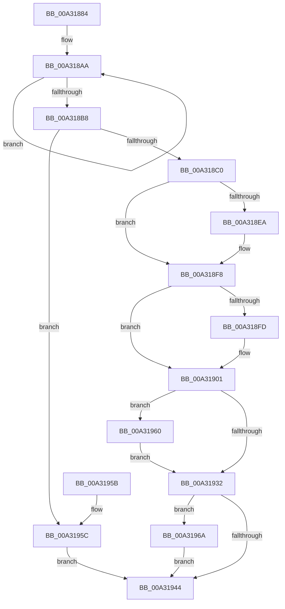

# PopDirectedDripsIdleResiliencyCallback

- RVA: `0x00A31884`–`0x00A31971` (길이 `237` bytes)
- VA: `0x0000000140A31884`
- 실행 섹션: `PAGE`
- PDB 이름 있음: `예`; PDB Function 태그: `아니요`
- unwind 정보 RVA: `0x00090A1C`
- 디코드: `61`개 명령, `237/237` bytes 표시
- 미해석 바이트: `0` (있으면 어셈블리에 `.byte`로 보존)

> 이 문서는 커널 이미지의 기계어와 PDB 기호를 분석해 생성했습니다. 4번과 5번은 함수 원형과 자료형을 바이너리 사용 방식에서 추정한 C 해석이며 원본 소스 복구 결과는 아닙니다.

## 1. Dependencies

- 직접 호출 지점: **7**; 고유 호출 대상: **7**
- 직접 호출자로 확인된 함수: **1**
- RIP 상대 이미지 참조: **6**

### Outgoing calls
- `0x00A318C5` → [PopDeepSleepSetDisengageReason](../../text/38/PopDeepSleepSetDisengageReason_function_0038FEC4.md) (function, `0x0038FEC4`)
- `0x00A318D9` → [KeAbPreAcquire](../../text/21/KeAbPreAcquire_function_00210230.md) (function, `0x00210230`)
- `0x00A318F3` → [ExfAcquirePushLockExclusiveEx](../../text/20/ExfAcquirePushLockExclusiveEx_function_0020FC90.md) (function, `0x0020FC90`)
- `0x00A3191A` → [PopQueueDirectedDripsWork](../../text/47/PopQueueDirectedDripsWork_function_00478DC4.md) (function, `0x00478DC4`)
- `0x00A31935` → [KeAbPostRelease](../../text/2E/KeAbPostRelease_function_002E1600.md) (function, `0x002E1600`)
- `0x00A31963` → [ExfTryToWakePushLock](../../text/26/ExfTryToWakePushLock_function_00265DD0.md) (function, `0x00265DD0`)
- `0x00A3196A` → [PopDirectedDripsUmMarkTestDevices](../AC/PopDirectedDripsUmMarkTestDevices_function_00ACF828.md) (function, `0x00ACF828`)

### Direct callers
- [PopPdcIdleResiliencyCallback](PopPdcIdleResiliencyCallback_function_00A31518.md) at `0x00A315F3`

### Static image references
- `0x00A3189D` → RVA `0x00F0EAC0` (`.data`; read)
- `0x00A318CA` → RVA `0x00F0EB60` (`.data`; read)
- `0x00A31906` → RVA `0x00F0EB69` (`.data`; write)
- `0x00A3190D` → RVA `0x00F0EB6C` (`.data`; write)
- `0x00A31913` → RVA `0x00F0EB70` (`.data`; write)
- `0x00A31923` → RVA `0x00F0EB60` (`.data`; read/write)

## 2. Other-region calls and transfers

- 다른 실행 섹션으로 향하는 call: **6**
  - `0x00A318C5` → [PopDeepSleepSetDisengageReason](../../text/38/PopDeepSleepSetDisengageReason_function_0038FEC4.md) (`PAGE` → `.text`)
  - `0x00A318D9` → [KeAbPreAcquire](../../text/21/KeAbPreAcquire_function_00210230.md) (`PAGE` → `.text`)
  - `0x00A318F3` → [ExfAcquirePushLockExclusiveEx](../../text/20/ExfAcquirePushLockExclusiveEx_function_0020FC90.md) (`PAGE` → `.text`)
  - `0x00A3191A` → [PopQueueDirectedDripsWork](../../text/47/PopQueueDirectedDripsWork_function_00478DC4.md) (`PAGE` → `.text`)
  - `0x00A31935` → [KeAbPostRelease](../../text/2E/KeAbPostRelease_function_002E1600.md) (`PAGE` → `.text`)
  - `0x00A31963` → [ExfTryToWakePushLock](../../text/26/ExfTryToWakePushLock_function_00265DD0.md) (`PAGE` → `.text`)
- 별도 외부 분기/꼬리 이동을 확인하지 못했습니다.

## 3. Assembly (complete function range)

```asm
00A31884  48 89 5C 24 08                  mov qword ptr [rsp + 8], rbx
00A31889  48 89 6C 24 10                  mov qword ptr [rsp + 0x10], rbp
00A3188E  48 89 74 24 18                  mov qword ptr [rsp + 0x18], rsi
00A31893  57                              push rdi
00A31894  48 83 EC 20                     sub rsp, 0x20
00A31898  40 8A FA                        mov dil, dl
00A3189B  8B F1                           mov esi, ecx
00A3189D  0F 0D 0D 1C D2 4D 00            prefetchw byte ptr [rip + 0x4dd21c]
00A318A4  8B 05 16 D2 4D 00               mov eax, dword ptr [rip + 0x4dd216]
00A318AA  44 8B C0                        mov r8d, eax
00A318AD  F0 44 0F B1 05 0A D2 4D 00      lock cmpxchg dword ptr [rip + 0x4dd20a], r8d
00A318B6  75 F2                           jne 0x140a318aa
00A318B8  A8 01                           test al, 1
00A318BA  0F 84 9C 00 00 00               je 0x140a3195c
00A318C0  B9 08 00 00 00                  mov ecx, 8
00A318C5  E8 FA E5 95 FF                  call 0x14038fec4
00A318CA  48 8D 2D 8F D2 4D 00            lea rbp, [rip + 0x4dd28f]
00A318D1  45 33 C0                        xor r8d, r8d
00A318D4  48 8B CD                        mov rcx, rbp
00A318D7  33 D2                           xor edx, edx
00A318D9  E8 52 E9 7D FF                  call 0x140210230
00A318DE  F0 48 0F BA 6D 00 00            lock bts qword ptr [rbp], 0
00A318E5  48 8B D8                        mov rbx, rax
00A318E8  73 0E                           jae 0x140a318f8
00A318EA  4C 8B C5                        mov r8, rbp
00A318ED  48 8B D0                        mov rdx, rax
00A318F0  48 8B CD                        mov rcx, rbp
00A318F3  E8 98 E3 7D FF                  call 0x14020fc90
00A318F8  48 85 DB                        test rbx, rbx
00A318FB  74 04                           je 0x140a31901
00A318FD  C6 43 0A 01                     mov byte ptr [rbx + 0xa], 1
00A31901  BA 00 04 00 00                  mov edx, 0x400
00A31906  40 88 3D 5C D2 4D 00            mov byte ptr [rip + 0x4dd25c], dil
00A3190D  89 35 59 D2 4D 00               mov dword ptr [rip + 0x4dd259], esi
00A31913  C6 05 56 D2 4D 00 00            mov byte ptr [rip + 0x4dd256], 0
00A3191A  E8 A5 74 A4 FF                  call 0x140478dc4
00A3191F  48 83 C8 FF                     or rax, 0xffffffffffffffff
00A31923  F0 48 0F C1 05 34 D2 4D 00      lock xadd qword ptr [rip + 0x4dd234], rax
00A3192C  24 06                           and al, 6
00A3192E  3C 02                           cmp al, 2
00A31930  74 2E                           je 0x140a31960
00A31932  48 8B CD                        mov rcx, rbp
00A31935  E8 C6 FC 8A FF                  call 0x1402e1600
00A3193A  BB 03 01 00 00                  mov ebx, 0x103
00A3193F  40 84 FF                        test dil, dil
00A31942  75 26                           jne 0x140a3196a
00A31944  48 8B 6C 24 38                  mov rbp, qword ptr [rsp + 0x38]
00A31949  8B C3                           mov eax, ebx
00A3194B  48 8B 5C 24 30                  mov rbx, qword ptr [rsp + 0x30]
00A31950  48 8B 74 24 40                  mov rsi, qword ptr [rsp + 0x40]
00A31955  48 83 C4 20                     add rsp, 0x20
00A31959  5F                              pop rdi
00A3195A  C3                              ret
00A3195B  CC                              int3
00A3195C  33 DB                           xor ebx, ebx
00A3195E  EB E4                           jmp 0x140a31944
00A31960  48 8B CD                        mov rcx, rbp
00A31963  E8 68 44 83 FF                  call 0x140265dd0
00A31968  EB C8                           jmp 0x140a31932
00A3196A  E8 B9 DE 09 00                  call 0x140acf828
00A3196F  EB D3                           jmp 0x140a31944
```

## 4. C-style interpretation (structured pseudocode)

```c
__int64 __fastcall PopDirectedDripsIdleResiliencyCallback(int a1, int a2)
{
    __int64 result;
    __int64 v_rbx;
    __int64 v_rsp;
    unsigned __int64 v_stack_p10;
    unsigned __int64 v_stack_p18;
    unsigned __int64 v_stack_p8;

    v_stack_p8 = v_rbx;
    v_stack_p10 = v_rbp;
    v_stack_p18 = v_rsi;
    v_rsp = (v_rsp) - (32);
loc_00A318AA:
    if (condition_is_not_equal) goto loc_00A318AA;
    if ((((unsigned __int8)((unsigned int)(*(unsigned int *)(v_rip + 5100054)))) & (1)) == 0) goto loc_00A3195C;
    result = PopDeepSleepSetDisengageReason(8, a2, (unsigned int)((unsigned int)((unsigned int)(*(unsigned int *)(v_rip + 5100054)))), a4);
    a3 = 0;
    a2 = 0;
    result = KeAbPreAcquire(v_rip + 5100175, a2, a3, a4);
    if (!(condition_is_above_or_equal)) {
        a3 = v_rip + 5100175;
        a2 = result;
        a1 = v_rip + 5100175;
        result = ExfAcquirePushLockExclusiveEx(a1, a2, a3, a4);
    }
    if (result != 0) {
        *(unsigned __int8 *)(result + 10) = 1;
    }
    *(unsigned __int8 *)(v_rip + 5100124) = (unsigned __int8)((unsigned __int8)(a2));
    *(unsigned int *)(v_rip + 5100121) = (unsigned int)((unsigned int)(a1));
    *(unsigned __int8 *)(v_rip + 5100118) = 0;
    result = PopQueueDirectedDripsWork(a1, (unsigned int)(0x400ULL), a3, a4);
    result = (result) | (-1);
    result = (unsigned __int8)((result) & (6));
    if (((unsigned __int8)(result)) == 2) goto loc_00A31960;
loc_00A31932:
    result = KeAbPostRelease(v_rip + 5100175, (unsigned int)(0x400ULL), a3, a4);
    if ((unsigned __int8)((unsigned __int8)(a2)) != 0) goto loc_00A3196A;
loc_00A31944:
    v_rsp = (v_rsp) + (32);
    return 259;
loc_00A3195C:
    v_rbx = 0;
    goto loc_00A31944;
loc_00A31960:
    result = ExfTryToWakePushLock(v_stack_p10, (unsigned int)(0x400ULL), a3, a4);
    goto loc_00A31932;
loc_00A3196A:
    result = PopDirectedDripsUmMarkTestDevices(v_stack_p10, (unsigned int)(0x400ULL), a3, a4);
    goto loc_00A31944;
}
```

## 5. (Beta) C Style

```c
int64_t PopDirectedDripsIdleResiliencyCallback(int32_t Arg1, int32_t Arg2)
{
    int64_t result;
    int64_t local_rbx;
    int64_t local_rsp;
    uint64_t v_stack_p10;
    uint64_t v_stack_p18;
    uint64_t v_stack_p8;

    v_stack_p8 = local_rbx;
    v_stack_p10 = local_rbp;
    v_stack_p18 = local_rsi;
    local_rsp = (local_rsp) - (32);
loc_00A318AA:
    if (condition_is_not_equal) goto loc_00A318AA;
    if ((((uint8_t)((uint32_t)(*(uint32_t *)(v_rip + 0x4DD216)))) & (1)) == 0) goto loc_00A3195C;
    result = PopDeepSleepSetDisengageReason(8, Arg2, (uint32_t)((uint32_t)((uint32_t)(*(uint32_t *)(v_rip + 0x4DD216)))), a4);
    a3 = 0;
    Arg2 = 0;
    result = KeAbPreAcquire(v_rip + 5100175, Arg2, a3, a4);
    if (!(condition_is_above_or_equal)) {
        a3 = v_rip + 5100175;
        Arg2 = result;
        Arg1 = v_rip + 5100175;
        result = ExfAcquirePushLockExclusiveEx(Arg1, Arg2, a3, a4);
    }
    if (result != 0) {
        *(uint8_t *)(result + 0xA) = 1;
    }
    *(uint8_t *)(v_rip + 0x4DD25C) = (uint8_t)((uint8_t)(Arg2));
    *(uint32_t *)(v_rip + 0x4DD259) = (uint32_t)((uint32_t)(Arg1));
    *(uint8_t *)(v_rip + 0x4DD256) = 0;
    result = PopQueueDirectedDripsWork(Arg1, (uint32_t)(0x400ULL), a3, a4);
    result = (result) | (-1);
    result = (uint8_t)((result) & (6));
    if (((uint8_t)(result)) == 2) goto loc_00A31960;
loc_00A31932:
    result = KeAbPostRelease(v_rip + 5100175, (uint32_t)(0x400ULL), a3, a4);
    if ((uint8_t)((uint8_t)(Arg2)) != 0) goto loc_00A3196A;
loc_00A31944:
    local_rsp = (local_rsp) + (32);
    return 259;
loc_00A3195C:
    local_rbx = 0;
    goto loc_00A31944;
loc_00A31960:
    result = ExfTryToWakePushLock(v_stack_p10, (uint32_t)(0x400ULL), a3, a4);
    goto loc_00A31932;
loc_00A3196A:
    result = PopDirectedDripsUmMarkTestDevices(v_stack_p10, (uint32_t)(0x400ULL), a3, a4);
    goto loc_00A31944;
}
```

## 6. Execution-region graph

[열기: 2D/3D 그래프와 함수 탐색 컨트롤 패널](../../../control-panel.html?section=page&rva=0x00A31884&view=graph)

- 2D 그래프는 위에서 아래로 흐르고, 3D 그래프는 빈 공간을 드래그해 회전합니다. Shift+드래그는 이동, 휠은 확대·축소, 함수 노드 선택은 대상 보고서 이동입니다.

### Static fallback


