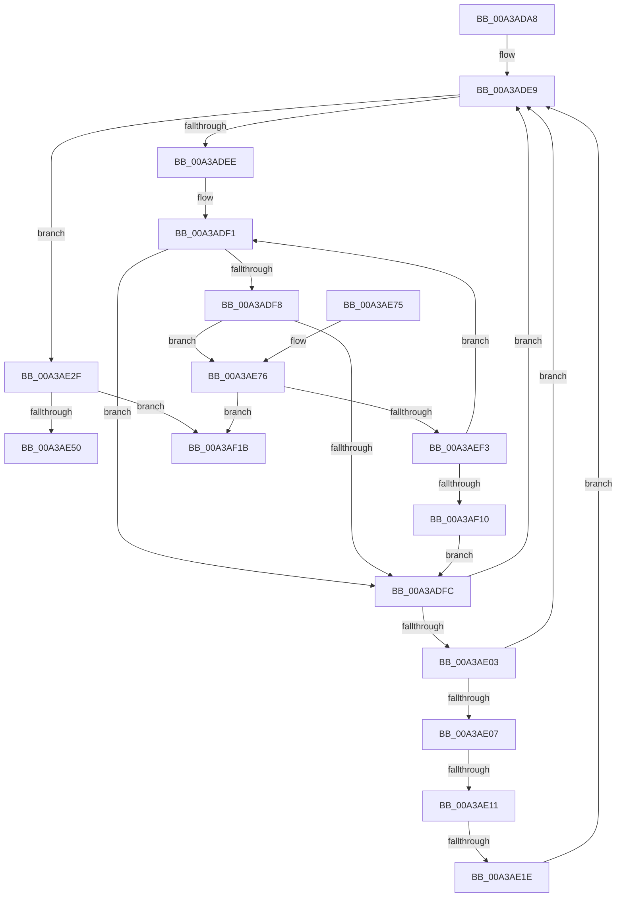

# PopDispatchNotificationsToList

- RVA: `0x00A3ADA8`–`0x00A3AF22` (길이 `378` bytes)
- VA: `0x0000000140A3ADA8`
- 실행 섹션: `PAGE`
- PDB 이름 있음: `예`; PDB Function 태그: `예`
- unwind 정보 RVA: `0x000AE1F0`
- 디코드: `97`개 명령, `378/378` bytes 표시
- 미해석 바이트: `0` (있으면 어셈블리에 `.byte`로 보존)

> 이 문서는 커널 이미지의 기계어와 PDB 기호를 분석해 생성했습니다. 4번과 5번은 함수 원형과 자료형을 바이너리 사용 방식에서 추정한 C 해석이며 원본 소스 복구 결과는 아닙니다.

## 1. Dependencies

- 직접 호출 지점: **8**; 고유 호출 대상: **6**
- 직접 호출자로 확인된 함수: **1**
- RIP 상대 이미지 참조: **2**

### Outgoing calls
- `0x00A3ADE1` → [ExAcquireFastMutex](../../text/20/ExAcquireFastMutex_function_0020E5A0.md) (function, `0x0020E5A0`)
- `0x00A3AE28` → [PopFreeRegistration](../75/PopFreeRegistration_function_0075C484.md) (function, `0x0075C484`)
- `0x00A3AE36` → [ExReleaseFastMutex](../../text/25/ExReleaseFastMutex_function_002519C0.md) (function, `0x002519C0`)
- `0x00A3AE58` → [_security_check_cookie](../../text/6A/_security_check_cookie_function_006AC640.md) (function, `0x006AC640`)
- `0x00A3AE9E` → [PopMarshalSettingValues](../91/PopMarshalSettingValues_function_009165A8.md) (function, `0x009165A8`)
- `0x00A3AEAC` → [ExReleaseFastMutex](../../text/25/ExReleaseFastMutex_function_002519C0.md) (function, `0x002519C0`)
- `0x00A3AEDB` → [ZwUpdateWnfStateData](../../text/6B/ZwUpdateWnfStateData_function_006B0D10.md) (function, `0x006B0D10`)
- `0x00A3AEFA` → [ExAcquireFastMutex](../../text/20/ExAcquireFastMutex_function_0020E5A0.md) (function, `0x0020E5A0`)

### Direct callers
- [PopDispatchNotifications](PopDispatchNotifications_function_00A3AD60.md) at `0x00A3AD71`
- [PopDispatchNotifications](PopDispatchNotifications_function_00A3AD60.md) at `0x00A3AD85`

### Static image references
- `0x00A3ADBD` → RVA `0x00E0A740` (`.data`; read)
- `0x00A3ADD1` → RVA `0x00F0DF40` (`.data`; read)

## 2. Other-region calls and transfers

- 다른 실행 섹션으로 향하는 call: **6**
  - `0x00A3ADE1` → [ExAcquireFastMutex](../../text/20/ExAcquireFastMutex_function_0020E5A0.md) (`PAGE` → `.text`)
  - `0x00A3AE36` → [ExReleaseFastMutex](../../text/25/ExReleaseFastMutex_function_002519C0.md) (`PAGE` → `.text`)
  - `0x00A3AE58` → [_security_check_cookie](../../text/6A/_security_check_cookie_function_006AC640.md) (`PAGE` → `.text`)
  - `0x00A3AEAC` → [ExReleaseFastMutex](../../text/25/ExReleaseFastMutex_function_002519C0.md) (`PAGE` → `.text`)
  - `0x00A3AEDB` → [ZwUpdateWnfStateData](../../text/6B/ZwUpdateWnfStateData_function_006B0D10.md) (`PAGE` → `.text`)
  - `0x00A3AEFA` → [ExAcquireFastMutex](../../text/20/ExAcquireFastMutex_function_0020E5A0.md) (`PAGE` → `.text`)
- call이 아닌 외부 분기/꼬리 이동: **2**
  - `0x00A3AE0B` → [sub_00B3A326](../B3/Unknown_function_00B3A326.md) (`tail-transfer`)
  - `0x00A3AE18` → [sub_00B3A326](../B3/Unknown_function_00B3A326.md) (`tail-transfer`)

## 3. Assembly (complete function range)

```asm
00A3ADA8  48 89 5C 24 10                  mov qword ptr [rsp + 0x10], rbx
00A3ADAD  48 89 6C 24 18                  mov qword ptr [rsp + 0x18], rbp
00A3ADB2  56                              push rsi
00A3ADB3  57                              push rdi
00A3ADB4  41 56                           push r14
00A3ADB6  48 81 EC 80 00 00 00            sub rsp, 0x80
00A3ADBD  48 8B 05 7C F9 3C 00            mov rax, qword ptr [rip + 0x3cf97c]
00A3ADC4  48 33 C4                        xor rax, rsp
00A3ADC7  48 89 44 24 78                  mov qword ptr [rsp + 0x78], rax
00A3ADCC  33 ED                           xor ebp, ebp
00A3ADCE  4C 8B F1                        mov r14, rcx
00A3ADD1  48 8D 0D 68 31 4D 00            lea rcx, [rip + 0x4d3168]
00A3ADD8  89 6C 24 40                     mov dword ptr [rsp + 0x40], ebp
00A3ADDC  48 89 6C 24 48                  mov qword ptr [rsp + 0x48], rbp
00A3ADE1  E8 BA 37 7D FF                  call 0x14020e5a0
00A3ADE6  49 8B 3E                        mov rdi, qword ptr [r14]
00A3ADE9  49 3B FE                        cmp rdi, r14
00A3ADEC  74 41                           je 0x140a3ae2f
00A3ADEE  48 8B F7                        mov rsi, rdi
00A3ADF1  8B 47 34                        mov eax, dword ptr [rdi + 0x34]
00A3ADF4  A8 01                           test al, 1
00A3ADF6  74 04                           je 0x140a3adfc
00A3ADF8  A8 02                           test al, 2
00A3ADFA  74 7A                           je 0x140a3ae76
00A3ADFC  48 8B 3F                        mov rdi, qword ptr [rdi]
00A3ADFF  A8 02                           test al, 2
00A3AE01  75 E6                           jne 0x140a3ade9
00A3AE03  A8 04                           test al, 4
00A3AE05  74 E2                           je 0x140a3ade9
00A3AE07  48 39 77 08                     cmp qword ptr [rdi + 8], rsi
00A3AE0B  0F 85 15 F5 0F 00               jne 0x140b3a326
00A3AE11  48 8B 46 08                     mov rax, qword ptr [rsi + 8]
00A3AE15  48 39 30                        cmp qword ptr [rax], rsi
00A3AE18  0F 85 08 F5 0F 00               jne 0x140b3a326
00A3AE1E  48 89 38                        mov qword ptr [rax], rdi
00A3AE21  48 8B CE                        mov rcx, rsi
00A3AE24  48 89 47 08                     mov qword ptr [rdi + 8], rax
00A3AE28  E8 57 16 D2 FF                  call 0x14075c484
00A3AE2D  EB BA                           jmp 0x140a3ade9
00A3AE2F  48 8D 0D 0A 31 4D 00            lea rcx, [rip + 0x4d310a]
00A3AE36  E8 85 6B 81 FF                  call 0x1402519c0
00A3AE3B  65 48 8B 04 25 88 01 00 00      mov rax, qword ptr gs:[0x188]
00A3AE44  39 A8 E4 01 00 00               cmp dword ptr [rax + 0x1e4], ebp
00A3AE4A  0F 85 CB 00 00 00               jne 0x140a3af1b
00A3AE50  48 8B 4C 24 78                  mov rcx, qword ptr [rsp + 0x78]
00A3AE55  48 33 CC                        xor rcx, rsp
00A3AE58  E8 E3 17 C7 FF                  call 0x1406ac640
00A3AE5D  4C 8D 9C 24 80 00 00 00         lea r11, [rsp + 0x80]
00A3AE65  49 8B 5B 28                     mov rbx, qword ptr [r11 + 0x28]
00A3AE69  49 8B 6B 30                     mov rbp, qword ptr [r11 + 0x30]
00A3AE6D  49 8B E3                        mov rsp, r11
00A3AE70  41 5E                           pop r14
00A3AE72  5F                              pop rdi
00A3AE73  5E                              pop rsi
00A3AE74  C3                              ret
00A3AE75  CC                              int3
00A3AE76  48 8B 47 38                     mov rax, qword ptr [rdi + 0x38]
00A3AE7A  4C 8D 4C 24 40                  lea r9, [rsp + 0x40]
00A3AE7F  48 89 44 24 48                  mov qword ptr [rsp + 0x48], rax
00A3AE84  48 8D 54 24 50                  lea rdx, [rsp + 0x50]
00A3AE89  8B 47 34                        mov eax, dword ptr [rdi + 0x34]
00A3AE8C  41 B8 24 00 00 00               mov r8d, 0x24
00A3AE92  83 E0 FE                        and eax, 0xfffffffe
00A3AE95  48 8B CF                        mov rcx, rdi
00A3AE98  83 C8 02                        or eax, 2
00A3AE9B  89 47 34                        mov dword ptr [rdi + 0x34], eax
00A3AE9E  E8 05 B7 ED FF                  call 0x1409165a8
00A3AEA3  48 8D 0D 96 30 4D 00            lea rcx, [rip + 0x4d3096]
00A3AEAA  8B D8                           mov ebx, eax
00A3AEAC  E8 0F 6B 81 FF                  call 0x1402519c0
00A3AEB1  44 8B 44 24 40                  mov r8d, dword ptr [rsp + 0x40]
00A3AEB6  48 8D 54 24 50                  lea rdx, [rsp + 0x50]
00A3AEBB  89 6C 24 30                     mov dword ptr [rsp + 0x30], ebp
00A3AEBF  48 8D 4C 24 48                  lea rcx, [rsp + 0x48]
00A3AEC4  85 DB                           test ebx, ebx
00A3AEC6  89 6C 24 28                     mov dword ptr [rsp + 0x28], ebp
00A3AECA  48 89 6C 24 20                  mov qword ptr [rsp + 0x20], rbp
00A3AECF  44 0F 48 C5                     cmovs r8d, ebp
00A3AED3  45 33 C9                        xor r9d, r9d
00A3AED6  44 89 44 24 40                  mov dword ptr [rsp + 0x40], r8d
00A3AEDB  E8 30 5E C7 FF                  call 0x1406b0d10
00A3AEE0  65 48 8B 0C 25 88 01 00 00      mov rcx, qword ptr gs:[0x188]
00A3AEE9  8B D8                           mov ebx, eax
00A3AEEB  39 A9 E4 01 00 00               cmp dword ptr [rcx + 0x1e4], ebp
00A3AEF1  75 28                           jne 0x140a3af1b
00A3AEF3  48 8D 0D 46 30 4D 00            lea rcx, [rip + 0x4d3046]
00A3AEFA  E8 A1 36 7D FF                  call 0x14020e5a0
00A3AEFF  8B 47 34                        mov eax, dword ptr [rdi + 0x34]
00A3AF02  83 E0 FD                        and eax, 0xfffffffd
00A3AF05  89 47 34                        mov dword ptr [rdi + 0x34], eax
00A3AF08  85 DB                           test ebx, ebx
00A3AF0A  0F 89 E1 FE FF FF               jns 0x140a3adf1
00A3AF10  83 C8 01                        or eax, 1
00A3AF13  89 47 34                        mov dword ptr [rdi + 0x34], eax
00A3AF16  E9 E1 FE FF FF                  jmp 0x140a3adfc
00A3AF1B  B9 20 00 00 00                  mov ecx, 0x20
00A3AF20  CD 29                           int 0x29
```

## 4. C-style interpretation (structured pseudocode)

```c
__int64 __fastcall PopDispatchNotificationsToList(__int64 a1)
{
    __int64 result;
    __int64 v_rbp;
    __int64 v_rsp;
    unsigned __int64 v_stack_m18;
    unsigned __int64 v_stack_m20;
    unsigned __int64 v_stack_m30;
    unsigned __int64 v_stack_m38;
    unsigned __int64 v_stack_m40;
    unsigned __int64 v_stack_m50;
    unsigned int v_stack_m58;
    unsigned __int64 v_stack_m60;
    unsigned __int64 v_stack_p10;
    unsigned __int64 v_stack_p18;

    v_stack_p10 = v_rbx;
    v_stack_p18 = v_rbp;
    v_rsp = (v_rsp) - (128);
    result = (*(unsigned __int64 *)(v_rip + 3996028)) ^ (v_rsp);
    v_stack_m20 = result;
    v_rbp = 0;
    v_stack_m58 = 0;
    v_stack_m50 = 0;
    result = ExAcquireFastMutex(v_rip + 5058920, a2, a3, a4);
loc_00A3ADE9:
    if ((*(unsigned __int64 *)(a1)) == a1) goto loc_00A3AE2F;
loc_00A3ADF1:
    if ((((unsigned __int8)((unsigned int)(*(unsigned int *)(*(unsigned __int64 *)(a1) + 52)))) & (1)) == 0) goto loc_00A3ADFC;
    if ((((unsigned __int8)((unsigned int)(*(unsigned int *)(*(unsigned __int64 *)(a1) + 52)))) & (2)) == 0) goto loc_00A3AE76;
loc_00A3ADFC:
    if ((((unsigned __int8)((unsigned int)(*(unsigned int *)(*(unsigned __int64 *)(a1) + 52)))) & (2)) != 0) goto loc_00A3ADE9;
    if ((((unsigned __int8)((unsigned int)(*(unsigned int *)(*(unsigned __int64 *)(a1) + 52)))) & (4)) == 0) goto loc_00A3ADE9;
    *(unsigned __int64 *)(*(unsigned __int64 *)(*(unsigned __int64 *)(a1) + 8)) = *(unsigned __int64 *)(*(unsigned __int64 *)(a1));
    *(unsigned __int64 *)(*(unsigned __int64 *)(*(unsigned __int64 *)(a1)) + 8) = *(unsigned __int64 *)(*(unsigned __int64 *)(a1) + 8);
    result = PopFreeRegistration(*(unsigned __int64 *)(a1), a2, a3, a4);
    goto loc_00A3ADE9;
loc_00A3AE2F:
    result = ExReleaseFastMutex(v_rip + 5058826, a2, a3, a4);
    if ((*(unsigned int *)(*(unsigned __int64 *)(gs_base + (0 + 392)) + 484)) != 0) goto loc_00A3AF1B;
    a1 = (v_stack_m20) ^ (v_rsp);
    result = _security_check_cookie(a1, a2, a3, a4);
    return result;
loc_00A3AE76:
    v_stack_m38 = *(unsigned __int64 *)(*(unsigned __int64 *)(*(unsigned __int64 *)(a1)) + 56);
    result = (unsigned int)(((unsigned int)(*(unsigned int *)(*(unsigned __int64 *)(*(unsigned __int64 *)(a1)) + 52))) & (0xFFFFFFFEULL));
    result = (unsigned int)((result) | (2));
    *(unsigned int *)(*(unsigned __int64 *)(*(unsigned __int64 *)(a1)) + 52) = (unsigned int)(result);
    result = PopMarshalSettingValues(*(unsigned __int64 *)(*(unsigned __int64 *)(a1)), v_stack_m30, 36, v_stack_m40);
    result = ExReleaseFastMutex(v_rip + 5058710, v_stack_m30, 36, v_stack_m40);
    v_stack_m50 = (unsigned int)(*(unsigned __int64 *)(v_stack_m18 + 48));
    v_stack_m58 = (unsigned int)(*(unsigned __int64 *)(v_stack_m18 + 48));
    v_stack_m60 = *(unsigned __int64 *)(v_stack_m18 + 48);
    a3 = (unsigned int)(v_stack_m40);
    if (sign_flag) { a3 = (unsigned int)(*(unsigned __int64 *)(v_stack_m18 + 48)); }
    a4 = 0;
    v_stack_m40 = (unsigned int)(a3);
    result = ZwUpdateWnfStateData(v_stack_m38, v_stack_m30, a3, a4);
    if ((*(unsigned int *)(*(unsigned __int64 *)(gs_base + (0 + 392)) + 484)) != ((unsigned int)(*(unsigned __int64 *)(v_stack_m18 + 48)))) goto loc_00A3AF1B;
    result = ExAcquireFastMutex(v_rip + 5058630, v_stack_m30, a3, a4);
    result = (unsigned int)(((unsigned int)(*(unsigned int *)(*(unsigned __int64 *)(*(unsigned __int64 *)(a1)) + 52))) & (0xFFFFFFFDULL));
    *(unsigned int *)(*(unsigned __int64 *)(*(unsigned __int64 *)(a1)) + 52) = (unsigned int)(result);
    if (!sign_flag) goto loc_00A3ADF1;
    result = (unsigned int)((result) | (1));
    *(unsigned int *)(*(unsigned __int64 *)(*(unsigned __int64 *)(a1)) + 52) = (unsigned int)(result);
    goto loc_00A3ADFC;
loc_00A3AF1B:
    return result;
}
```

## 5. (Beta) C Style

```c
int64_t PopDispatchNotificationsToList(void *Arg1)
{
    uint8_t *arg1 = (uint8_t *)Arg1;

    int64_t result;
    int64_t local_rbp;
    int64_t local_rsp;
    uint64_t v_stack_m18;
    uint64_t v_stack_m20;
    uint64_t v_stack_m30;
    uint64_t v_stack_m38;
    uint64_t v_stack_m40;
    uint64_t v_stack_m50;
    uint32_t v_stack_m58;
    uint64_t v_stack_m60;
    uint64_t v_stack_p10;
    uint64_t v_stack_p18;

    v_stack_p10 = local_rbx;
    v_stack_p18 = local_rbp;
    local_rsp = (local_rsp) - (128);
    result = (*(uint64_t *)(v_rip + 0x3CF97C)) ^ (local_rsp);
    v_stack_m20 = result;
    local_rbp = 0;
    v_stack_m58 = 0;
    v_stack_m50 = 0;
    result = ExAcquireFastMutex(v_rip + 5058920, a2, a3, a4);
loc_00A3ADE9:
    if ((*(uint64_t *)(arg1)) == Arg1) goto loc_00A3AE2F;
loc_00A3ADF1:
    if ((((uint8_t)((uint32_t)(*(uint32_t *)(*(uint64_t *)(arg1) + 0x34)))) & (1)) == 0) goto loc_00A3ADFC;
    if ((((uint8_t)((uint32_t)(*(uint32_t *)(*(uint64_t *)(arg1) + 0x34)))) & (2)) == 0) goto loc_00A3AE76;
loc_00A3ADFC:
    if ((((uint8_t)((uint32_t)(*(uint32_t *)(*(uint64_t *)(arg1) + 0x34)))) & (2)) != 0) goto loc_00A3ADE9;
    if ((((uint8_t)((uint32_t)(*(uint32_t *)(*(uint64_t *)(arg1) + 0x34)))) & (4)) == 0) goto loc_00A3ADE9;
    *(uint64_t *)(*(uint64_t *)(*(uint64_t *)(arg1) + 0x8)) = *(uint64_t *)(*(uint64_t *)(arg1));
    *(uint64_t *)(*(uint64_t *)(*(uint64_t *)(arg1)) + 0x8) = *(uint64_t *)(*(uint64_t *)(arg1) + 0x8);
    result = PopFreeRegistration(*(uint64_t *)(arg1), a2, a3, a4);
    goto loc_00A3ADE9;
loc_00A3AE2F:
    result = ExReleaseFastMutex(v_rip + 5058826, a2, a3, a4);
    if ((*(uint32_t *)(*(uint64_t *)(gs_base + (0 + 0x188)) + 0x1E4)) != 0) goto loc_00A3AF1B;
    Arg1 = (v_stack_m20) ^ (local_rsp);
    result = _security_check_cookie(Arg1, a2, a3, a4);
    return result;
loc_00A3AE76:
    v_stack_m38 = *(uint64_t *)(*(uint64_t *)(*(uint64_t *)(arg1)) + 0x38);
    result = (uint32_t)(((uint32_t)(*(uint32_t *)(*(uint64_t *)(*(uint64_t *)(arg1)) + 0x34))) & (0xFFFFFFFEULL));
    result = (uint32_t)((result) | (2));
    *(uint32_t *)(*(uint64_t *)(*(uint64_t *)(arg1)) + 0x34) = (uint32_t)(result);
    result = PopMarshalSettingValues(*(uint64_t *)(*(uint64_t *)(arg1)), v_stack_m30, 36, v_stack_m40);
    result = ExReleaseFastMutex(v_rip + 5058710, v_stack_m30, 36, v_stack_m40);
    v_stack_m50 = (uint32_t)(*(uint64_t *)(v_stack_m18 + 0x30));
    v_stack_m58 = (uint32_t)(*(uint64_t *)(v_stack_m18 + 0x30));
    v_stack_m60 = *(uint64_t *)(v_stack_m18 + 0x30);
    a3 = (uint32_t)(v_stack_m40);
    if (sign_flag) { a3 = (uint32_t)(*(uint64_t *)(v_stack_m18 + 0x30)); }
    a4 = 0;
    v_stack_m40 = (uint32_t)(a3);
    result = ZwUpdateWnfStateData(v_stack_m38, v_stack_m30, a3, a4);
    if ((*(uint32_t *)(*(uint64_t *)(gs_base + (0 + 0x188)) + 0x1E4)) != ((uint32_t)(*(uint64_t *)(v_stack_m18 + 0x30)))) goto loc_00A3AF1B;
    result = ExAcquireFastMutex(v_rip + 5058630, v_stack_m30, a3, a4);
    result = (uint32_t)(((uint32_t)(*(uint32_t *)(*(uint64_t *)(*(uint64_t *)(arg1)) + 0x34))) & (0xFFFFFFFDULL));
    *(uint32_t *)(*(uint64_t *)(*(uint64_t *)(arg1)) + 0x34) = (uint32_t)(result);
    if (!sign_flag) goto loc_00A3ADF1;
    result = (uint32_t)((result) | (1));
    *(uint32_t *)(*(uint64_t *)(*(uint64_t *)(arg1)) + 0x34) = (uint32_t)(result);
    goto loc_00A3ADFC;
loc_00A3AF1B:
    return result;
}
```

### 관측된 메모리 오프셋

구조체 형식이 확인되지 않은 접근은 인자 기준의 오프셋으로만 기록했습니다.

| 기준 인자 | 오프셋 표현 | 폭 (bit) | 접근 |
|---|---:|---:|---|
| `Arg1` | `+ 0x0` | `64` | `R` |

## 6. Execution-region graph

[열기: 2D/3D 그래프와 함수 탐색 컨트롤 패널](../../../control-panel.html?section=page&rva=0x00A3ADA8&view=graph)

- 2D 그래프는 위에서 아래로 흐르고, 3D 그래프는 빈 공간을 드래그해 회전합니다. Shift+드래그는 이동, 휠은 확대·축소, 함수 노드 선택은 대상 보고서 이동입니다.

### Static fallback


