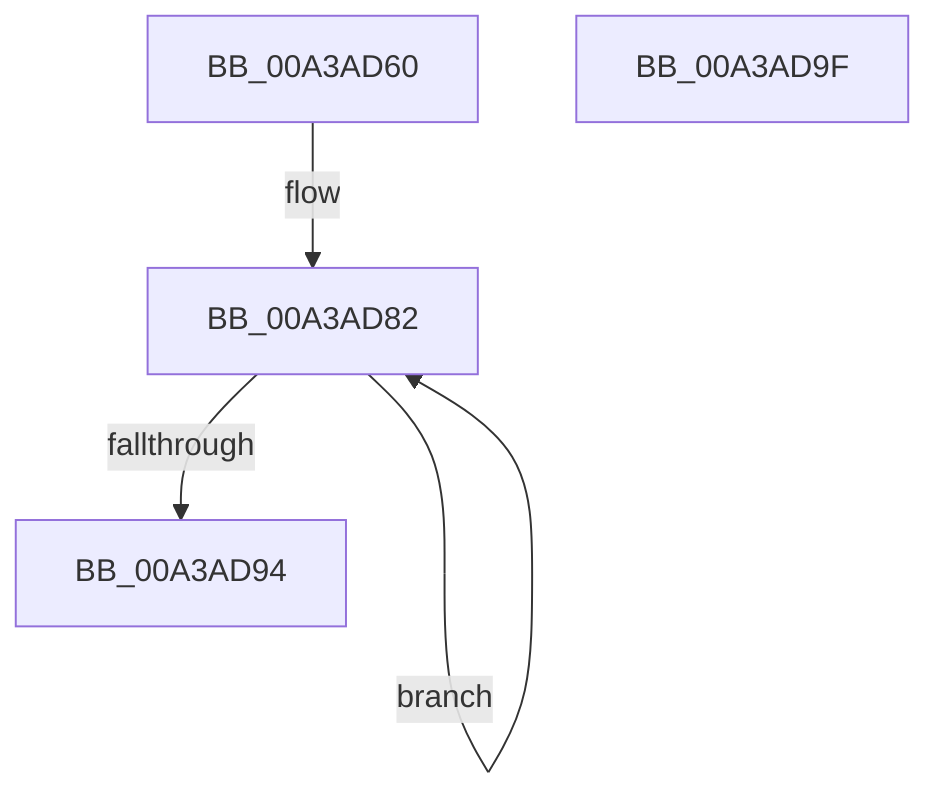

# PopDispatchNotifications

- RVA: `0x00A3AD60`–`0x00A3ADA0` (길이 `64` bytes)
- VA: `0x0000000140A3AD60`
- 실행 섹션: `PAGE`
- PDB 이름 있음: `예`; PDB Function 태그: `아니요`
- unwind 정보 RVA: `0x0005CAAC`
- 디코드: `17`개 명령, `64/64` bytes 표시
- 미해석 바이트: `0` (있으면 어셈블리에 `.byte`로 보존)

> 이 문서는 커널 이미지의 기계어와 PDB 기호를 분석해 생성했습니다. 4번과 5번은 함수 원형과 자료형을 바이너리 사용 방식에서 추정한 C 해석이며 원본 소스 복구 결과는 아닙니다.

## 1. Dependencies

- 직접 호출 지점: **2**; 고유 호출 대상: **1**
- 직접 호출자로 확인된 함수: **0**
- RIP 상대 이미지 참조: **2**

### Outgoing calls
- `0x00A3AD71` → [PopDispatchNotificationsToList](PopDispatchNotificationsToList_function_00A3ADA8.md) (function, `0x00A3ADA8`)
- `0x00A3AD85` → [PopDispatchNotificationsToList](PopDispatchNotificationsToList_function_00A3ADA8.md) (function, `0x00A3ADA8`)

### Direct callers
- 이 함수 시작 RVA로 연결되는 직접 call은 확인되지 않았습니다. 간접 호출은 완전히 역산할 수 없습니다.

### Static image references
- `0x00A3AD6A` → RVA `0x00F0C6A0` (`.data`; read)
- `0x00A3AD76` → RVA `0x00F0C6C0` (`.data`; read)

## 2. Other-region calls and transfers

- 다른 실행 섹션으로 향하는 call: **0**
- 별도 외부 분기/꼬리 이동을 확인하지 못했습니다.

## 3. Assembly (complete function range)

```asm
00A3AD60  48 89 5C 24 08                  mov qword ptr [rsp + 8], rbx
00A3AD65  57                              push rdi
00A3AD66  48 83 EC 20                     sub rsp, 0x20
00A3AD6A  48 8D 0D 2F 19 4D 00            lea rcx, [rip + 0x4d192f]
00A3AD71  E8 32 00 00 00                  call 0x140a3ada8
00A3AD76  48 8D 1D 43 19 4D 00            lea rbx, [rip + 0x4d1943]
00A3AD7D  BF 02 00 00 00                  mov edi, 2
00A3AD82  48 8B CB                        mov rcx, rbx
00A3AD85  E8 1E 00 00 00                  call 0x140a3ada8
00A3AD8A  48 83 C3 10                     add rbx, 0x10
00A3AD8E  48 83 EF 01                     sub rdi, 1
00A3AD92  75 EE                           jne 0x140a3ad82
00A3AD94  48 8B 5C 24 30                  mov rbx, qword ptr [rsp + 0x30]
00A3AD99  48 83 C4 20                     add rsp, 0x20
00A3AD9D  5F                              pop rdi
00A3AD9E  C3                              ret
00A3AD9F  CC                              int3
```

## 4. C-style interpretation (structured pseudocode)

```c
__int64 __fastcall PopDispatchNotifications(void)
{
    __int64 result;
    __int64 v_rbx;
    __int64 v_rdi;
    __int64 v_rsp;
    unsigned __int64 v_stack_p8;

    v_stack_p8 = v_rbx;
    v_rsp = (v_rsp) - (32);
    result = PopDispatchNotificationsToList(v_rip + 5052719, a2, a3, a4);
loc_00A3AD82:
    result = PopDispatchNotificationsToList(v_rip + 5052739, a2, a3, a4);
    v_rbx = (v_rip + 5052739) + (16);
    v_rdi = (2) - (1);
    if (condition_is_not_equal) goto loc_00A3AD82;
    v_rsp = (v_rsp) + (32);
    return result;
}
```

## 5. (Beta) C Style

```c
void PopDispatchNotifications(void)
{
    int64_t result;
    int64_t local_rbx;
    int64_t local_rdi;
    int64_t local_rsp;
    uint64_t v_stack_p8;

    v_stack_p8 = local_rbx;
    local_rsp = (local_rsp) - (32);
    result = PopDispatchNotificationsToList(v_rip + 5052719, a2, a3, a4);
loc_00A3AD82:
    result = PopDispatchNotificationsToList(v_rip + 5052739, a2, a3, a4);
    local_rbx = (v_rip + 5052739) + (16);
    local_rdi = (2) - (1);
    if (condition_is_not_equal) goto loc_00A3AD82;
    local_rsp = (local_rsp) + (32);
    return result;
}
```

## 6. Execution-region graph

[열기: 2D/3D 그래프와 함수 탐색 컨트롤 패널](../../../control-panel.html?section=page&rva=0x00A3AD60&view=graph)

- 2D 그래프는 위에서 아래로 흐르고, 3D 그래프는 빈 공간을 드래그해 회전합니다. Shift+드래그는 이동, 휠은 확대·축소, 함수 노드 선택은 대상 보고서 이동입니다.

### Static fallback


