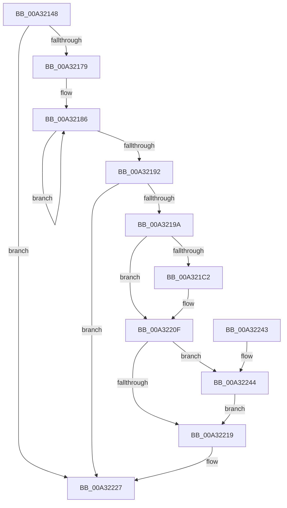

# PopDripsWatchdogStartWatchdog

- RVA: `0x00A32148`–`0x00A322A1` (길이 `345` bytes)
- VA: `0x0000000140A32148`
- 실행 섹션: `PAGE`
- PDB 이름 있음: `예`; PDB Function 태그: `아니요`
- unwind 정보 RVA: `0x000AD2FC`
- 디코드: `67`개 명령, `345/345` bytes 표시
- 미해석 바이트: `0` (있으면 어셈블리에 `.byte`로 보존)

> 이 문서는 커널 이미지의 기계어와 PDB 기호를 분석해 생성했습니다. 4번과 5번은 함수 원형과 자료형을 바이너리 사용 방식에서 추정한 C 해석이며 원본 소스 복구 결과는 아닙니다.

## 1. Dependencies

- 직접 호출 지점: **7**; 고유 호출 대상: **6**
- 직접 호출자로 확인된 함수: **1**
- RIP 상대 이미지 참조: **26**

### Outgoing calls
- `0x00A32166` → [PiDmObjectManagerAcquireExclusiveLock](../95/PiDmObjectManagerAcquireExclusiveLock_function_00951334.md) (function, `0x00951334`)
- `0x00A321AC` → [PopCalculateIdleInformation](../../text/43/PopCalculateIdleInformation_function_0043ADEC.md) (function, `0x0043ADEC`)
- `0x00A3220A` → [PopDripsWatchdogScheduleNextTimer](../70/PopDripsWatchdogScheduleNextTimer_function_00705880.md) (function, `0x00705880`)
- `0x00A3222E` → [ExReleaseResourceLite](../../text/25/ExReleaseResourceLite_function_0025FA10.md) (function, `0x0025FA10`)
- `0x00A32233` → [KeLeaveCriticalRegion](../../text/25/KeLeaveCriticalRegion_function_0025D8B0.md) (function, `0x0025D8B0`)
- `0x00A32259` → [memset](../../text/6C/memset_function_006C6C40.md) (function, `0x006C6C40`)
- `0x00A32297` → [PopDripsWatchdogScheduleNextTimer](../70/PopDripsWatchdogScheduleNextTimer_function_00705880.md) (function, `0x00705880`)

### Direct callers
- [PopPdcIdleResiliencyCallback](PopPdcIdleResiliencyCallback_function_00A31518.md) at `0x00A31627`

### Static image references
- `0x00A32155` → RVA `0x00F07EA0` (`.data`; read)
- `0x00A3216B` → RVA `0x00F07F08` (`.data`; read)
- `0x00A32179` → RVA `0x00F07288` (`.data`; read)
- `0x00A321B1` → RVA `0x00F07FC4` (`.data`; read)
- `0x00A321B7` → RVA `0x00F0B410` (`.data`; read)
- `0x00A321C7` → RVA `0x00F07E90` (`.data`; read)
- `0x00A321CD` → RVA `0x00F07F10` (`.data`; read)
- `0x00A321D4` → RVA `0x00F07FD4` (`.data`; read/write)
- `0x00A321DB` → RVA `0x00F07FC8` (`.data`; read/write)
- `0x00A321E3` → RVA `0x00F07FF8` (`.data`; read)
- `0x00A321EA` → RVA `0x00F07FD8` (`.data`; write)
- `0x00A321F5` → RVA `0x00F07FE0` (`.data`; write)
- `0x00A321FC` → RVA `0x00F07FE8` (`.data`; write)
- `0x00A32203` → RVA `0x00F08008` (`.data`; read)
- `0x00A3220F` → RVA `0x00F080CC` (`.data`; read)
- `0x00A32219` → RVA `0x00F07F08` (`.data`; read/write)
- `0x00A32220` → RVA `0x00F08128` (`.data`; write)
- `0x00A32244` → RVA `0x00F080D0` (`.data`; read/write)
- `0x00A3224C` → RVA `0x00F080D8` (`.data`; read)
- `0x00A32263` → RVA `0x00F0C064` (`.data`; read)
- `0x00A32269` → RVA `0x00F08018` (`.data`; read)
- `0x00A32270` → RVA `0x00F080F4` (`.data`; write)
- `0x00A32276` → RVA `0x00E27D60` (`.data`; read)
- `0x00A3227D` → RVA `0x00F08100` (`.data`; read)
- `0x00A32284` → RVA `0x00F080F8` (`.data`; write)
- `0x00A32290` → RVA `0x00F08110` (`.data`; read)

## 2. Other-region calls and transfers

- 다른 실행 섹션으로 향하는 call: **4**
  - `0x00A321AC` → [PopCalculateIdleInformation](../../text/43/PopCalculateIdleInformation_function_0043ADEC.md) (`PAGE` → `.text`)
  - `0x00A3222E` → [ExReleaseResourceLite](../../text/25/ExReleaseResourceLite_function_0025FA10.md) (`PAGE` → `.text`)
  - `0x00A32233` → [KeLeaveCriticalRegion](../../text/25/KeLeaveCriticalRegion_function_0025D8B0.md) (`PAGE` → `.text`)
  - `0x00A32259` → [memset](../../text/6C/memset_function_006C6C40.md) (`PAGE` → `.text`)
- 별도 외부 분기/꼬리 이동을 확인하지 못했습니다.

## 3. Assembly (complete function range)

```asm
00A32148  48 89 5C 24 08                  mov qword ptr [rsp + 8], rbx
00A3214D  57                              push rdi
00A3214E  48 83 EC 40                     sub rsp, 0x40
00A32152  0F 57 C0                        xorps xmm0, xmm0
00A32155  48 8D 0D 44 5D 4D 00            lea rcx, [rip + 0x4d5d44]
00A3215C  0F 11 44 24 20                  movups xmmword ptr [rsp + 0x20], xmm0
00A32161  0F 11 44 24 30                  movups xmmword ptr [rsp + 0x30], xmm0
00A32166  E8 C9 F1 F1 FF                  call 0x140951334
00A3216B  8B 05 97 5D 4D 00               mov eax, dword ptr [rip + 0x4d5d97]
00A32171  A8 02                           test al, 2
00A32173  0F 84 AE 00 00 00               je 0x140a32227
00A32179  0F 0D 0D 08 51 4D 00            prefetchw byte ptr [rip + 0x4d5108]
00A32180  8B 05 02 51 4D 00               mov eax, dword ptr [rip + 0x4d5102]
00A32186  8B C8                           mov ecx, eax
00A32188  F0 0F B1 0D F8 50 4D 00         lock cmpxchg dword ptr [rip + 0x4d50f8], ecx
00A32190  75 F4                           jne 0x140a32186
00A32192  85 C0                           test eax, eax
00A32194  0F 85 8D 00 00 00               jne 0x140a32227
00A3219A  48 BB 08 00 00 00 80 F7 FF FF   movabs rbx, 0xfffff78000000008
00A321A4  48 8D 4C 24 20                  lea rcx, [rsp + 0x20]
00A321A9  48 8B 1B                        mov rbx, qword ptr [rbx]
00A321AC  E8 3B 8C A0 FF                  call 0x14043adec
00A321B1  8B 05 0D 5E 4D 00               mov eax, dword ptr [rip + 0x4d5e0d]
00A321B7  48 8B 3D 52 92 4D 00            mov rdi, qword ptr [rip + 0x4d9252]
00A321BE  A8 01                           test al, 1
00A321C0  74 4D                           je 0x140a3220f
00A321C2  0F 10 44 24 20                  movups xmm0, xmmword ptr [rsp + 0x20]
00A321C7  8B 05 C3 5C 4D 00               mov eax, dword ptr [rip + 0x4d5cc3]
00A321CD  48 8D 0D 3C 5D 4D 00            lea rcx, [rip + 0x4d5d3c]
00A321D4  83 25 F9 5D 4D 00 00            and dword ptr [rip + 0x4d5df9], 0
00A321DB  48 83 25 E5 5D 4D 00 00         and qword ptr [rip + 0x4d5de5], 0
00A321E3  0F 11 05 0E 5E 4D 00            movups xmmword ptr [rip + 0x4d5e0e], xmm0
00A321EA  89 05 E8 5D 4D 00               mov dword ptr [rip + 0x4d5de8], eax
00A321F0  0F 10 44 24 30                  movups xmm0, xmmword ptr [rsp + 0x30]
00A321F5  48 89 1D E4 5D 4D 00            mov qword ptr [rip + 0x4d5de4], rbx
00A321FC  48 89 1D E5 5D 4D 00            mov qword ptr [rip + 0x4d5de5], rbx
00A32203  0F 11 05 FE 5D 4D 00            movups xmmword ptr [rip + 0x4d5dfe], xmm0
00A3220A  E8 71 36 CD FF                  call 0x140705880
00A3220F  8B 05 B7 5E 4D 00               mov eax, dword ptr [rip + 0x4d5eb7]
00A32215  A8 01                           test al, 1
00A32217  75 2B                           jne 0x140a32244
00A32219  83 0D E8 5C 4D 00 04            or dword ptr [rip + 0x4d5ce8], 4
00A32220  48 89 3D 01 5F 4D 00            mov qword ptr [rip + 0x4d5f01], rdi
00A32227  48 8D 0D 72 5C 4D 00            lea rcx, [rip + 0x4d5c72]
00A3222E  E8 DD D7 82 FF                  call 0x14025fa10
00A32233  E8 78 B6 82 FF                  call 0x14025d8b0
00A32238  48 8B 5C 24 50                  mov rbx, qword ptr [rsp + 0x50]
00A3223D  48 83 C4 40                     add rsp, 0x40
00A32241  5F                              pop rdi
00A32242  C3                              ret
00A32243  CC                              int3
00A32244  48 83 25 84 5E 4D 00 00         and qword ptr [rip + 0x4d5e84], 0
00A3224C  48 8D 0D 85 5E 4D 00            lea rcx, [rip + 0x4d5e85]
00A32253  33 D2                           xor edx, edx
00A32255  44 8D 42 48                     lea r8d, [rdx + 0x48]
00A32259  E8 E2 49 C9 FF                  call 0x1406c6c40
00A3225E  0F 10 44 24 20                  movups xmm0, xmmword ptr [rsp + 0x20]
00A32263  8B 05 FB 9D 4D 00               mov eax, dword ptr [rip + 0x4d9dfb]
00A32269  48 8D 0D A8 5D 4D 00            lea rcx, [rip + 0x4d5da8]
00A32270  89 05 7E 5E 4D 00               mov dword ptr [rip + 0x4d5e7e], eax
00A32276  48 8B 05 E3 5A 3F 00            mov rax, qword ptr [rip + 0x3f5ae3]
00A3227D  0F 11 05 7C 5E 4D 00            movups xmmword ptr [rip + 0x4d5e7c], xmm0
00A32284  48 89 05 6D 5E 4D 00            mov qword ptr [rip + 0x4d5e6d], rax
00A3228B  0F 10 44 24 30                  movups xmm0, xmmword ptr [rsp + 0x30]
00A32290  0F 11 05 79 5E 4D 00            movups xmmword ptr [rip + 0x4d5e79], xmm0
00A32297  E8 E4 35 CD FF                  call 0x140705880
00A3229C  E9 78 FF FF FF                  jmp 0x140a32219
```

## 4. C-style interpretation (structured pseudocode)

```c
__int64 __fastcall PopDripsWatchdogStartWatchdog(__int64 a1, int a2)
{
    __int64 result;
    __int64 v_rsp;
    unsigned __int64 v_stack_m18;
    unsigned __int64 v_stack_m28;
    unsigned __int64 v_stack_p20;
    unsigned __int64 v_stack_p30;
    unsigned __int64 v_stack_p8;

    v_stack_p8 = v_rbx;
    v_rsp = (v_rsp) - (64);
    v_stack_m28 = v_xmm0;
    v_stack_m18 = v_xmm0;
    result = PiDmObjectManagerAcquireExclusiveLock(v_rip + 5070148, a2, a3, a4);
    if ((((unsigned __int8)((unsigned int)(*(unsigned int *)(v_rip + 5070231)))) & (2)) == 0) goto loc_00A32227;
loc_00A32186:
    if ((((unsigned __int8)((unsigned int)(*(unsigned int *)(v_rip + 5070231)))) & (2)) != 0) goto loc_00A32186;
    if ((unsigned int)((unsigned int)(*(unsigned int *)(v_rip + 5067010))) != 0) goto loc_00A32227;
    result = PopCalculateIdleInformation(v_stack_m28, a2, a3, a4);
    result = (unsigned int)(*(unsigned int *)(v_rip + 5070349));
    if ((((unsigned __int8)((unsigned int)(*(unsigned int *)(v_rip + 5070349)))) & (1)) != 0) {
        result = *(unsigned int *)(v_rip + 5070019);
        a1 = v_rip + 5070140;
        *(unsigned __int64 *)(v_rip + 5070350) = v_xmm0;
        *(unsigned int *)(v_rip + 5070312) = (unsigned int)(result);
        *(unsigned __int64 *)(v_rip + 5070308) = *(unsigned __int64 *)(v_rbx);
        *(unsigned __int64 *)(v_rip + 5070309) = *(unsigned __int64 *)(v_rbx);
        *(unsigned __int64 *)(v_rip + 5070334) = v_xmm0;
        result = PopDripsWatchdogScheduleNextTimer(a1, a2, a3, a4);
    }
    if ((((unsigned __int8)((unsigned int)(*(unsigned int *)(v_rip + 5070519)))) & (1)) != 0) goto loc_00A32244;
loc_00A32219:
    *(unsigned __int64 *)(v_rip + 5070593) = *(unsigned __int64 *)(v_rip + 5083730);
loc_00A32227:
    result = ExReleaseResourceLite(v_rip + 5069938, a2, a3, a4);
    result = KeLeaveCriticalRegion(v_rip + 5069938, a2, a3, a4);
    v_rsp = (v_rsp) + (64);
    return result;
loc_00A32244:
    a2 = 0;
    result = memset(v_rip + 5070469, a2, a2 + 72, a4);
    *(unsigned int *)(v_rip + 5070462) = (unsigned int)((unsigned int)(*(unsigned int *)(v_rip + 5086715)));
    *(unsigned __int64 *)(v_rip + 5070460) = v_xmm0;
    *(unsigned __int64 *)(v_rip + 5070445) = *(unsigned __int64 *)(v_rip + 4152035);
    *(unsigned __int64 *)(v_rip + 5070457) = v_xmm0;
    result = PopDripsWatchdogScheduleNextTimer(v_rip + 5070248, a2, a2 + 72, a4);
    goto loc_00A32219;
}
```

## 5. (Beta) C Style

```c
int64_t PopDripsWatchdogStartWatchdog(int64_t Arg1, int32_t Arg2)
{
    int64_t result;
    int64_t local_rsp;
    uint64_t v_stack_m18;
    uint64_t v_stack_m28;
    uint64_t v_stack_p20;
    uint64_t v_stack_p30;
    uint64_t v_stack_p8;

    v_stack_p8 = local_rbx;
    local_rsp = (local_rsp) - (64);
    v_stack_m28 = v_xmm0;
    v_stack_m18 = v_xmm0;
    result = PiDmObjectManagerAcquireExclusiveLock(v_rip + 5070148, Arg2, a3, a4);
    if ((((uint8_t)((uint32_t)(*(uint32_t *)(v_rip + 0x4D5D97)))) & (2)) == 0) goto loc_00A32227;
loc_00A32186:
    if ((((uint8_t)((uint32_t)(*(uint32_t *)(v_rip + 0x4D5D97)))) & (2)) != 0) goto loc_00A32186;
    if ((uint32_t)((uint32_t)(*(uint32_t *)(v_rip + 0x4D5102))) != 0) goto loc_00A32227;
    result = PopCalculateIdleInformation(v_stack_m28, Arg2, a3, a4);
    result = (uint32_t)(*(uint32_t *)(v_rip + 0x4D5E0D));
    if ((((uint8_t)((uint32_t)(*(uint32_t *)(v_rip + 0x4D5E0D)))) & (1)) != 0) {
        result = *(uint32_t *)(v_rip + 0x4D5CC3);
        Arg1 = v_rip + 5070140;
        *(uint64_t *)(v_rip + 0x4D5E0E) = v_xmm0;
        *(uint32_t *)(v_rip + 0x4D5DE8) = (uint32_t)(result);
        *(uint64_t *)(v_rip + 0x4D5DE4) = *(uint64_t *)(local_rbx);
        *(uint64_t *)(v_rip + 0x4D5DE5) = *(uint64_t *)(local_rbx);
        *(uint64_t *)(v_rip + 0x4D5DFE) = v_xmm0;
        result = PopDripsWatchdogScheduleNextTimer(Arg1, Arg2, a3, a4);
    }
    if ((((uint8_t)((uint32_t)(*(uint32_t *)(v_rip + 0x4D5EB7)))) & (1)) != 0) goto loc_00A32244;
loc_00A32219:
    *(uint64_t *)(v_rip + 0x4D5F01) = *(uint64_t *)(v_rip + 0x4D9252);
loc_00A32227:
    result = ExReleaseResourceLite(v_rip + 5069938, Arg2, a3, a4);
    result = KeLeaveCriticalRegion(v_rip + 5069938, Arg2, a3, a4);
    local_rsp = (local_rsp) + (64);
    return result;
loc_00A32244:
    Arg2 = 0;
    result = memset(v_rip + 5070469, Arg2, Arg2 + 72, a4);
    *(uint32_t *)(v_rip + 0x4D5E7E) = (uint32_t)((uint32_t)(*(uint32_t *)(v_rip + 0x4D9DFB)));
    *(uint64_t *)(v_rip + 0x4D5E7C) = v_xmm0;
    *(uint64_t *)(v_rip + 0x4D5E6D) = *(uint64_t *)(v_rip + 0x3F5AE3);
    *(uint64_t *)(v_rip + 0x4D5E79) = v_xmm0;
    result = PopDripsWatchdogScheduleNextTimer(v_rip + 5070248, Arg2, Arg2 + 72, a4);
    goto loc_00A32219;
}
```

## 6. Execution-region graph

[열기: 2D/3D 그래프와 함수 탐색 컨트롤 패널](../../../control-panel.html?section=page&rva=0x00A32148&view=graph)

- 2D 그래프는 위에서 아래로 흐르고, 3D 그래프는 빈 공간을 드래그해 회전합니다. Shift+드래그는 이동, 휠은 확대·축소, 함수 노드 선택은 대상 보고서 이동입니다.

### Static fallback


