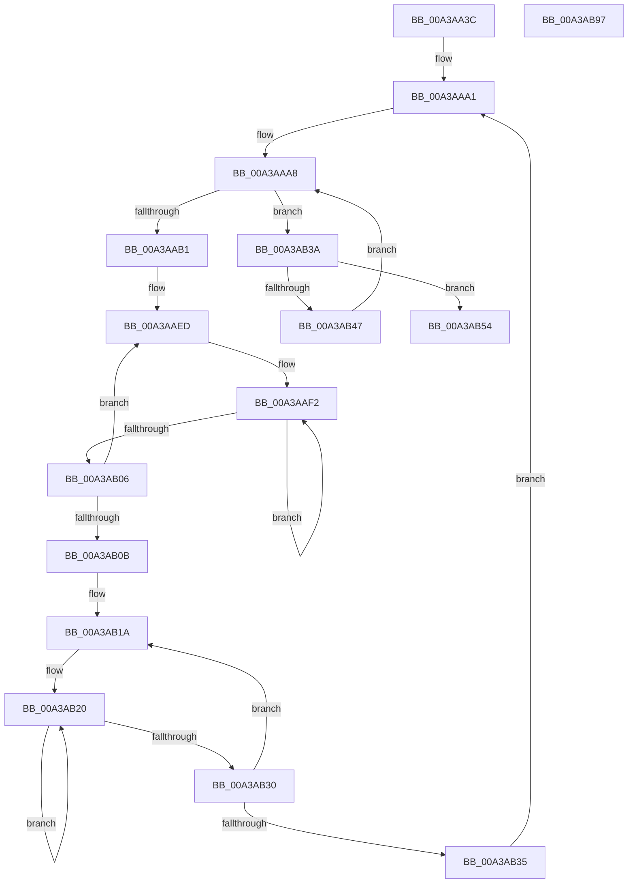

# PopEtIsrDpcQuery

- RVA: `0x00A3AA3C`–`0x00A3AB98` (길이 `348` bytes)
- VA: `0x0000000140A3AA3C`
- 실행 섹션: `PAGE`
- PDB 이름 있음: `예`; PDB Function 태그: `아니요`
- unwind 정보 RVA: `0x000AE194`
- 디코드: `88`개 명령, `348/348` bytes 표시
- 미해석 바이트: `0` (있으면 어셈블리에 `.byte`로 보존)

> 이 문서는 커널 이미지의 기계어와 PDB 기호를 분석해 생성했습니다. 4번과 5번은 함수 원형과 자료형을 바이너리 사용 방식에서 추정한 C 해석이며 원본 소스 복구 결과는 아닙니다.

## 1. Dependencies

- 직접 호출 지점: **3**; 고유 호출 대상: **2**
- 직접 호출자로 확인된 함수: **1**
- RIP 상대 이미지 참조: **5**

### Outgoing calls
- `0x00A3AA75` → [memset](../../text/6C/memset_function_006C6C40.md) (function, `0x006C6C40`)
- `0x00A3AA85` → [memset](../../text/6C/memset_function_006C6C40.md) (function, `0x006C6C40`)
- `0x00A3AB7A` → [_security_check_cookie](../../text/6A/_security_check_cookie_function_006AC640.md) (function, `0x006AC640`)

### Direct callers
- [PopEtProcessEnumSnapshotCallback](../91/PopEtProcessEnumSnapshotCallback_function_0091CCA0.md) at `0x0091CDA2`

### Static image references
- `0x00A3AA51` → RVA `0x00E0A740` (`.data`; read)
- `0x00A3AA8A` → RVA `0x00FC7128` (`ALMOSTRO`; read)
- `0x00A3AA91` → RVA `0x00000000` (`image boundary/outside`; read)
- `0x00A3AAA1` → RVA `0x00FC7120` (`ALMOSTRO`; read)
- `0x00A3AACE` → RVA `0x00F231B8` (`.data`; read)

## 2. Other-region calls and transfers

- 다른 실행 섹션으로 향하는 call: **3**
  - `0x00A3AA75` → [memset](../../text/6C/memset_function_006C6C40.md) (`PAGE` → `.text`)
  - `0x00A3AA85` → [memset](../../text/6C/memset_function_006C6C40.md) (`PAGE` → `.text`)
  - `0x00A3AB7A` → [_security_check_cookie](../../text/6A/_security_check_cookie_function_006AC640.md) (`PAGE` → `.text`)
- 별도 외부 분기/꼬리 이동을 확인하지 못했습니다.

## 3. Assembly (complete function range)

```asm
00A3AA3C  48 89 5C 24 18                  mov qword ptr [rsp + 0x18], rbx
00A3AA41  48 89 6C 24 20                  mov qword ptr [rsp + 0x20], rbp
00A3AA46  56                              push rsi
00A3AA47  57                              push rdi
00A3AA48  41 54                           push r12
00A3AA4A  48 81 EC 80 00 00 00            sub rsp, 0x80
00A3AA51  48 8B 05 E8 FC 3C 00            mov rax, qword ptr [rip + 0x3cfce8]
00A3AA58  48 33 C4                        xor rax, rsp
00A3AA5B  48 89 44 24 70                  mov qword ptr [rsp + 0x70], rax
00A3AA60  48 8B 99 68 06 00 00            mov rbx, qword ptr [rcx + 0x668]
00A3AA67  48 8B FA                        mov rdi, rdx
00A3AA6A  33 D2                           xor edx, edx
00A3AA6C  48 8D 4C 24 30                  lea rcx, [rsp + 0x30]
00A3AA71  44 8D 42 40                     lea r8d, [rdx + 0x40]
00A3AA75  E8 C6 C1 C8 FF                  call 0x1406c6c40
00A3AA7A  33 D2                           xor edx, edx
00A3AA7C  41 B8 B8 01 00 00               mov r8d, 0x1b8
00A3AA82  48 8B CF                        mov rcx, rdi
00A3AA85  E8 B6 C1 C8 FF                  call 0x1406c6c40
00A3AA8A  4C 8B 1D 97 C6 58 00            mov r11, qword ptr [rip + 0x58c697]
00A3AA91  4C 8D 25 68 55 5C FF            lea r12, [rip - 0xa3aa98]
00A3AA98  33 ED                           xor ebp, ebp
00A3AA9A  44 0F B7 C5                     movzx r8d, bp
00A3AA9E  8D 75 01                        lea esi, [rbp + 1]
00A3AAA1  0F B7 0D 78 C6 58 00            movzx ecx, word ptr [rip + 0x58c678]
00A3AAA8  4D 85 DB                        test r11, r11
00A3AAAB  0F 84 89 00 00 00               je 0x140a3ab3a
00A3AAB1  49 0F BC D3                     bsf rdx, r11
00A3AAB5  41 0F B7 C8                     movzx ecx, r8w
00A3AAB9  41 B9 04 00 00 00               mov r9d, 4
00A3AABF  C1 E1 06                        shl ecx, 6
00A3AAC2  0F B6 C2                        movzx eax, dl
00A3AAC5  49 0F B3 C3                     btr r11, rax
00A3AAC9  0F B6 C2                        movzx eax, dl
00A3AACC  03 C8                           add ecx, eax
00A3AACE  48 8B 05 E3 86 4E 00            mov rax, qword ptr [rip + 0x4e86e3]
00A3AAD5  8B 0C 88                        mov ecx, dword ptr [rax + rcx*4]
00A3AAD8  48 8D 44 24 30                  lea rax, [rsp + 0x30]
00A3AADD  4D 8B 94 CC 40 8C FC 00         mov r10, qword ptr [r12 + rcx*8 + 0xfc8c40]
00A3AAE5  48 8D 4C 24 30                  lea rcx, [rsp + 0x30]
00A3AAEA  4C 2B D0                        sub r10, rax
00A3AAED  BA 02 00 00 00                  mov edx, 2
00A3AAF2  49 8B 84 0A 80 87 00 00         mov rax, qword ptr [r10 + rcx + 0x8780]
00A3AAFA  48 89 01                        mov qword ptr [rcx], rax
00A3AAFD  48 83 C1 08                     add rcx, 8
00A3AB01  48 2B D6                        sub rdx, rsi
00A3AB04  75 EC                           jne 0x140a3aaf2
00A3AB06  4C 2B CE                        sub r9, rsi
00A3AB09  75 E2                           jne 0x140a3aaed
00A3AB0B  48 8D 54 24 30                  lea rdx, [rsp + 0x30]
00A3AB10  48 8B CF                        mov rcx, rdi
00A3AB13  48 2B D7                        sub rdx, rdi
00A3AB16  45 8D 51 04                     lea r10d, [r9 + 4]
00A3AB1A  41 B9 02 00 00 00               mov r9d, 2
00A3AB20  48 8B 04 0A                     mov rax, qword ptr [rdx + rcx]
00A3AB24  48 01 01                        add qword ptr [rcx], rax
00A3AB27  48 83 C1 08                     add rcx, 8
00A3AB2B  4C 2B CE                        sub r9, rsi
00A3AB2E  75 F0                           jne 0x140a3ab20
00A3AB30  4C 2B D6                        sub r10, rsi
00A3AB33  75 E5                           jne 0x140a3ab1a
00A3AB35  E9 67 FF FF FF                  jmp 0x140a3aaa1
00A3AB3A  66 44 03 C6                     add r8w, si
00A3AB3E  45 0F B7 C0                     movzx r8d, r8w
00A3AB42  44 3B C1                        cmp r8d, ecx
00A3AB45  73 0D                           jae 0x140a3ab54
00A3AB47  4F 8B 9C C4 28 71 FC 00         mov r11, qword ptr [r12 + r8*8 + 0xfc7128]
00A3AB4F  E9 54 FF FF FF                  jmp 0x140a3aaa8
00A3AB54  0F 10 07                        movups xmm0, xmmword ptr [rdi]
00A3AB57  0F 11 03                        movups xmmword ptr [rbx], xmm0
00A3AB5A  0F 10 4F 10                     movups xmm1, xmmword ptr [rdi + 0x10]
00A3AB5E  0F 11 4B 10                     movups xmmword ptr [rbx + 0x10], xmm1
00A3AB62  0F 10 47 20                     movups xmm0, xmmword ptr [rdi + 0x20]
00A3AB66  0F 11 43 20                     movups xmmword ptr [rbx + 0x20], xmm0
00A3AB6A  0F 10 4F 30                     movups xmm1, xmmword ptr [rdi + 0x30]
00A3AB6E  0F 11 4B 30                     movups xmmword ptr [rbx + 0x30], xmm1
00A3AB72  48 8B 4C 24 70                  mov rcx, qword ptr [rsp + 0x70]
00A3AB77  48 33 CC                        xor rcx, rsp
00A3AB7A  E8 C1 1A C7 FF                  call 0x1406ac640
00A3AB7F  4C 8D 9C 24 80 00 00 00         lea r11, [rsp + 0x80]
00A3AB87  49 8B 5B 30                     mov rbx, qword ptr [r11 + 0x30]
00A3AB8B  49 8B 6B 38                     mov rbp, qword ptr [r11 + 0x38]
00A3AB8F  49 8B E3                        mov rsp, r11
00A3AB92  41 5C                           pop r12
00A3AB94  5F                              pop rdi
00A3AB95  5E                              pop rsi
00A3AB96  C3                              ret
00A3AB97  CC                              int3
```

## 4. C-style interpretation (structured pseudocode)

```c
__int64 __fastcall PopEtIsrDpcQuery(__int64 a1, __int64 a2)
{
    __int64 result;
    __int64 v_r10;
    __int64 v_rbp;
    __int64 v_rsp;
    unsigned __int64 v_stack_m18;
    unsigned __int64 v_stack_m28;
    unsigned __int64 v_stack_m68;
    unsigned __int64 v_stack_p18;
    unsigned __int64 v_stack_p20;

    v_stack_p18 = v_rbx;
    v_stack_p20 = v_rbp;
    v_rsp = (v_rsp) - (128);
    result = (*(unsigned __int64 *)(v_rip + 3996904)) ^ (v_rsp);
    v_stack_m28 = result;
    a2 = 0;
    result = memset(v_stack_m68, a2, a2 + 64, a4);
    a2 = 0;
    result = memset(0, a2, 440, a4);
    v_rbp = 0;
loc_00A3AAA1:
loc_00A3AAA8:
    if (*(unsigned __int64 *)(v_rip + 5818007) == 0) goto loc_00A3AB3A;
    a1 = (unsigned int)((0) << (6));
    a1 = (unsigned int)((a1) + (0));
    v_r10 = (*(unsigned __int64 *)(v_rip - 10726040 + (unsigned int)(*(unsigned int *)(*(unsigned __int64 *)(v_rip + 5146339) + a1 * 4)) * 8 + 16550976)) - (v_stack_m68);
loc_00A3AAED:
loc_00A3AAF2:
    *(unsigned __int64 *)(v_stack_m68) = *(unsigned __int64 *)(v_r10 + v_stack_m68 * 1 + 34688);
    a1 = (v_stack_m68) + (8);
    a2 = (2) - (v_rbp + 1);
    if (condition_is_not_equal) goto loc_00A3AAF2;
    a4 = (4) - (v_rbp + 1);
    if (condition_is_not_equal) goto loc_00A3AAED;
    a2 = (v_stack_m68) - (a2);
loc_00A3AB1A:
loc_00A3AB20:
    a1 = (a2) + (8);
    a4 = (2) - (v_rbp + 1);
    if (condition_is_not_equal) goto loc_00A3AB20;
    v_r10 = (a4 + 4) - (v_rbp + 1);
    if (condition_is_not_equal) goto loc_00A3AB1A;
    goto loc_00A3AAA1;
loc_00A3AB3A:
    a3 = (unsigned __int16)((0) + ((unsigned __int16)(v_rbp + 1)));
    if (((unsigned int)((unsigned __int16)(a3))) >= ((unsigned int)(a1))) goto loc_00A3AB54;
    goto loc_00A3AAA8;
loc_00A3AB54:
    *(unsigned __int64 *)(*(unsigned __int64 *)(a1 + 1640)) = v_xmm0;
    *(unsigned __int64 *)(*(unsigned __int64 *)(a1 + 1640) + 16) = v_xmm1;
    *(unsigned __int64 *)(*(unsigned __int64 *)(a1 + 1640) + 32) = v_xmm0;
    *(unsigned __int64 *)(*(unsigned __int64 *)(a1 + 1640) + 48) = v_xmm1;
    a1 = (v_stack_m28) ^ (v_rsp);
    result = _security_check_cookie(a1, a2, (unsigned __int16)(a3), a4);
    return result;
}
```

## 5. (Beta) C Style

```c
int64_t PopEtIsrDpcQuery(void *Arg1, void *Arg2)
{
    uint8_t *arg1 = (uint8_t *)Arg1;
    uint8_t *arg2 = (uint8_t *)Arg2;

    int64_t result;
    int64_t local_r10;
    int64_t local_rbp;
    int64_t local_rsp;
    uint64_t v_stack_m18;
    uint64_t v_stack_m28;
    uint64_t v_stack_m68;
    uint64_t v_stack_p18;
    uint64_t v_stack_p20;

    v_stack_p18 = local_rbx;
    v_stack_p20 = local_rbp;
    local_rsp = (local_rsp) - (128);
    result = (*(uint64_t *)(v_rip + 0x3CFCE8)) ^ (local_rsp);
    v_stack_m28 = result;
    Arg2 = 0;
    result = memset(v_stack_m68, Arg2, Arg2 + 64, a4);
    Arg2 = 0;
    result = memset(0, Arg2, 440, a4);
    local_rbp = 0;
loc_00A3AAA1:
loc_00A3AAA8:
    if (*(uint64_t *)(v_rip + 0x58C697) == 0) goto loc_00A3AB3A;
    Arg1 = (uint32_t)((0) << (6));
    Arg1 = (uint32_t)((Arg1) + (0));
    local_r10 = (*(uint64_t *)(v_rip - 0xA3AA98 + (uint32_t)(*(uint32_t *)(*(uint64_t *)(v_rip + 0x4E86E3) + arg1 * 4)) * 8 + 0xFC8C40)) - (v_stack_m68);
loc_00A3AAED:
loc_00A3AAF2:
    *(uint64_t *)(v_stack_m68) = *(uint64_t *)(local_r10 + v_stack_m68 * 1 + 0x8780);
    Arg1 = (v_stack_m68) + (8);
    Arg2 = (2) - (local_rbp + 1);
    if (condition_is_not_equal) goto loc_00A3AAF2;
    a4 = (4) - (local_rbp + 1);
    if (condition_is_not_equal) goto loc_00A3AAED;
    Arg2 = (v_stack_m68) - (Arg2);
loc_00A3AB1A:
loc_00A3AB20:
    Arg1 = (Arg2) + (8);
    a4 = (2) - (local_rbp + 1);
    if (condition_is_not_equal) goto loc_00A3AB20;
    local_r10 = (a4 + 4) - (local_rbp + 1);
    if (condition_is_not_equal) goto loc_00A3AB1A;
    goto loc_00A3AAA1;
loc_00A3AB3A:
    a3 = (uint16_t)((0) + ((uint16_t)(local_rbp + 1)));
    if (((uint32_t)((uint16_t)(a3))) >= ((uint32_t)(Arg1))) goto loc_00A3AB54;
    goto loc_00A3AAA8;
loc_00A3AB54:
    *(uint64_t *)(*(uint64_t *)(arg1 + 0x668)) = v_xmm0;
    *(uint64_t *)(*(uint64_t *)(arg1 + 0x668) + 0x10) = v_xmm1;
    *(uint64_t *)(*(uint64_t *)(arg1 + 0x668) + 0x20) = v_xmm0;
    *(uint64_t *)(*(uint64_t *)(arg1 + 0x668) + 0x30) = v_xmm1;
    Arg1 = (v_stack_m28) ^ (local_rsp);
    result = _security_check_cookie(Arg1, Arg2, (uint16_t)(a3), a4);
    return result;
}
```

### 관측된 메모리 오프셋

구조체 형식이 확인되지 않은 접근은 인자 기준의 오프셋으로만 기록했습니다.

| 기준 인자 | 오프셋 표현 | 폭 (bit) | 접근 |
|---|---:|---:|---|
| `Arg1` | `+ 0x668` | `64` | `R` |
| `Arg2` | `+ 0x0` | `64` | `R/W` |
| `Arg2` | `+ 0x0` | `128` | `R` |
| `Arg2` | `+ 0x10` | `128` | `R` |
| `Arg2` | `+ 0x20` | `128` | `R` |
| `Arg2` | `+ 0x30` | `128` | `R` |

## 6. Execution-region graph

[열기: 2D/3D 그래프와 함수 탐색 컨트롤 패널](../../../control-panel.html?section=page&rva=0x00A3AA3C&view=graph)

- 2D 그래프는 위에서 아래로 흐르고, 3D 그래프는 빈 공간을 드래그해 회전합니다. Shift+드래그는 이동, 휠은 확대·축소, 함수 노드 선택은 대상 보고서 이동입니다.

### Static fallback


