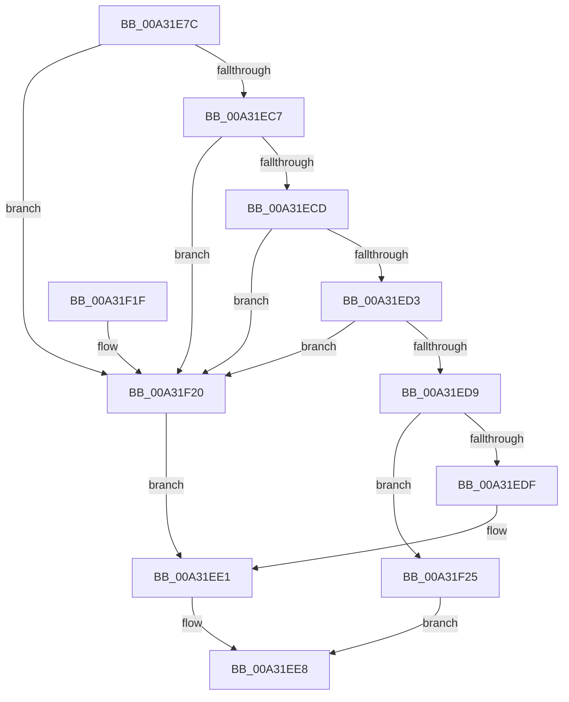

# PopExecuteSystemIdleAction

- RVA: `0x00A31E7C`–`0x00A31F2C` (길이 `176` bytes)
- VA: `0x0000000140A31E7C`
- 실행 섹션: `PAGE`
- PDB 이름 있음: `예`; PDB Function 태그: `아니요`
- unwind 정보 RVA: `0x000AD2A0`
- 디코드: `51`개 명령, `176/176` bytes 표시
- 미해석 바이트: `0` (있으면 어셈블리에 `.byte`로 보존)

> 이 문서는 커널 이미지의 기계어와 PDB 기호를 분석해 생성했습니다. 4번과 5번은 함수 원형과 자료형을 바이너리 사용 방식에서 추정한 C 해석이며 원본 소스 복구 결과는 아닙니다.

## 1. Dependencies

- 직접 호출 지점: **2**; 고유 호출 대상: **2**
- 직접 호출자로 확인된 함수: **1**
- RIP 상대 이미지 참조: **0**

### Outgoing calls
- `0x00A31EE1` → [PopUpdatePdcSystemIdleState](PopUpdatePdcSystemIdleState_function_00A320B4.md) (function, `0x00A320B4`)
- `0x00A31EFD` → [PopDiagTraceSystemIdleAction](PopDiagTraceSystemIdleAction_function_00A31F34.md) (function, `0x00A31F34`)

### Direct callers
- [PopSystemIdleWorker](PopSystemIdleWorker_function_00A31A60.md) at `0x00A31B19`

### Static image references
- 디코드된 RIP-relative 메모리 참조가 없습니다.

## 2. Other-region calls and transfers

- 다른 실행 섹션으로 향하는 call: **0**
- 별도 외부 분기/꼬리 이동을 확인하지 못했습니다.

## 3. Assembly (complete function range)

```asm
00A31E7C  48 8B C4                        mov rax, rsp
00A31E7F  48 89 58 08                     mov qword ptr [rax + 8], rbx
00A31E83  48 89 68 10                     mov qword ptr [rax + 0x10], rbp
00A31E87  48 89 70 18                     mov qword ptr [rax + 0x18], rsi
00A31E8B  48 89 78 20                     mov qword ptr [rax + 0x20], rdi
00A31E8F  41 56                           push r14
00A31E91  48 83 EC 20                     sub rsp, 0x20
00A31E95  49 B9 08 00 00 00 80 F7 FF FF   movabs r9, 0xfffff78000000008
00A31E9F  48 B8 BD 42 7A E5 D5 94 BF D6   movabs rax, 0xd6bf94d5e57a42bd
00A31EA9  40 8A F2                        mov sil, dl
00A31EAC  49 8B F8                        mov rdi, r8
00A31EAF  8B E9                           mov ebp, ecx
00A31EB1  4D 8B 09                        mov r9, qword ptr [r9]
00A31EB4  49 F7 E1                        mul r9
00A31EB7  44 8B C9                        mov r9d, ecx
00A31EBA  4C 8B F2                        mov r14, rdx
00A31EBD  49 C1 EE 17                     shr r14, 0x17
00A31EC1  41 83 E9 01                     sub r9d, 1
00A31EC5  74 59                           je 0x140a31f20
00A31EC7  41 83 E9 01                     sub r9d, 1
00A31ECB  74 53                           je 0x140a31f20
00A31ECD  41 83 E9 01                     sub r9d, 1
00A31ED1  74 4D                           je 0x140a31f20
00A31ED3  41 83 E9 01                     sub r9d, 1
00A31ED7  74 47                           je 0x140a31f20
00A31ED9  41 83 F9 01                     cmp r9d, 1
00A31EDD  75 46                           jne 0x140a31f25
00A31EDF  33 C9                           xor ecx, ecx
00A31EE1  E8 CE 01 00 00                  call 0x140a320b4
00A31EE6  8B D8                           mov ebx, eax
00A31EE8  44 8B C3                        mov r8d, ebx
00A31EEB  4C 89 37                        mov qword ptr [rdi], r14
00A31EEE  40 8A D6                        mov dl, sil
00A31EF1  89 6F 08                        mov dword ptr [rdi + 8], ebp
00A31EF4  8B CD                           mov ecx, ebp
00A31EF6  40 88 77 0C                     mov byte ptr [rdi + 0xc], sil
00A31EFA  89 5F 10                        mov dword ptr [rdi + 0x10], ebx
00A31EFD  E8 32 00 00 00                  call 0x140a31f34
00A31F02  48 8B 6C 24 38                  mov rbp, qword ptr [rsp + 0x38]
00A31F07  8B C3                           mov eax, ebx
00A31F09  48 8B 5C 24 30                  mov rbx, qword ptr [rsp + 0x30]
00A31F0E  48 8B 74 24 40                  mov rsi, qword ptr [rsp + 0x40]
00A31F13  48 8B 7C 24 48                  mov rdi, qword ptr [rsp + 0x48]
00A31F18  48 83 C4 20                     add rsp, 0x20
00A31F1C  41 5E                           pop r14
00A31F1E  C3                              ret
00A31F1F  CC                              int3
00A31F20  40 8A CE                        mov cl, sil
00A31F23  EB BC                           jmp 0x140a31ee1
00A31F25  BB 0D 00 00 C0                  mov ebx, 0xc000000d
00A31F2A  EB BC                           jmp 0x140a31ee8
```

## 4. C-style interpretation (structured pseudocode)

```c
__int64 __fastcall PopExecuteSystemIdleAction(int a1, __int64 a2, __int64 a3)
{
    __int64 result;
    __int64 v_r14;
    __int64 v_rsp;
    unsigned __int64 v_stack_p10;
    unsigned __int64 v_stack_p18;
    unsigned __int64 v_stack_p20;
    unsigned __int64 v_stack_p8;

    *(unsigned __int64 *)(v_rsp + 8) = v_rbx;
    *(unsigned __int64 *)(v_rsp + 16) = v_rbp;
    *(unsigned __int64 *)(v_rsp + 24) = v_rsi;
    *(unsigned __int64 *)(v_rsp + 32) = v_rdi;
    v_rsp = (v_rsp) - (32);
    v_r14 = (a2) >> (23);
    a4 = (unsigned int)(((unsigned int)(a1)) - (1));
    if (condition_is_equal) goto loc_00A31F20;
    a4 = (unsigned int)((a4) - (1));
    if (condition_is_equal) goto loc_00A31F20;
    a4 = (unsigned int)((a4) - (1));
    if (condition_is_equal) goto loc_00A31F20;
    a4 = (unsigned int)((a4) - (1));
    if (condition_is_equal) goto loc_00A31F20;
    if (((unsigned int)(a4)) != 1) goto loc_00A31F25;
    a1 = 0;
loc_00A31EE1:
    result = PopUpdatePdcSystemIdleState(a1, a2, a3, a4);
loc_00A31EE8:
    *(unsigned __int64 *)(a3) = v_r14;
    *(unsigned int *)(a3 + 8) = (unsigned int)((unsigned int)(a1));
    *(unsigned __int8 *)(a3 + 12) = (unsigned __int8)((unsigned __int8)(a2));
    *(unsigned int *)(a3 + 16) = (unsigned int)((unsigned int)((unsigned int)(result)));
    result = PopDiagTraceSystemIdleAction((unsigned int)((unsigned int)((unsigned int)(a1))), (unsigned __int8)((unsigned __int8)(a2)), (unsigned int)((unsigned int)((unsigned int)((unsigned int)(result)))), a4);
    v_rsp = (v_rsp) + (32);
    return (unsigned int)((unsigned int)((unsigned int)((unsigned int)(result))));
loc_00A31F20:
    goto loc_00A31EE1;
loc_00A31F25:
    goto loc_00A31EE8;
}
```

## 5. (Beta) C Style

```c
int64_t PopExecuteSystemIdleAction(int32_t Arg1, int64_t Arg2, void *Arg3)
{
    uint8_t *arg3 = (uint8_t *)Arg3;

    int64_t result;
    int64_t local_r14;
    int64_t local_rsp;
    uint64_t v_stack_p10;
    uint64_t v_stack_p18;
    uint64_t v_stack_p20;
    uint64_t v_stack_p8;

    *(uint64_t *)(local_rsp + 0x8) = local_rbx;
    *(uint64_t *)(local_rsp + 0x10) = local_rbp;
    *(uint64_t *)(local_rsp + 0x18) = local_rsi;
    *(uint64_t *)(local_rsp + 0x20) = local_rdi;
    local_rsp = (local_rsp) - (32);
    local_r14 = (Arg2) >> (23);
    a4 = (uint32_t)(((uint32_t)(Arg1)) - (1));
    if (condition_is_equal) goto loc_00A31F20;
    a4 = (uint32_t)((a4) - (1));
    if (condition_is_equal) goto loc_00A31F20;
    a4 = (uint32_t)((a4) - (1));
    if (condition_is_equal) goto loc_00A31F20;
    a4 = (uint32_t)((a4) - (1));
    if (condition_is_equal) goto loc_00A31F20;
    if (((uint32_t)(a4)) != 1) goto loc_00A31F25;
    Arg1 = 0;
loc_00A31EE1:
    result = PopUpdatePdcSystemIdleState(Arg1, Arg2, Arg3, a4);
loc_00A31EE8:
    *(uint64_t *)(arg3) = local_r14;
    *(uint32_t *)(arg3 + 0x8) = (uint32_t)((uint32_t)(Arg1));
    *(uint8_t *)(arg3 + 0xC) = (uint8_t)((uint8_t)(Arg2));
    *(uint32_t *)(arg3 + 0x10) = (uint32_t)((uint32_t)((uint32_t)(result)));
    result = PopDiagTraceSystemIdleAction((uint32_t)((uint32_t)((uint32_t)(Arg1))), (uint8_t)((uint8_t)(Arg2)), (uint32_t)((uint32_t)((uint32_t)((uint32_t)(result)))), a4);
    local_rsp = (local_rsp) + (32);
    return (uint32_t)((uint32_t)((uint32_t)((uint32_t)(result))));
loc_00A31F20:
    goto loc_00A31EE1;
loc_00A31F25:
    goto loc_00A31EE8;
}
```

### 관측된 메모리 오프셋

구조체 형식이 확인되지 않은 접근은 인자 기준의 오프셋으로만 기록했습니다.

| 기준 인자 | 오프셋 표현 | 폭 (bit) | 접근 |
|---|---:|---:|---|
| `Arg3` | `+ 0x0` | `64` | `W` |
| `Arg3` | `+ 0x8` | `32` | `W` |
| `Arg3` | `+ 0xC` | `8` | `W` |
| `Arg3` | `+ 0x10` | `32` | `W` |

## 6. Execution-region graph

[열기: 2D/3D 그래프와 함수 탐색 컨트롤 패널](../../../control-panel.html?section=page&rva=0x00A31E7C&view=graph)

- 2D 그래프는 위에서 아래로 흐르고, 3D 그래프는 빈 공간을 드래그해 회전합니다. Shift+드래그는 이동, 휠은 확대·축소, 함수 노드 선택은 대상 보고서 이동입니다.

### Static fallback


