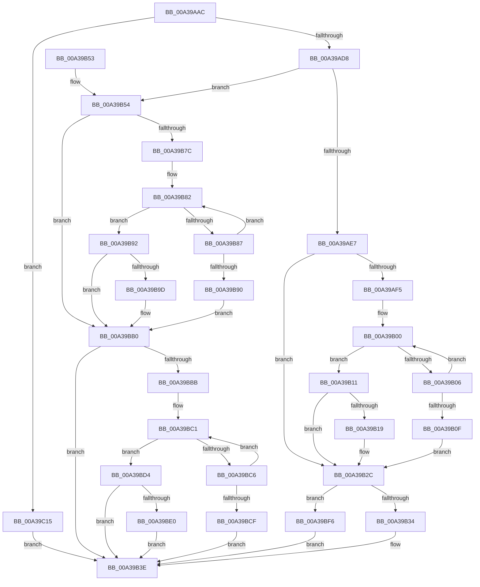

# PopGetCallerContextFromBuffer

- RVA: `0x00A39AAC`–`0x00A39C21` (길이 `373` bytes)
- VA: `0x0000000140A39AAC`
- 실행 섹션: `PAGE`
- PDB 이름 있음: `예`; PDB Function 태그: `아니요`
- unwind 정보 RVA: `0x000ADF68`
- 디코드: `111`개 명령, `373/373` bytes 표시
- 미해석 바이트: `0` (있으면 어셈블리에 `.byte`로 보존)

> 이 문서는 커널 이미지의 기계어와 PDB 기호를 분석해 생성했습니다. 4번과 5번은 함수 원형과 자료형을 바이너리 사용 방식에서 추정한 C 해석이며 원본 소스 복구 결과는 아닙니다.

## 1. Dependencies

- 직접 호출 지점: **2**; 고유 호출 대상: **2**
- 직접 호출자로 확인된 함수: **2**
- RIP 상대 이미지 참조: **1**

### Outgoing calls
- `0x00A39B39` → [RtlInitUnicodeString](../../text/42/RtlInitUnicodeString_function_0042A780.md) (function, `0x0042A780`)
- `0x00A39C04` → [RtlUnicodeStringPrintf](../../text/48/RtlUnicodeStringPrintf_function_0048B984.md) (function, `0x0048B984`)

### Direct callers
- [PopQueryMostRecentWakeSourceInfo](../75/PopQueryMostRecentWakeSourceInfo_function_0075C630.md) at `0x0075C84C`
- [PopDiagTracePowerRequestCreate](PopDiagTracePowerRequestCreate_function_00A38EEC.md) at `0x00A39023`

### Static image references
- `0x00A39BFA` → RVA `0x00AFCAE0` (` ?? ::NNGAKEGL::`string'`; read)

## 2. Other-region calls and transfers

- 다른 실행 섹션으로 향하는 call: **2**
  - `0x00A39B39` → [RtlInitUnicodeString](../../text/42/RtlInitUnicodeString_function_0042A780.md) (`PAGE` → `.text`)
  - `0x00A39C04` → [RtlUnicodeStringPrintf](../../text/48/RtlUnicodeStringPrintf_function_0048B984.md) (`PAGE` → `.text`)
- 별도 외부 분기/꼬리 이동을 확인하지 못했습니다.

## 3. Assembly (complete function range)

```asm
00A39AAC  48 89 5C 24 08                  mov qword ptr [rsp + 8], rbx
00A39AB1  48 89 6C 24 10                  mov qword ptr [rsp + 0x10], rbp
00A39AB6  48 89 74 24 18                  mov qword ptr [rsp + 0x18], rsi
00A39ABB  57                              push rdi
00A39ABC  48 83 EC 20                     sub rsp, 0x20
00A39AC0  33 ED                           xor ebp, ebp
00A39AC2  0F 57 C0                        xorps xmm0, xmm0
00A39AC5  49 8B D9                        mov rbx, r9
00A39AC8  48 8B F2                        mov rsi, rdx
00A39ACB  41 0F 11 00                     movups xmmword ptr [r8], xmm0
00A39ACF  48 85 C9                        test rcx, rcx
00A39AD2  0F 84 3D 01 00 00               je 0x140a39c15
00A39AD8  48 8B 51 10                     mov rdx, qword ptr [rcx + 0x10]
00A39ADC  8B 79 08                        mov edi, dword ptr [rcx + 8]
00A39ADF  48 8D 04 11                     lea rax, [rcx + rdx]
00A39AE3  85 FF                           test edi, edi
00A39AE5  74 6D                           je 0x140a39b54
00A39AE7  48 F7 DA                        neg rdx
00A39AEA  8D 55 02                        lea edx, [rbp + 2]
00A39AED  4D 1B C9                        sbb r9, r9
00A39AF0  4C 23 C8                        and r9, rax
00A39AF3  74 37                           je 0x140a39b2c
00A39AF5  B8 FF 7F 00 00                  mov eax, 0x7fff
00A39AFA  4D 8B D1                        mov r10, r9
00A39AFD  44 8B D8                        mov r11d, eax
00A39B00  66 41 39 2A                     cmp word ptr [r10], bp
00A39B04  74 0B                           je 0x140a39b11
00A39B06  4C 03 D2                        add r10, rdx
00A39B09  49 83 EB 01                     sub r11, 1
00A39B0D  75 F1                           jne 0x140a39b00
00A39B0F  EB 1B                           jmp 0x140a39b2c
00A39B11  49 2B C3                        sub rax, r11
00A39B14  4D 85 C0                        test r8, r8
00A39B17  74 13                           je 0x140a39b2c
00A39B19  66 03 C0                        add ax, ax
00A39B1C  4D 89 48 08                     mov qword ptr [r8 + 8], r9
00A39B20  66 41 89 00                     mov word ptr [r8], ax
00A39B24  66 03 C2                        add ax, dx
00A39B27  66 41 89 40 02                  mov word ptr [r8 + 2], ax
00A39B2C  3B FA                           cmp edi, edx
00A39B2E  0F 84 C2 00 00 00               je 0x140a39bf6
00A39B34  33 D2                           xor edx, edx
00A39B36  48 8B CB                        mov rcx, rbx
00A39B39  E8 42 0C 9F FF                  call 0x14042a780
00A39B3E  48 8B 5C 24 30                  mov rbx, qword ptr [rsp + 0x30]
00A39B43  48 8B 6C 24 38                  mov rbp, qword ptr [rsp + 0x38]
00A39B48  48 8B 74 24 40                  mov rsi, qword ptr [rsp + 0x40]
00A39B4D  48 83 C4 20                     add rsp, 0x20
00A39B51  5F                              pop rdi
00A39B52  C3                              ret
00A39B53  CC                              int3
00A39B54  48 F7 DA                        neg rdx
00A39B57  BA 02 00 00 00                  mov edx, 2
00A39B5C  4D 1B DB                        sbb r11, r11
00A39B5F  4C 23 D8                        and r11, rax
00A39B62  48 8B 41 18                     mov rax, qword ptr [rcx + 0x18]
00A39B66  48 03 C8                        add rcx, rax
00A39B69  48 F7 D8                        neg rax
00A39B6C  B8 FF 7F 00 00                  mov eax, 0x7fff
00A39B71  4D 1B D2                        sbb r10, r10
00A39B74  4C 23 D1                        and r10, rcx
00A39B77  4D 85 DB                        test r11, r11
00A39B7A  74 34                           je 0x140a39bb0
00A39B7C  44 8B C8                        mov r9d, eax
00A39B7F  49 8B CB                        mov rcx, r11
00A39B82  66 39 29                        cmp word ptr [rcx], bp
00A39B85  74 0B                           je 0x140a39b92
00A39B87  48 03 CA                        add rcx, rdx
00A39B8A  49 83 E9 01                     sub r9, 1
00A39B8E  75 F2                           jne 0x140a39b82
00A39B90  EB 1E                           jmp 0x140a39bb0
00A39B92  48 8B C8                        mov rcx, rax
00A39B95  49 2B C9                        sub rcx, r9
00A39B98  4D 85 C0                        test r8, r8
00A39B9B  74 13                           je 0x140a39bb0
00A39B9D  66 03 C9                        add cx, cx
00A39BA0  4D 89 58 08                     mov qword ptr [r8 + 8], r11
00A39BA4  66 41 89 08                     mov word ptr [r8], cx
00A39BA8  66 03 CA                        add cx, dx
00A39BAB  66 41 89 48 02                  mov word ptr [r8 + 2], cx
00A39BB0  0F 57 C0                        xorps xmm0, xmm0
00A39BB3  0F 11 03                        movups xmmword ptr [rbx], xmm0
00A39BB6  4D 85 D2                        test r10, r10
00A39BB9  74 83                           je 0x140a39b3e
00A39BBB  4C 8B C0                        mov r8, rax
00A39BBE  49 8B CA                        mov rcx, r10
00A39BC1  66 39 29                        cmp word ptr [rcx], bp
00A39BC4  74 0E                           je 0x140a39bd4
00A39BC6  48 03 CA                        add rcx, rdx
00A39BC9  49 83 E8 01                     sub r8, 1
00A39BCD  75 F2                           jne 0x140a39bc1
00A39BCF  E9 6A FF FF FF                  jmp 0x140a39b3e
00A39BD4  49 2B C0                        sub rax, r8
00A39BD7  48 85 DB                        test rbx, rbx
00A39BDA  0F 84 5E FF FF FF               je 0x140a39b3e
00A39BE0  66 03 C0                        add ax, ax
00A39BE3  4C 89 53 08                     mov qword ptr [rbx + 8], r10
00A39BE7  66 89 03                        mov word ptr [rbx], ax
00A39BEA  66 03 C2                        add ax, dx
00A39BED  66 89 43 02                     mov word ptr [rbx + 2], ax
00A39BF1  E9 48 FF FF FF                  jmp 0x140a39b3e
00A39BF6  44 8B 41 1C                     mov r8d, dword ptr [rcx + 0x1c]
00A39BFA  48 8D 15 DF 2E 0C 00            lea rdx, [rip + 0xc2edf]
00A39C01  48 8B CE                        mov rcx, rsi
00A39C04  E8 7B 1D A5 FF                  call 0x14048b984
00A39C09  0F 10 06                        movups xmm0, xmmword ptr [rsi]
00A39C0C  F3 0F 7F 03                     movdqu xmmword ptr [rbx], xmm0
00A39C10  E9 29 FF FF FF                  jmp 0x140a39b3e
00A39C15  0F 57 C9                        xorps xmm1, xmm1
00A39C18  41 0F 11 09                     movups xmmword ptr [r9], xmm1
00A39C1C  E9 1D FF FF FF                  jmp 0x140a39b3e
```

## 4. C-style interpretation (structured pseudocode)

```c
__int64 __fastcall PopGetCallerContextFromBuffer(__int64 a1, __int64 a2, __int64 a3, __int64 a4)
{
    __int64 result;
    __int64 v_r10;
    __int64 v_r11;
    __int64 v_rbp;
    __int64 v_rsp;
    unsigned __int64 v_stack_p10;
    unsigned __int64 v_stack_p18;
    unsigned __int64 v_stack_p8;

    v_stack_p8 = v_rbx;
    v_stack_p10 = v_rbp;
    v_stack_p18 = v_rsi;
    v_rsp = (v_rsp) - (32);
    v_rbp = 0;
    *(unsigned __int64 *)(a3) = v_xmm0;
    if (a1 == 0) goto loc_00A39C15;
    if ((unsigned int)((unsigned int)(*(unsigned int *)(a1 + 8))) == 0) goto loc_00A39B54;
    a2 = -(*(unsigned __int64 *)(a1 + 16));
    a4 = (a4) & (a1 + *(unsigned __int64 *)(a1 + 16) * 1);
    if (condition_is_equal) goto loc_00A39B2C;
loc_00A39B00:
    if ((*(unsigned __int16 *)(a4)) == 0) goto loc_00A39B11;
    v_r10 = (a4) + (v_rbp + 2);
    v_r11 = ((unsigned int)((unsigned int)((unsigned int)(0x7FFFULL)))) - (1);
    if (condition_is_not_equal) goto loc_00A39B00;
    goto loc_00A39B2C;
loc_00A39B11:
    result = ((unsigned int)(0x7FFFULL)) - (v_r11);
    if (a3 != 0) {
        result = (unsigned __int16)((result) + ((unsigned __int16)(result)));
        *(unsigned __int64 *)(a3 + 8) = a4;
        *(unsigned __int16 *)(a3) = (unsigned __int16)(result);
        result = (unsigned __int16)((result) + ((unsigned __int16)(v_rbp + 2)));
        *(unsigned __int16 *)(a3 + 2) = (unsigned __int16)(result);
    }
    if (((unsigned int)((unsigned int)(*(unsigned int *)(a1 + 8)))) == ((unsigned int)(v_rbp + 2))) goto loc_00A39BF6;
    a2 = 0;
    result = RtlInitUnicodeString(a4, a2, a3, a4);
loc_00A39B3E:
    v_rsp = (v_rsp) + (32);
    return result;
loc_00A39B54:
    a2 = -(a2);
    v_r11 = (v_r11) & (result);
    a1 = (a4) + (*(unsigned __int64 *)(a4 + 24));
    result = -(*(unsigned __int64 *)(a4 + 24));
    v_r10 = (v_r10) & (a1);
    if (v_r11 == 0) goto loc_00A39BB0;
loc_00A39B82:
    if ((*(unsigned __int16 *)(v_r11)) == ((unsigned __int16)(v_stack_p10))) goto loc_00A39B92;
    a1 = (v_r11) + (2);
    a4 = ((unsigned int)((unsigned int)((unsigned int)(0x7FFFULL)))) - (1);
    if (condition_is_not_equal) goto loc_00A39B82;
    goto loc_00A39BB0;
loc_00A39B92:
    a1 = ((unsigned int)(0x7FFFULL)) - (a4);
    if (a3 != 0) {
        a1 = (unsigned __int16)((a1) + ((unsigned __int16)(a1)));
        *(unsigned __int64 *)(a3 + 8) = v_r11;
        *(unsigned __int16 *)(a3) = (unsigned __int16)(a1);
        a1 = (unsigned __int16)((a1) + (2));
        *(unsigned __int16 *)(a3 + 2) = (unsigned __int16)(a1);
    }
    *(unsigned __int64 *)(v_stack_p8) = v_xmm0;
    if (v_r10 == 0) goto loc_00A39B3E;
loc_00A39BC1:
    if ((*(unsigned __int16 *)(v_r10)) == ((unsigned __int16)(v_stack_p10))) goto loc_00A39BD4;
    a1 = (v_r10) + (2);
    a3 = ((unsigned int)(0x7FFFULL)) - (1);
    if (condition_is_not_equal) goto loc_00A39BC1;
    goto loc_00A39B3E;
loc_00A39BD4:
    result = ((unsigned int)(0x7FFFULL)) - (a3);
    if (v_stack_p8 == 0) goto loc_00A39B3E;
    result = (unsigned __int16)((result) + ((unsigned __int16)(result)));
    *(unsigned __int64 *)(v_stack_p8 + 8) = v_r10;
    *(unsigned __int16 *)(v_stack_p8) = (unsigned __int16)(result);
    result = (unsigned __int16)((result) + (2));
    *(unsigned __int16 *)(v_stack_p8 + 2) = (unsigned __int16)(result);
    goto loc_00A39B3E;
loc_00A39BF6:
    result = RtlUnicodeStringPrintf(v_stack_p18, v_rip + 798431, (unsigned int)(*(unsigned int *)(a1 + 28)), a4);
    *(unsigned __int64 *)(v_stack_p8) = v_xmm0;
    goto loc_00A39B3E;
loc_00A39C15:
    *(unsigned __int64 *)(a4) = v_xmm1;
    goto loc_00A39B3E;
}
```

## 5. (Beta) C Style

```c
int64_t PopGetCallerContextFromBuffer(int64_t Arg1, void *Arg2, void *Arg3, void *Arg4)
{
    uint8_t *arg2 = (uint8_t *)Arg2;
    uint8_t *arg3 = (uint8_t *)Arg3;
    uint8_t *arg4 = (uint8_t *)Arg4;

    int64_t result;
    int64_t local_r10;
    int64_t local_r11;
    int64_t local_rbp;
    int64_t local_rsp;
    uint64_t v_stack_p10;
    uint64_t v_stack_p18;
    uint64_t v_stack_p8;

    v_stack_p8 = local_rbx;
    v_stack_p10 = local_rbp;
    v_stack_p18 = local_rsi;
    local_rsp = (local_rsp) - (32);
    local_rbp = 0;
    *(uint64_t *)(arg3) = v_xmm0;
    if (Arg1 == 0) goto loc_00A39C15;
    if ((uint32_t)((uint32_t)(*(uint32_t *)(Arg1 + 0x8))) == 0) goto loc_00A39B54;
    Arg2 = -(*(uint64_t *)(Arg1 + 0x10));
    Arg4 = (Arg4) & (Arg1 + *(uint64_t *)(Arg1 + 0x10) * 1);
    if (condition_is_equal) goto loc_00A39B2C;
loc_00A39B00:
    if ((*(uint16_t *)(arg4)) == 0) goto loc_00A39B11;
    local_r10 = (Arg4) + (local_rbp + 2);
    local_r11 = ((uint32_t)((uint32_t)((uint32_t)(0x7FFFULL)))) - (1);
    if (condition_is_not_equal) goto loc_00A39B00;
    goto loc_00A39B2C;
loc_00A39B11:
    result = ((uint32_t)(0x7FFFULL)) - (local_r11);
    if (Arg3 != NULL) {
        result = (uint16_t)((result) + ((uint16_t)(result)));
        *(void **)(arg3 + 0x8) = Arg4;
        *(uint16_t *)(arg3) = (uint16_t)(result);
        result = (uint16_t)((result) + ((uint16_t)(local_rbp + 2)));
        *(uint16_t *)(arg3 + 0x2) = (uint16_t)(result);
    }
    if (((uint32_t)((uint32_t)(*(uint32_t *)(Arg1 + 0x8)))) == ((uint32_t)(local_rbp + 2))) goto loc_00A39BF6;
    Arg2 = 0;
    result = RtlInitUnicodeString(Arg4, Arg2, Arg3, Arg4);
loc_00A39B3E:
    local_rsp = (local_rsp) + (32);
    return result;
loc_00A39B54:
    Arg2 = -(Arg2);
    local_r11 = (local_r11) & (result);
    Arg1 = (Arg4) + (*(uint64_t *)(arg4 + 0x18));
    result = -(*(uint64_t *)(arg4 + 0x18));
    local_r10 = (local_r10) & (Arg1);
    if (local_r11 == 0) goto loc_00A39BB0;
loc_00A39B82:
    if ((*(uint16_t *)(local_r11)) == ((uint16_t)(v_stack_p10))) goto loc_00A39B92;
    Arg1 = (local_r11) + (2);
    Arg4 = ((uint32_t)((uint32_t)((uint32_t)(0x7FFFULL)))) - (1);
    if (condition_is_not_equal) goto loc_00A39B82;
    goto loc_00A39BB0;
loc_00A39B92:
    Arg1 = ((uint32_t)(0x7FFFULL)) - (Arg4);
    if (Arg3 != NULL) {
        Arg1 = (uint16_t)((Arg1) + ((uint16_t)(Arg1)));
        *(uint64_t *)(arg3 + 0x8) = local_r11;
        *(uint16_t *)(arg3) = (uint16_t)(Arg1);
        Arg1 = (uint16_t)((Arg1) + (2));
        *(uint16_t *)(arg3 + 0x2) = (uint16_t)(Arg1);
    }
    *(uint64_t *)(v_stack_p8) = v_xmm0;
    if (local_r10 == 0) goto loc_00A39B3E;
loc_00A39BC1:
    if ((*(uint16_t *)(local_r10)) == ((uint16_t)(v_stack_p10))) goto loc_00A39BD4;
    Arg1 = (local_r10) + (2);
    Arg3 = ((uint32_t)(0x7FFFULL)) - (1);
    if (condition_is_not_equal) goto loc_00A39BC1;
    goto loc_00A39B3E;
loc_00A39BD4:
    result = ((uint32_t)(0x7FFFULL)) - (Arg3);
    if (v_stack_p8 == 0) goto loc_00A39B3E;
    result = (uint16_t)((result) + ((uint16_t)(result)));
    *(uint64_t *)(v_stack_p8 + 0x8) = local_r10;
    *(uint16_t *)(v_stack_p8) = (uint16_t)(result);
    result = (uint16_t)((result) + (2));
    *(uint16_t *)(v_stack_p8 + 0x2) = (uint16_t)(result);
    goto loc_00A39B3E;
loc_00A39BF6:
    result = RtlUnicodeStringPrintf(v_stack_p18, v_rip + 798431, (uint32_t)(*(uint32_t *)(Arg1 + 0x1C)), Arg4);
    *(uint64_t *)(v_stack_p8) = v_xmm0;
    goto loc_00A39B3E;
loc_00A39C15:
    *(uint64_t *)(arg4) = v_xmm1;
    goto loc_00A39B3E;
}
```

### 관측된 메모리 오프셋

구조체 형식이 확인되지 않은 접근은 인자 기준의 오프셋으로만 기록했습니다.

| 기준 인자 | 오프셋 표현 | 폭 (bit) | 접근 |
|---|---:|---:|---|
| `Arg2` | `+ 0x0` | `128` | `R` |
| `Arg3` | `+ 0x0` | `128` | `R` |
| `Arg4` | `+ 0x0` | `128` | `R` |
| `Arg4` | `+ 0x0` | `128` | `W` |

## 6. Execution-region graph

[열기: 2D/3D 그래프와 함수 탐색 컨트롤 패널](../../../control-panel.html?section=page&rva=0x00A39AAC&view=graph)

- 2D 그래프는 위에서 아래로 흐르고, 3D 그래프는 빈 공간을 드래그해 회전합니다. Shift+드래그는 이동, 휠은 확대·축소, 함수 노드 선택은 대상 보고서 이동입니다.

### Static fallback


