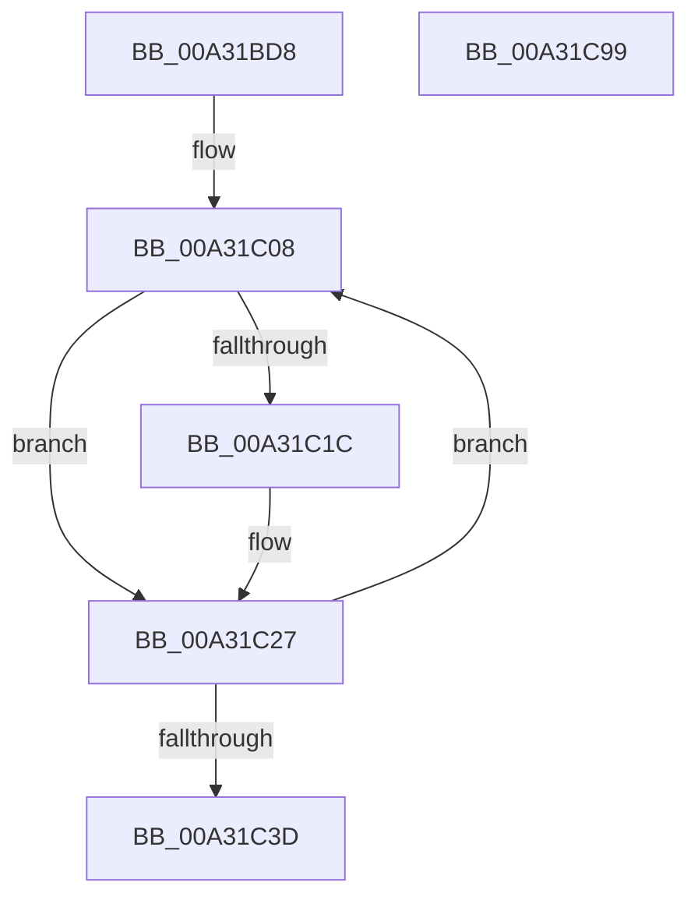

# PopIsSystemIdle

- RVA: `0x00A31BD8`–`0x00A31C9A` (길이 `194` bytes)
- VA: `0x0000000140A31BD8`
- 실행 섹션: `PAGE`
- PDB 이름 있음: `예`; PDB Function 태그: `아니요`
- unwind 정보 RVA: `0x0008DF5C`
- 디코드: `59`개 명령, `194/194` bytes 표시
- 미해석 바이트: `0` (있으면 어셈블리에 `.byte`로 보존)

> 이 문서는 커널 이미지의 기계어와 PDB 기호를 분석해 생성했습니다. 4번과 5번은 함수 원형과 자료형을 바이너리 사용 방식에서 추정한 C 해석이며 원본 소스 복구 결과는 아닙니다.

## 1. Dependencies

- 직접 호출 지점: **2**; 고유 호출 대상: **2**
- 직접 호출자로 확인된 함수: **1**
- RIP 상대 이미지 참조: **0**

### Outgoing calls
- `0x00A31C13` → [PopAssessSystemIdleEvent](PopAssessSystemIdleEvent_function_00A31CA0.md) (function, `0x00A31CA0`)
- `0x00A31C7B` → [PopDiagTraceSystemIdleAssessment](PopDiagTraceSystemIdleAssessment_function_00A31FF4.md) (function, `0x00A31FF4`)

### Direct callers
- [PopSystemIdleWorker](PopSystemIdleWorker_function_00A31A60.md) at `0x00A31AE0`

### Static image references
- 디코드된 RIP-relative 메모리 참조가 없습니다.

## 2. Other-region calls and transfers

- 다른 실행 섹션으로 향하는 call: **0**
- 별도 외부 분기/꼬리 이동을 확인하지 못했습니다.

## 3. Assembly (complete function range)

```asm
00A31BD8  48 89 5C 24 08                  mov qword ptr [rsp + 8], rbx
00A31BDD  48 89 6C 24 10                  mov qword ptr [rsp + 0x10], rbp
00A31BE2  56                              push rsi
00A31BE3  57                              push rdi
00A31BE4  41 54                           push r12
00A31BE6  41 56                           push r14
00A31BE8  41 57                           push r15
00A31BEA  48 83 EC 20                     sub rsp, 0x20
00A31BEE  48 83 64 24 60 00               and qword ptr [rsp + 0x60], 0
00A31BF4  33 F6                           xor esi, esi
00A31BF6  48 83 CB FF                     or rbx, 0xffffffffffffffff
00A31BFA  4D 8B F1                        mov r14, r9
00A31BFD  33 FF                           xor edi, edi
00A31BFF  4D 8B E0                        mov r12, r8
00A31C02  44 8B FA                        mov r15d, edx
00A31C05  48 8B E9                        mov rbp, rcx
00A31C08  4C 8D 44 24 60                  lea r8, [rsp + 0x60]
00A31C0D  41 8B D7                        mov edx, r15d
00A31C10  48 8B CD                        mov rcx, rbp
00A31C13  E8 88 00 00 00                  call 0x140a31ca0
00A31C18  85 C0                           test eax, eax
00A31C1A  74 0B                           je 0x140a31c27
00A31C1C  8B CF                           mov ecx, edi
00A31C1E  B8 01 00 00 00                  mov eax, 1
00A31C23  D3 E0                           shl eax, cl
00A31C25  0B F0                           or esi, eax
00A31C27  48 3B 5C 24 60                  cmp rbx, qword ptr [rsp + 0x60]
00A31C2C  48 0F 43 5C 24 60               cmovae rbx, qword ptr [rsp + 0x60]
00A31C32  FF C7                           inc edi
00A31C34  48 83 C5 38                     add rbp, 0x38
00A31C38  83 FF 04                        cmp edi, 4
00A31C3B  72 CB                           jb 0x140a31c08
00A31C3D  85 F6                           test esi, esi
00A31C3F  49 89 1C 24                     mov qword ptr [r12], rbx
00A31C43  48 B9 08 00 00 00 80 F7 FF FF   movabs rcx, 0xfffff78000000008
00A31C4D  48 B8 BD 42 7A E5 D5 94 BF D6   movabs rax, 0xd6bf94d5e57a42bd
00A31C57  0F 94 C3                        sete bl
00A31C5A  44 8A C3                        mov r8b, bl
00A31C5D  48 8B 09                        mov rcx, qword ptr [rcx]
00A31C60  48 F7 E1                        mul rcx
00A31C63  41 8B CF                        mov ecx, r15d
00A31C66  45 89 7E 08                     mov dword ptr [r14 + 8], r15d
00A31C6A  48 C1 EA 17                     shr rdx, 0x17
00A31C6E  49 89 16                        mov qword ptr [r14], rdx
00A31C71  8B D6                           mov edx, esi
00A31C73  41 89 76 0C                     mov dword ptr [r14 + 0xc], esi
00A31C77  41 88 5E 10                     mov byte ptr [r14 + 0x10], bl
00A31C7B  E8 74 03 00 00                  call 0x140a31ff4
00A31C80  48 8B 6C 24 58                  mov rbp, qword ptr [rsp + 0x58]
00A31C85  8A C3                           mov al, bl
00A31C87  48 8B 5C 24 50                  mov rbx, qword ptr [rsp + 0x50]
00A31C8C  48 83 C4 20                     add rsp, 0x20
00A31C90  41 5F                           pop r15
00A31C92  41 5E                           pop r14
00A31C94  41 5C                           pop r12
00A31C96  5F                              pop rdi
00A31C97  5E                              pop rsi
00A31C98  C3                              ret
00A31C99  CC                              int3
```

## 4. C-style interpretation (structured pseudocode)

```c
__int64 __fastcall PopIsSystemIdle(__int64 a1, int a2, __int64 a3, __int64 a4)
{
    __int64 result;
    __int64 v_rbp;
    __int64 v_rbx;
    __int64 v_rdi;
    __int64 v_rsi;
    __int64 v_rsp;
    unsigned __int64 v_stack_p10;
    unsigned __int64 v_stack_p18;
    unsigned __int64 v_stack_p8;

    v_stack_p8 = v_rbx;
    v_stack_p10 = v_rbp;
    v_rsp = (v_rsp) - (32);
    v_rsi = 0;
    v_rbx = (v_rbx) | (-1);
    v_rdi = 0;
loc_00A31C08:
    result = PopAssessSystemIdleEvent(a1, (unsigned int)((unsigned int)((unsigned int)(a2))), v_stack_p18, a4);
    if ((unsigned int)(result) != 0) {
        a1 = 0;
        result = 1;
        result = (unsigned int)((result) << ((unsigned __int8)(a1)));
        v_rsi = (unsigned int)((v_rsi) | ((unsigned int)(result)));
    }
    if (v_rbx >= v_stack_p18) { v_rbx = v_stack_p18; }
    v_rdi = (unsigned int)((v_rdi) + 1);
    v_rbp = (a1) + (56);
    if (((unsigned int)(v_rdi)) < 4) goto loc_00A31C08;
    *(unsigned __int64 *)(a3) = v_rbx;
    v_rbx = ((unsigned int)(v_rsi) == 0) ? 1 : 0;
    *(unsigned int *)(a4 + 8) = (unsigned int)((unsigned int)(a2));
    a2 = ((unsigned int)((unsigned int)((unsigned int)(a2)))) >> (23);
    *(unsigned __int64 *)(a4) = a2;
    *(unsigned int *)(a4 + 12) = (unsigned int)(v_rsi);
    *(unsigned __int8 *)(a4 + 16) = (unsigned __int8)(v_rbx);
    result = PopDiagTraceSystemIdleAssessment((unsigned int)((unsigned int)((unsigned int)(a2))), (unsigned int)((unsigned int)(v_rsi)), (unsigned __int8)(v_rbx), a4);
    v_rsp = (v_rsp) + (32);
    return (unsigned __int8)(v_rbx);
}
```

## 5. (Beta) C Style

```c
int64_t PopIsSystemIdle(int64_t Arg1, int32_t Arg2, void *Arg3, void *Arg4)
{
    uint8_t *arg3 = (uint8_t *)Arg3;
    uint8_t *arg4 = (uint8_t *)Arg4;

    int64_t result;
    int64_t local_rbp;
    int64_t local_rbx;
    int64_t local_rdi;
    int64_t local_rsi;
    int64_t local_rsp;
    uint64_t v_stack_p10;
    uint64_t v_stack_p18;
    uint64_t v_stack_p8;

    v_stack_p8 = local_rbx;
    v_stack_p10 = local_rbp;
    local_rsp = (local_rsp) - (32);
    local_rsi = 0;
    local_rbx = (local_rbx) | (-1);
    local_rdi = 0;
loc_00A31C08:
    result = PopAssessSystemIdleEvent(Arg1, (uint32_t)((uint32_t)((uint32_t)(Arg2))), v_stack_p18, Arg4);
    if ((uint32_t)(result) != 0) {
        Arg1 = 0;
        result = 1;
        result = (uint32_t)((result) << ((uint8_t)(Arg1)));
        local_rsi = (uint32_t)((local_rsi) | ((uint32_t)(result)));
    }
    if (local_rbx >= v_stack_p18) { local_rbx = v_stack_p18; }
    local_rdi = (uint32_t)((local_rdi) + 1);
    local_rbp = (Arg1) + (56);
    if (((uint32_t)(local_rdi)) < 4) goto loc_00A31C08;
    *(uint64_t *)(arg3) = local_rbx;
    local_rbx = ((uint32_t)(local_rsi) == 0) ? 1 : 0;
    *(uint32_t *)(arg4 + 0x8) = (uint32_t)((uint32_t)(Arg2));
    Arg2 = ((uint32_t)((uint32_t)((uint32_t)(Arg2)))) >> (23);
    *(uint64_t *)(arg4) = Arg2;
    *(uint32_t *)(arg4 + 0xC) = (uint32_t)(local_rsi);
    *(uint8_t *)(arg4 + 0x10) = (uint8_t)(local_rbx);
    result = PopDiagTraceSystemIdleAssessment((uint32_t)((uint32_t)((uint32_t)(Arg2))), (uint32_t)((uint32_t)(local_rsi)), (uint8_t)(local_rbx), Arg4);
    local_rsp = (local_rsp) + (32);
    return (uint8_t)(local_rbx);
}
```

### 관측된 메모리 오프셋

구조체 형식이 확인되지 않은 접근은 인자 기준의 오프셋으로만 기록했습니다.

| 기준 인자 | 오프셋 표현 | 폭 (bit) | 접근 |
|---|---:|---:|---|
| `Arg3` | `+ 0x0` | `64` | `W` |
| `Arg4` | `+ 0x0` | `64` | `W` |
| `Arg4` | `+ 0x8` | `32` | `W` |
| `Arg4` | `+ 0xC` | `32` | `W` |
| `Arg4` | `+ 0x10` | `8` | `W` |

## 6. Execution-region graph

[열기: 2D/3D 그래프와 함수 탐색 컨트롤 패널](../../../control-panel.html?section=page&rva=0x00A31BD8&view=graph)

- 2D 그래프는 위에서 아래로 흐르고, 3D 그래프는 빈 공간을 드래그해 회전합니다. Shift+드래그는 이동, 휠은 확대·축소, 함수 노드 선택은 대상 보고서 이동입니다.

### Static fallback


