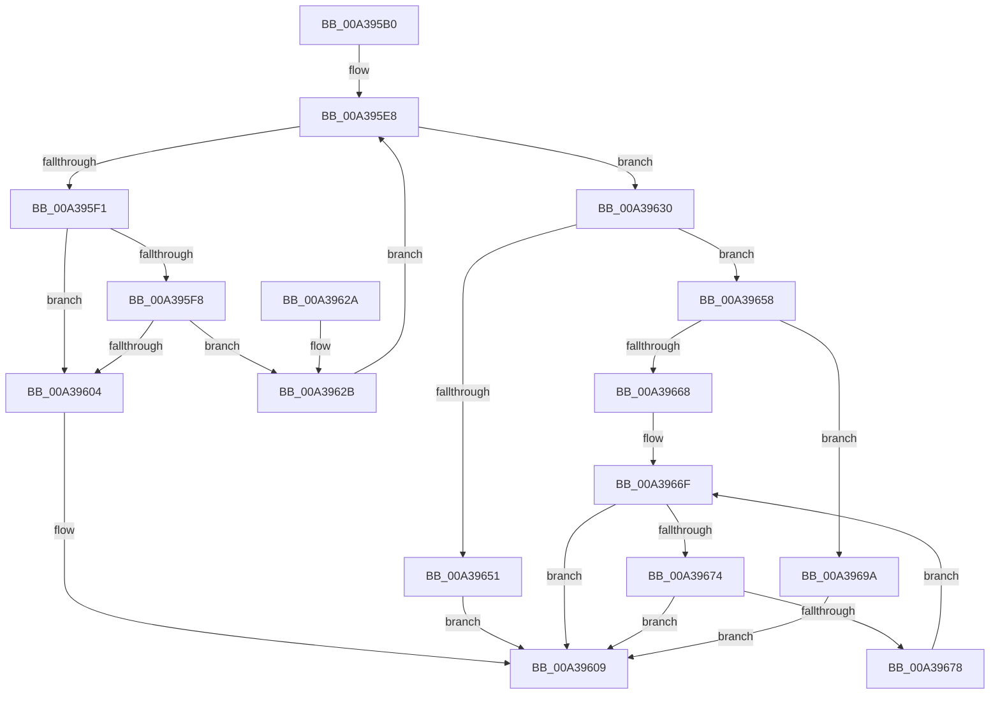

# PopLoggingInformation

- RVA: `0x00A395B0`–`0x00A396A9` (길이 `249` bytes)
- VA: `0x0000000140A395B0`
- 실행 섹션: `PAGE`
- PDB 이름 있음: `예`; PDB Function 태그: `아니요`
- unwind 정보 RVA: `0x000ADEF0`
- 디코드: `77`개 명령, `249/249` bytes 표시
- 미해석 바이트: `0` (있으면 어셈블리에 `.byte`로 보존)

> 이 문서는 커널 이미지의 기계어와 PDB 기호를 분석해 생성했습니다. 4번과 5번은 함수 원형과 자료형을 바이너리 사용 방식에서 추정한 C 해석이며 원본 소스 복구 결과는 아닙니다.

## 1. Dependencies

- 직접 호출 지점: **2**; 고유 호출 대상: **2**
- 직접 호출자로 확인된 함수: **2**
- RIP 상대 이미지 참조: **1**

### Outgoing calls
- `0x00A39647` → [ExAllocatePool2](../../poolcode/B8/ExAllocatePool2_function_00B820F0.md) (function, `0x00B820F0`)
- `0x00A3968B` → [memcpy](../../text/6C/memcpy_function_006C6840.md) (function, `0x006C6840`)

### Direct callers
- [NtPowerInformation](../95/NtPowerInformation_function_00955D80.md) at `0x00956888`
- [PopDiagTraceControlCallback](PopDiagTraceControlCallback_function_00A38CB0.md) at `0x00A38DAD`

### Static image references
- `0x00A395CD` → RVA `0x00F0CBB0` (`.data`; read)

## 2. Other-region calls and transfers

- 다른 실행 섹션으로 향하는 call: **2**
  - `0x00A39647` → [ExAllocatePool2](../../poolcode/B8/ExAllocatePool2_function_00B820F0.md) (`PAGE` → `POOLCODE`)
  - `0x00A3968B` → [memcpy](../../text/6C/memcpy_function_006C6840.md) (`PAGE` → `.text`)
- 별도 외부 분기/꼬리 이동을 확인하지 못했습니다.

## 3. Assembly (complete function range)

```asm
00A395B0  48 8B C4                        mov rax, rsp
00A395B3  48 89 58 08                     mov qword ptr [rax + 8], rbx
00A395B7  48 89 68 10                     mov qword ptr [rax + 0x10], rbp
00A395BB  48 89 70 18                     mov qword ptr [rax + 0x18], rsi
00A395BF  48 89 78 20                     mov qword ptr [rax + 0x20], rdi
00A395C3  41 54                           push r12
00A395C5  41 56                           push r14
00A395C7  41 57                           push r15
00A395C9  48 83 EC 20                     sub rsp, 0x20
00A395CD  4C 8B 0D DC 35 4D 00            mov r9, qword ptr [rip + 0x4d35dc]
00A395D4  4C 8D 25 D5 35 4D 00            lea r12, [rip + 0x4d35d5]
00A395DB  33 FF                           xor edi, edi
00A395DD  4C 8B F2                        mov r14, rdx
00A395E0  4C 8B F9                        mov r15, rcx
00A395E3  8B F7                           mov esi, edi
00A395E5  8D 47 04                        lea eax, [rdi + 4]
00A395E8  44 8D 40 10                     lea r8d, [rax + 0x10]
00A395EC  4D 3B CC                        cmp r9, r12
00A395EF  74 3F                           je 0x140a39630
00A395F1  FF C6                           inc esi
00A395F3  44 3B C0                        cmp r8d, eax
00A395F6  72 0C                           jb 0x140a39604
00A395F8  41 8B 41 1C                     mov eax, dword ptr [r9 + 0x1c]
00A395FC  41 03 C0                        add eax, r8d
00A395FF  41 3B C0                        cmp eax, r8d
00A39602  73 27                           jae 0x140a3962b
00A39604  BF 95 00 00 C0                  mov edi, 0xc0000095
00A39609  48 8B 5C 24 40                  mov rbx, qword ptr [rsp + 0x40]
00A3960E  8B C7                           mov eax, edi
00A39610  48 8B 7C 24 58                  mov rdi, qword ptr [rsp + 0x58]
00A39615  48 8B 6C 24 48                  mov rbp, qword ptr [rsp + 0x48]
00A3961A  48 8B 74 24 50                  mov rsi, qword ptr [rsp + 0x50]
00A3961F  48 83 C4 20                     add rsp, 0x20
00A39623  41 5F                           pop r15
00A39625  41 5E                           pop r14
00A39627  41 5C                           pop r12
00A39629  C3                              ret
00A3962A  CC                              int3
00A3962B  4D 8B 09                        mov r9, qword ptr [r9]
00A3962E  EB B8                           jmp 0x140a395e8
00A39630  85 F6                           test esi, esi
00A39632  B9 00 01 00 00                  mov ecx, 0x100
00A39637  44 0F 45 C0                     cmovne r8d, eax
00A3963B  41 8B D8                        mov ebx, r8d
00A3963E  41 8B D0                        mov edx, r8d
00A39641  41 B8 63 62 75 66               mov r8d, 0x66756263
00A39647  E8 A4 8A 14 00                  call 0x140b820f0
00A3964C  48 85 C0                        test rax, rax
00A3964F  75 07                           jne 0x140a39658
00A39651  BF 9A 00 00 C0                  mov edi, 0xc000009a
00A39656  EB B1                           jmp 0x140a39609
00A39658  41 89 1E                        mov dword ptr [r14], ebx
00A3965B  48 8D 68 04                     lea rbp, [rax + 4]
00A3965F  49 89 07                        mov qword ptr [r15], rax
00A39662  89 18                           mov dword ptr [rax], ebx
00A39664  85 F6                           test esi, esi
00A39666  74 32                           je 0x140a3969a
00A39668  4C 8B 35 41 35 4D 00            mov r14, qword ptr [rip + 0x4d3541]
00A3966F  4D 3B F4                        cmp r14, r12
00A39672  74 95                           je 0x140a39609
00A39674  85 F6                           test esi, esi
00A39676  74 91                           je 0x140a39609
00A39678  41 8B 46 1C                     mov eax, dword ptr [r14 + 0x1c]
00A3967C  49 8D 56 10                     lea rdx, [r14 + 0x10]
00A39680  83 C0 10                        add eax, 0x10
00A39683  48 8B CD                        mov rcx, rbp
00A39686  44 8B C0                        mov r8d, eax
00A39689  8B D8                           mov ebx, eax
00A3968B  E8 B0 D1 C8 FF                  call 0x1406c6840
00A39690  4D 8B 36                        mov r14, qword ptr [r14]
00A39693  48 03 EB                        add rbp, rbx
00A39696  FF CE                           dec esi
00A39698  EB D5                           jmp 0x140a3966f
00A3969A  0F 57 C0                        xorps xmm0, xmm0
00A3969D  0F 11 45 00                     movups xmmword ptr [rbp], xmm0
00A396A1  89 7D 08                        mov dword ptr [rbp + 8], edi
00A396A4  E9 60 FF FF FF                  jmp 0x140a39609
```

## 4. C-style interpretation (structured pseudocode)

```c
__int64 __fastcall PopLoggingInformation(__int64 a1, __int64 a2)
{
    __int64 result;
    __int64 v_rbp;
    __int64 v_rdi;
    __int64 v_rsi;
    __int64 v_rsp;
    unsigned __int64 v_stack_p10;
    unsigned __int64 v_stack_p18;
    unsigned __int64 v_stack_p20;
    unsigned __int64 v_stack_p8;

    *(unsigned __int64 *)(v_rsp + 8) = v_rbx;
    *(unsigned __int64 *)(v_rsp + 16) = v_rbp;
    *(unsigned __int64 *)(v_rsp + 24) = v_rsi;
    *(unsigned __int64 *)(v_rsp + 32) = v_rdi;
    v_rsp = (v_rsp) - (32);
    v_rdi = 0;
loc_00A395E8:
    if ((*(unsigned __int64 *)(v_rip + 5060060)) == (v_rip + 5060053)) goto loc_00A39630;
    v_rsi = (unsigned int)((0) + 1);
    if (((unsigned int)(v_rdi + 4 + 16)) < ((unsigned int)(v_rdi + 4))) goto loc_00A39604;
    result = (unsigned int)(((unsigned int)(*(unsigned int *)(*(unsigned __int64 *)(v_rip + 5060060) + 28))) + ((unsigned int)(v_rdi + 4 + 16)));
    if (((unsigned int)(result)) >= ((unsigned int)(v_rdi + 4 + 16))) goto loc_00A3962B;
loc_00A39604:
loc_00A39609:
    v_rsp = (v_rsp) + (32);
    return (unsigned int)((unsigned int)((unsigned int)(0xC0000095ULL)));
loc_00A3962B:
    goto loc_00A395E8;
loc_00A39630:
    a3 = v_rdi + 4 + 16;
    if ((unsigned int)(v_stack_p18) != 0) { a3 = (unsigned int)((unsigned int)((unsigned int)((unsigned int)(0xC0000095ULL)))); }
    result = ExAllocatePool2(256, (unsigned int)((unsigned int)(a3)), (unsigned int)(0x66756263ULL), *(unsigned __int64 *)(*(unsigned __int64 *)(v_rip + 5060060)));
    if (result != 0) goto loc_00A39658;
    goto loc_00A39609;
loc_00A39658:
    *(unsigned int *)(a2) = (unsigned int)((unsigned int)((unsigned int)(a3)));
    *(unsigned __int64 *)(a1) = result;
    *(unsigned int *)(result) = (unsigned int)((unsigned int)((unsigned int)(a3)));
    if ((unsigned int)(v_stack_p18) == 0) goto loc_00A3969A;
loc_00A3966F:
    if ((*(unsigned __int64 *)(v_rip + 5059905)) == (v_rip + 5060053)) goto loc_00A39609;
    if ((unsigned int)(v_stack_p18) == 0) goto loc_00A39609;
    result = (unsigned int)(((unsigned int)(*(unsigned int *)(*(unsigned __int64 *)(v_rip + 5059905) + 28))) + (16));
    result = memcpy(result + 4, *(unsigned __int64 *)(v_rip + 5059905) + 16, (unsigned int)((unsigned int)(result)), *(unsigned __int64 *)(*(unsigned __int64 *)(v_rip + 5060060)));
    v_rbp = (result + 4) + ((unsigned int)((unsigned int)(result)));
    v_rsi = (unsigned int)((v_stack_p18) - 1);
    goto loc_00A3966F;
loc_00A3969A:
    *(unsigned __int64 *)(v_rbp) = v_xmm0;
    *(unsigned int *)(v_rbp + 8) = (unsigned int)((unsigned int)(0xC000009AULL));
    goto loc_00A39609;
}
```

## 5. (Beta) C Style

```c
int64_t PopLoggingInformation(void *Arg1, void *Arg2)
{
    uint8_t *arg1 = (uint8_t *)Arg1;
    uint8_t *arg2 = (uint8_t *)Arg2;

    int64_t result;
    int64_t local_rbp;
    int64_t local_rdi;
    int64_t local_rsi;
    int64_t local_rsp;
    uint64_t v_stack_p10;
    uint64_t v_stack_p18;
    uint64_t v_stack_p20;
    uint64_t v_stack_p8;

    *(uint64_t *)(local_rsp + 0x8) = local_rbx;
    *(uint64_t *)(local_rsp + 0x10) = local_rbp;
    *(uint64_t *)(local_rsp + 0x18) = local_rsi;
    *(uint64_t *)(local_rsp + 0x20) = local_rdi;
    local_rsp = (local_rsp) - (32);
    local_rdi = 0;
loc_00A395E8:
    if ((*(uint64_t *)(v_rip + 0x4D35DC)) == (v_rip + 5060053)) goto loc_00A39630;
    local_rsi = (uint32_t)((0) + 1);
    if (((uint32_t)(local_rdi + 4 + 16)) < ((uint32_t)(local_rdi + 4))) goto loc_00A39604;
    result = (uint32_t)(((uint32_t)(*(uint32_t *)(*(uint64_t *)(v_rip + 0x4D35DC) + 0x1C))) + ((uint32_t)(local_rdi + 4 + 16)));
    if (((uint32_t)(result)) >= ((uint32_t)(local_rdi + 4 + 16))) goto loc_00A3962B;
loc_00A39604:
loc_00A39609:
    local_rsp = (local_rsp) + (32);
    return (uint32_t)((uint32_t)((uint32_t)(0xC0000095ULL)));
loc_00A3962B:
    goto loc_00A395E8;
loc_00A39630:
    a3 = local_rdi + 4 + 16;
    if ((uint32_t)(v_stack_p18) != 0) { a3 = (uint32_t)((uint32_t)((uint32_t)((uint32_t)(0xC0000095ULL)))); }
    result = ExAllocatePool2(256, (uint32_t)((uint32_t)(a3)), (uint32_t)(0x66756263ULL), *(uint64_t *)(*(uint64_t *)(v_rip + 0x4D35DC)));
    if (result != 0) goto loc_00A39658;
    goto loc_00A39609;
loc_00A39658:
    *(uint32_t *)(arg2) = (uint32_t)((uint32_t)((uint32_t)(a3)));
    *(uint64_t *)(arg1) = result;
    *(uint32_t *)(result) = (uint32_t)((uint32_t)((uint32_t)(a3)));
    if ((uint32_t)(v_stack_p18) == 0) goto loc_00A3969A;
loc_00A3966F:
    if ((*(uint64_t *)(v_rip + 0x4D3541)) == (v_rip + 5060053)) goto loc_00A39609;
    if ((uint32_t)(v_stack_p18) == 0) goto loc_00A39609;
    result = (uint32_t)(((uint32_t)(*(uint32_t *)(*(uint64_t *)(v_rip + 0x4D3541) + 0x1C))) + (16));
    result = memcpy(result + 4, *(uint64_t *)(v_rip + 0x4D3541) + 16, (uint32_t)((uint32_t)(result)), *(uint64_t *)(*(uint64_t *)(v_rip + 0x4D35DC)));
    local_rbp = (result + 4) + ((uint32_t)((uint32_t)(result)));
    local_rsi = (uint32_t)((v_stack_p18) - 1);
    goto loc_00A3966F;
loc_00A3969A:
    *(uint64_t *)(local_rbp) = v_xmm0;
    *(uint32_t *)(local_rbp + 0x8) = (uint32_t)((uint32_t)(0xC000009AULL));
    goto loc_00A39609;
}
```

### 관측된 메모리 오프셋

구조체 형식이 확인되지 않은 접근은 인자 기준의 오프셋으로만 기록했습니다.

| 기준 인자 | 오프셋 표현 | 폭 (bit) | 접근 |
|---|---:|---:|---|
| `Arg1` | `+ 0x0` | `64` | `W` |
| `Arg2` | `+ 0x0` | `32` | `W` |

## 6. Execution-region graph

[열기: 2D/3D 그래프와 함수 탐색 컨트롤 패널](../../../control-panel.html?section=page&rva=0x00A395B0&view=graph)

- 2D 그래프는 위에서 아래로 흐르고, 3D 그래프는 빈 공간을 드래그해 회전합니다. Shift+드래그는 이동, 휠은 확대·축소, 함수 노드 선택은 대상 보고서 이동입니다.

### Static fallback


