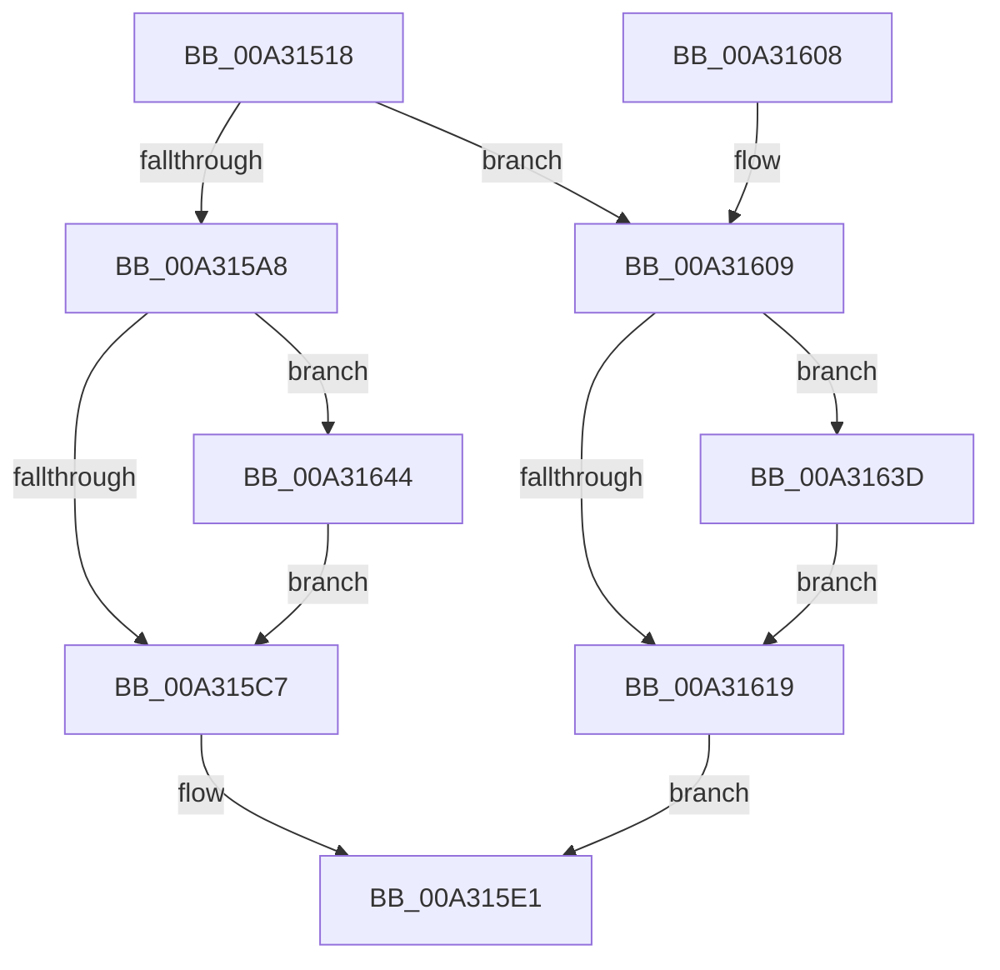

# PopPdcIdleResiliencyCallback

- RVA: `0x00A31518`–`0x00A3164E` (길이 `310` bytes)
- VA: `0x0000000140A31518`
- 실행 섹션: `PAGE`
- PDB 이름 있음: `예`; PDB Function 태그: `아니요`
- unwind 정보 RVA: `0x000AD224`
- 디코드: `75`개 명령, `310/310` bytes 표시
- 미해석 바이트: `0` (있으면 어셈블리에 `.byte`로 보존)

> 이 문서는 커널 이미지의 기계어와 PDB 기호를 분석해 생성했습니다. 4번과 5번은 함수 원형과 자료형을 바이너리 사용 방식에서 추정한 C 해석이며 원본 소스 복구 결과는 아닙니다.

## 1. Dependencies

- 직접 호출 지점: **21**; 고유 호출 대상: **17**
- 직접 호출자로 확인된 함수: **1**
- RIP 상대 이미지 참조: **8**

### Outgoing calls
- `0x00A3152C` → [PopAcquirePolicyLock](../../pagelk/B7/PopAcquirePolicyLock_function_00B783C0.md) (function, `0x00B783C0`)
- `0x00A3155B` → [PopSetPowerSettingValue](../91/PopSetPowerSettingValue_function_00914E54.md) (function, `0x00914E54`)
- `0x00A3157B` → [PopSetPowerSettingValue](../91/PopSetPowerSettingValue_function_00914E54.md) (function, `0x00914E54`)
- `0x00A31580` → [PopCheckResiliencyScenarios](PopCheckResiliencyScenarios_function_00A31718.md) (function, `0x00A31718`)
- `0x00A31596` → [PopAccumulateNonActivatedCpuTime](../../text/4A/PopAccumulateNonActivatedCpuTime_function_004A0AA4.md) (function, `0x004A0AA4`)
- `0x00A3159B` → [PpmQueryTime](../../text/45/PpmQueryTime_function_00454604.md) (function, `0x00454604`)
- `0x00A315B9` → [PopFxEndDeviceIRPhaseAccounting](../../text/4C/PopFxEndDeviceIRPhaseAccounting_function_004C9AB0.md) (function, `0x004C9AB0`)
- `0x00A315C9` → [PpmIdleCsVetoAccountingResiliencyUpdate](../../text/30/PpmIdleCsVetoAccountingResiliencyUpdate_function_00304028.md) (function, `0x00304028`)
- `0x00A315D0` → [PopUpdateNonAttributedCpuTimeReference](../../text/30/PopUpdateNonAttributedCpuTimeReference_function_00304720.md) (function, `0x00304720`)
- `0x00A315D5` → [PopDripsWatchdogStopWatchdog](../70/PopDripsWatchdogStopWatchdog_function_00705674.md) (function, `0x00705674`)
- `0x00A315DC` → [PpmDisableHighPerfRequestDeferredExpiration](../../text/4B/PpmDisableHighPerfRequestDeferredExpiration_function_004BA678.md) (function, `0x004BA678`)
- `0x00A315E1` → [PopReleasePolicyLock](../../pagelk/B7/PopReleasePolicyLock_function_00B78410.md) (function, `0x00B78410`)
- `0x00A315E9` → [PopIdleWakeNotifyIdleResiliencyState](../../text/4B/PopIdleWakeNotifyIdleResiliencyState_function_004B476C.md) (function, `0x004B476C`)
- `0x00A315F3` → [PopDirectedDripsIdleResiliencyCallback](PopDirectedDripsIdleResiliencyCallback_function_00A31884.md) (function, `0x00A31884`)
- `0x00A3161B` → [PpmIdleCsVetoAccountingResiliencyUpdate](../../text/30/PpmIdleCsVetoAccountingResiliencyUpdate_function_00304028.md) (function, `0x00304028`)
- `0x00A31622` → [PopUpdateNonAttributedCpuTimeReference](../../text/30/PopUpdateNonAttributedCpuTimeReference_function_00304720.md) (function, `0x00304720`)
- `0x00A31627` → [PopDripsWatchdogStartWatchdog](PopDripsWatchdogStartWatchdog_function_00A32148.md) (function, `0x00A32148`)
- `0x00A3162E` → [PpmDisableHighPerfRequestDeferredExpiration](../../text/4B/PpmDisableHighPerfRequestDeferredExpiration_function_004BA678.md) (function, `0x004BA678`)
- `0x00A31636` → [PopFxBeginDeviceIRPhaseAccounting](../../text/4C/PopFxBeginDeviceIRPhaseAccounting_function_004CDD80.md) (function, `0x004CDD80`)
- `0x00A3163D` → [PopFxResumeDeviceAccounting](../../text/43/PopFxResumeDeviceAccounting_function_0043D4D8.md) (function, `0x0043D4D8`)
- `0x00A31644` → [PopFxPauseDeviceAccounting](../../text/43/PopFxPauseDeviceAccounting_function_0043D0C8.md) (function, `0x0043D0C8`)

### Direct callers
- [PdcPoResiliencyClient](PdcPoResiliencyClient_function_00A314B0.md) at `0x00A314C5`

### Static image references
- `0x00A31536` → RVA `0x00F0C720` (`.data`; write)
- `0x00A31551` → RVA `0x0001A268` (`.rdata`; read)
- `0x00A31585` → RVA `0x00E27D68` (`.data`; read)
- `0x00A3158F` → RVA `0x00E27D60` (`.data`; read)
- `0x00A315A8` → RVA `0x00E27D30` (`.data`; read)
- `0x00A315B2` → RVA `0x00E27D38` (`.data`; read/write)
- `0x00A315BE` → RVA `0x00E676B0` (`.data`; read)
- `0x00A31610` → RVA `0x00E27D30` (`.data`; write)

## 2. Other-region calls and transfers

- 다른 실행 섹션으로 향하는 call: **15**
  - `0x00A3152C` → [PopAcquirePolicyLock](../../pagelk/B7/PopAcquirePolicyLock_function_00B783C0.md) (`PAGE` → `PAGELK`)
  - `0x00A31596` → [PopAccumulateNonActivatedCpuTime](../../text/4A/PopAccumulateNonActivatedCpuTime_function_004A0AA4.md) (`PAGE` → `.text`)
  - `0x00A3159B` → [PpmQueryTime](../../text/45/PpmQueryTime_function_00454604.md) (`PAGE` → `.text`)
  - `0x00A315B9` → [PopFxEndDeviceIRPhaseAccounting](../../text/4C/PopFxEndDeviceIRPhaseAccounting_function_004C9AB0.md) (`PAGE` → `.text`)
  - `0x00A315C9` → [PpmIdleCsVetoAccountingResiliencyUpdate](../../text/30/PpmIdleCsVetoAccountingResiliencyUpdate_function_00304028.md) (`PAGE` → `.text`)
  - `0x00A315D0` → [PopUpdateNonAttributedCpuTimeReference](../../text/30/PopUpdateNonAttributedCpuTimeReference_function_00304720.md) (`PAGE` → `.text`)
  - `0x00A315DC` → [PpmDisableHighPerfRequestDeferredExpiration](../../text/4B/PpmDisableHighPerfRequestDeferredExpiration_function_004BA678.md) (`PAGE` → `.text`)
  - `0x00A315E1` → [PopReleasePolicyLock](../../pagelk/B7/PopReleasePolicyLock_function_00B78410.md) (`PAGE` → `PAGELK`)
  - `0x00A315E9` → [PopIdleWakeNotifyIdleResiliencyState](../../text/4B/PopIdleWakeNotifyIdleResiliencyState_function_004B476C.md) (`PAGE` → `.text`)
  - `0x00A3161B` → [PpmIdleCsVetoAccountingResiliencyUpdate](../../text/30/PpmIdleCsVetoAccountingResiliencyUpdate_function_00304028.md) (`PAGE` → `.text`)
  - `0x00A31622` → [PopUpdateNonAttributedCpuTimeReference](../../text/30/PopUpdateNonAttributedCpuTimeReference_function_00304720.md) (`PAGE` → `.text`)
  - `0x00A3162E` → [PpmDisableHighPerfRequestDeferredExpiration](../../text/4B/PpmDisableHighPerfRequestDeferredExpiration_function_004BA678.md) (`PAGE` → `.text`)
  - `0x00A31636` → [PopFxBeginDeviceIRPhaseAccounting](../../text/4C/PopFxBeginDeviceIRPhaseAccounting_function_004CDD80.md) (`PAGE` → `.text`)
  - `0x00A3163D` → [PopFxResumeDeviceAccounting](../../text/43/PopFxResumeDeviceAccounting_function_0043D4D8.md) (`PAGE` → `.text`)
  - `0x00A31644` → [PopFxPauseDeviceAccounting](../../text/43/PopFxPauseDeviceAccounting_function_0043D0C8.md) (`PAGE` → `.text`)
- 별도 외부 분기/꼬리 이동을 확인하지 못했습니다.

## 3. Assembly (complete function range)

```asm
00A31518  48 89 5C 24 08                  mov qword ptr [rsp + 8], rbx
00A3151D  48 89 74 24 18                  mov qword ptr [rsp + 0x18], rsi
00A31522  57                              push rdi
00A31523  48 83 EC 30                     sub rsp, 0x30
00A31527  0F B6 FA                        movzx edi, dl
00A3152A  8B F1                           mov esi, ecx
00A3152C  E8 8F 6E 14 00                  call 0x140b783c0
00A31531  48 8D 44 24 48                  lea rax, [rsp + 0x48]
00A31536  40 88 3D E3 B1 4D 00            mov byte ptr [rip + 0x4db1e3], dil
00A3153D  BB 04 00 00 00                  mov ebx, 4
00A31542  48 89 44 24 20                  mov qword ptr [rsp + 0x20], rax
00A31547  44 8B CB                        mov r9d, ebx
00A3154A  89 7C 24 48                     mov dword ptr [rsp + 0x48], edi
00A3154E  45 33 C0                        xor r8d, r8d
00A31551  48 8D 0D 10 8D 5E FF            lea rcx, [rip - 0xa172f0]
00A31558  83 CA FF                        or edx, 0xffffffff
00A3155B  E8 F4 38 EE FF                  call 0x140914e54
00A31560  48 8D 44 24 48                  lea rax, [rsp + 0x48]
00A31565  44 8B CB                        mov r9d, ebx
00A31568  44 8D 43 FD                     lea r8d, [rbx - 3]
00A3156C  48 89 44 24 20                  mov qword ptr [rsp + 0x20], rax
00A31571  83 CA FF                        or edx, 0xffffffff
00A31574  48 8D 0D ED 8C 5E FF            lea rcx, [rip - 0xa17313]
00A3157B  E8 D4 38 EE FF                  call 0x140914e54
00A31580  E8 93 01 00 00                  call 0x140a31718
00A31585  4C 8D 05 DC 67 3F 00            lea r8, [rip + 0x3f67dc]
00A3158C  40 8A CF                        mov cl, dil
00A3158F  48 8D 15 CA 67 3F 00            lea rdx, [rip + 0x3f67ca]
00A31596  E8 09 F5 A6 FF                  call 0x1404a0aa4
00A3159B  E8 64 30 A2 FF                  call 0x140454604
00A315A0  48 8B D8                        mov rbx, rax
00A315A3  40 84 FF                        test dil, dil
00A315A6  75 61                           jne 0x140a31609
00A315A8  48 2B 05 81 67 3F 00            sub rax, qword ptr [rip + 0x3f6781]
00A315AF  48 8B CB                        mov rcx, rbx
00A315B2  48 01 05 7F 67 3F 00            add qword ptr [rip + 0x3f677f], rax
00A315B9  E8 F2 84 A9 FF                  call 0x1404c9ab0
00A315BE  83 3D EB 60 43 00 03            cmp dword ptr [rip + 0x4360eb], 3
00A315C5  74 7D                           je 0x140a31644
00A315C7  33 C9                           xor ecx, ecx
00A315C9  E8 5A 2A 8D FF                  call 0x140304028
00A315CE  B1 01                           mov cl, 1
00A315D0  E8 4B 31 8D FF                  call 0x140304720
00A315D5  E8 9A 40 CD FF                  call 0x140705674
00A315DA  33 C9                           xor ecx, ecx
00A315DC  E8 97 90 A8 FF                  call 0x1404ba678
00A315E1  E8 2A 6E 14 00                  call 0x140b78410
00A315E6  40 8A CF                        mov cl, dil
00A315E9  E8 7E 31 A8 FF                  call 0x1404b476c
00A315EE  40 8A D7                        mov dl, dil
00A315F1  8B CE                           mov ecx, esi
00A315F3  E8 8C 02 00 00                  call 0x140a31884
00A315F8  48 8B 5C 24 40                  mov rbx, qword ptr [rsp + 0x40]
00A315FD  48 8B 74 24 50                  mov rsi, qword ptr [rsp + 0x50]
00A31602  48 83 C4 30                     add rsp, 0x30
00A31606  5F                              pop rdi
00A31607  C3                              ret
00A31608  CC                              int3
00A31609  83 3D A0 60 43 00 03            cmp dword ptr [rip + 0x4360a0], 3
00A31610  48 89 1D 19 67 3F 00            mov qword ptr [rip + 0x3f6719], rbx
00A31617  74 24                           je 0x140a3163d
00A31619  B1 01                           mov cl, 1
00A3161B  E8 08 2A 8D FF                  call 0x140304028
00A31620  33 C9                           xor ecx, ecx
00A31622  E8 F9 30 8D FF                  call 0x140304720
00A31627  E8 1C 0B 00 00                  call 0x140a32148
00A3162C  B1 01                           mov cl, 1
00A3162E  E8 45 90 A8 FF                  call 0x1404ba678
00A31633  48 8B CB                        mov rcx, rbx
00A31636  E8 45 C7 A9 FF                  call 0x1404cdd80
00A3163B  EB A4                           jmp 0x140a315e1
00A3163D  E8 96 BE A0 FF                  call 0x14043d4d8
00A31642  EB D5                           jmp 0x140a31619
00A31644  E8 7F BA A0 FF                  call 0x14043d0c8
00A31649  E9 79 FF FF FF                  jmp 0x140a315c7
```

## 4. C-style interpretation (structured pseudocode)

```c
__int64 __fastcall PopPdcIdleResiliencyCallback(int a1, int a2, int a3)
{
    __int64 result;
    __int64 v_rsp;
    unsigned __int64 v_stack_m18;
    unsigned __int64 v_stack_p10;
    unsigned __int64 v_stack_p18;
    unsigned __int64 v_stack_p8;

    v_stack_p8 = v_rbx;
    v_stack_p18 = v_rsi;
    v_rsp = (v_rsp) - (48);
    result = PopAcquirePolicyLock(a1, a2, a3, a4);
    *(unsigned __int8 *)(v_rip + 5091811) = (unsigned __int8)((unsigned __int8)(a2));
    v_stack_m18 = v_stack_p10;
    v_stack_p10 = (unsigned int)((unsigned __int8)(a2));
    a3 = 0;
    a2 = (unsigned int)((a2) | (0xFFFFFFFFULL));
    result = PopSetPowerSettingValue(v_rip - 10580720, a2, a3, 4);
    v_stack_m18 = v_stack_p10;
    a2 = (unsigned int)((a2) | (0xFFFFFFFFULL));
    result = PopSetPowerSettingValue(v_rip - 10580755, a2, 4 - 3, 4);
    result = PopCheckResiliencyScenarios(v_rip - 10580755, a2, 4 - 3, 4);
    result = PopAccumulateNonActivatedCpuTime((unsigned __int8)((unsigned __int8)(a2)), v_rip + 4155338, v_rip + 4155356, 4);
    result = PpmQueryTime((unsigned __int8)((unsigned __int8)(a2)), v_rip + 4155338, v_rip + 4155356, 4);
    if ((unsigned __int8)((unsigned __int8)(a2)) != 0) goto loc_00A31609;
    result = (result) - (*(unsigned __int64 *)(v_rip + 4155265));
    result = PopFxEndDeviceIRPhaseAccounting(result, v_rip + 4155338, v_rip + 4155356, 4);
    if ((*(unsigned int *)(v_rip + 4415723)) == 3) goto loc_00A31644;
loc_00A315C7:
    a1 = 0;
    result = PpmIdleCsVetoAccountingResiliencyUpdate(a1, v_rip + 4155338, v_rip + 4155356, 4);
    result = PopUpdateNonAttributedCpuTimeReference(1, v_rip + 4155338, v_rip + 4155356, 4);
    result = PopDripsWatchdogStopWatchdog(1, v_rip + 4155338, v_rip + 4155356, 4);
    a1 = 0;
    result = PpmDisableHighPerfRequestDeferredExpiration(a1, v_rip + 4155338, v_rip + 4155356, 4);
loc_00A315E1:
    result = PopReleasePolicyLock(a1, v_rip + 4155338, v_rip + 4155356, 4);
    result = PopIdleWakeNotifyIdleResiliencyState((unsigned __int8)((unsigned __int8)(a2)), v_rip + 4155338, v_rip + 4155356, 4);
    result = PopDirectedDripsIdleResiliencyCallback((unsigned int)((unsigned int)((unsigned int)(a1))), (unsigned __int8)((unsigned __int8)(a2)), v_rip + 4155356, 4);
    v_rsp = (v_rsp) + (48);
    return result;
loc_00A31609:
    *(unsigned __int64 *)(v_rip + 4155161) = v_stack_p8;
    if ((*(unsigned int *)(v_rip + 4415648)) == 3) goto loc_00A3163D;
loc_00A31619:
    result = PpmIdleCsVetoAccountingResiliencyUpdate(1, (unsigned __int8)((unsigned __int8)(a2)), v_rip + 4155356, 4);
    a1 = 0;
    result = PopUpdateNonAttributedCpuTimeReference(a1, (unsigned __int8)((unsigned __int8)(a2)), v_rip + 4155356, 4);
    result = PopDripsWatchdogStartWatchdog(a1, (unsigned __int8)((unsigned __int8)(a2)), v_rip + 4155356, 4);
    result = PpmDisableHighPerfRequestDeferredExpiration(1, (unsigned __int8)((unsigned __int8)(a2)), v_rip + 4155356, 4);
    result = PopFxBeginDeviceIRPhaseAccounting(v_stack_p8, (unsigned __int8)((unsigned __int8)(a2)), v_rip + 4155356, 4);
    goto loc_00A315E1;
loc_00A3163D:
    result = PopFxResumeDeviceAccounting(v_stack_p8, (unsigned __int8)((unsigned __int8)(a2)), v_rip + 4155356, 4);
    goto loc_00A31619;
loc_00A31644:
    result = PopFxPauseDeviceAccounting(v_stack_p8, (unsigned __int8)((unsigned __int8)(a2)), v_rip + 4155356, 4);
    goto loc_00A315C7;
}
```

## 5. (Beta) C Style

```c
int64_t PopPdcIdleResiliencyCallback(int32_t Arg1, int32_t Arg2, int32_t Arg3)
{
    int64_t result;
    int64_t local_rsp;
    uint64_t v_stack_m18;
    uint64_t v_stack_p10;
    uint64_t v_stack_p18;
    uint64_t v_stack_p8;

    v_stack_p8 = local_rbx;
    v_stack_p18 = local_rsi;
    local_rsp = (local_rsp) - (48);
    result = PopAcquirePolicyLock(Arg1, Arg2, Arg3, a4);
    *(uint8_t *)(v_rip + 0x4DB1E3) = (uint8_t)((uint8_t)(Arg2));
    v_stack_m18 = v_stack_p10;
    v_stack_p10 = (uint32_t)((uint8_t)(Arg2));
    Arg3 = 0;
    Arg2 = (uint32_t)((Arg2) | (0xFFFFFFFFULL));
    result = PopSetPowerSettingValue(v_rip - 10580720, Arg2, Arg3, 4);
    v_stack_m18 = v_stack_p10;
    Arg2 = (uint32_t)((Arg2) | (0xFFFFFFFFULL));
    result = PopSetPowerSettingValue(v_rip - 10580755, Arg2, 4 - 3, 4);
    result = PopCheckResiliencyScenarios(v_rip - 10580755, Arg2, 4 - 3, 4);
    result = PopAccumulateNonActivatedCpuTime((uint8_t)((uint8_t)(Arg2)), v_rip + 4155338, v_rip + 4155356, 4);
    result = PpmQueryTime((uint8_t)((uint8_t)(Arg2)), v_rip + 4155338, v_rip + 4155356, 4);
    if ((uint8_t)((uint8_t)(Arg2)) != 0) goto loc_00A31609;
    result = (result) - (*(uint64_t *)(v_rip + 0x3F6781));
    result = PopFxEndDeviceIRPhaseAccounting(result, v_rip + 4155338, v_rip + 4155356, 4);
    if ((*(uint32_t *)(v_rip + 0x4360EB)) == 3) goto loc_00A31644;
loc_00A315C7:
    Arg1 = 0;
    result = PpmIdleCsVetoAccountingResiliencyUpdate(Arg1, v_rip + 4155338, v_rip + 4155356, 4);
    result = PopUpdateNonAttributedCpuTimeReference(1, v_rip + 4155338, v_rip + 4155356, 4);
    result = PopDripsWatchdogStopWatchdog(1, v_rip + 4155338, v_rip + 4155356, 4);
    Arg1 = 0;
    result = PpmDisableHighPerfRequestDeferredExpiration(Arg1, v_rip + 4155338, v_rip + 4155356, 4);
loc_00A315E1:
    result = PopReleasePolicyLock(Arg1, v_rip + 4155338, v_rip + 4155356, 4);
    result = PopIdleWakeNotifyIdleResiliencyState((uint8_t)((uint8_t)(Arg2)), v_rip + 4155338, v_rip + 4155356, 4);
    result = PopDirectedDripsIdleResiliencyCallback((uint32_t)((uint32_t)((uint32_t)(Arg1))), (uint8_t)((uint8_t)(Arg2)), v_rip + 4155356, 4);
    local_rsp = (local_rsp) + (48);
    return result;
loc_00A31609:
    *(uint64_t *)(v_rip + 0x3F6719) = v_stack_p8;
    if ((*(uint32_t *)(v_rip + 0x4360A0)) == 3) goto loc_00A3163D;
loc_00A31619:
    result = PpmIdleCsVetoAccountingResiliencyUpdate(1, (uint8_t)((uint8_t)(Arg2)), v_rip + 4155356, 4);
    Arg1 = 0;
    result = PopUpdateNonAttributedCpuTimeReference(Arg1, (uint8_t)((uint8_t)(Arg2)), v_rip + 4155356, 4);
    result = PopDripsWatchdogStartWatchdog(Arg1, (uint8_t)((uint8_t)(Arg2)), v_rip + 4155356, 4);
    result = PpmDisableHighPerfRequestDeferredExpiration(1, (uint8_t)((uint8_t)(Arg2)), v_rip + 4155356, 4);
    result = PopFxBeginDeviceIRPhaseAccounting(v_stack_p8, (uint8_t)((uint8_t)(Arg2)), v_rip + 4155356, 4);
    goto loc_00A315E1;
loc_00A3163D:
    result = PopFxResumeDeviceAccounting(v_stack_p8, (uint8_t)((uint8_t)(Arg2)), v_rip + 4155356, 4);
    goto loc_00A31619;
loc_00A31644:
    result = PopFxPauseDeviceAccounting(v_stack_p8, (uint8_t)((uint8_t)(Arg2)), v_rip + 4155356, 4);
    goto loc_00A315C7;
}
```

## 6. Execution-region graph

[열기: 2D/3D 그래프와 함수 탐색 컨트롤 패널](../../../control-panel.html?section=page&rva=0x00A31518&view=graph)

- 2D 그래프는 위에서 아래로 흐르고, 3D 그래프는 빈 공간을 드래그해 회전합니다. Shift+드래그는 이동, 휠은 확대·축소, 함수 노드 선택은 대상 보고서 이동입니다.

### Static fallback


