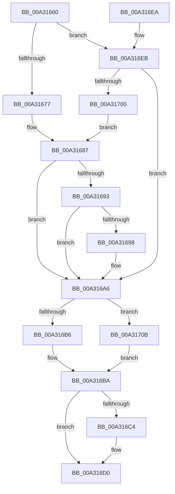

# PopPowerRequestCallbackExecutionRequired

- RVA: `0x00A31660`–`0x00A3170F` (길이 `175` bytes)
- VA: `0x0000000140A31660`
- 실행 섹션: `PAGE`
- PDB 이름 있음: `예`; PDB Function 태그: `아니요`
- unwind 정보 RVA: `0x0008D44C`
- 디코드: `46`개 명령, `175/175` bytes 표시
- 미해석 바이트: `0` (있으면 어셈블리에 `.byte`로 보존)

> 이 문서는 커널 이미지의 기계어와 PDB 기호를 분석해 생성했습니다. 4번과 5번은 함수 원형과 자료형을 바이너리 사용 방식에서 추정한 C 해석이며 원본 소스 복구 결과는 아닙니다.

## 1. Dependencies

- 직접 호출 지점: **4**; 고유 호출 대상: **4**
- 직접 호출자로 확인된 함수: **0**
- RIP 상대 이미지 참조: **8**

### Outgoing calls
- `0x00A3169E` → [guard_dispatch_icall](../../text/6B/guard_dispatch_icall_function_006BAAD0.md) (function, `0x006BAAD0`)
- `0x00A316A6` → [PopAcquirePolicyLock](../../pagelk/B7/PopAcquirePolicyLock_function_00B783C0.md) (function, `0x00B783C0`)
- `0x00A316D0` → [PopCheckResiliencyScenarios](PopCheckResiliencyScenarios_function_00A31718.md) (function, `0x00A31718`)
- `0x00A316D5` → [PopReleasePolicyLock](../../pagelk/B7/PopReleasePolicyLock_function_00B78410.md) (function, `0x00B78410`)

### Direct callers
- 이 함수 시작 RVA로 연결되는 직접 call은 확인되지 않았습니다. 간접 호출은 완전히 역산할 수 없습니다.

### Static image references
- `0x00A31677` → RVA `0x00FD807E` (`PAGEDATA`; read)
- `0x00A31687` → RVA `0x00E67810` (`.data`; read)
- `0x00A316AB` → RVA `0x00F0BC70` (`.data`; read)
- `0x00A316BA` → RVA `0x00F0BC70` (`.data`; write)
- `0x00A316C4` → RVA `0x00F0BC68` (`.data`; read)
- `0x00A316CA` → RVA `0x00F0BC90` (`.data`; write)
- `0x00A316EB` → RVA `0x00FD8114` (`PAGEDATA`; read)
- `0x00A316F2` → RVA `0x00FD807F` (`PAGEDATA`; read)

## 2. Other-region calls and transfers

- 다른 실행 섹션으로 향하는 call: **3**
  - `0x00A3169E` → [guard_dispatch_icall](../../text/6B/guard_dispatch_icall_function_006BAAD0.md) (`PAGE` → `.text`)
  - `0x00A316A6` → [PopAcquirePolicyLock](../../pagelk/B7/PopAcquirePolicyLock_function_00B783C0.md) (`PAGE` → `PAGELK`)
  - `0x00A316D5` → [PopReleasePolicyLock](../../pagelk/B7/PopReleasePolicyLock_function_00B78410.md) (`PAGE` → `PAGELK`)
- 별도 외부 분기/꼬리 이동을 확인하지 못했습니다.

## 3. Assembly (complete function range)

```asm
00A31660  48 89 5C 24 08                  mov qword ptr [rsp + 8], rbx
00A31665  48 89 74 24 10                  mov qword ptr [rsp + 0x10], rsi
00A3166A  57                              push rdi
00A3166B  48 83 EC 20                     sub rsp, 0x20
00A3166F  41 8A F8                        mov dil, r8b
00A31672  83 FA 03                        cmp edx, 3
00A31675  75 74                           jne 0x140a316eb
00A31677  8A 05 01 6A 5A 00               mov al, byte ptr [rip + 0x5a6a01]
00A3167D  8D 5A FF                        lea ebx, [rdx - 1]
00A31680  48 8D 35 F7 69 5A 00            lea rsi, [rip + 0x5a69f7]
00A31687  48 8B 15 82 61 43 00            mov rdx, qword ptr [rip + 0x436182]
00A3168E  48 85 D2                        test rdx, rdx
00A31691  74 13                           je 0x140a316a6
00A31693  40 3A C7                        cmp al, dil
00A31696  74 0E                           je 0x140a316a6
00A31698  40 8A CF                        mov cl, dil
00A3169B  48 8B C2                        mov rax, rdx
00A3169E  E8 2D 94 C8 FF                  call 0x1406baad0
00A316A3  40 88 3E                        mov byte ptr [rsi], dil
00A316A6  E8 15 6D 14 00                  call 0x140b783c0
00A316AB  8B 05 BF A5 4D 00               mov eax, dword ptr [rip + 0x4da5bf]
00A316B1  40 84 FF                        test dil, dil
00A316B4  75 55                           jne 0x140a3170b
00A316B6  F7 D3                           not ebx
00A316B8  23 C3                           and eax, ebx
00A316BA  89 05 B0 A5 4D 00               mov dword ptr [rip + 0x4da5b0], eax
00A316C0  85 C0                           test eax, eax
00A316C2  75 0C                           jne 0x140a316d0
00A316C4  8B 05 9E A5 4D 00               mov eax, dword ptr [rip + 0x4da59e]
00A316CA  89 05 C0 A5 4D 00               mov dword ptr [rip + 0x4da5c0], eax
00A316D0  E8 43 00 00 00                  call 0x140a31718
00A316D5  E8 36 6D 14 00                  call 0x140b78410
00A316DA  48 8B 5C 24 30                  mov rbx, qword ptr [rsp + 0x30]
00A316DF  48 8B 74 24 38                  mov rsi, qword ptr [rsp + 0x38]
00A316E4  48 83 C4 20                     add rsp, 0x20
00A316E8  5F                              pop rdi
00A316E9  C3                              ret
00A316EA  CC                              int3
00A316EB  83 3D 22 6A 5A 00 00            cmp dword ptr [rip + 0x5a6a22], 0
00A316F2  48 8D 35 86 69 5A 00            lea rsi, [rip + 0x5a6986]
00A316F9  BB 01 00 00 00                  mov ebx, 1
00A316FE  74 A6                           je 0x140a316a6
00A31700  8A 05 79 69 5A 00               mov al, byte ptr [rip + 0x5a6979]
00A31706  E9 7C FF FF FF                  jmp 0x140a31687
00A3170B  0B C3                           or eax, ebx
00A3170D  EB AB                           jmp 0x140a316ba
```

## 4. C-style interpretation (structured pseudocode)

```c
__int64 __fastcall PopPowerRequestCallbackExecutionRequired(__int64 a1, __int64 a2, unsigned __int8 a3)
{
    __int64 result;
    __int64 v_rbx;
    __int64 v_rsp;
    unsigned __int64 v_stack_p10;
    unsigned __int64 v_stack_p8;

    v_stack_p8 = v_rbx;
    v_stack_p10 = v_rsi;
    v_rsp = (v_rsp) - (32);
    if (((unsigned int)(a2)) != 3) goto loc_00A316EB;
loc_00A31687:
    if (*(unsigned __int64 *)(v_rip + 4415874) == 0) goto loc_00A316A6;
    result = *(unsigned __int8 *)(v_rip + 5925377);
    if (((unsigned __int8)(*(unsigned __int8 *)(v_rip + 5925377))) != a3) {
        a1 = a3;
        result = *(unsigned __int64 *)(v_rip + 4415874);
        result = guard_dispatch_icall(a1, *(unsigned __int64 *)(v_rip + 4415874), a3, a4);
        *(unsigned __int8 *)(v_rip + 5925367) = a3;
    }
    result = PopAcquirePolicyLock(a1, *(unsigned __int64 *)(v_rip + 4415874), a3, a4);
    if (a3 != 0) goto loc_00A3170B;
    v_rbx = (unsigned int)(~(a2 - 1));
    result = (unsigned int)(((unsigned int)(*(unsigned int *)(v_rip + 5088703))) & ((unsigned int)(v_rbx)));
loc_00A316BA:
    *(unsigned int *)(v_rip + 5088688) = (unsigned int)(result);
    if ((unsigned int)(result) == 0) {
        result = *(unsigned int *)(v_rip + 5088670);
        *(unsigned int *)(v_rip + 5088704) = (unsigned int)(result);
    }
    result = PopCheckResiliencyScenarios(a1, *(unsigned __int64 *)(v_rip + 4415874), a3, a4);
    result = PopReleasePolicyLock(a1, *(unsigned __int64 *)(v_rip + 4415874), a3, a4);
    v_rsp = (v_rsp) + (32);
    return result;
loc_00A316EB:
    if ((*(unsigned int *)(v_rip + 5925410)) == 0) goto loc_00A316A6;
    goto loc_00A31687;
loc_00A3170B:
    result = (unsigned int)((*(unsigned __int8 *)(v_rip + 5925241)) | (1));
    goto loc_00A316BA;
}
```

## 5. (Beta) C Style

```c
int64_t PopPowerRequestCallbackExecutionRequired(int64_t Arg1, int64_t Arg2, uint8_t Arg3)
{
    int64_t result;
    int64_t local_rbx;
    int64_t local_rsp;
    uint64_t v_stack_p10;
    uint64_t v_stack_p8;

    v_stack_p8 = local_rbx;
    v_stack_p10 = local_rsi;
    local_rsp = (local_rsp) - (32);
    if (((uint32_t)(Arg2)) != 3) goto loc_00A316EB;
loc_00A31687:
    if (*(uint64_t *)(v_rip + 0x436182) == 0) goto loc_00A316A6;
    result = *(uint8_t *)(v_rip + 0x5A6A01);
    if (((uint8_t)(*(uint8_t *)(v_rip + 0x5A6A01))) != Arg3) {
        Arg1 = Arg3;
        result = *(uint64_t *)(v_rip + 0x436182);
        result = guard_dispatch_icall(Arg1, *(uint64_t *)(v_rip + 0x436182), Arg3, a4);
        *(uint8_t *)(v_rip + 0x5A69F7) = Arg3;
    }
    result = PopAcquirePolicyLock(Arg1, *(uint64_t *)(v_rip + 0x436182), Arg3, a4);
    if (Arg3 != 0) goto loc_00A3170B;
    local_rbx = (uint32_t)(~(Arg2 - 1));
    result = (uint32_t)(((uint32_t)(*(uint32_t *)(v_rip + 0x4DA5BF))) & ((uint32_t)(local_rbx)));
loc_00A316BA:
    *(uint32_t *)(v_rip + 0x4DA5B0) = (uint32_t)(result);
    if ((uint32_t)(result) == 0) {
        result = *(uint32_t *)(v_rip + 0x4DA59E);
        *(uint32_t *)(v_rip + 0x4DA5C0) = (uint32_t)(result);
    }
    result = PopCheckResiliencyScenarios(Arg1, *(uint64_t *)(v_rip + 0x436182), Arg3, a4);
    result = PopReleasePolicyLock(Arg1, *(uint64_t *)(v_rip + 0x436182), Arg3, a4);
    local_rsp = (local_rsp) + (32);
    return result;
loc_00A316EB:
    if ((*(uint32_t *)(v_rip + 0x5A6A22)) == 0) goto loc_00A316A6;
    goto loc_00A31687;
loc_00A3170B:
    result = (uint32_t)((*(uint8_t *)(v_rip + 0x5A6979)) | (1));
    goto loc_00A316BA;
}
```

## 6. Execution-region graph

[열기: 2D/3D 그래프와 함수 탐색 컨트롤 패널](../../../control-panel.html?section=page&rva=0x00A31660&view=graph)

- 2D 그래프는 위에서 아래로 흐르고, 3D 그래프는 빈 공간을 드래그해 회전합니다. Shift+드래그는 이동, 휠은 확대·축소, 함수 노드 선택은 대상 보고서 이동입니다.

### Static fallback


