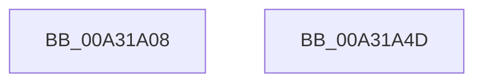

# PopRecordDisplayState

- RVA: `0x00A31A08`–`0x00A31A4E` (길이 `70` bytes)
- VA: `0x0000000140A31A08`
- 실행 섹션: `PAGE`
- PDB 이름 있음: `예`; PDB Function 태그: `아니요`
- unwind 정보 RVA: `0x0005CF00`
- 디코드: `19`개 명령, `70/70` bytes 표시
- 미해석 바이트: `0` (있으면 어셈블리에 `.byte`로 보존)

> 이 문서는 커널 이미지의 기계어와 PDB 기호를 분석해 생성했습니다. 4번과 5번은 함수 원형과 자료형을 바이너리 사용 방식에서 추정한 C 해석이며 원본 소스 복구 결과는 아닙니다.

## 1. Dependencies

- 직접 호출 지점: **3**; 고유 호출 대상: **3**
- 직접 호출자로 확인된 함수: **1**
- RIP 상대 이미지 참조: **3**

### Outgoing calls
- `0x00A31A17` → [PopAcquireRwLockExclusive](../../text/43/PopAcquireRwLockExclusive_function_00430B44.md) (function, `0x00430B44`)
- `0x00A31A36` → [PopBsdHandleRequest](../../text/4B/PopBsdHandleRequest_function_004B27A0.md) (function, `0x004B27A0`)
- `0x00A31A42` → [PopReleaseRwLock](../../text/2D/PopReleaseRwLock_function_002DFBBC.md) (function, `0x002DFBBC`)

### Direct callers
- [PopUpdateConsoleDisplayState](PopUpdateConsoleDisplayState_function_00A31298.md) at `0x00A31322`

### Static image references
- `0x00A31A10` → RVA `0x00F0F1E0` (`.data`; read)
- `0x00A31A1C` → RVA `0x00E6741E` (`.data`; read)
- `0x00A31A30` → RVA `0x00E6741E` (`.data`; write)

## 2. Other-region calls and transfers

- 다른 실행 섹션으로 향하는 call: **3**
  - `0x00A31A17` → [PopAcquireRwLockExclusive](../../text/43/PopAcquireRwLockExclusive_function_00430B44.md) (`PAGE` → `.text`)
  - `0x00A31A36` → [PopBsdHandleRequest](../../text/4B/PopBsdHandleRequest_function_004B27A0.md) (`PAGE` → `.text`)
  - `0x00A31A42` → [PopReleaseRwLock](../../text/2D/PopReleaseRwLock_function_002DFBBC.md) (`PAGE` → `.text`)
- 별도 외부 분기/꼬리 이동을 확인하지 못했습니다.

## 3. Assembly (complete function range)

```asm
00A31A08  40 53                           push rbx
00A31A0A  48 83 EC 20                     sub rsp, 0x20
00A31A0E  8B D9                           mov ebx, ecx
00A31A10  48 8D 0D C9 D7 4D 00            lea rcx, [rip + 0x4dd7c9]
00A31A17  E8 28 F1 9F FF                  call 0x140430b44
00A31A1C  8A 05 FC 59 43 00               mov al, byte ptr [rip + 0x4359fc]
00A31A22  B9 01 00 00 00                  mov ecx, 1
00A31A27  02 D9                           add bl, cl
00A31A29  24 3F                           and al, 0x3f
00A31A2B  C0 E3 06                        shl bl, 6
00A31A2E  0A D8                           or bl, al
00A31A30  88 1D E8 59 43 00               mov byte ptr [rip + 0x4359e8], bl
00A31A36  E8 65 0D A8 FF                  call 0x1404b27a0
00A31A3B  48 8D 0D 9E D7 4D 00            lea rcx, [rip + 0x4dd79e]
00A31A42  E8 75 E1 8A FF                  call 0x1402dfbbc
00A31A47  48 83 C4 20                     add rsp, 0x20
00A31A4B  5B                              pop rbx
00A31A4C  C3                              ret
00A31A4D  CC                              int3
```

## 4. C-style interpretation (structured pseudocode)

```c
__int64 __fastcall PopRecordDisplayState(int a1)
{
    __int64 result;
    __int64 v_rbx;
    __int64 v_rsp;

    v_rsp = (v_rsp) - (32);
    result = PopAcquireRwLockExclusive(v_rip + 5101513, a2, a3, a4);
    v_rbx = (unsigned __int8)(((unsigned int)(a1)) + (1));
    result = (unsigned __int8)((*(unsigned __int8 *)(v_rip + 4413948)) & (63));
    v_rbx = (unsigned __int8)((v_rbx) << (6));
    v_rbx = (unsigned __int8)((v_rbx) | ((unsigned __int8)(result)));
    *(unsigned __int8 *)(v_rip + 4413928) = (unsigned __int8)(v_rbx);
    result = PopBsdHandleRequest(1, a2, a3, a4);
    result = PopReleaseRwLock(v_rip + 5101470, a2, a3, a4);
    v_rsp = (v_rsp) + (32);
    return result;
}
```

## 5. (Beta) C Style

```c
int64_t PopRecordDisplayState(int32_t Arg1)
{
    int64_t result;
    int64_t local_rbx;
    int64_t local_rsp;

    local_rsp = (local_rsp) - (32);
    result = PopAcquireRwLockExclusive(v_rip + 5101513, a2, a3, a4);
    local_rbx = (uint8_t)(((uint32_t)(Arg1)) + (1));
    result = (uint8_t)((*(uint8_t *)(v_rip + 0x4359FC)) & (63));
    local_rbx = (uint8_t)((local_rbx) << (6));
    local_rbx = (uint8_t)((local_rbx) | ((uint8_t)(result)));
    *(uint8_t *)(v_rip + 0x4359E8) = (uint8_t)(local_rbx);
    result = PopBsdHandleRequest(1, a2, a3, a4);
    result = PopReleaseRwLock(v_rip + 5101470, a2, a3, a4);
    local_rsp = (local_rsp) + (32);
    return result;
}
```

## 6. Execution-region graph

[열기: 2D/3D 그래프와 함수 탐색 컨트롤 패널](../../../control-panel.html?section=page&rva=0x00A31A08&view=graph)

- 2D 그래프는 위에서 아래로 흐르고, 3D 그래프는 빈 공간을 드래그해 회전합니다. Shift+드래그는 이동, 휠은 확대·축소, 함수 노드 선택은 대상 보고서 이동입니다.

### Static fallback


