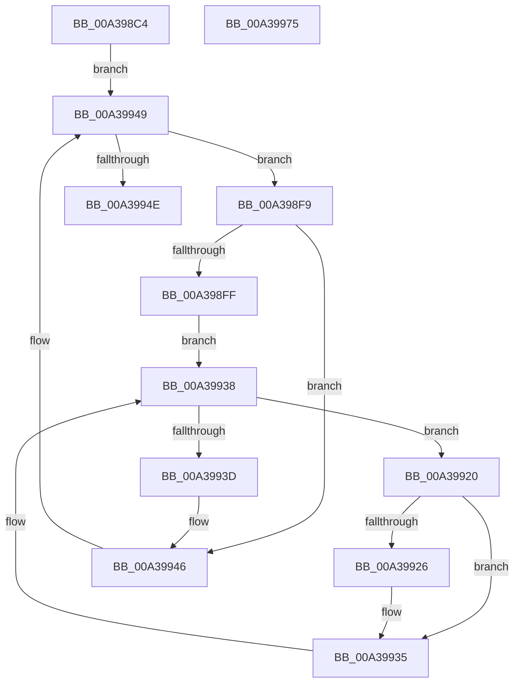

# PopRundownPowerLimitRequests

- RVA: `0x00A398C4`–`0x00A39976` (길이 `178` bytes)
- VA: `0x0000000140A398C4`
- 실행 섹션: `PAGE`
- PDB 이름 있음: `예`; PDB Function 태그: `아니요`
- unwind 정보 RVA: `0x0005E6B4`
- 디코드: `45`개 명령, `178/178` bytes 표시
- 미해석 바이트: `0` (있으면 어셈블리에 `.byte`로 보존)

> 이 문서는 커널 이미지의 기계어와 PDB 기호를 분석해 생성했습니다. 4번과 5번은 함수 원형과 자료형을 바이너리 사용 방식에서 추정한 C 해석이며 원본 소스 복구 결과는 아닙니다.

## 1. Dependencies

- 직접 호출 지점: **6**; 고유 호출 대상: **4**
- 직접 호출자로 확인된 함수: **1**
- RIP 상대 이미지 참조: **4**

### Outgoing calls
- `0x00A398E4` → [PopAcquireRwLockExclusive](../../text/43/PopAcquireRwLockExclusive_function_00430B44.md) (function, `0x00430B44`)
- `0x00A39903` → [PopAcquireRwLockExclusive](../../text/43/PopAcquireRwLockExclusive_function_00430B44.md) (function, `0x00430B44`)
- `0x00A39912` → [PopDiagTracePowerLimitExtension](../76/PopDiagTracePowerLimitExtension_function_0076233C.md) (function, `0x0076233C`)
- `0x00A39930` → [PopDiagTracePowerLimitRequest](../76/PopDiagTracePowerLimitRequest_function_007626D0.md) (function, `0x007626D0`)
- `0x00A39941` → [PopReleaseRwLock](../../text/2D/PopReleaseRwLock_function_002DFBBC.md) (function, `0x002DFBBC`)
- `0x00A39955` → [PopReleaseRwLock](../../text/2D/PopReleaseRwLock_function_002DFBBC.md) (function, `0x002DFBBC`)

### Direct callers
- [PopDiagTraceControlCallback](PopDiagTraceControlCallback_function_00A38CB0.md) at `0x00A38E03`

### Static image references
- `0x00A398DD` → RVA `0x00F0BB50` (`.data`; read)
- `0x00A398E9` → RVA `0x00F0BB60` (`.data`; read)
- `0x00A39908` → RVA `0x000210A8` (`.rdata`; read)
- `0x00A39926` → RVA `0x00022F60` (`.rdata`; read)

## 2. Other-region calls and transfers

- 다른 실행 섹션으로 향하는 call: **4**
  - `0x00A398E4` → [PopAcquireRwLockExclusive](../../text/43/PopAcquireRwLockExclusive_function_00430B44.md) (`PAGE` → `.text`)
  - `0x00A39903` → [PopAcquireRwLockExclusive](../../text/43/PopAcquireRwLockExclusive_function_00430B44.md) (`PAGE` → `.text`)
  - `0x00A39941` → [PopReleaseRwLock](../../text/2D/PopReleaseRwLock_function_002DFBBC.md) (`PAGE` → `.text`)
  - `0x00A39955` → [PopReleaseRwLock](../../text/2D/PopReleaseRwLock_function_002DFBBC.md) (`PAGE` → `.text`)
- 별도 외부 분기/꼬리 이동을 확인하지 못했습니다.

## 3. Assembly (complete function range)

```asm
00A398C4  48 8B C4                        mov rax, rsp
00A398C7  48 89 58 08                     mov qword ptr [rax + 8], rbx
00A398CB  48 89 68 10                     mov qword ptr [rax + 0x10], rbp
00A398CF  48 89 70 18                     mov qword ptr [rax + 0x18], rsi
00A398D3  48 89 78 20                     mov qword ptr [rax + 0x20], rdi
00A398D7  41 56                           push r14
00A398D9  48 83 EC 20                     sub rsp, 0x20
00A398DD  48 8D 0D 6C 22 4D 00            lea rcx, [rip + 0x4d226c]
00A398E4  E8 5B 72 9F FF                  call 0x140430b44
00A398E9  48 8B 1D 70 22 4D 00            mov rbx, qword ptr [rip + 0x4d2270]
00A398F0  4C 8D 35 69 22 4D 00            lea r14, [rip + 0x4d2269]
00A398F7  EB 50                           jmp 0x140a39949
00A398F9  80 7B 30 00                     cmp byte ptr [rbx + 0x30], 0
00A398FD  74 47                           je 0x140a39946
00A398FF  48 8D 4B 20                     lea rcx, [rbx + 0x20]
00A39903  E8 3C 72 9F FF                  call 0x140430b44
00A39908  48 8D 15 99 77 5E FF            lea rdx, [rip - 0xa18867]
00A3990F  48 8B CB                        mov rcx, rbx
00A39912  E8 25 8A D2 FF                  call 0x14076233c
00A39917  48 8D 73 10                     lea rsi, [rbx + 0x10]
00A3991B  48 8B 3E                        mov rdi, qword ptr [rsi]
00A3991E  EB 18                           jmp 0x140a39938
00A39920  80 7F 10 00                     cmp byte ptr [rdi + 0x10], 0
00A39924  74 0F                           je 0x140a39935
00A39926  48 8D 15 33 96 5E FF            lea rdx, [rip - 0xa169cd]
00A3992D  48 8B CF                        mov rcx, rdi
00A39930  E8 9B 8D D2 FF                  call 0x1407626d0
00A39935  48 8B 3F                        mov rdi, qword ptr [rdi]
00A39938  48 3B FE                        cmp rdi, rsi
00A3993B  75 E3                           jne 0x140a39920
00A3993D  48 8D 4B 20                     lea rcx, [rbx + 0x20]
00A39941  E8 76 62 8A FF                  call 0x1402dfbbc
00A39946  48 8B 1B                        mov rbx, qword ptr [rbx]
00A39949  49 3B DE                        cmp rbx, r14
00A3994C  75 AB                           jne 0x140a398f9
00A3994E  48 8D 0D FB 21 4D 00            lea rcx, [rip + 0x4d21fb]
00A39955  E8 62 62 8A FF                  call 0x1402dfbbc
00A3995A  48 8B 5C 24 30                  mov rbx, qword ptr [rsp + 0x30]
00A3995F  48 8B 6C 24 38                  mov rbp, qword ptr [rsp + 0x38]
00A39964  48 8B 74 24 40                  mov rsi, qword ptr [rsp + 0x40]
00A39969  48 8B 7C 24 48                  mov rdi, qword ptr [rsp + 0x48]
00A3996E  48 83 C4 20                     add rsp, 0x20
00A39972  41 5E                           pop r14
00A39974  C3                              ret
00A39975  CC                              int3
```

## 4. C-style interpretation (structured pseudocode)

```c
__int64 __fastcall PopRundownPowerLimitRequests(void)
{
    __int64 result;
    __int64 v_rsp;
    unsigned __int64 v_stack_p10;
    unsigned __int64 v_stack_p18;
    unsigned __int64 v_stack_p20;
    unsigned __int64 v_stack_p8;

    *(unsigned __int64 *)(v_rsp + 8) = v_rbx;
    *(unsigned __int64 *)(v_rsp + 16) = v_rbp;
    *(unsigned __int64 *)(v_rsp + 24) = v_rsi;
    *(unsigned __int64 *)(v_rsp + 32) = v_rdi;
    v_rsp = (v_rsp) - (32);
    result = PopAcquireRwLockExclusive(v_rip + 5055084, a2, a3, a4);
    goto loc_00A39949;
loc_00A398F9:
    if ((*(unsigned __int8 *)(*(unsigned __int64 *)(v_rip + 5055088) + 48)) == 0) goto loc_00A39946;
    result = PopAcquireRwLockExclusive(*(unsigned __int64 *)(v_rip + 5055088) + 32, a2, a3, a4);
    result = PopDiagTracePowerLimitExtension(*(unsigned __int64 *)(v_rip + 5055088), v_rip - 10586215, a3, a4);
    goto loc_00A39938;
loc_00A39920:
    if ((*(unsigned __int8 *)(*(unsigned __int64 *)(*(unsigned __int64 *)(v_rip + 5055088) + 16) + 16)) != 0) {
        a2 = v_rip - 10578381;
        a1 = *(unsigned __int64 *)(*(unsigned __int64 *)(v_rip + 5055088) + 16);
        result = PopDiagTracePowerLimitRequest(a1, a2, a3, a4);
    }
loc_00A39938:
    if ((*(unsigned __int64 *)(*(unsigned __int64 *)(*(unsigned __int64 *)(v_rip + 5055088) + 16))) != (*(unsigned __int64 *)(v_rip + 5055088) + 16)) goto loc_00A39920;
    result = PopReleaseRwLock(*(unsigned __int64 *)(v_rip + 5055088) + 32, a2, a3, a4);
loc_00A39946:
loc_00A39949:
    if ((*(unsigned __int64 *)(*(unsigned __int64 *)(v_rip + 5055088))) != (v_rip + 5055081)) goto loc_00A398F9;
    result = PopReleaseRwLock(v_rip + 5054971, a2, a3, a4);
    v_rsp = (v_rsp) + (32);
    return result;
}
```

## 5. (Beta) C Style

```c
void PopRundownPowerLimitRequests(void)
{
    int64_t result;
    int64_t local_rsp;
    uint64_t v_stack_p10;
    uint64_t v_stack_p18;
    uint64_t v_stack_p20;
    uint64_t v_stack_p8;

    *(uint64_t *)(local_rsp + 0x8) = local_rbx;
    *(uint64_t *)(local_rsp + 0x10) = local_rbp;
    *(uint64_t *)(local_rsp + 0x18) = local_rsi;
    *(uint64_t *)(local_rsp + 0x20) = local_rdi;
    local_rsp = (local_rsp) - (32);
    result = PopAcquireRwLockExclusive(v_rip + 5055084, a2, a3, a4);
    goto loc_00A39949;
loc_00A398F9:
    if ((*(uint8_t *)(*(uint64_t *)(v_rip + 0x4D2270) + 0x30)) == 0) goto loc_00A39946;
    result = PopAcquireRwLockExclusive(*(uint64_t *)(v_rip + 0x4D2270) + 32, a2, a3, a4);
    result = PopDiagTracePowerLimitExtension(*(uint64_t *)(v_rip + 0x4D2270), v_rip - 10586215, a3, a4);
    goto loc_00A39938;
loc_00A39920:
    if ((*(uint8_t *)(*(uint64_t *)(*(uint64_t *)(v_rip + 0x4D2270) + 0x10) + 0x10)) != 0) {
        a2 = v_rip - 10578381;
        a1 = *(uint64_t *)(*(uint64_t *)(v_rip + 0x4D2270) + 0x10);
        result = PopDiagTracePowerLimitRequest(a1, a2, a3, a4);
    }
loc_00A39938:
    if ((*(uint64_t *)(*(uint64_t *)(*(uint64_t *)(v_rip + 0x4D2270) + 0x10))) != (*(uint64_t *)(v_rip + 0x4D2270) + 16)) goto loc_00A39920;
    result = PopReleaseRwLock(*(uint64_t *)(v_rip + 0x4D2270) + 32, a2, a3, a4);
loc_00A39946:
loc_00A39949:
    if ((*(uint64_t *)(*(uint64_t *)(v_rip + 0x4D2270))) != (v_rip + 5055081)) goto loc_00A398F9;
    result = PopReleaseRwLock(v_rip + 5054971, a2, a3, a4);
    local_rsp = (local_rsp) + (32);
    return result;
}
```

## 6. Execution-region graph

[열기: 2D/3D 그래프와 함수 탐색 컨트롤 패널](../../../control-panel.html?section=page&rva=0x00A398C4&view=graph)

- 2D 그래프는 위에서 아래로 흐르고, 3D 그래프는 빈 공간을 드래그해 회전합니다. Shift+드래그는 이동, 휠은 확대·축소, 함수 노드 선택은 대상 보고서 이동입니다.

### Static fallback


