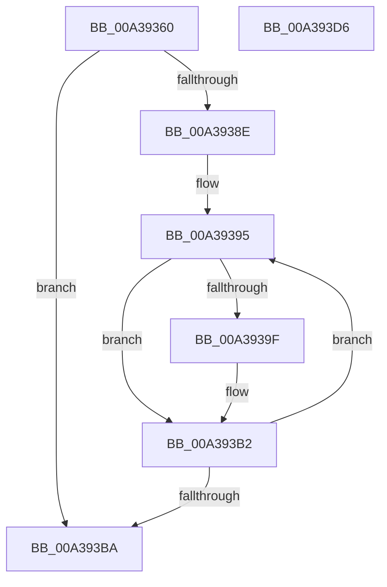

# PopRundownPowerSettings

- RVA: `0x00A39360`–`0x00A393D7` (길이 `119` bytes)
- VA: `0x0000000140A39360`
- 실행 섹션: `PAGE`
- PDB 이름 있음: `예`; PDB Function 태그: `아니요`
- unwind 정보 RVA: `0x00060BC4`
- 디코드: `30`개 명령, `119/119` bytes 표시
- 미해석 바이트: `0` (있으면 어셈블리에 `.byte`로 보존)

> 이 문서는 커널 이미지의 기계어와 PDB 기호를 분석해 생성했습니다. 4번과 5번은 함수 원형과 자료형을 바이너리 사용 방식에서 추정한 C 해석이며 원본 소스 복구 결과는 아닙니다.

## 1. Dependencies

- 직접 호출 지점: **3**; 고유 호출 대상: **3**
- 직접 호출자로 확인된 함수: **1**
- RIP 상대 이미지 참조: **3**

### Outgoing calls
- `0x00A39376` → [ExAcquireFastMutex](../../text/20/ExAcquireFastMutex_function_0020E5A0.md) (function, `0x0020E5A0`)
- `0x00A393AD` → [PopDiagTracePowerSetting](PopDiagTracePowerSetting_function_00A393E0.md) (function, `0x00A393E0`)
- `0x00A393C1` → [ExReleaseFastMutex](../../text/25/ExReleaseFastMutex_function_002519C0.md) (function, `0x002519C0`)

### Direct callers
- [PopDiagTraceControlCallback](PopDiagTraceControlCallback_function_00A38CB0.md) at `0x00A38D91`

### Static image references
- `0x00A3936F` → RVA `0x00F0DF40` (`.data`; read)
- `0x00A3937B` → RVA `0x00F0C6A0` (`.data`; read)
- `0x00A3938E` → RVA `0x00F0CE0C` (`.data`; read)

## 2. Other-region calls and transfers

- 다른 실행 섹션으로 향하는 call: **2**
  - `0x00A39376` → [ExAcquireFastMutex](../../text/20/ExAcquireFastMutex_function_0020E5A0.md) (`PAGE` → `.text`)
  - `0x00A393C1` → [ExReleaseFastMutex](../../text/25/ExReleaseFastMutex_function_002519C0.md) (`PAGE` → `.text`)
- 별도 외부 분기/꼬리 이동을 확인하지 못했습니다.

## 3. Assembly (complete function range)

```asm
00A39360  48 89 5C 24 08                  mov qword ptr [rsp + 8], rbx
00A39365  48 89 74 24 10                  mov qword ptr [rsp + 0x10], rsi
00A3936A  57                              push rdi
00A3936B  48 83 EC 20                     sub rsp, 0x20
00A3936F  48 8D 0D CA 4B 4D 00            lea rcx, [rip + 0x4d4bca]
00A39376  E8 25 52 7D FF                  call 0x14020e5a0
00A3937B  48 8B 1D 1E 33 4D 00            mov rbx, qword ptr [rip + 0x4d331e]
00A39382  48 8D 35 17 33 4D 00            lea rsi, [rip + 0x4d3317]
00A39389  48 3B DE                        cmp rbx, rsi
00A3938C  74 2C                           je 0x140a393ba
00A3938E  48 63 3D 77 3A 4D 00            movsxd rdi, dword ptr [rip + 0x4d3a77]
00A39395  4C 8B 44 FB 40                  mov r8, qword ptr [rbx + rdi*8 + 0x40]
00A3939A  4D 85 C0                        test r8, r8
00A3939D  74 13                           je 0x140a393b2
00A3939F  4D 8D 48 0C                     lea r9, [r8 + 0xc]
00A393A3  B1 01                           mov cl, 1
00A393A5  45 8B 40 04                     mov r8d, dword ptr [r8 + 4]
00A393A9  48 8D 53 20                     lea rdx, [rbx + 0x20]
00A393AD  E8 2E 00 00 00                  call 0x140a393e0
00A393B2  48 8B 1B                        mov rbx, qword ptr [rbx]
00A393B5  48 3B DE                        cmp rbx, rsi
00A393B8  75 DB                           jne 0x140a39395
00A393BA  48 8D 0D 7F 4B 4D 00            lea rcx, [rip + 0x4d4b7f]
00A393C1  E8 FA 85 81 FF                  call 0x1402519c0
00A393C6  48 8B 5C 24 30                  mov rbx, qword ptr [rsp + 0x30]
00A393CB  48 8B 74 24 38                  mov rsi, qword ptr [rsp + 0x38]
00A393D0  48 83 C4 20                     add rsp, 0x20
00A393D4  5F                              pop rdi
00A393D5  C3                              ret
00A393D6  CC                              int3
```

## 4. C-style interpretation (structured pseudocode)

```c
__int64 __fastcall PopRundownPowerSettings(void)
{
    __int64 result;
    __int64 v_rsp;
    unsigned __int64 v_stack_p10;
    unsigned __int64 v_stack_p8;

    v_stack_p8 = v_rbx;
    v_stack_p10 = v_rsi;
    v_rsp = (v_rsp) - (32);
    result = ExAcquireFastMutex(v_rip + 5065674, a2, a3, a4);
    if ((*(unsigned __int64 *)(v_rip + 5059358)) == (v_rip + 5059351)) goto loc_00A393BA;
loc_00A39395:
    if (*(unsigned __int64 *)(*(unsigned __int64 *)(v_rip + 5059358) + (int)(*(unsigned int *)(v_rip + 5061239)) * 8 + 64) != 0) {
        a4 = *(unsigned __int64 *)(*(unsigned __int64 *)(v_rip + 5059358) + (int)(*(unsigned int *)(v_rip + 5061239)) * 8 + 64) + 12;
        a1 = 1;
        a3 = *(unsigned int *)(*(unsigned __int64 *)(*(unsigned __int64 *)(v_rip + 5059358) + (int)(*(unsigned int *)(v_rip + 5061239)) * 8 + 64) + 4);
        a2 = *(unsigned __int64 *)(v_rip + 5059358) + 32;
        result = PopDiagTracePowerSetting(a1, a2, a3, a4);
    }
    if ((*(unsigned __int64 *)(*(unsigned __int64 *)(v_rip + 5059358))) != (v_rip + 5059351)) goto loc_00A39395;
loc_00A393BA:
    result = ExReleaseFastMutex(v_rip + 5065599, a2, a3, a4);
    v_rsp = (v_rsp) + (32);
    return result;
}
```

## 5. (Beta) C Style

```c
void PopRundownPowerSettings(void)
{
    int64_t result;
    int64_t local_rsp;
    uint64_t v_stack_p10;
    uint64_t v_stack_p8;

    v_stack_p8 = local_rbx;
    v_stack_p10 = local_rsi;
    local_rsp = (local_rsp) - (32);
    result = ExAcquireFastMutex(v_rip + 5065674, a2, a3, a4);
    if ((*(uint64_t *)(v_rip + 0x4D331E)) == (v_rip + 5059351)) goto loc_00A393BA;
loc_00A39395:
    if (*(uint64_t *)(*(uint64_t *)(v_rip + 0x4D331E) + (int32_t)(*(uint32_t *)(v_rip + 0x4D3A77)) * 8 + 0x40) != 0) {
        a4 = *(uint64_t *)(*(uint64_t *)(v_rip + 0x4D331E) + (int32_t)(*(uint32_t *)(v_rip + 0x4D3A77)) * 8 + 0x40) + 12;
        a1 = 1;
        a3 = *(uint32_t *)(*(uint64_t *)(*(uint64_t *)(v_rip + 0x4D331E) + (int32_t)(*(uint32_t *)(v_rip + 0x4D3A77)) * 8 + 0x40) + 0x4);
        a2 = *(uint64_t *)(v_rip + 0x4D331E) + 32;
        result = PopDiagTracePowerSetting(a1, a2, a3, a4);
    }
    if ((*(uint64_t *)(*(uint64_t *)(v_rip + 0x4D331E))) != (v_rip + 5059351)) goto loc_00A39395;
loc_00A393BA:
    result = ExReleaseFastMutex(v_rip + 5065599, a2, a3, a4);
    local_rsp = (local_rsp) + (32);
    return result;
}
```

## 6. Execution-region graph

[열기: 2D/3D 그래프와 함수 탐색 컨트롤 패널](../../../control-panel.html?section=page&rva=0x00A39360&view=graph)

- 2D 그래프는 위에서 아래로 흐르고, 3D 그래프는 빈 공간을 드래그해 회전합니다. Shift+드래그는 이동, 휠은 확대·축소, 함수 노드 선택은 대상 보고서 이동입니다.

### Static fallback


