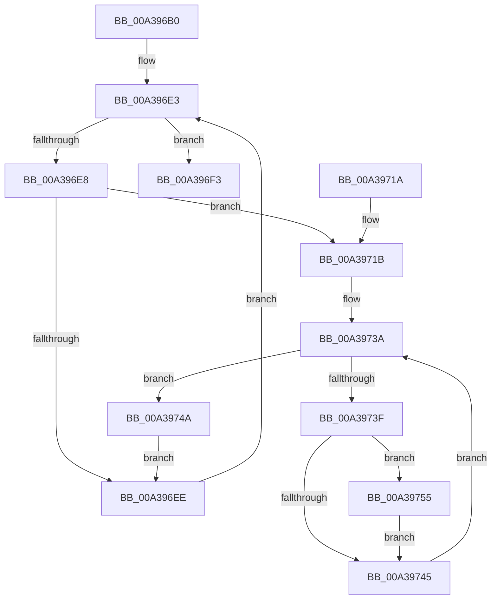

# PopRundownThermalRequests

- RVA: `0x00A396B0`–`0x00A39766` (길이 `182` bytes)
- VA: `0x0000000140A396B0`
- 실행 섹션: `PAGE`
- PDB 이름 있음: `예`; PDB Function 태그: `아니요`
- unwind 정보 RVA: `0x000ADF10`
- 디코드: `47`개 명령, `182/182` bytes 표시
- 미해석 바이트: `0` (있으면 어셈블리에 `.byte`로 보존)

> 이 문서는 커널 이미지의 기계어와 PDB 기호를 분석해 생성했습니다. 4번과 5번은 함수 원형과 자료형을 바이너리 사용 방식에서 추정한 C 해석이며 원본 소스 복구 결과는 아닙니다.

## 1. Dependencies

- 직접 호출 지점: **6**; 고유 호출 대상: **4**
- 직접 호출자로 확인된 함수: **1**
- RIP 상대 이미지 참조: **4**

### Outgoing calls
- `0x00A396D0` → [PopAcquireRwLockExclusive](../../text/43/PopAcquireRwLockExclusive_function_00430B44.md) (function, `0x00430B44`)
- `0x00A396FA` → [PopReleaseRwLock](../../text/2D/PopReleaseRwLock_function_002DFBBC.md) (function, `0x002DFBBC`)
- `0x00A3971F` → [PopAcquireRwLockExclusive](../../text/43/PopAcquireRwLockExclusive_function_00430B44.md) (function, `0x00430B44`)
- `0x00A3972E` → [PopDiagTraceCoolingExtension](PopDiagTraceCoolingExtension_function_00A39C28.md) (function, `0x00A39C28`)
- `0x00A3974E` → [PopReleaseRwLock](../../text/2D/PopReleaseRwLock_function_002DFBBC.md) (function, `0x002DFBBC`)
- `0x00A3975F` → [PopDiagTraceThermalRequest](../AD/PopDiagTraceThermalRequest_function_00ADF828.md) (function, `0x00ADF828`)

### Direct callers
- [PopDiagTraceControlCallback](PopDiagTraceControlCallback_function_00A38CB0.md) at `0x00A38DFE`

### Static image references
- `0x00A396C9` → RVA `0x00F0BB30` (`.data`; read)
- `0x00A396D5` → RVA `0x00F0BB40` (`.data`; read)
- `0x00A39724` → RVA `0x0001A440` (`.rdata`; read)
- `0x00A39755` → RVA `0x00021B78` (`.rdata`; read)

## 2. Other-region calls and transfers

- 다른 실행 섹션으로 향하는 call: **4**
  - `0x00A396D0` → [PopAcquireRwLockExclusive](../../text/43/PopAcquireRwLockExclusive_function_00430B44.md) (`PAGE` → `.text`)
  - `0x00A396FA` → [PopReleaseRwLock](../../text/2D/PopReleaseRwLock_function_002DFBBC.md) (`PAGE` → `.text`)
  - `0x00A3971F` → [PopAcquireRwLockExclusive](../../text/43/PopAcquireRwLockExclusive_function_00430B44.md) (`PAGE` → `.text`)
  - `0x00A3974E` → [PopReleaseRwLock](../../text/2D/PopReleaseRwLock_function_002DFBBC.md) (`PAGE` → `.text`)
- 별도 외부 분기/꼬리 이동을 확인하지 못했습니다.

## 3. Assembly (complete function range)

```asm
00A396B0  48 8B C4                        mov rax, rsp
00A396B3  48 89 58 08                     mov qword ptr [rax + 8], rbx
00A396B7  48 89 68 10                     mov qword ptr [rax + 0x10], rbp
00A396BB  48 89 70 18                     mov qword ptr [rax + 0x18], rsi
00A396BF  48 89 78 20                     mov qword ptr [rax + 0x20], rdi
00A396C3  41 56                           push r14
00A396C5  48 83 EC 20                     sub rsp, 0x20
00A396C9  48 8D 0D 60 24 4D 00            lea rcx, [rip + 0x4d2460]
00A396D0  E8 6F 74 9F FF                  call 0x140430b44
00A396D5  48 8B 1D 64 24 4D 00            mov rbx, qword ptr [rip + 0x4d2464]
00A396DC  4C 8D 35 5D 24 4D 00            lea r14, [rip + 0x4d245d]
00A396E3  49 3B DE                        cmp rbx, r14
00A396E6  74 0B                           je 0x140a396f3
00A396E8  80 7B 50 00                     cmp byte ptr [rbx + 0x50], 0
00A396EC  75 2D                           jne 0x140a3971b
00A396EE  48 8B 1B                        mov rbx, qword ptr [rbx]
00A396F1  EB F0                           jmp 0x140a396e3
00A396F3  48 8D 0D 36 24 4D 00            lea rcx, [rip + 0x4d2436]
00A396FA  E8 BD 64 8A FF                  call 0x1402dfbbc
00A396FF  48 8B 5C 24 30                  mov rbx, qword ptr [rsp + 0x30]
00A39704  48 8B 6C 24 38                  mov rbp, qword ptr [rsp + 0x38]
00A39709  48 8B 74 24 40                  mov rsi, qword ptr [rsp + 0x40]
00A3970E  48 8B 7C 24 48                  mov rdi, qword ptr [rsp + 0x48]
00A39713  48 83 C4 20                     add rsp, 0x20
00A39717  41 5E                           pop r14
00A39719  C3                              ret
00A3971A  CC                              int3
00A3971B  48 8D 4B 20                     lea rcx, [rbx + 0x20]
00A3971F  E8 20 74 9F FF                  call 0x140430b44
00A39724  48 8D 15 15 0D 5E FF            lea rdx, [rip - 0xa1f2eb]
00A3972B  48 8B CB                        mov rcx, rbx
00A3972E  E8 F5 04 00 00                  call 0x140a39c28
00A39733  48 8D 73 10                     lea rsi, [rbx + 0x10]
00A39737  48 8B 3E                        mov rdi, qword ptr [rsi]
00A3973A  48 3B FE                        cmp rdi, rsi
00A3973D  74 0B                           je 0x140a3974a
00A3973F  80 7F 12 00                     cmp byte ptr [rdi + 0x12], 0
00A39743  75 10                           jne 0x140a39755
00A39745  48 8B 3F                        mov rdi, qword ptr [rdi]
00A39748  EB F0                           jmp 0x140a3973a
00A3974A  48 8D 4B 20                     lea rcx, [rbx + 0x20]
00A3974E  E8 69 64 8A FF                  call 0x1402dfbbc
00A39753  EB 99                           jmp 0x140a396ee
00A39755  48 8D 15 1C 84 5E FF            lea rdx, [rip - 0xa17be4]
00A3975C  48 8B CF                        mov rcx, rdi
00A3975F  E8 C4 60 0A 00                  call 0x140adf828
00A39764  EB DF                           jmp 0x140a39745
```

## 4. C-style interpretation (structured pseudocode)

```c
__int64 __fastcall PopRundownThermalRequests(void)
{
    __int64 result;
    __int64 v_rsp;
    unsigned __int64 v_stack_p10;
    unsigned __int64 v_stack_p18;
    unsigned __int64 v_stack_p20;
    unsigned __int64 v_stack_p8;

    *(unsigned __int64 *)(v_rsp + 8) = v_rbx;
    *(unsigned __int64 *)(v_rsp + 16) = v_rbp;
    *(unsigned __int64 *)(v_rsp + 24) = v_rsi;
    *(unsigned __int64 *)(v_rsp + 32) = v_rdi;
    v_rsp = (v_rsp) - (32);
    result = PopAcquireRwLockExclusive(v_rip + 5055584, a2, a3, a4);
loc_00A396E3:
    if ((*(unsigned __int64 *)(v_rip + 5055588)) == (v_rip + 5055581)) goto loc_00A396F3;
    if ((*(unsigned __int8 *)(*(unsigned __int64 *)(v_rip + 5055588) + 80)) != 0) goto loc_00A3971B;
loc_00A396EE:
    goto loc_00A396E3;
loc_00A396F3:
    result = PopReleaseRwLock(v_rip + 5055542, a2, a3, a4);
    v_rsp = (v_rsp) + (32);
    return result;
loc_00A3971B:
    result = PopAcquireRwLockExclusive(v_stack_p8 + 32, a2, a3, a4);
    result = PopDiagTraceCoolingExtension(v_stack_p8, v_rip - 10613483, a3, a4);
loc_00A3973A:
    if ((*(unsigned __int64 *)(v_stack_p8 + 16)) == (v_stack_p8 + 16)) goto loc_00A3974A;
    if ((*(unsigned __int8 *)(*(unsigned __int64 *)(v_stack_p8 + 16) + 18)) != 0) goto loc_00A39755;
loc_00A39745:
    goto loc_00A3973A;
loc_00A3974A:
    result = PopReleaseRwLock(v_stack_p8 + 32, v_rip - 10613483, a3, a4);
    goto loc_00A396EE;
loc_00A39755:
    result = PopDiagTraceThermalRequest(*(unsigned __int64 *)(*(unsigned __int64 *)(v_stack_p8 + 16)), v_rip - 10583012, a3, a4);
    goto loc_00A39745;
}
```

## 5. (Beta) C Style

```c
void PopRundownThermalRequests(void)
{
    int64_t result;
    int64_t local_rsp;
    uint64_t v_stack_p10;
    uint64_t v_stack_p18;
    uint64_t v_stack_p20;
    uint64_t v_stack_p8;

    *(uint64_t *)(local_rsp + 0x8) = local_rbx;
    *(uint64_t *)(local_rsp + 0x10) = local_rbp;
    *(uint64_t *)(local_rsp + 0x18) = local_rsi;
    *(uint64_t *)(local_rsp + 0x20) = local_rdi;
    local_rsp = (local_rsp) - (32);
    result = PopAcquireRwLockExclusive(v_rip + 5055584, a2, a3, a4);
loc_00A396E3:
    if ((*(uint64_t *)(v_rip + 0x4D2464)) == (v_rip + 5055581)) goto loc_00A396F3;
    if ((*(uint8_t *)(*(uint64_t *)(v_rip + 0x4D2464) + 0x50)) != 0) goto loc_00A3971B;
loc_00A396EE:
    goto loc_00A396E3;
loc_00A396F3:
    result = PopReleaseRwLock(v_rip + 5055542, a2, a3, a4);
    local_rsp = (local_rsp) + (32);
    return result;
loc_00A3971B:
    result = PopAcquireRwLockExclusive(v_stack_p8 + 32, a2, a3, a4);
    result = PopDiagTraceCoolingExtension(v_stack_p8, v_rip - 10613483, a3, a4);
loc_00A3973A:
    if ((*(uint64_t *)(v_stack_p8 + 0x10)) == (v_stack_p8 + 16)) goto loc_00A3974A;
    if ((*(uint8_t *)(*(uint64_t *)(v_stack_p8 + 0x10) + 0x12)) != 0) goto loc_00A39755;
loc_00A39745:
    goto loc_00A3973A;
loc_00A3974A:
    result = PopReleaseRwLock(v_stack_p8 + 32, v_rip - 10613483, a3, a4);
    goto loc_00A396EE;
loc_00A39755:
    result = PopDiagTraceThermalRequest(*(uint64_t *)(*(uint64_t *)(v_stack_p8 + 0x10)), v_rip - 10583012, a3, a4);
    goto loc_00A39745;
}
```

## 6. Execution-region graph

[열기: 2D/3D 그래프와 함수 탐색 컨트롤 패널](../../../control-panel.html?section=page&rva=0x00A396B0&view=graph)

- 2D 그래프는 위에서 아래로 흐르고, 3D 그래프는 빈 공간을 드래그해 회전합니다. Shift+드래그는 이동, 휠은 확대·축소, 함수 노드 선택은 대상 보고서 이동입니다.

### Static fallback


