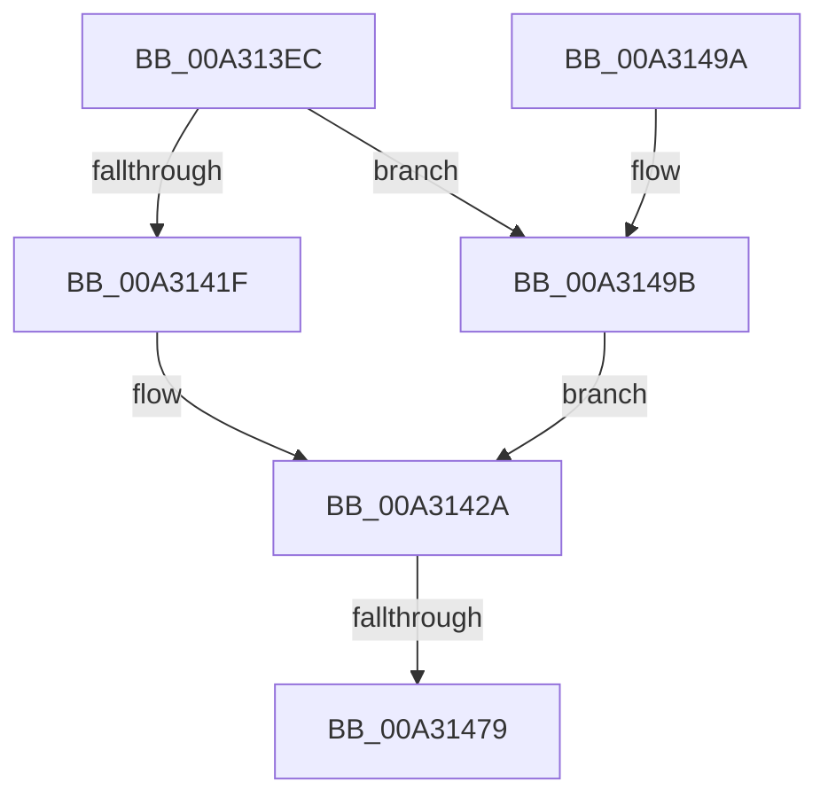

# PopSpoilBatteryEstimate

- RVA: `0x00A313EC`–`0x00A314A5` (길이 `185` bytes)
- VA: `0x0000000140A313EC`
- 실행 섹션: `PAGE`
- PDB 이름 있음: `예`; PDB Function 태그: `예`
- unwind 정보 RVA: `0x000AD1E8`
- 디코드: `40`개 명령, `185/185` bytes 표시
- 미해석 바이트: `0` (있으면 어셈블리에 `.byte`로 보존)

> 이 문서는 커널 이미지의 기계어와 PDB 기호를 분석해 생성했습니다. 4번과 5번은 함수 원형과 자료형을 바이너리 사용 방식에서 추정한 C 해석이며 원본 소스 복구 결과는 아닙니다.

## 1. Dependencies

- 직접 호출 지점: **3**; 고유 호출 대상: **3**
- 직접 호출자로 확인된 함수: **2**
- RIP 상대 이미지 참조: **7**

### Outgoing calls
- `0x00A3142F` → [PopBatteryQueueWork](../../text/4A/PopBatteryQueueWork_function_004AE3DC.md) (function, `0x004AE3DC`)
- `0x00A31467` → [DbgPrintEx](../../text/35/DbgPrintEx_function_00359290.md) (function, `0x00359290`)
- `0x00A31484` → [_security_check_cookie](../../text/6A/_security_check_cookie_function_006AC640.md) (function, `0x006AC640`)

### Direct callers
- [PopSpoilEstimatesOnPowerStateTransitionWorker](../76/PopSpoilEstimatesOnPowerStateTransitionWorker_function_007602A0.md) at `0x007602A9`
- [PopUpdateConsoleDisplayState](PopUpdateConsoleDisplayState_function_00A31298.md) at `0x00A313A8`

### Static image references
- `0x00A313F9` → RVA `0x00E0A740` (`.data`; read)
- `0x00A31422` → RVA `0x00E678A4` (`.data`; read/write)
- `0x00A31434` → RVA `0x00B02BE0` (` ?? ::NNGAKEGL::`string'`; read)
- `0x00A3143D` → RVA `0x00B02BF0` (` ?? ::NNGAKEGL::`string'`; read)
- `0x00A3144D` → RVA `0x00B02C20` (` ?? ::NNGAKEGL::`string'`; read)
- `0x00A31454` → RVA `0x00E678A4` (`.data`; read)
- `0x00A3146C` → RVA `0x00E07748` (`.data`; read)

## 2. Other-region calls and transfers

- 다른 실행 섹션으로 향하는 call: **3**
  - `0x00A3142F` → [PopBatteryQueueWork](../../text/4A/PopBatteryQueueWork_function_004AE3DC.md) (`PAGE` → `.text`)
  - `0x00A31467` → [DbgPrintEx](../../text/35/DbgPrintEx_function_00359290.md) (`PAGE` → `.text`)
  - `0x00A31484` → [_security_check_cookie](../../text/6A/_security_check_cookie_function_006AC640.md) (`PAGE` → `.text`)
- call이 아닌 외부 분기/꼬리 이동: **1**
  - `0x00A31473` → [sub_00B39AFE](../B3/Unknown_function_00B39AFE.md) (`tail-transfer`)

## 3. Assembly (complete function range)

```asm
00A313EC  48 89 5C 24 10                  mov qword ptr [rsp + 0x10], rbx
00A313F1  57                              push rdi
00A313F2  48 81 EC 90 00 00 00            sub rsp, 0x90
00A313F9  48 8B 05 40 93 3D 00            mov rax, qword ptr [rip + 0x3d9340]
00A31400  48 33 C4                        xor rax, rsp
00A31403  48 89 84 24 80 00 00 00         mov qword ptr [rsp + 0x80], rax
00A3140B  B8 01 00 00 00                  mov eax, 1
00A31410  0F B6 DA                        movzx ebx, dl
00A31413  D2 E0                           shl al, cl
00A31415  8B F9                           mov edi, ecx
00A31417  44 0F B6 C0                     movzx r8d, al
00A3141B  84 D2                           test dl, dl
00A3141D  75 7C                           jne 0x140a3149b
00A3141F  41 F7 D0                        not r8d
00A31422  F0 44 21 05 7A 64 43 00         lock and dword ptr [rip + 0x43647a], r8d
00A3142A  B9 04 00 00 00                  mov ecx, 4
00A3142F  E8 A8 CF A7 FF                  call 0x1404ae3dc
00A31434  48 8D 05 A5 17 0D 00            lea rax, [rip + 0xd17a5]
00A3143B  84 DB                           test bl, bl
00A3143D  4C 8D 0D AC 17 0D 00            lea r9, [rip + 0xd17ac]
00A31444  BA 03 00 00 00                  mov edx, 3
00A31449  4C 0F 44 C8                     cmove r9, rax
00A3144D  4C 8D 05 CC 17 0D 00            lea r8, [rip + 0xd17cc]
00A31454  8B 05 4A 64 43 00               mov eax, dword ptr [rip + 0x43644a]
00A3145A  B9 92 00 00 00                  mov ecx, 0x92
00A3145F  89 44 24 28                     mov dword ptr [rsp + 0x28], eax
00A31463  89 7C 24 20                     mov dword ptr [rsp + 0x20], edi
00A31467  E8 24 7E 92 FF                  call 0x140359290
00A3146C  83 3D D5 62 3D 00 05            cmp dword ptr [rip + 0x3d62d5], 5
00A31473  0F 87 85 86 10 00               ja 0x140b39afe
00A31479  48 8B 8C 24 80 00 00 00         mov rcx, qword ptr [rsp + 0x80]
00A31481  48 33 CC                        xor rcx, rsp
00A31484  E8 B7 B1 C7 FF                  call 0x1406ac640
00A31489  48 8B 9C 24 A8 00 00 00         mov rbx, qword ptr [rsp + 0xa8]
00A31491  48 81 C4 90 00 00 00            add rsp, 0x90
00A31498  5F                              pop rdi
00A31499  C3                              ret
00A3149A  CC                              int3
00A3149B  F0 44 09 05 01 64 43 00         lock or dword ptr [rip + 0x436401], r8d
00A314A3  EB 85                           jmp 0x140a3142a
```

## 4. C-style interpretation (structured pseudocode)

```c
__int64 __fastcall PopSpoilBatteryEstimate(int a1, unsigned __int8 a2)
{
    __int64 result;
    __int64 v_rsp;
    unsigned __int64 v_stack_m18;
    unsigned int v_stack_m70;
    unsigned int v_stack_m78;
    unsigned __int64 v_stack_p10;

    v_stack_p10 = v_rbx;
    v_rsp = (v_rsp) - (144);
    result = (*(unsigned __int64 *)(v_rip + 4035392)) ^ (v_rsp);
    v_stack_m18 = result;
    result = (unsigned __int8)((1) << ((unsigned __int8)(a1)));
    if (a2 != 0) goto loc_00A3149B;
    a3 = (unsigned int)(~((unsigned __int8)(result)));
loc_00A3142A:
    result = PopBatteryQueueWork(4, a2, a3, a4);
    a4 = v_rip + 858028;
    if (a2 == 0) { a4 = v_rip + 858021; }
    v_stack_m70 = (unsigned int)((unsigned int)(*(unsigned int *)(v_rip + 4416586)));
    v_stack_m78 = (unsigned int)((unsigned int)(a1));
    result = DbgPrintEx(146, 3, v_rip + 858060, a4);
    a1 = (v_stack_m18) ^ (v_rsp);
    result = _security_check_cookie(a1, 3, v_rip + 858060, a4);
    v_rsp = (v_rsp) + (144);
    return result;
loc_00A3149B:
    goto loc_00A3142A;
}
```

## 5. (Beta) C Style

```c
int64_t PopSpoilBatteryEstimate(int32_t Arg1, uint8_t Arg2)
{
    int64_t result;
    int64_t local_rsp;
    uint64_t v_stack_m18;
    uint32_t v_stack_m70;
    uint32_t v_stack_m78;
    uint64_t v_stack_p10;

    v_stack_p10 = local_rbx;
    local_rsp = (local_rsp) - (144);
    result = (*(uint64_t *)(v_rip + 0x3D9340)) ^ (local_rsp);
    v_stack_m18 = result;
    result = (uint8_t)((1) << ((uint8_t)(Arg1)));
    if (Arg2 != 0) goto loc_00A3149B;
    a3 = (uint32_t)(~((uint8_t)(result)));
loc_00A3142A:
    result = PopBatteryQueueWork(4, Arg2, a3, a4);
    a4 = v_rip + 858028;
    if (Arg2 == 0) { a4 = v_rip + 858021; }
    v_stack_m70 = (uint32_t)((uint32_t)(*(uint32_t *)(v_rip + 0x43644A)));
    v_stack_m78 = (uint32_t)((uint32_t)(Arg1));
    result = DbgPrintEx(146, 3, v_rip + 858060, a4);
    Arg1 = (v_stack_m18) ^ (local_rsp);
    result = _security_check_cookie(Arg1, 3, v_rip + 858060, a4);
    local_rsp = (local_rsp) + (144);
    return result;
loc_00A3149B:
    goto loc_00A3142A;
}
```

## 6. Execution-region graph

[열기: 2D/3D 그래프와 함수 탐색 컨트롤 패널](../../../control-panel.html?section=page&rva=0x00A313EC&view=graph)

- 2D 그래프는 위에서 아래로 흐르고, 3D 그래프는 빈 공간을 드래그해 회전합니다. Shift+드래그는 이동, 휠은 확대·축소, 함수 노드 선택은 대상 보고서 이동입니다.

### Static fallback


