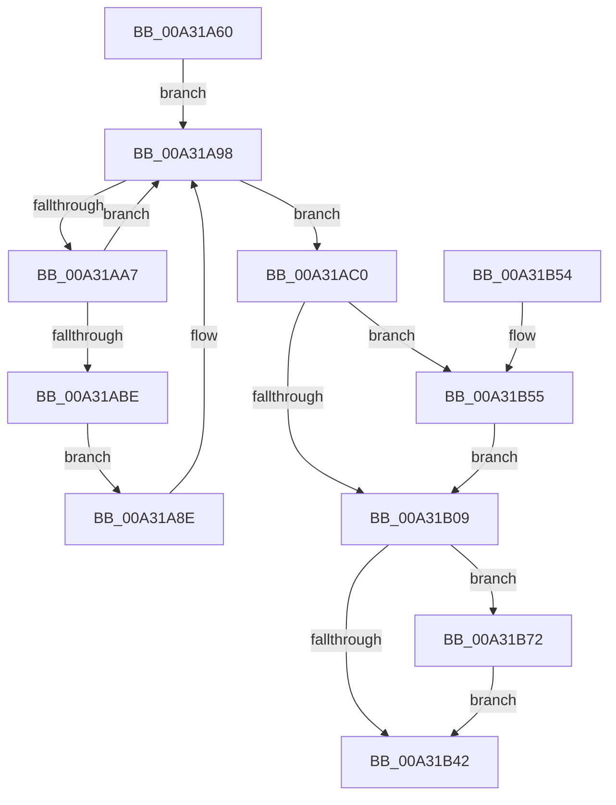

# PopSystemIdleWorker

- RVA: `0x00A31A60`–`0x00A31B85` (길이 `293` bytes)
- VA: `0x0000000140A31A60`
- 실행 섹션: `PAGE`
- PDB 이름 있음: `예`; PDB Function 태그: `아니요`
- unwind 정보 RVA: `0x000AD270`
- 디코드: `68`개 명령, `293/293` bytes 표시
- 미해석 바이트: `0` (있으면 어셈블리에 `.byte`로 보존)

> 이 문서는 커널 이미지의 기계어와 PDB 기호를 분석해 생성했습니다. 4번과 5번은 함수 원형과 자료형을 바이너리 사용 방식에서 추정한 C 해석이며 원본 소스 복구 결과는 아닙니다.

## 1. Dependencies

- 직접 호출 지점: **10**; 고유 호출 대상: **8**
- 직접 호출자로 확인된 함수: **0**
- RIP 상대 이미지 참조: **15**

### Outgoing calls
- `0x00A31A87` → [PopAcquireRwLockExclusive](../../text/43/PopAcquireRwLockExclusive_function_00430B44.md) (function, `0x00430B44`)
- `0x00A31A93` → [PopPulseSystemIdleEvent](PopPulseSystemIdleEvent_function_00A31B8C.md) (function, `0x00A31B8C`)
- `0x00A31AC0` → [PopUpdateLastUserInputTime](PopUpdateLastUserInputTime_function_00A31E24.md) (function, `0x00A31E24`)
- `0x00A31AE0` → [PopIsSystemIdle](PopIsSystemIdle_function_00A31BD8.md) (function, `0x00A31BD8`)
- `0x00A31AFB` → [PopReleaseRwLock](../../text/2D/PopReleaseRwLock_function_002DFBBC.md) (function, `0x002DFBBC`)
- `0x00A31B19` → [PopExecuteSystemIdleAction](PopExecuteSystemIdleAction_function_00A31E7C.md) (function, `0x00A31E7C`)
- `0x00A31B25` → [PopAcquireRwLockExclusive](../../text/43/PopAcquireRwLockExclusive_function_00430B44.md) (function, `0x00430B44`)
- `0x00A31B38` → [PopReleaseRwLock](../../text/2D/PopReleaseRwLock_function_002DFBBC.md) (function, `0x002DFBBC`)
- `0x00A31B6B` → [PopScanIdleList](../../text/49/PopScanIdleList_function_00497F04.md) (function, `0x00497F04`)
- `0x00A31B7E` → [KeSetEvent](../../text/33/KeSetEvent_function_0033F310.md) (function, `0x0033F310`)

### Direct callers
- 이 함수 시작 RVA로 연결되는 직접 call은 확인되지 않았습니다. 간접 호출은 완전히 역산할 수 없습니다.

### Static image references
- `0x00A31A75` → RVA `0x00F093E0` (`.data`; read)
- `0x00A31A7C` → RVA `0x00F0AD64` (`.data`; read)
- `0x00A31A98` → RVA `0x00F09380` (`.data`; read)
- `0x00A31AB0` → RVA `0x00F09380` (`.data`; read/write)
- `0x00A31AC5` → RVA `0x00E0B6B8` (`.data`; read)
- `0x00A31AD2` → RVA `0x00E0B6C8` (`.data`; read)
- `0x00A31AD9` → RVA `0x00E0B7C8` (`.data`; read)
- `0x00A31AE5` → RVA `0x00E0B6B4` (`.data`; read)
- `0x00A31AEE` → RVA `0x00E0B7A8` (`.data`; write)
- `0x00A31B00` → RVA `0x00F06628` (`.data`; read)
- `0x00A31B09` → RVA `0x00E0B7A8` (`.data`; read)
- `0x00A31B0F` → RVA `0x00E0B7B0` (`.data`; read)
- `0x00A31B2A` → RVA `0x00E0B7A8` (`.data`; read/write)
- `0x00A31B55` → RVA `0x00E0B558` (`.data`; read)
- `0x00A31B75` → RVA `0x00F0AD60` (`.data`; read)

## 2. Other-region calls and transfers

- 다른 실행 섹션으로 향하는 call: **6**
  - `0x00A31A87` → [PopAcquireRwLockExclusive](../../text/43/PopAcquireRwLockExclusive_function_00430B44.md) (`PAGE` → `.text`)
  - `0x00A31AFB` → [PopReleaseRwLock](../../text/2D/PopReleaseRwLock_function_002DFBBC.md) (`PAGE` → `.text`)
  - `0x00A31B25` → [PopAcquireRwLockExclusive](../../text/43/PopAcquireRwLockExclusive_function_00430B44.md) (`PAGE` → `.text`)
  - `0x00A31B38` → [PopReleaseRwLock](../../text/2D/PopReleaseRwLock_function_002DFBBC.md) (`PAGE` → `.text`)
  - `0x00A31B6B` → [PopScanIdleList](../../text/49/PopScanIdleList_function_00497F04.md) (`PAGE` → `.text`)
  - `0x00A31B7E` → [KeSetEvent](../../text/33/KeSetEvent_function_0033F310.md) (`PAGE` → `.text`)
- 별도 외부 분기/꼬리 이동을 확인하지 못했습니다.

## 3. Assembly (complete function range)

```asm
00A31A60  48 89 5C 24 18                  mov qword ptr [rsp + 0x18], rbx
00A31A65  48 89 74 24 20                  mov qword ptr [rsp + 0x20], rsi
00A31A6A  57                              push rdi
00A31A6B  48 83 EC 20                     sub rsp, 0x20
00A31A6F  48 83 64 24 38 00               and qword ptr [rsp + 0x38], 0
00A31A75  48 8D 0D 64 79 4D 00            lea rcx, [rip + 0x4d7964]
00A31A7C  83 3D E1 92 4D 00 00            cmp dword ptr [rip + 0x4d92e1], 0
00A31A83  40 0F 94 C6                     sete sil
00A31A87  E8 B8 F0 9F FF                  call 0x140430b44
00A31A8C  EB 0A                           jmp 0x140a31a98
00A31A8E  B9 02 00 00 00                  mov ecx, 2
00A31A93  E8 F4 00 00 00                  call 0x140a31b8c
00A31A98  8B 05 E2 78 4D 00               mov eax, dword ptr [rip + 0x4d78e2]
00A31A9E  0F BC C8                        bsf ecx, eax
00A31AA1  89 4C 24 30                     mov dword ptr [rsp + 0x30], ecx
00A31AA5  74 19                           je 0x140a31ac0
00A31AA7  B8 01 00 00 00                  mov eax, 1
00A31AAC  D3 E0                           shl eax, cl
00A31AAE  F7 D0                           not eax
00A31AB0  F0 21 05 C9 78 4D 00            lock and dword ptr [rip + 0x4d78c9], eax
00A31AB7  83 7C 24 30 02                  cmp dword ptr [rsp + 0x30], 2
00A31ABC  75 DA                           jne 0x140a31a98
00A31ABE  EB CE                           jmp 0x140a31a8e
00A31AC0  E8 5F 03 00 00                  call 0x140a31e24
00A31AC5  8B 1D ED 9B 3D 00               mov ebx, dword ptr [rip + 0x3d9bed]
00A31ACB  4C 8D 44 24 38                  lea r8, [rsp + 0x38]
00A31AD0  8B D3                           mov edx, ebx
00A31AD2  48 8D 0D EF 9B 3D 00            lea rcx, [rip + 0x3d9bef]
00A31AD9  4C 8D 0D E8 9C 3D 00            lea r9, [rip + 0x3d9ce8]
00A31AE0  E8 F3 00 00 00                  call 0x140a31bd8
00A31AE5  8B 0D C9 9B 3D 00               mov ecx, dword ptr [rip + 0x3d9bc9]
00A31AEB  40 8A F8                        mov dil, al
00A31AEE  89 0D B4 9C 3D 00               mov dword ptr [rip + 0x3d9cb4], ecx
00A31AF4  48 8D 0D E5 78 4D 00            lea rcx, [rip + 0x4d78e5]
00A31AFB  E8 BC E0 8A FF                  call 0x1402dfbbc
00A31B00  80 3D 21 4B 4D 00 00            cmp byte ptr [rip + 0x4d4b21], 0
00A31B07  75 4C                           jne 0x140a31b55
00A31B09  8B 0D 99 9C 3D 00               mov ecx, dword ptr [rip + 0x3d9c99]
00A31B0F  4C 8D 05 9A 9C 3D 00            lea r8, [rip + 0x3d9c9a]
00A31B16  40 8A D7                        mov dl, dil
00A31B19  E8 5E 03 00 00                  call 0x140a31e7c
00A31B1E  48 8D 0D BB 78 4D 00            lea rcx, [rip + 0x4d78bb]
00A31B25  E8 1A F0 9F FF                  call 0x140430b44
00A31B2A  83 25 77 9C 3D 00 00            and dword ptr [rip + 0x3d9c77], 0
00A31B31  48 8D 0D A8 78 4D 00            lea rcx, [rip + 0x4d78a8]
00A31B38  E8 7F E0 8A FF                  call 0x1402dfbbc
00A31B3D  40 84 F6                        test sil, sil
00A31B40  75 30                           jne 0x140a31b72
00A31B42  48 8B 5C 24 40                  mov rbx, qword ptr [rsp + 0x40]
00A31B47  33 C0                           xor eax, eax
00A31B49  48 8B 74 24 48                  mov rsi, qword ptr [rsp + 0x48]
00A31B4E  48 83 C4 20                     add rsp, 0x20
00A31B52  5F                              pop rdi
00A31B53  C3                              ret
00A31B54  CC                              int3
00A31B55  44 8B 05 FC 99 3D 00            mov r8d, dword ptr [rip + 0x3d99fc]
00A31B5C  33 D2                           xor edx, edx
00A31B5E  48 8B 44 24 38                  mov rax, qword ptr [rsp + 0x38]
00A31B63  8B CB                           mov ecx, ebx
00A31B65  49 F7 F0                        div r8
00A31B68  48 8B D0                        mov rdx, rax
00A31B6B  E8 94 63 A6 FF                  call 0x140497f04
00A31B70  EB 97                           jmp 0x140a31b09
00A31B72  45 33 C0                        xor r8d, r8d
00A31B75  48 8D 0D E4 91 4D 00            lea rcx, [rip + 0x4d91e4]
00A31B7C  33 D2                           xor edx, edx
00A31B7E  E8 8D D7 90 FF                  call 0x14033f310
00A31B83  EB BD                           jmp 0x140a31b42
```

## 4. C-style interpretation (structured pseudocode)

```c
__int64 __fastcall PopSystemIdleWorker(void)
{
    __int64 result;
    __int64 v_rsi;
    __int64 v_rsp;
    unsigned __int64 v_stack_p10;
    unsigned __int64 v_stack_p18;
    unsigned __int64 v_stack_p20;
    unsigned __int64 v_stack_p38;
    unsigned int v_stack_p8;

    v_stack_p18 = v_rbx;
    v_stack_p20 = v_rsi;
    v_rsp = (v_rsp) - (32);
    v_rsi = ((*(unsigned int *)(v_rip + 5083873)) == 0) ? 1 : 0;
    result = PopAcquireRwLockExclusive(v_rip + 5077348, a2, a3, a4);
    goto loc_00A31A98;
loc_00A31A8E:
    result = PopPulseSystemIdleEvent(2, a2, a3, a4);
loc_00A31A98:
    v_stack_p8 = 2;
    if ((*(unsigned int *)(v_rip + 5083873)) == 0) goto loc_00A31AC0;
    result = (unsigned int)((1) << (2));
    result = (unsigned int)(~(result));
    if (v_stack_p8 != 2) goto loc_00A31A98;
    goto loc_00A31A8E;
loc_00A31AC0:
    result = PopUpdateLastUserInputTime(2, a2, a3, a4);
    result = PopIsSystemIdle(v_rip + 4037615, (unsigned int)((unsigned int)((unsigned int)(*(unsigned int *)(v_rip + 4037613)))), v_stack_p10, v_rip + 4037864);
    *(unsigned int *)(v_rip + 4037812) = (unsigned int)((unsigned int)(*(unsigned int *)(v_rip + 4037577)));
    result = PopReleaseRwLock(v_rip + 5077221, (unsigned int)((unsigned int)((unsigned int)(*(unsigned int *)(v_rip + 4037613)))), v_stack_p10, v_rip + 4037864);
    if ((*(unsigned __int8 *)(v_rip + 5065505)) != 0) goto loc_00A31B55;
loc_00A31B09:
    result = PopExecuteSystemIdleAction((unsigned int)(*(unsigned int *)(v_rip + 4037785)), (unsigned __int8)((unsigned __int8)(result)), v_rip + 4037786, v_rip + 4037864);
    result = PopAcquireRwLockExclusive(v_rip + 5077179, (unsigned __int8)((unsigned __int8)(result)), v_rip + 4037786, v_rip + 4037864);
    result = PopReleaseRwLock(v_rip + 5077160, (unsigned __int8)((unsigned __int8)(result)), v_rip + 4037786, v_rip + 4037864);
    if ((unsigned __int8)(v_rsi) != 0) goto loc_00A31B72;
loc_00A31B42:
    result = 0;
    v_rsp = (v_rsp) + (32);
    return result;
loc_00A31B55:
    a2 = 0;
    result = PopScanIdleList((unsigned int)((unsigned int)(v_stack_p18)), v_stack_p38, (unsigned int)(*(unsigned int *)(v_rip + 4037116)), v_rip + 4037864);
    goto loc_00A31B09;
loc_00A31B72:
    a3 = 0;
    a2 = 0;
    result = KeSetEvent(v_rip + 5083620, a2, a3, v_rip + 4037864);
    goto loc_00A31B42;
}
```

## 5. (Beta) C Style

```c
void PopSystemIdleWorker(void)
{
    int64_t result;
    int64_t local_rsi;
    int64_t local_rsp;
    uint64_t v_stack_p10;
    uint64_t v_stack_p18;
    uint64_t v_stack_p20;
    uint64_t v_stack_p38;
    uint32_t v_stack_p8;

    v_stack_p18 = local_rbx;
    v_stack_p20 = local_rsi;
    local_rsp = (local_rsp) - (32);
    local_rsi = ((*(uint32_t *)(v_rip + 0x4D92E1)) == 0) ? 1 : 0;
    result = PopAcquireRwLockExclusive(v_rip + 5077348, a2, a3, a4);
    goto loc_00A31A98;
loc_00A31A8E:
    result = PopPulseSystemIdleEvent(2, a2, a3, a4);
loc_00A31A98:
    v_stack_p8 = 2;
    if ((*(uint32_t *)(v_rip + 0x4D92E1)) == 0) goto loc_00A31AC0;
    result = (uint32_t)((1) << (2));
    result = (uint32_t)(~(result));
    if (v_stack_p8 != 2) goto loc_00A31A98;
    goto loc_00A31A8E;
loc_00A31AC0:
    result = PopUpdateLastUserInputTime(2, a2, a3, a4);
    result = PopIsSystemIdle(v_rip + 4037615, (uint32_t)((uint32_t)((uint32_t)(*(uint32_t *)(v_rip + 0x3D9BED)))), v_stack_p10, v_rip + 4037864);
    *(uint32_t *)(v_rip + 0x3D9CB4) = (uint32_t)((uint32_t)(*(uint32_t *)(v_rip + 0x3D9BC9)));
    result = PopReleaseRwLock(v_rip + 5077221, (uint32_t)((uint32_t)((uint32_t)(*(uint32_t *)(v_rip + 0x3D9BED)))), v_stack_p10, v_rip + 4037864);
    if ((*(uint8_t *)(v_rip + 0x4D4B21)) != 0) goto loc_00A31B55;
loc_00A31B09:
    result = PopExecuteSystemIdleAction((uint32_t)(*(uint32_t *)(v_rip + 0x3D9C99)), (uint8_t)((uint8_t)(result)), v_rip + 4037786, v_rip + 4037864);
    result = PopAcquireRwLockExclusive(v_rip + 5077179, (uint8_t)((uint8_t)(result)), v_rip + 4037786, v_rip + 4037864);
    result = PopReleaseRwLock(v_rip + 5077160, (uint8_t)((uint8_t)(result)), v_rip + 4037786, v_rip + 4037864);
    if ((uint8_t)(local_rsi) != 0) goto loc_00A31B72;
loc_00A31B42:
    result = 0;
    local_rsp = (local_rsp) + (32);
    return result;
loc_00A31B55:
    a2 = 0;
    result = PopScanIdleList((uint32_t)((uint32_t)(v_stack_p18)), v_stack_p38, (uint32_t)(*(uint32_t *)(v_rip + 0x3D99FC)), v_rip + 4037864);
    goto loc_00A31B09;
loc_00A31B72:
    a3 = 0;
    a2 = 0;
    result = KeSetEvent(v_rip + 5083620, a2, a3, v_rip + 4037864);
    goto loc_00A31B42;
}
```

## 6. Execution-region graph

[열기: 2D/3D 그래프와 함수 탐색 컨트롤 패널](../../../control-panel.html?section=page&rva=0x00A31A60&view=graph)

- 2D 그래프는 위에서 아래로 흐르고, 3D 그래프는 빈 공간을 드래그해 회전합니다. Shift+드래그는 이동, 휠은 확대·축소, 함수 노드 선택은 대상 보고서 이동입니다.

### Static fallback


