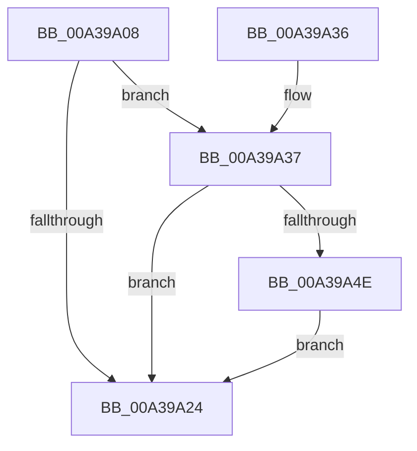

# PopTraceStandbyConnectivityRundown

- RVA: `0x00A39A08`–`0x00A39AA3` (길이 `155` bytes)
- VA: `0x0000000140A39A08`
- 실행 섹션: `PAGE`
- PDB 이름 있음: `예`; PDB Function 태그: `아니요`
- unwind 정보 RVA: `0x000ADF54`
- 디코드: `34`개 명령, `155/155` bytes 표시
- 미해석 바이트: `0` (있으면 어셈블리에 `.byte`로 보존)

> 이 문서는 커널 이미지의 기계어와 PDB 기호를 분석해 생성했습니다. 4번과 5번은 함수 원형과 자료형을 바이너리 사용 방식에서 추정한 C 해석이며 원본 소스 복구 결과는 아닙니다.

## 1. Dependencies

- 직접 호출 지점: **3**; 고유 호출 대상: **3**
- 직접 호출자로 확인된 함수: **1**
- RIP 상대 이미지 참조: **6**

### Outgoing calls
- `0x00A39A2C` → [_security_check_cookie](../../text/6A/_security_check_cookie_function_006AC640.md) (function, `0x006AC640`)
- `0x00A39A45` → [EtwEventEnabled](../../text/39/EtwEventEnabled_function_00392450.md) (function, `0x00392450`)
- `0x00A39A9C` → [EtwWrite](../../text/41/EtwWrite_function_0041C720.md) (function, `0x0041C720`)

### Direct callers
- [PopDiagTraceControlCallback](PopDiagTraceControlCallback_function_00A38CB0.md) at `0x00A38E0D`

### Static image references
- `0x00A39A0C` → RVA `0x00E0A740` (`.data`; read)
- `0x00A39A1B` → RVA `0x00E67858` (`.data`; read)
- `0x00A39A37` → RVA `0x00F0B408` (`.data`; read)
- `0x00A39A3E` → RVA `0x0001A470` (`.rdata`; read)
- `0x00A39A53` → RVA `0x00E678DC` (`.data`; read)
- `0x00A39A70` → RVA `0x00E678E0` (`.data`; read)

## 2. Other-region calls and transfers

- 다른 실행 섹션으로 향하는 call: **3**
  - `0x00A39A2C` → [_security_check_cookie](../../text/6A/_security_check_cookie_function_006AC640.md) (`PAGE` → `.text`)
  - `0x00A39A45` → [EtwEventEnabled](../../text/39/EtwEventEnabled_function_00392450.md) (`PAGE` → `.text`)
  - `0x00A39A9C` → [EtwWrite](../../text/41/EtwWrite_function_0041C720.md) (`PAGE` → `.text`)
- 별도 외부 분기/꼬리 이동을 확인하지 못했습니다.

## 3. Assembly (complete function range)

```asm
00A39A08  48 83 EC 68                     sub rsp, 0x68
00A39A0C  48 8B 05 2D 0D 3D 00            mov rax, qword ptr [rip + 0x3d0d2d]
00A39A13  48 33 C4                        xor rax, rsp
00A39A16  48 89 44 24 50                  mov qword ptr [rsp + 0x50], rax
00A39A1B  80 3D 36 DE 42 00 00            cmp byte ptr [rip + 0x42de36], 0
00A39A22  75 13                           jne 0x140a39a37
00A39A24  48 8B 4C 24 50                  mov rcx, qword ptr [rsp + 0x50]
00A39A29  48 33 CC                        xor rcx, rsp
00A39A2C  E8 0F 2C C7 FF                  call 0x1406ac640
00A39A31  48 83 C4 68                     add rsp, 0x68
00A39A35  C3                              ret
00A39A36  CC                              int3
00A39A37  48 8B 0D CA 19 4D 00            mov rcx, qword ptr [rip + 0x4d19ca]
00A39A3E  48 8D 15 2B 0A 5E FF            lea rdx, [rip - 0xa1f5d5]
00A39A45  E8 06 8A 95 FF                  call 0x140392450
00A39A4A  84 C0                           test al, al
00A39A4C  74 D6                           je 0x140a39a24
00A39A4E  83 64 24 3C 00                  and dword ptr [rsp + 0x3c], 0
00A39A53  48 8D 05 82 DE 42 00            lea rax, [rip + 0x42de82]
00A39A5A  83 64 24 4C 00                  and dword ptr [rsp + 0x4c], 0
00A39A5F  48 8D 15 0A 0A 5E FF            lea rdx, [rip - 0xa1f5f6]
00A39A66  B9 04 00 00 00                  mov ecx, 4
00A39A6B  48 89 44 24 30                  mov qword ptr [rsp + 0x30], rax
00A39A70  48 8D 05 69 DE 42 00            lea rax, [rip + 0x42de69]
00A39A77  89 4C 24 38                     mov dword ptr [rsp + 0x38], ecx
00A39A7B  48 89 44 24 40                  mov qword ptr [rsp + 0x40], rax
00A39A80  45 33 C0                        xor r8d, r8d
00A39A83  48 8D 44 24 30                  lea rax, [rsp + 0x30]
00A39A88  89 4C 24 48                     mov dword ptr [rsp + 0x48], ecx
00A39A8C  44 8D 49 FE                     lea r9d, [rcx - 2]
00A39A90  48 89 44 24 20                  mov qword ptr [rsp + 0x20], rax
00A39A95  48 8B 0D 6C 19 4D 00            mov rcx, qword ptr [rip + 0x4d196c]
00A39A9C  E8 7F 2C 9E FF                  call 0x14041c720
00A39AA1  EB 81                           jmp 0x140a39a24
```

## 4. C-style interpretation (structured pseudocode)

```c
__int64 __fastcall PopTraceStandbyConnectivityRundown(__int64 a1, __int64 a2, int a3)
{
    __int64 result;
    __int64 v_rsp;
    unsigned __int64 v_stack_m18;
    unsigned __int64 v_stack_p20;
    unsigned __int64 v_stack_p30;
    unsigned int v_stack_p38;
    unsigned int v_stack_p3C;
    unsigned __int64 v_stack_p40;
    unsigned int v_stack_p48;
    unsigned int v_stack_p4C;

    v_rsp = (v_rsp) - (104);
    result = (*(unsigned __int64 *)(v_rip + 4001069)) ^ (v_rsp);
    v_stack_m18 = result;
    if ((*(unsigned __int8 *)(v_rip + 4382262)) != 0) goto loc_00A39A37;
loc_00A39A24:
    a1 = (v_stack_m18) ^ (v_rsp);
    result = _security_check_cookie(a1, a2, a3, a4);
    v_rsp = (v_rsp) + (104);
    return result;
loc_00A39A37:
    result = EtwEventEnabled(*(unsigned __int64 *)(v_rip + 5052874), v_rip - 10614229, a3, a4);
    if ((unsigned __int8)(result) == 0) goto loc_00A39A24;
    v_stack_p30 = v_rip + 4382338;
    v_stack_p38 = 4;
    v_stack_p40 = v_rip + 4382313;
    a3 = 0;
    v_stack_p48 = 4;
    v_stack_p20 = v_stack_p30;
    result = EtwWrite(*(unsigned __int64 *)(v_rip + 5052780), v_rip - 10614262, a3, 4 - 2);
    goto loc_00A39A24;
}
```

## 5. (Beta) C Style

```c
int64_t PopTraceStandbyConnectivityRundown(int64_t Arg1, int64_t Arg2, int32_t Arg3)
{
    int64_t result;
    int64_t local_rsp;
    uint64_t v_stack_m18;
    uint64_t v_stack_p20;
    uint64_t v_stack_p30;
    uint32_t v_stack_p38;
    uint32_t v_stack_p3C;
    uint64_t v_stack_p40;
    uint32_t v_stack_p48;
    uint32_t v_stack_p4C;

    local_rsp = (local_rsp) - (104);
    result = (*(uint64_t *)(v_rip + 0x3D0D2D)) ^ (local_rsp);
    v_stack_m18 = result;
    if ((*(uint8_t *)(v_rip + 0x42DE36)) != 0) goto loc_00A39A37;
loc_00A39A24:
    Arg1 = (v_stack_m18) ^ (local_rsp);
    result = _security_check_cookie(Arg1, Arg2, Arg3, a4);
    local_rsp = (local_rsp) + (104);
    return result;
loc_00A39A37:
    result = EtwEventEnabled(*(uint64_t *)(v_rip + 0x4D19CA), v_rip - 10614229, Arg3, a4);
    if ((uint8_t)(result) == 0) goto loc_00A39A24;
    v_stack_p30 = v_rip + 4382338;
    v_stack_p38 = 4;
    v_stack_p40 = v_rip + 4382313;
    Arg3 = 0;
    v_stack_p48 = 4;
    v_stack_p20 = v_stack_p30;
    result = EtwWrite(*(uint64_t *)(v_rip + 0x4D196C), v_rip - 10614262, Arg3, 4 - 2);
    goto loc_00A39A24;
}
```

## 6. Execution-region graph

[열기: 2D/3D 그래프와 함수 탐색 컨트롤 패널](../../../control-panel.html?section=page&rva=0x00A39A08&view=graph)

- 2D 그래프는 위에서 아래로 흐르고, 3D 그래프는 빈 공간을 드래그해 회전합니다. Shift+드래그는 이동, 휠은 확대·축소, 함수 노드 선택은 대상 보고서 이동입니다.

### Static fallback


