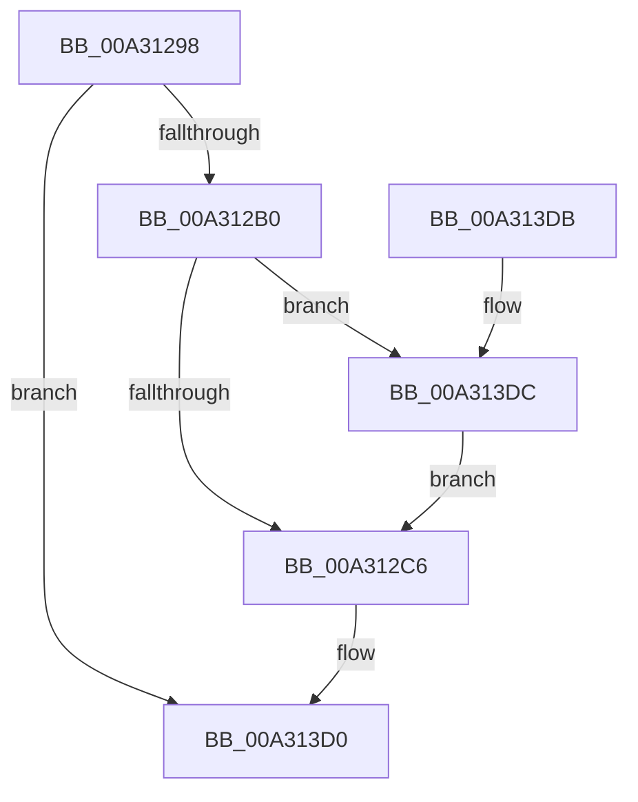

# PopUpdateConsoleDisplayState

- RVA: `0x00A31298`–`0x00A313E6` (길이 `334` bytes)
- VA: `0x0000000140A31298`
- 실행 섹션: `PAGE`
- PDB 이름 있음: `예`; PDB Function 태그: `아니요`
- unwind 정보 RVA: `0x000AD1D8`
- 디코드: `75`개 명령, `334/334` bytes 표시
- 미해석 바이트: `0` (있으면 어셈블리에 `.byte`로 보존)

> 이 문서는 커널 이미지의 기계어와 PDB 기호를 분석해 생성했습니다. 4번과 5번은 함수 원형과 자료형을 바이너리 사용 방식에서 추정한 C 해석이며 원본 소스 복구 결과는 아닙니다.

## 1. Dependencies

- 직접 호출 지점: **13**; 고유 호출 대상: **10**
- 직접 호출자로 확인된 함수: **3**
- RIP 상대 이미지 참조: **8**

### Outgoing calls
- `0x00A312C8` → [PopDiagTraceConsoleDisplayState](PopDiagTraceConsoleDisplayState_function_00A31978.md) (function, `0x00A31978`)
- `0x00A312CD` → [PopCheckResiliencyScenarios](PopCheckResiliencyScenarios_function_00A31718.md) (function, `0x00A31718`)
- `0x00A312FB` → [PopSetPowerSettingValue](../91/PopSetPowerSettingValue_function_00914E54.md) (function, `0x00914E54`)
- `0x00A3131B` → [PopSetPowerSettingValue](../91/PopSetPowerSettingValue_function_00914E54.md) (function, `0x00914E54`)
- `0x00A31322` → [PopRecordDisplayState](PopRecordDisplayState_function_00A31A08.md) (function, `0x00A31A08`)
- `0x00A31350` → [PopSetPowerSettingValue](../91/PopSetPowerSettingValue_function_00914E54.md) (function, `0x00914E54`)
- `0x00A31370` → [PopSetPowerSettingValue](../91/PopSetPowerSettingValue_function_00914E54.md) (function, `0x00914E54`)
- `0x00A31397` → [ZwUpdateWnfStateData](../../text/6B/ZwUpdateWnfStateData_function_006B0D10.md) (function, `0x006B0D10`)
- `0x00A313A8` → [PopSpoilBatteryEstimate](PopSpoilBatteryEstimate_function_00A313EC.md) (function, `0x00A313EC`)
- `0x00A313B4` → [PopAcquireRwLockExclusive](../../text/43/PopAcquireRwLockExclusive_function_00430B44.md) (function, `0x00430B44`)
- `0x00A313B9` → [PopUpdateLastUserInputTime](PopUpdateLastUserInputTime_function_00A31E24.md) (function, `0x00A31E24`)
- `0x00A313CB` → [PopReleaseRwLock](../../text/2D/PopReleaseRwLock_function_002DFBBC.md) (function, `0x002DFBBC`)
- `0x00A313DC` → [guard_dispatch_icall](../../text/6B/guard_dispatch_icall_function_006BAAD0.md) (function, `0x006BAAD0`)

### Direct callers
- [NtPowerInformation](../95/NtPowerInformation_function_00955D80.md) at `0x00956DD6`
- [PopPowerInformationInternal](../A8/PopPowerInformationInternal_function_00A8B7C0.md) at `0x00A8BCED`
- [PoInitSystem](../../init/C7/PoInitSystem_function_00C72358.md) at `0x00C73113`

### Static image references
- `0x00A312A2` → RVA `0x00E67A50` (`.data`; read)
- `0x00A312B0` → RVA `0x00E67818` (`.data`; read)
- `0x00A312B7` → RVA `0x00E67A50` (`.data`; write)
- `0x00A312D8` → RVA `0x0001C130` (`.rdata`; read)
- `0x00A31329` → RVA `0x0001A2B0` (`.rdata`; read)
- `0x00A31384` → RVA `0x0001A278` (`.rdata`; read)
- `0x00A313AD` → RVA `0x00F093E0` (`.data`; read)
- `0x00A313C5` → RVA `0x00E0B6C4` (`.data`; write)

## 2. Other-region calls and transfers

- 다른 실행 섹션으로 향하는 call: **4**
  - `0x00A31397` → [ZwUpdateWnfStateData](../../text/6B/ZwUpdateWnfStateData_function_006B0D10.md) (`PAGE` → `.text`)
  - `0x00A313B4` → [PopAcquireRwLockExclusive](../../text/43/PopAcquireRwLockExclusive_function_00430B44.md) (`PAGE` → `.text`)
  - `0x00A313CB` → [PopReleaseRwLock](../../text/2D/PopReleaseRwLock_function_002DFBBC.md) (`PAGE` → `.text`)
  - `0x00A313DC` → [guard_dispatch_icall](../../text/6B/guard_dispatch_icall_function_006BAAD0.md) (`PAGE` → `.text`)
- 별도 외부 분기/꼬리 이동을 확인하지 못했습니다.

## 3. Assembly (complete function range)

```asm
00A31298  48 89 5C 24 10                  mov qword ptr [rsp + 0x10], rbx
00A3129D  55                              push rbp
00A3129E  48 83 EC 40                     sub rsp, 0x40
00A312A2  39 0D A8 67 43 00               cmp dword ptr [rip + 0x4367a8], ecx
00A312A8  8B D9                           mov ebx, ecx
00A312AA  0F 84 20 01 00 00               je 0x140a313d0
00A312B0  48 8B 05 61 65 43 00            mov rax, qword ptr [rip + 0x436561]
00A312B7  89 0D 93 67 43 00               mov dword ptr [rip + 0x436793], ecx
00A312BD  48 85 C0                        test rax, rax
00A312C0  0F 85 16 01 00 00               jne 0x140a313dc
00A312C6  8B CB                           mov ecx, ebx
00A312C8  E8 AB 06 00 00                  call 0x140a31978
00A312CD  E8 46 04 00 00                  call 0x140a31718
00A312D2  8B 05 78 67 43 00               mov eax, dword ptr [rip + 0x436778]
00A312D8  48 8D 0D 51 AE 5E FF            lea rcx, [rip - 0xa151af]
00A312DF  89 44 24 50                     mov dword ptr [rsp + 0x50], eax
00A312E3  BD 04 00 00 00                  mov ebp, 4
00A312E8  48 8D 44 24 50                  lea rax, [rsp + 0x50]
00A312ED  44 8B CD                        mov r9d, ebp
00A312F0  45 33 C0                        xor r8d, r8d
00A312F3  48 89 44 24 20                  mov qword ptr [rsp + 0x20], rax
00A312F8  83 CA FF                        or edx, 0xffffffff
00A312FB  E8 54 3B EE FF                  call 0x140914e54
00A31300  48 8D 44 24 50                  lea rax, [rsp + 0x50]
00A31305  44 8B CD                        mov r9d, ebp
00A31308  44 8D 45 FD                     lea r8d, [rbp - 3]
00A3130C  48 89 44 24 20                  mov qword ptr [rsp + 0x20], rax
00A31311  83 CA FF                        or edx, 0xffffffff
00A31314  48 8D 0D 15 AE 5E FF            lea rcx, [rip - 0xa151eb]
00A3131B  E8 34 3B EE FF                  call 0x140914e54
00A31320  8B CB                           mov ecx, ebx
00A31322  E8 E1 06 00 00                  call 0x140a31a08
00A31327  33 C0                           xor eax, eax
00A31329  48 8D 0D 80 8F 5E FF            lea rcx, [rip - 0xa17080]
00A31330  39 05 1A 67 43 00               cmp dword ptr [rip + 0x43671a], eax
00A31336  44 8B CD                        mov r9d, ebp
00A31339  0F 95 C0                        setne al
00A3133C  45 33 C0                        xor r8d, r8d
00A3133F  89 44 24 50                     mov dword ptr [rsp + 0x50], eax
00A31343  83 CA FF                        or edx, 0xffffffff
00A31346  48 8D 44 24 50                  lea rax, [rsp + 0x50]
00A3134B  48 89 44 24 20                  mov qword ptr [rsp + 0x20], rax
00A31350  E8 FF 3A EE FF                  call 0x140914e54
00A31355  48 8D 44 24 50                  lea rax, [rsp + 0x50]
00A3135A  44 8B CD                        mov r9d, ebp
00A3135D  44 8D 45 FD                     lea r8d, [rbp - 3]
00A31361  48 89 44 24 20                  mov qword ptr [rsp + 0x20], rax
00A31366  83 CA FF                        or edx, 0xffffffff
00A31369  48 8D 0D 40 8F 5E FF            lea rcx, [rip - 0xa170c0]
00A31370  E8 DF 3A EE FF                  call 0x140914e54
00A31375  83 64 24 30 00                  and dword ptr [rsp + 0x30], 0
00A3137A  48 8D 54 24 50                  lea rdx, [rsp + 0x50]
00A3137F  83 64 24 28 00                  and dword ptr [rsp + 0x28], 0
00A31384  48 8D 0D ED 8E 5E FF            lea rcx, [rip - 0xa17113]
00A3138B  48 83 64 24 20 00               and qword ptr [rsp + 0x20], 0
00A31391  45 33 C9                        xor r9d, r9d
00A31394  44 8B C5                        mov r8d, ebp
00A31397  E8 74 F9 C7 FF                  call 0x1406b0d10
00A3139C  83 3D AD 66 43 00 00            cmp dword ptr [rip + 0x4366ad], 0
00A313A3  0F 94 C2                        sete dl
00A313A6  33 C9                           xor ecx, ecx
00A313A8  E8 3F 00 00 00                  call 0x140a313ec
00A313AD  48 8D 0D 2C 80 4D 00            lea rcx, [rip + 0x4d802c]
00A313B4  E8 8B F7 9F FF                  call 0x140430b44
00A313B9  E8 66 0A 00 00                  call 0x140a31e24
00A313BE  48 8D 0D 1B 80 4D 00            lea rcx, [rip + 0x4d801b]
00A313C5  89 1D F9 A2 3D 00               mov dword ptr [rip + 0x3da2f9], ebx
00A313CB  E8 EC E7 8A FF                  call 0x1402dfbbc
00A313D0  48 8B 5C 24 58                  mov rbx, qword ptr [rsp + 0x58]
00A313D5  48 83 C4 40                     add rsp, 0x40
00A313D9  5D                              pop rbp
00A313DA  C3                              ret
00A313DB  CC                              int3
00A313DC  E8 EF 96 C8 FF                  call 0x1406baad0
00A313E1  E9 E0 FE FF FF                  jmp 0x140a312c6
```

## 4. C-style interpretation (structured pseudocode)

```c
__int64 __fastcall PopUpdateConsoleDisplayState(int a1, int a2, int a3)
{
    __int64 result;
    __int64 v_rsp;
    unsigned int v_stack_m18;
    unsigned int v_stack_m20;
    unsigned __int64 v_stack_m28;
    unsigned __int64 v_stack_p10;
    unsigned int v_stack_p8;

    v_stack_p10 = v_rbx;
    v_rsp = (v_rsp) - (64);
    if ((*(unsigned int *)(v_rip + 4417448)) == a1) goto loc_00A313D0;
    *(unsigned int *)(v_rip + 4417427) = a1;
    if (*(unsigned __int64 *)(v_rip + 4416865) != 0) goto loc_00A313DC;
loc_00A312C6:
    result = PopDiagTraceConsoleDisplayState((unsigned int)((unsigned int)((unsigned int)(a1))), a2, a3, a4);
    result = PopCheckResiliencyScenarios((unsigned int)((unsigned int)((unsigned int)(a1))), a2, a3, a4);
    v_stack_p8 = (unsigned int)((unsigned int)(*(unsigned int *)(v_rip + 4417400)));
    a3 = 0;
    v_stack_m28 = v_stack_p8;
    a2 = (unsigned int)((a2) | (0xFFFFFFFFULL));
    result = PopSetPowerSettingValue(v_rip - 10572207, a2, a3, 4);
    v_stack_m28 = v_stack_p8;
    a2 = (unsigned int)((a2) | (0xFFFFFFFFULL));
    result = PopSetPowerSettingValue(v_rip - 10572267, a2, 4 - 3, 4);
    result = PopRecordDisplayState((unsigned int)((unsigned int)((unsigned int)(a1))), a2, 4 - 3, 4);
    result = 0;
    result = ((*(unsigned int *)(v_rip + 4417306)) != 0) ? 1 : 0;
    a3 = 0;
    v_stack_p8 = (unsigned int)(result);
    a2 = (unsigned int)((a2) | (0xFFFFFFFFULL));
    v_stack_m28 = v_stack_p8;
    result = PopSetPowerSettingValue(v_rip - 10580096, a2, a3, 4);
    v_stack_m28 = v_stack_p8;
    a2 = (unsigned int)((a2) | (0xFFFFFFFFULL));
    result = PopSetPowerSettingValue(v_rip - 10580160, a2, 4 - 3, 4);
    a4 = 0;
    result = ZwUpdateWnfStateData(v_rip - 10580243, v_stack_p8, 4, a4);
    a2 = ((*(unsigned int *)(v_rip + 4417197)) == 0) ? 1 : 0;
    a1 = 0;
    result = PopSpoilBatteryEstimate(a1, a2, 4, a4);
    result = PopAcquireRwLockExclusive(v_rip + 5079084, a2, 4, a4);
    result = PopUpdateLastUserInputTime(v_rip + 5079084, a2, 4, a4);
    *(unsigned int *)(v_rip + 4039417) = (unsigned int)((unsigned int)(a1));
    result = PopReleaseRwLock(v_rip + 5079067, a2, 4, a4);
loc_00A313D0:
    v_rsp = (v_rsp) + (64);
    return result;
loc_00A313DC:
    result = guard_dispatch_icall(v_rip + 5079067, a2, 4, a4);
    goto loc_00A312C6;
}
```

## 5. (Beta) C Style

```c
int64_t PopUpdateConsoleDisplayState(int32_t Arg1, int32_t Arg2, int32_t Arg3)
{
    int64_t result;
    int64_t local_rsp;
    uint32_t v_stack_m18;
    uint32_t v_stack_m20;
    uint64_t v_stack_m28;
    uint64_t v_stack_p10;
    uint32_t v_stack_p8;

    v_stack_p10 = local_rbx;
    local_rsp = (local_rsp) - (64);
    if ((*(uint32_t *)(v_rip + 0x4367A8)) == Arg1) goto loc_00A313D0;
    *(uint32_t *)(v_rip + 0x436793) = Arg1;
    if (*(uint64_t *)(v_rip + 0x436561) != 0) goto loc_00A313DC;
loc_00A312C6:
    result = PopDiagTraceConsoleDisplayState((uint32_t)((uint32_t)((uint32_t)(Arg1))), Arg2, Arg3, a4);
    result = PopCheckResiliencyScenarios((uint32_t)((uint32_t)((uint32_t)(Arg1))), Arg2, Arg3, a4);
    v_stack_p8 = (uint32_t)((uint32_t)(*(uint32_t *)(v_rip + 0x436778)));
    Arg3 = 0;
    v_stack_m28 = v_stack_p8;
    Arg2 = (uint32_t)((Arg2) | (0xFFFFFFFFULL));
    result = PopSetPowerSettingValue(v_rip - 10572207, Arg2, Arg3, 4);
    v_stack_m28 = v_stack_p8;
    Arg2 = (uint32_t)((Arg2) | (0xFFFFFFFFULL));
    result = PopSetPowerSettingValue(v_rip - 10572267, Arg2, 4 - 3, 4);
    result = PopRecordDisplayState((uint32_t)((uint32_t)((uint32_t)(Arg1))), Arg2, 4 - 3, 4);
    result = 0;
    result = ((*(uint32_t *)(v_rip + 0x43671A)) != 0) ? 1 : 0;
    Arg3 = 0;
    v_stack_p8 = (uint32_t)(result);
    Arg2 = (uint32_t)((Arg2) | (0xFFFFFFFFULL));
    v_stack_m28 = v_stack_p8;
    result = PopSetPowerSettingValue(v_rip - 10580096, Arg2, Arg3, 4);
    v_stack_m28 = v_stack_p8;
    Arg2 = (uint32_t)((Arg2) | (0xFFFFFFFFULL));
    result = PopSetPowerSettingValue(v_rip - 10580160, Arg2, 4 - 3, 4);
    a4 = 0;
    result = ZwUpdateWnfStateData(v_rip - 10580243, v_stack_p8, 4, a4);
    Arg2 = ((*(uint32_t *)(v_rip + 0x4366AD)) == 0) ? 1 : 0;
    Arg1 = 0;
    result = PopSpoilBatteryEstimate(Arg1, Arg2, 4, a4);
    result = PopAcquireRwLockExclusive(v_rip + 5079084, Arg2, 4, a4);
    result = PopUpdateLastUserInputTime(v_rip + 5079084, Arg2, 4, a4);
    *(uint32_t *)(v_rip + 0x3DA2F9) = (uint32_t)((uint32_t)(Arg1));
    result = PopReleaseRwLock(v_rip + 5079067, Arg2, 4, a4);
loc_00A313D0:
    local_rsp = (local_rsp) + (64);
    return result;
loc_00A313DC:
    result = guard_dispatch_icall(v_rip + 5079067, Arg2, 4, a4);
    goto loc_00A312C6;
}
```

## 6. Execution-region graph

[열기: 2D/3D 그래프와 함수 탐색 컨트롤 패널](../../../control-panel.html?section=page&rva=0x00A31298&view=graph)

- 2D 그래프는 위에서 아래로 흐르고, 3D 그래프는 빈 공간을 드래그해 회전합니다. Shift+드래그는 이동, 휠은 확대·축소, 함수 노드 선택은 대상 보고서 이동입니다.

### Static fallback


